# Flezha

[](https://github.com/Flezha/flezha/actions/workflows/elixir.yml)
[](https://github.com/Flezha/flezha/releases/latest)
[](https://hub.docker.com/r/flezha/flezha)
[](#license)

A durable runtime for streams, workflows and agents.

> Flezha 0.1.0 is an early release: interfaces may still change between versions until 1.0.



Code that processes data tends to grow the same scaffolding around it: somewhere
to keep state, a way to recover after a crash, retries, a way to spread the work
over more machines. Flezha provides that scaffolding, so your code can stay about
the data.

You write the logic in Java, Rust, Python, Node, Ruby, PHP, Go or Elixir. Flezha runs
it as many small, independent pieces in parallel, on one machine or across
several, keeps each piece's state on disk, and when a process or a machine fails,
starts the work again elsewhere and carries on from where it stopped.

## What you can build

The same building blocks carry many shapes of data processing:

- **Streams and ETL pipelines** that read from files, HTTP, WebSockets, Kafka or
  Postgres, transform with state that survives a crash, and load into Postgres,
  Kafka or files.
- **Workflows and long-running jobs** that commit progress at every step, retry
  a failing step, and undo finished steps when a later one fails.
- **Scheduled and timer-based work:** batch jobs on a cron schedule, windows,
  timeouts and reminders kept per key.
- **A service per user, device or order,** each copy with its own state, from a
  handful to thousands running side by side.
- **AI agents and chat sessions,** one per conversation, that remember what was
  said and survive a crash (see [Working with AI](#working-with-ai)).

## How it works

- **The controller** coordinates everything: it decides where work runs, keeps
  its state on disk, and starts it again elsewhere when something fails.
- **A runner** is your own program, written with one of the Flezha SDKs. It
  connects to the controller and runs the code you registered.
- **A relay** is one running copy of that code. A relay is a processing unit
  that works like a worker: it keeps its own state and carries data through its
  tasklets. Flezha runs thousands of relays in parallel. Inside a relay, your
  logic is split into small processing stages, called tasklets, wired into a
  graph.
- **Plugins** connect relays to the outside world (files, HTTP, Kafka,
  Postgres, RabbitMQ and more) without changing their code.

[What is Flezha](docs/public/getting_started/what_is_flezha.md) explains the pieces in
more detail.

## A look at the code

An echo in Python: it takes a line of text and sends it back.

**1. Write the logic.** A tasklet is one processing stage, run once per message:

```python
import flezha

@flezha.tasklet(name="echo")
class Echo:
    def run(self, value: str, ctx: flezha.Ctx[None, str]) -> None:
        ctx.emit(f"echo: {value}")
```

**2. Wire it into a relay.** The relay says where messages come in, which
stages they pass through and where results leave:

```python
@flezha.relay("echo")
def echo_relay(c: flezha.ChannelBuilder) -> None:
    c.input("in", codec="text").into(Echo).output("out")
```

**3. Serve it from a runner,** a process that connects to the controller:

```python
flezha.create_runner("default").register_factory(echo_relay).run()
```

**4. Start it and send it a message** with `flz`, the command-line tool that
comes with the controller:

```sh
$ ./bin/flz relay start echo --id my_echo
$ ./bin/flz relay send my_echo --text 'hello world' --await 2000
Delivered to 'my_echo'.
out	echo: hello world
```

The same echo exists in every SDK, under `sdk/<language>/examples/echo`.

## Get started

To start a project of your own, download a small, tested starter in any SDK language from the
release page ([Starter projects](docs/public/topics/core/starter_projects.md)).
[Up and running](docs/public/getting_started/up_and_running.md) builds the echo by hand, and the
[tutorials](docs/public/tutorials/tutorials.md) then build two larger example applications step by step.

## Working with AI

Flezha works with AI from both sides: as a tool AI assistants can drive, and as a
runtime for AI services.

- **For AI assistants.** `flz mcp` is an MCP server an assistant adds with one
  command: it gives the assistant the working rules and the current SDK form for its
  language before any controller runs, and then the controller's operations with a
  token of its own ([`docs/public/topics/core/mcp_server.md`](docs/public/topics/core/mcp_server.md)).
  A controller on another machine serves the same over HTTP
  ([`docs/public/plugins/http_api.md`](docs/public/plugins/http_api.md)). Your relays are tools too:
  each described entry channel is one an agent can call
  ([`docs/public/topics/core/sending_and_calling.md`](docs/public/topics/core/sending_and_calling.md)).
  Every error carries a stable code and a hint for the next step
  ([`docs/public/errors.md`](docs/public/errors.md)), every `flz` command can answer in JSON, the
  documentation ships an `llms.txt` map to its pages in Markdown, and local mode tries a
  change in seconds.
- **For AI services.** Each conversation runs as its own session with its own
  state; answers stream while they are written, a turn can be taken back, and a
  crash does not end the conversation. Your code calls the model SDK or agent
  framework you already use. [The agentdesk tutorial](docs/public/tutorials/agentdesk/agentdesk.md)
  builds one.

## Documentation

| Where to go | What you find |
|---|---|
| [Getting started](docs/public/getting_started/what_is_flezha.md) | What Flezha is, its pieces, and what it is for |
| [Up and running](docs/public/getting_started/up_and_running.md) | The echo built by hand: a controller, your own runner and a relay |
| [Tutorials](docs/public/tutorials/tutorials.md) | Two example applications: a trading desk on a demo exchange, and AI agent sessions |
| [Documentation index](docs/README.md) | Where the published pages and the contributors' pages live |
| [Errors](docs/public/errors.md) | Every error code and what to do about it |

## SDKs

| Language | Repository |
|---|---|
| Java | [flezha_java_sdk](https://github.com/flezha/flezha_java_sdk) |
| Rust | [flezha_rust_sdk](https://github.com/flezha/flezha_rust_sdk) |
| Python | [flezha_python_sdk](https://github.com/flezha/flezha_python_sdk) |
| Node | [flezha_node_sdk](https://github.com/flezha/flezha_node_sdk) |
| Ruby | [flezha_ruby_sdk](https://github.com/flezha/flezha_ruby_sdk) |
| PHP | [flezha_php_sdk](https://github.com/flezha/flezha_php_sdk) |
| Elixir | [flezha_elixir_sdk](https://github.com/flezha/flezha_elixir_sdk) |
| Go | [flezha_go_sdk](https://github.com/flezha/flezha_go_sdk) |

Each one is also a git submodule of this repository, under `sdk/<language>`.

## Development

You need Elixir 1.17 or later and a stable Rust toolchain, plus Node.js for
the WebSocket test server.

```sh
$ git clone --recurse-submodules https://github.com/flezha/flezha.git
$ cd flezha
$ make build && mix test.setup   # compile everything, build the test server
$ scripts/test.sh                # the controller's tests (mix test)
$ scripts/test-full.sh           # everything CI checks; --list prints each command
```

[Setting up a checkout](docs/public/contributing/setting_up.md) and
[running the tests](docs/public/contributing/testing.md) have the details.

## Contributing

Contributions are welcome, and each one needs a signed [CLA](docs/public/contributing/cla.md).
[Contributing](docs/public/contributing/contributing.md) has the rules, and the pages
next to it cover [setting up a checkout](docs/public/contributing/setting_up.md),
[running the tests](docs/public/contributing/testing.md) and the
[code standards](docs/public/contributing/code_standards.md).

## License

| Path | License |
|---|---|
| Everything not listed below: the controller (`lib/`), `crates/cli/`, `crates/flz_nif/`, `config/`, `rel/`, `deploy/`, `test/`, `docs/`, `scripts/` | [MPL-2.0](LICENSE) |
| The SDK side: `sdk/`, `crates/flz_core/`, `crates/flz_core_ffi/`, `crates/flz_transport/`, `crates/protobufs/`; the example plugin, `test/apps/example_plugin/`; and what is meant to be copied into your own project: the project templates, `priv/ai_kit/templates/`, and the getting-started and tutorial pages, `docs/public/getting_started/` and `docs/public/tutorials/` | [Apache-2.0](LICENSES/Apache-2.0.txt) |
| The plugins that ship with Flezha, `plugins/`: each is its own repository with its own license file | Apache-2.0 |

In short: build on the SDKs, the plugins and the examples freely, and copy
from them into closed code; if you modify and distribute the controller's
files, publish those modifications. Your own files never inherit either
license. [`REUSE.toml`](REUSE.toml) holds the per-path map, and CI checks it.

Flezha is provided "AS IS", without warranty of any kind (MPL-2.0 §6-7,
Apache-2.0 §7-8). Read [Durability](docs/public/topics/core/durability.md) before
trusting it with data. The licenses grant no trademark rights: a fork, derived
work or hosted service must not use the name "Flezha" or one confusingly similar.
Third-party components in binary distributions are listed in
[`rel/third_party/THIRD_PARTY_NOTICES.md`](rel/third_party/THIRD_PARTY_NOTICES.md).
