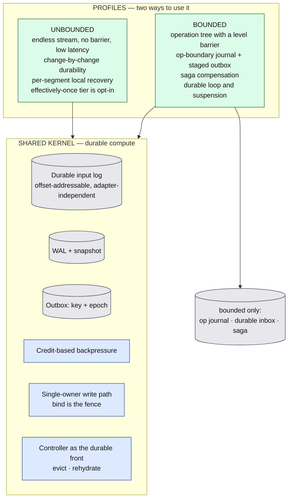
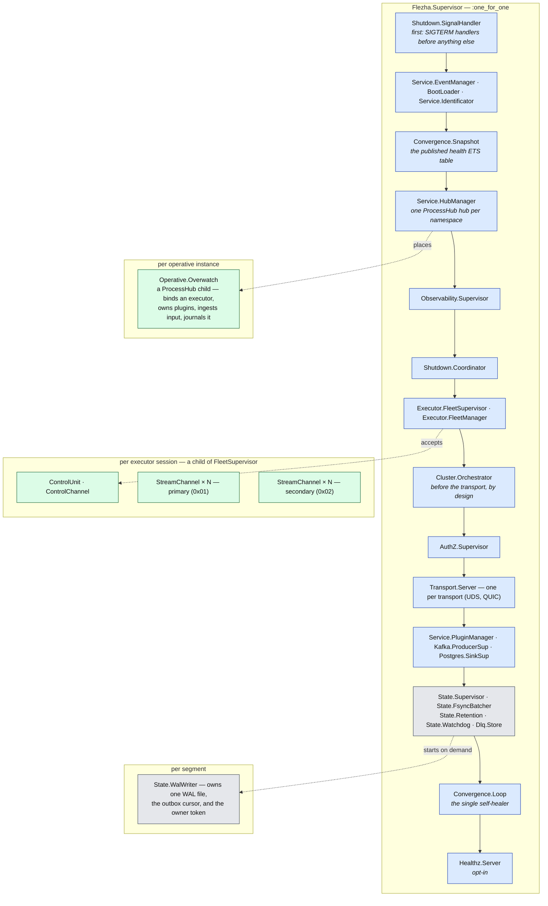
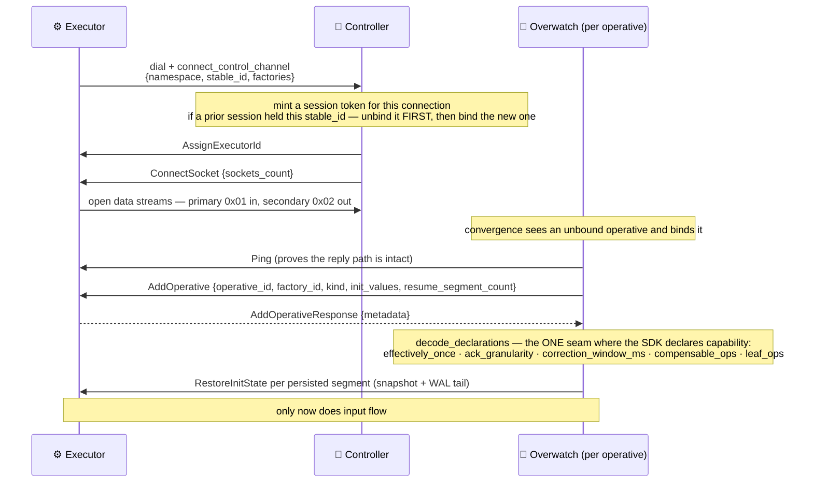
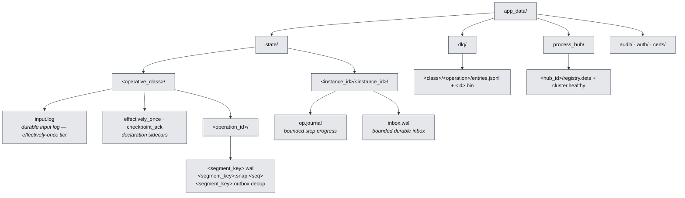
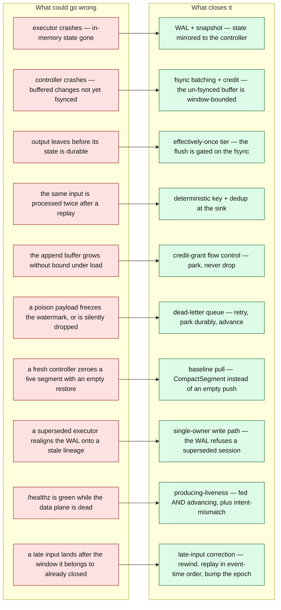

# Flezha architecture — the durable-compute kernel

Flezha runs user-authored stateful compute across a fleet of executors, and mirrors every
state change and every emitted output into a durable store on the controller. An executor is
disposable: it holds state in memory, and the controller holds the truth. Kill an executor and
its work resumes elsewhere from the last durable point.

This directory is the **architectural map** — the model, the invariants, and the diagrams. It
tells you how the pieces compose. For the mechanism-level detail behind any box, follow the
links; the deep docs live in [`../resilience/`](../resilience/) and
[`../sdk_protocol_spec.md`](../sdk_protocol_spec.md).

| Document | What it covers |
| --- | --- |
| **This file** | Roles, the workload model, the eight kernel invariants, process topology, on-disk layout, the failure model |
| [`kernel.md`](kernel.md) | The shared durable substrate: the input log, the atomic effect record, WAL + snapshot, the outbox, the watermark, output identity, the epoch rule, flow control, health |
| [`unbounded_profile.md`](unbounded_profile.md) | Streaming: per-segment recovery, the dead-letter queue, late-input correction, checkpoint intervals |
| [`bounded_profile.md`](bounded_profile.md) | Jobs and sessions: the operation tree, the op journal, the transactional outbox, saga compensation, the durable loop, suspension, rewind |

---

## Roles

- **Controller** — the Elixir control plane (`lib/flezha/`). It is the source of truth: it
  owns the durable store, routes input, decides where each operative runs, and heals the fleet.
  It scales horizontally — several controller nodes cluster over Erlang distribution, and a
  ProcessHub hub per namespace distributes operatives across them.
- **Executor** — the SDK process (Rust or Java) where user code runs. Executors **dial the
  controller**, never the reverse. They are disposable: state lives in memory, and the
  controller replicates it durably.
- **Source adapter** — where input comes from (a websocket, a feed, an HTTP endpoint). A
  pluggable edge, not a core component.
- **Sink adapter** — where output goes (Kafka, Postgres, anything). Also a pluggable edge.

A **segment's durable state is node-local**. It is not replicated across controller nodes;
cross-node state transfer happens only through the live handover an operative migration
performs. Cross-node WAL replication is a deliberate non-goal.

## The workload model

```
Operative  ─┬─ Operation ─┬─ Segment (key "BTC/USD")   ← state lives here
            │             └─ Segment (key "ETH/USD")
            └─ Operation ─── Segment (single)
```

- **Operative** — the unit you start and stop. It has a **kind**, frozen at start:
  `unbounded` (default) or `bounded`.
- **Operation** — a typed stage inside an operative. Declares `Input`, `Output`, `State`,
  `Change`, and `Clock` types.
- **Segment** — the per-key state-bearing slice of an operation. Durability is per segment:
  one WAL, one snapshot lineage, one outbox cursor.
- **Channel** — the typed edge between stages: entry (input from outside), inter-operation, or
  plugin-bound (output to a sink).

Full vocabulary: [`../glossary.md`](../glossary.md). The SDK authoring surface:
[`../operative_architecture.md`](../operative_architecture.md).

---

## Legend

Every diagram in this directory uses the same roles and colours.


A dashed arrow is a recovery or restore path. 🌐 source · 🧠 controller · ⚙️ executor ·
📤 sink · 💾 durable store.

---

## Component topology


**Read it as:** input is journaled durably (1–2) before it is forwarded, then routed to the
executor (3). The executor sends back a state change and any outputs (4), under a byte credit
it must hold. The controller writes state, outputs, and the consumed input offset as **one
atomic record under one fsync** (5) — state and emitted effect can never tear apart. Bounded
operatives additionally commit step progress to an op journal (6). Outputs reach the sink only
after that record is durable (7). On a crash, the controller restores the segment's state and
the bounded operative's step position (R).

## One kernel, two profiles



The WAL and the snapshot mechanism are **shared** — a bounded operative's segments persist
exactly like an unbounded operative's. What is bounded-specific is the op journal, the durable
inbox, and saga compensation.

---

## The eight kernel invariants

**1. Source and sink are pluggable edge adapters.** The core assumes no concrete external
system. Kafka is one optional sink; it is not a source and not a component. The internal model
— input log, WAL, outbox, watermark, credit — is adapter-independent.

**2. One atomic durable record.** Under the effectively-once tier, each processed input
produces a single CRC-protected WAL record holding `{state changes, plugin outputs, consumed
input offset, dead-letter entry, event time}`, appended and fsynced as one unit. State,
emitted effect, and progress can never tear apart. The sink flush happens only after that
record is durable. See [`kernel.md`](kernel.md#the-atomic-effect-record).

**3. The durable input log is opt-in.** Default is at-least-once: no input-log file, no
outbox, no gating, byte-identical to a build that never heard of the tier. With
`effectively_once()` declared, every source is normalised into one offset-addressable durable
log and each segment recovers from its own consumed offset.

**4. Output identity, and the epoch rule.** Replay-stable output identity is
`(flz.segment, flz.seq, flz.key)`; the durable outbox identity adds `flz.epoch`. A crash
retry, a re-drive, or an executor takeover **keeps** the epoch — sink-side dedup absorbs the
repeat. Only a deliberate correction, an operator replay, or a bounded rewind **bumps** it, so
the corrected output passes dedup and overwrites the stale row by natural key. See
[`kernel.md`](kernel.md#the-epoch-rule).

**5. One owner writes a segment's WAL.** Executor identity is two layers — a durable stable
identity owned by the SDK, and a controller-minted session token per connection. Takeover is
newest-wins, and it **unbinds the old session before binding the new one**. The session token
rides every write and the WAL refuses one from a superseded session, so the owner pays no
per-write cost and a stale writer can never realign the log onto its own lineage. See
[`kernel.md`](kernel.md#ownership-and-fencing).

**6. Flow control parks, it does not drop.** Executor→controller byte credit is minted on WAL
**fsync** — durable drain, not append — so the un-fsynced buffer is hard-bounded by the window.
A sender out of credit parks. Under the tier a second credit loop gates source ingestion on the
minimum watermark across the operative's segments, so the slowest branch back-pressures the
source instead of growing the input log to disk-full. The controller→executor direction is
deliberately **not** credit: it drops the newest frame past 8 MiB, because parking there would
freeze a controller serving thousands of operatives behind one dead executor. See
[`kernel.md`](kernel.md#flow-control-the-three-loops).

**7. The minimum watermark is the retention signal.** The controller tracks `min(consumed
offset)` across an operative's segments and truncates the input log below it, subject to the
correction hold window. A permanently-failing payload must never freeze it: after bounded
retries the segment parks the payload durably to the dead-letter queue and advances its offset.
Data is never lost and never silently dropped. See
[`unbounded_profile.md`](unbounded_profile.md#dead-letter-queue).

**8. Health is producing-liveness, not channel-liveness.** `/healthz` and convergence answer
"is work flowing" — is the WAL sequence advancing — with an *is it being fed?* precondition, so
an idle segment (no input, flat is correct) is distinguished from a stuck one (fed but not
advancing). An empty intended set is never vacuously healthy: durable state on disk for an
operative absent from the live intent degrades health. See
[`kernel.md`](kernel.md#health-and-liveness).

---

## Process topology

The controller is one flat `:one_for_one` supervisor. Order matters and is load-bearing: the
signal handler installs OS handlers before anything can observe a `SIGTERM`; cluster formation
precedes the transport, so a hub is never created on a not-yet-clustered node; and the
convergence loop starts last, after the state subsystem it heals.



`Flezha.Operative.Overwatch` is the per-operative-instance GenServer and the pivot of the whole
control plane: it binds an executor, prepares and activates plugins, journals every inbound
input, and receives every output on its way to a sink. `Flezha.State.WalWriter` is the
per-segment durable writer. `Flezha.Convergence.Loop` is the **only** self-healer; it runs
`Intent → Probe → Diff → Planner → Heal` every 5 s and on declared events.

Placement uses two independent hashes that must not be conflated: ProcessHub's consistent
hashing picks which **controller node** hosts the Overwatch, and a rendezvous hash over the
operative id picks which **executor** it binds to.

---

## Connect, bind, declare

An executor dials in, presents a **stable identity** that survives its own restarts, and the
controller mints a per-connection **session token**. Everything the controller keys on — stream
routing, registry names, the WAL owner — is the session token; the stable identity is what makes
a reconnect a *binding swap* rather than a new executor.



Those five metadata keys are the complete set of SDK→controller declarations. An executor that
declares nothing — a Java executor, or a plain unbounded class — sends an empty map and the
controller keeps every default. Wire detail:
[`../sdk_protocol_spec.md`](../sdk_protocol_spec.md).

---

## On-disk layout

Everything durable lives under `app_data/`.



The path triple `(operative_class, operation_id, segment_key)` uniquely identifies a segment's
state. It does **not** include the executor id — an executor is an addressing concern, not a
durability one, so a restarted executor pod inherits the state that was already on disk.

The op journal and the durable inbox ride the *same* WalWriter substrate as a segment, under
two reserved segment keys (`_op_journal`, `_op_inbox`), which is why they sit at
`<instance_id>/<instance_id>/` and are skipped by the segment scan. Root is configurable
(`:state_root`, default `app_data/state`).

---

## The failure model

Each failure class on the left is closed by exactly one mechanism on the right.



R3 and R4 are **permitted** in the default at-least-once mode — deduplication downstream is
the user's concern there. The effectively-once tier is what closes them.

### Durability guarantee summary

| Scenario | State loss | Output |
| --- | --- | --- |
| Graceful executor stop (SIGTERM / `disconnect()`) | none — the SDK ships final state | at-least-once |
| Executor SIGKILL, default tier | best-effort — up to the async WAL lag | at-least-once |
| Executor SIGKILL, effectively-once tier | none past the last fsync | effectively-once into a conforming sink |
| Controller graceful restart with a live peer | none — peer sync | at-least-once |
| Controller recovery-mode restart, sole node | none — DETS replay | at-least-once |
| Whole-cluster cold boot | recovered from DETS + the on-disk WAL | n/a |
| Bounded operative SIGKILL, durable | none past the last committed op | at-least-once |
| Bounded operative SIGKILL, persistence opted out | full — re-runs from the top | at-least-once |

The full scenario matrix and the operator playbook are in
[`../resilience/data_durability.md`](../resilience/data_durability.md).

---

## Where to go next

- The durable substrate every profile shares → [`kernel.md`](kernel.md)
- Streaming workloads → [`unbounded_profile.md`](unbounded_profile.md)
- Jobs, sagas, and agent sessions → [`bounded_profile.md`](bounded_profile.md)
- Fault-tolerance mechanisms in depth → [`../resilience/overview.md`](../resilience/overview.md)
- The wire protocol → [`../sdk_protocol_spec.md`](../sdk_protocol_spec.md)
- Authoring an operative → [`../operative_architecture.md`](../operative_architecture.md)
