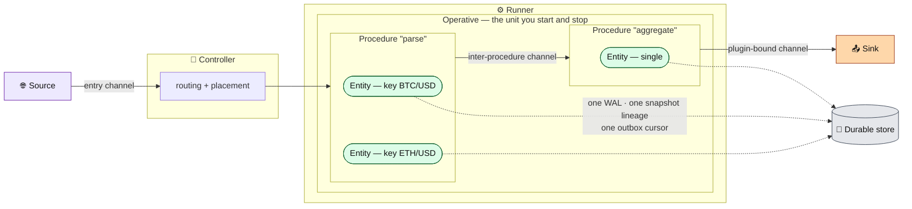
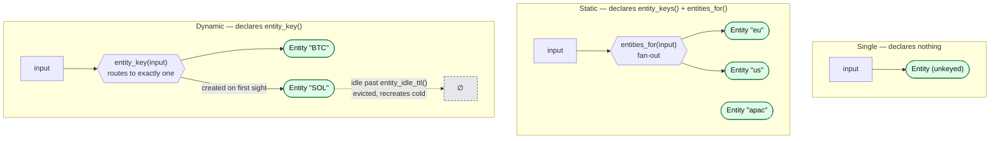
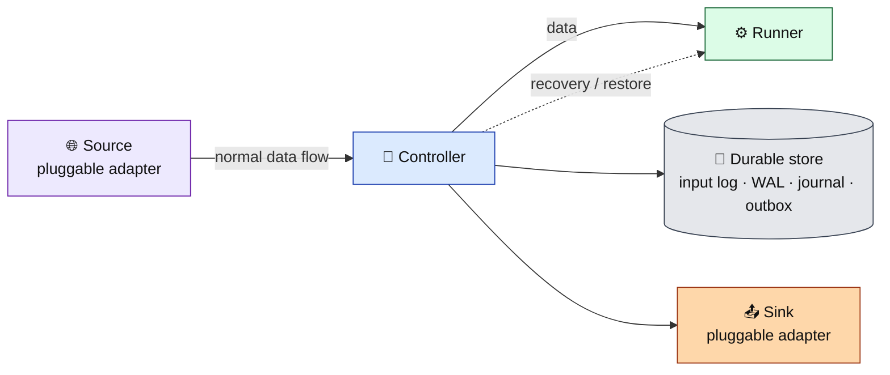
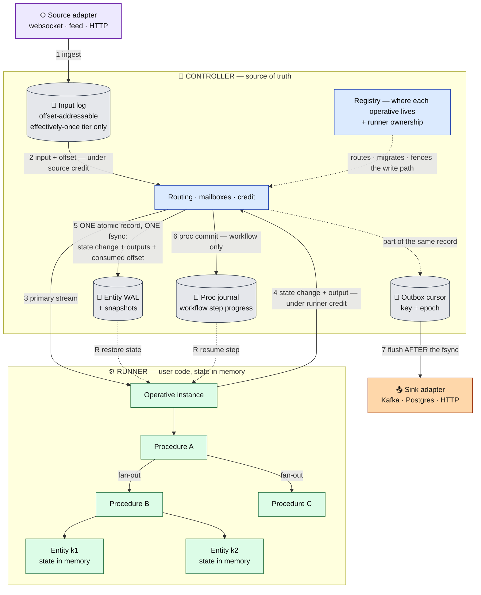
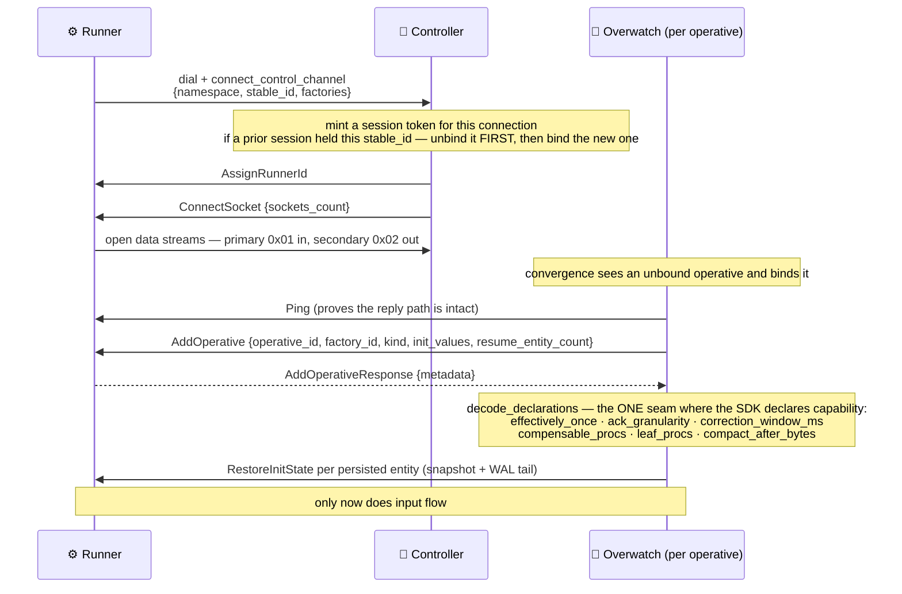
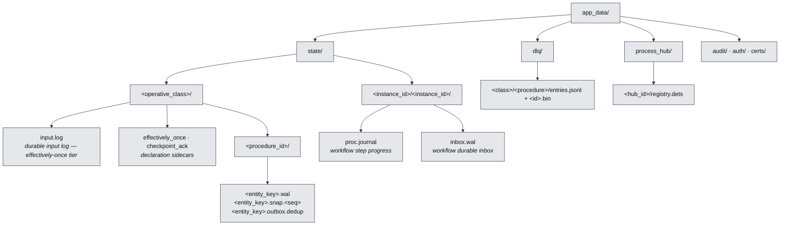

# Flezha architecture — the durable-compute kernel

Flezha runs user-authored stateful compute across a fleet of runners, and mirrors every
state change and every emitted output into a durable store on the controller. A runner is
disposable: it holds state in memory, and the controller holds the truth. Kill a runner and
its work resumes elsewhere from the last durable point.

This directory is the **architectural map** — the model, the invariants, and the diagrams. It
tells you how the pieces compose. For the mechanism-level detail behind any box, follow the
links; the deep docs live in [`../resilience/`](../resilience/) and
[`../sdk_protocol_spec.md`](../sdk_protocol_spec.md).

| Document | What it covers |
| --- | --- |
| **This file** | Roles, the workload model, the eight kernel invariants, process topology, on-disk layout, the failure model |
| [`kernel.md`](kernel.md) | The shared durable substrate: the input log, the atomic effect record, WAL + snapshot, the outbox, the watermark, output identity, the epoch rule, flow control, health |
| [`stream_profile.md`](stream_profile.md) | Streaming: per-entity recovery, the dead-letter queue, late-input correction, checkpoint intervals |
| [`workflow_profile.md`](workflow_profile.md) | Jobs and sessions: the procedure tree, the proc journal, the transactional outbox, saga compensation, the durable loop, suspension, rewind |
| [`runner.md`](runner.md) | Inside a runner: the shared kernel, the poll boundary, per-entity exclusivity, and what each host SDK owns |

---

## Roles

- **Controller** — the Elixir control plane (`lib/flezha/`). It is the source of truth: it
  owns the durable store, routes input, decides where each operative runs, and heals the fleet.
  It scales horizontally — several controller nodes cluster over Erlang distribution, and a
  ProcessHub hub per namespace distributes operatives across them.
- **Runner** — the SDK process (Rust or Java) where user code runs. Runners **dial the
  controller**, never the reverse. They are disposable: state lives in memory, and the
  controller replicates it durably. Inside a runner there is one more split: transport,
  ordering, durability, retries, timers and the workflow driver live in a shared Rust kernel
  (`flz_core`), and the host SDK brings the authoring surface and the threads that run user
  code. See [`runner.md`](runner.md).
- **Source adapter** — where input comes from (a websocket, a feed, an HTTP endpoint). A
  pluggable edge, not a core component.
- **Sink adapter** — where output goes (Kafka, Postgres, anything). Also a pluggable edge.

An **entity's durable state is node-local**. It is not replicated across controller nodes;
cross-node state transfer happens only through the live handover an operative migration
performs. Cross-node WAL replication is a deliberate non-goal.

## The workload model

Three levels of containment, and one edge type that joins them:

- **Operative** — the unit you start and stop. It has a **kind**, frozen at start:
  `stream` (default) or `workflow`.
- **Procedure** — a typed stage inside an operative. Declares `Input`, `Output`, `State`,
  `Change`, and `Clock` types.
- **Entity** — the per-key state-bearing slice of a procedure. Durability is per entity:
  one WAL, one snapshot lineage, one outbox cursor.
- **Channel** — the typed edge between stages: entry (input from outside), inter-procedure, or
  plugin-bound (output to a sink).

### The three entity modes

A procedure resolves to exactly one of three modes, chosen by what it declares. The mode
decides how many entities exist and when they are created — nothing else about the procedure
changes.

- **Single** — one unkeyed entity. The default when a procedure declares no entity opt-in.
- **Static** — a fixed keyset from `entity_keys()`; every entity exists from start. One input
  may fan out to **several** entities, which is why the selector is plural (`entities_for`).
- **Dynamic** — a stream keyset. `entity_key(input)` routes each input to exactly one
  entity, created lazily on first sight. Eviction is off unless `entity_idle_ttl()` is
  declared; when it is, an idle entity is dropped destructively and a later key of the same
  name cold-starts fresh. Workflow operatives refuse dynamic mode.

Full vocabulary: [`../glossary.md`](../glossary.md). The SDK authoring surface:
[`../operative_architecture.md`](../operative_architecture.md).

---

## Legend

Every diagram in this directory uses the same roles and colours.

A dashed arrow is a recovery or restore path. 🌐 source · 🧠 controller · ⚙️ runner ·
📤 sink · 💾 durable store.

---

## Component topology

**Read it as:** input is journaled durably (1–2) before it is forwarded, then routed to the
runner (3). The runner sends back a state change and any outputs (4), under a byte credit
it must hold. The controller writes state, outputs, and the consumed input offset as **one
atomic record under one fsync** (5) — state and emitted effect can never tear apart. Workflow
operatives additionally commit step progress to a proc journal (6). Outputs reach the sink only
after that record is durable (7). On a crash, the controller restores the entity's state and
the workflow operative's step position (R).

## One kernel, two profiles

The WAL and the snapshot mechanism are **shared** — a workflow operative's entities persist
exactly like a stream operative's. What is workflow-specific is the proc journal, the durable
inbox, and saga compensation.

---

## The eight kernel invariants

**1. Source and sink are pluggable edge adapters.** The core assumes no concrete external
system. Kafka is one optional sink; it is not a source and not a component. The internal model
— input log, WAL, outbox, watermark, credit — is adapter-independent.

**2. One atomic durable record.** Under the effectively-once tier, each processed input
produces a single CRC-protected WAL record holding `{state changes, plugin outputs, consumed
input offset, dead-letter entry, event time}`, appended and fsynced as one unit. State,
emitted effect, and progress can never tear apart. The sink flush happens only after that
record is durable. See [`kernel.md`](kernel.md#the-atomic-effect-record).

**3. The durable input log is opt-in.** Default is at-least-once: no input-log file, no
outbox, no gating, byte-identical to a build that never heard of the tier. With
`effectively_once()` declared, every source is normalised into one offset-addressable durable
log and each entity recovers from its own consumed offset.

**4. Output identity, and the epoch rule.** Replay-stable output identity is
`(flz.entity, flz.seq, flz.key)`; the durable outbox identity adds `flz.epoch`. A crash
retry, a re-drive, or a runner takeover **keeps** the epoch — sink-side dedup absorbs the
repeat. Only a deliberate correction, an operator replay, or a workflow rewind **bumps** it, so
the corrected output passes dedup and overwrites the stale row by natural key. See
[`kernel.md`](kernel.md#the-epoch-rule).

**5. One owner writes an entity's WAL.** Runner identity is two layers — a durable stable
identity owned by the SDK, and a controller-minted session token per connection. Takeover is
newest-wins, and it **unbinds the old session before binding the new one**. The session token
rides every write and the WAL refuses one from a superseded session, so the owner pays no
per-write cost and a stale writer can never realign the log onto its own lineage. See
[`kernel.md`](kernel.md#ownership-and-fencing).

**6. Flow control parks, it does not drop.** Runner→controller byte credit is minted on WAL
**fsync** — durable drain, not append — so the un-fsynced buffer is hard-bounded by the window.
A sender out of credit parks. Under the tier a second credit loop gates source ingestion on the
minimum watermark across the operative's entities, so the slowest branch back-pressures the
source instead of growing the input log to disk-full. The controller→runner direction is
deliberately **not** credit: it drops the newest frame past 8 MiB, because parking there would
freeze a controller serving thousands of operatives behind one dead runner. See
[`kernel.md`](kernel.md#flow-control-the-three-loops).

**7. The minimum watermark is the retention signal.** The controller tracks `min(consumed
offset)` across an operative's entities and truncates the input log below it, subject to the
correction hold window. A permanently-failing payload must never freeze it: after workflow
retries the entity parks the payload durably to the dead-letter queue and advances its offset.
Data is never lost and never silently dropped. See
[`stream_profile.md`](stream_profile.md#dead-letter-queue).

**8. Health is producing-liveness, not channel-liveness.** `/healthz` and convergence answer
"is work flowing" — is the WAL sequence advancing — with an *is it being fed?* precondition, so
an idle entity (no input, flat is correct) is distinguished from a stuck one (fed but not
advancing). An empty intended set is never vacuously healthy: durable state on disk for an
operative absent from the live intent degrades health. See
[`kernel.md`](kernel.md#health-and-liveness).

---

## Process topology

The controller is one flat `:one_for_one` supervisor. Order matters and is load-bearing: the
signal handler installs OS handlers before anything can observe a `SIGTERM`; cluster formation
precedes the transport, so a hub is never created on a not-yet-clustered node; and the
convergence loop starts last, after the state subsystem it heals.

`Flezha.Operative.Overwatch` is the per-operative-instance GenServer and the pivot of the whole
control plane: it binds a runner, prepares and activates plugins, journals every inbound
input, and receives every output on its way to a sink. `Flezha.State.WalWriter` is the
per-entity durable writer. `Flezha.Convergence.Loop` is the **only** self-healer; it runs
`Intent → Probe → Diff → Planner → Heal` every 5 s and on declared events.

Placement uses two independent hashes that must not be conflated: ProcessHub's consistent
hashing picks which **controller node** hosts the Overwatch, and a rendezvous hash over the
operative id picks which **runner** it binds to.

---

## Connect, bind, declare

A runner dials in, presents a **stable identity** that survives its own restarts, and the
controller mints a per-connection **session token**. Everything the controller keys on — stream
routing, registry names, the WAL owner — is the session token; the stable identity is what makes
a reconnect a *binding swap* rather than a new runner.

Those six metadata keys are the complete set of SDK→controller declarations, and the shared
runner core emits them for every host language — a Java class and a Rust class declaring the
same thing send the same map. A class that declares nothing — a plain stream class — sends
an empty map and the controller keeps every default. Wire detail:
[`../sdk_protocol_spec.md`](../sdk_protocol_spec.md).

---

## On-disk layout

Everything durable lives under `app_data/`.

The path triple `(operative_class, procedure_id, entity_key)` uniquely identifies an entity's
state. It does **not** include the runner id — a runner is an addressing concern, not a
durability one, so a restarted runner pod inherits the state that was already on disk.

The proc journal and the durable inbox ride the *same* WalWriter substrate as an entity, under
two reserved entity keys (`_proc_journal`, `_proc_inbox`), which is why they sit at
`<instance_id>/<instance_id>/` and are skipped by the entity scan. Root is configurable
(`:state_root`, default `app_data/state`).

---

## The failure model

Each failure class on the left is closed by exactly one mechanism on the right.

R3 and R4 are **permitted** in the default at-least-once mode — deduplication downstream is
the user's concern there. The effectively-once tier is what closes them.

### Durability guarantee summary

| Scenario | State loss | Output |
| --- | --- | --- |
| Graceful runner stop (SIGTERM / `disconnect()`) | none — the SDK ships final state | at-least-once |
| Runner SIGKILL, default tier | best-effort — up to the async WAL lag | at-least-once |
| Runner SIGKILL, effectively-once tier | none past the last fsync | effectively-once into a conforming sink |
| Controller graceful restart with a live peer | none — peer sync | at-least-once |
| Controller recovery-mode restart, sole node | none — DETS replay | at-least-once |
| Whole-cluster cold boot | recovered from DETS + the on-disk WAL | n/a |
| Workflow operative SIGKILL, durable | none past the last committed proc | at-least-once |
| Workflow operative SIGKILL, persistence opted out | full — re-runs from the top | at-least-once |

The full scenario matrix and the operator playbook are in
[`../resilience/data_durability.md`](../resilience/data_durability.md).

---

## Where to go next

- The durable substrate every profile shares → [`kernel.md`](kernel.md)
- Streaming workloads → [`stream_profile.md`](stream_profile.md)
- Jobs, sagas, and agent sessions → [`workflow_profile.md`](workflow_profile.md)
- Inside a runner, and writing a new SDK → [`runner.md`](runner.md)
- Fault-tolerance mechanisms in depth → [`../resilience/overview.md`](../resilience/overview.md)
- The wire protocol → [`../sdk_protocol_spec.md`](../sdk_protocol_spec.md)
- Authoring an operative → [`../operative_architecture.md`](../operative_architecture.md)
