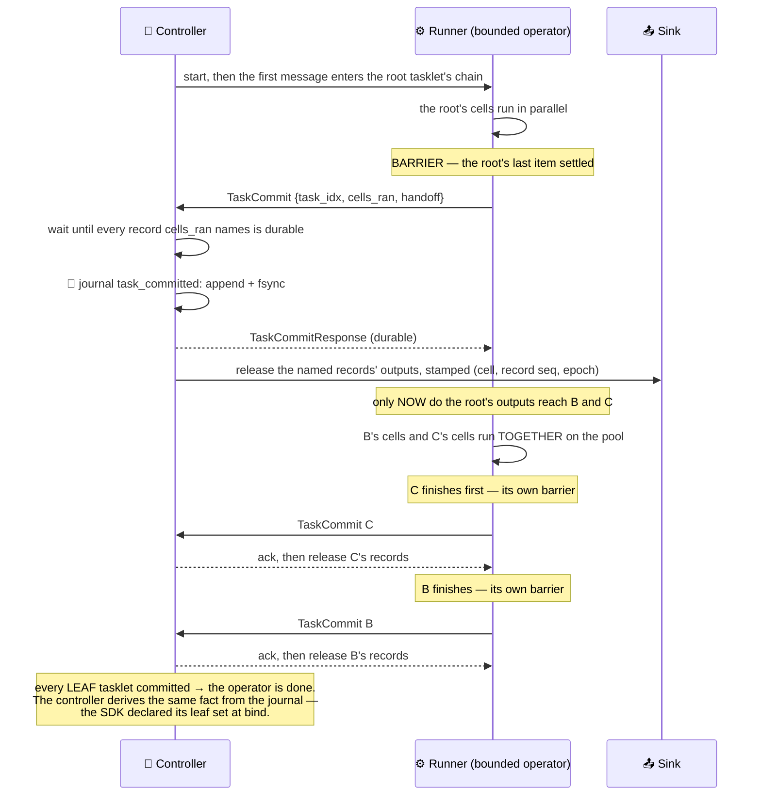
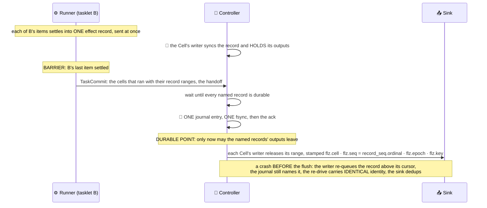
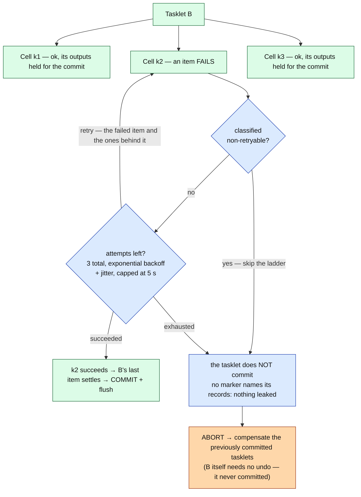
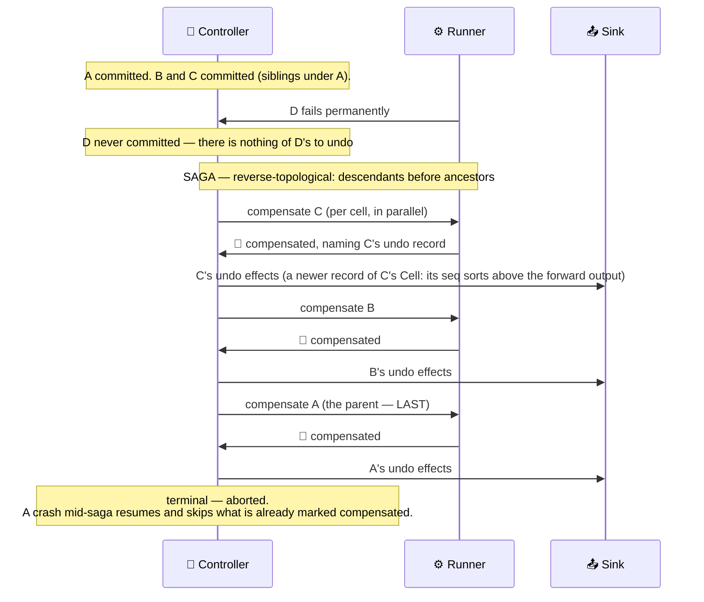
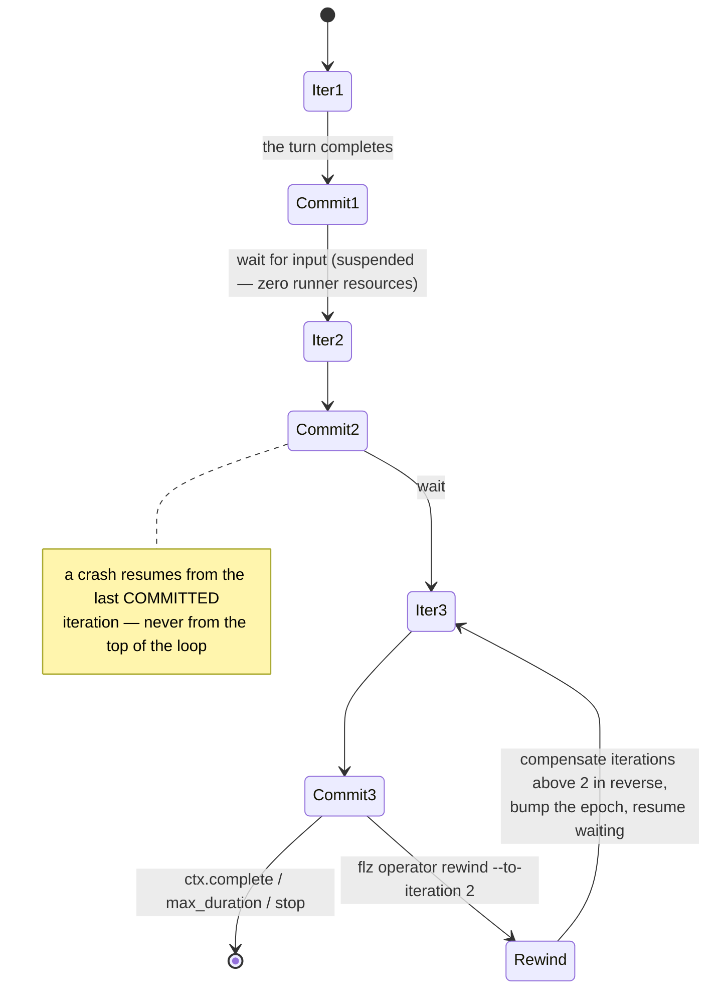
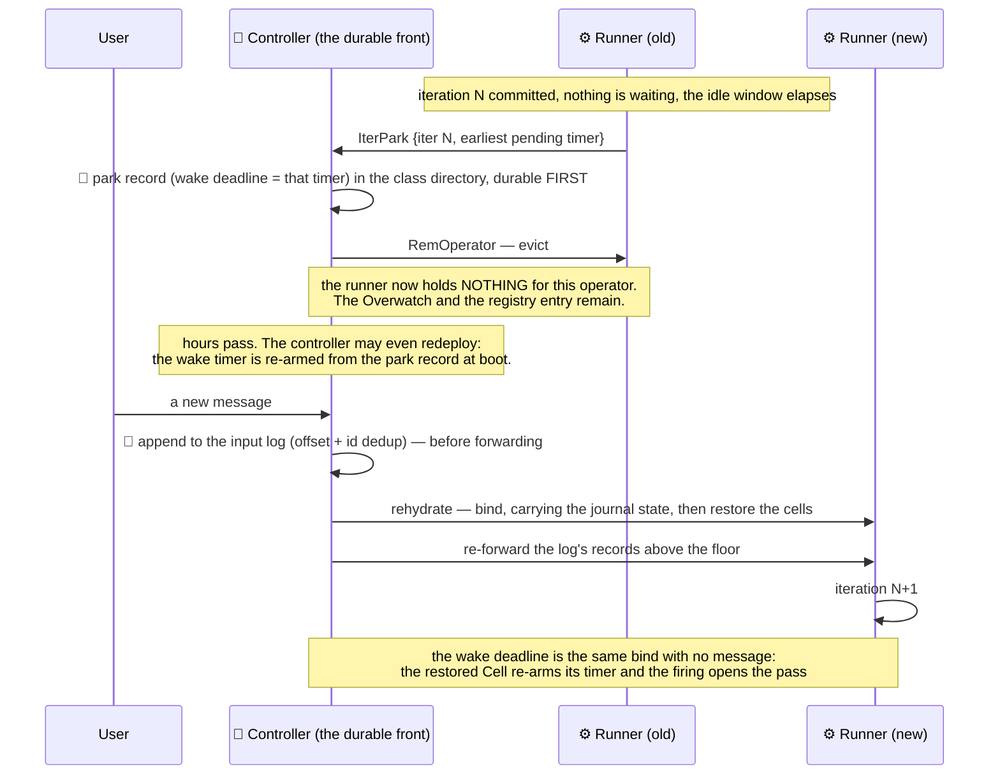
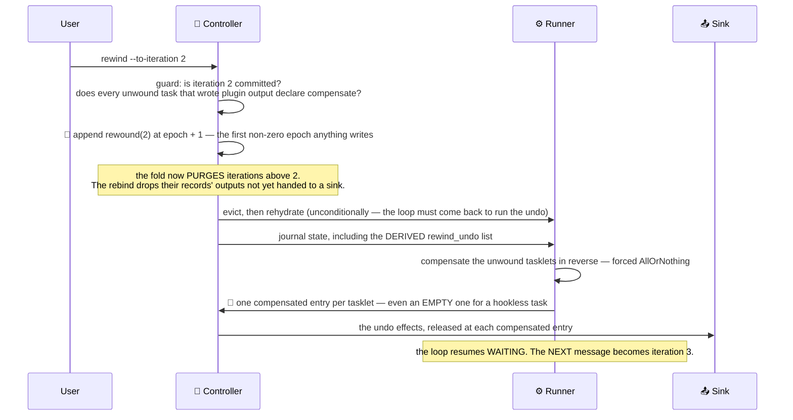

# The bounded profile

A bounded operator is a job with a beginning and an end: an ETL run, a payment saga, an AI chat
session. It authors the same tasklets, channels, and cells an unbounded operator does — the
same per-cell state engine — but it schedules them **topologically**, commits its progress at
every step boundary, can **undo** what it did, and can wait for input for hours while costing
nothing.

- [Structure: a graph of tasklets](#structure-a-graph-of-tasklets)
- [The task journal](#the-task-journal)
- [Happy path: the stage barrier](#happy-path-the-stage-barrier)
- [One outbox](#one-outbox)
- [Retry, then abort](#retry-then-abort)
- [Saga compensation](#saga-compensation)
- [The durable loop](#the-durable-loop)
- [Suspension](#suspension)
- [Rewind](#rewind)

---

## Structure: a graph of tasklets

A tasklet has a single `Output` type, and therefore exactly one output channel. An **edge** is
*(that channel, one of its consumers)* — so a fan-out is simply one channel declaring several
consumers, and a fan-in (a join) is one tasklet consuming several channels.

```mermaid
flowchart TB
    IN(["entry channel"]):::src
    A["Extract"]:::exec
    B["Enrich"]:::exec
    C["Archive"]:::exec
    D["Reconcile"]:::exec
    P1["📤 sink"]:::sink

    IN --> A
    A -->|"channel &#34;records&#34;<br/>ONE channel, TWO consumers"| B
    A -->|"the same channel"| C
    B -->|"fan-in — Reconcile ACCUMULATES<br/>both producers' output"| D
    C --> D
    D --> P1

    CYC["❌ a cycle — a tasklet's output<br/>reaching its own input — is REFUSED"]:::risk
    D -.-> CYC
    CYC -.-> A

    classDef exec fill:#dcfce7,stroke:#166534,color:#111
    classDef sink fill:#fed7aa,stroke:#9a3412,color:#111
    classDef src fill:#ede9fe,stroke:#6b21a8,color:#111
    classDef risk fill:#fee2e2,stroke:#991b1b,color:#111
```



Routing is **per channel**: a downstream tasklet receives exactly the values released on the
channels it consumes. A join is explicit — two streams wiring the same consumer — and the join
tasklet **accumulates** every producer's contribution rather than overwriting one with the
other. Branches stay independent mid-flight; where they must meet, they meet at a join.
Registration refuses anything that is not a DAG rooted at the entry channels, naming the
offending node:

| Shape | Refusal |
| --- | --- |
| a tasklet's output can reach its own input (a cycle) | `topology.cycle` |
| one tasklet produces two output channels | `topology.multiple_output_channels` |
| a tasklet is unreachable from any entry channel | `Disconnected` |
| a handoff-chained loop over a branching chain | `topology.branching_chained_loop` |

An entry channel may feed several tasklets, and a class may declare several entry channels:
each roots its own chain, the tasklets reachable from its consumers, and a message runs only
the chain of the channel it arrived on. A join where two chains meet waits only for the
producers of the chain that runs, live and on a crash-resume.

Within one tasklet, cells run in parallel exactly as in stream: single, static or dynamic
cell mode, per-cell state, per-cell WAL. A tasklet reached by a `key_by` edge gets one cell
per key, minted by routing the moment a stage's item is addressed to it and capped by
`max_cells` as an unbounded operator's is (a new key past the cap is dropped and counted in
`inputs_dropped_capped_total`). A stage is done when every cell it addressed has drained,
and its commit names each of those cells once. An idle keyed cell is evicted by its
`cell_idle_ttl()` only between passes, and never while a rollback of the declared
`rollback_mode` could still reach it: under all-or-nothing every cell that ran a compensable
tasklet is held until the instance ends, under keep-progress only the running pass's cells
are. A `task_committed` entry counts its cells in 16 bits, so one pass of one tasklet runs at
most 65 535 cells, below the `max_cells` default of 100 000; a class that keys more than that
per pass declares a smaller cap. A `per_input` bounded operator whose entry edge is keyed may be
[partitioned](../sdk/partitioned_operators.md#a-per-input-bounded-operator-as-a-group) into N instances
that each end, compensate and commit on their own; a `once` or `chained` one is refused.

The `(operator_class, tasklet_id, cell_key)` identity is the same one an unbounded operator
uses. A bounded operator genuinely has tasklets and cells; there are no synthetic
placeholders.

## The task journal

Bounded durability is a per-instance append-only journal on the same WAL substrate a cell
uses, under a reserved identity so it never surfaces as a phantom cell.

```
<state_root>/<namespace>/<instance_id>/<instance_id>/task.journal

record header (16 B): [epoch u32 BE][zero]
record body:          [type u8][task_idx u16 BE][iter u32 BE][payload]
```

| Type | Entry | Carries |
| --- | --- | --- |
| 1 | `task_committed` | `cells_ran`, the handoff batch, and the tasklet's completion if it asked to end the instance |
| 3 | `iter_committed` | the input-log offset the iteration consumed (or none, for a carry-fed pass), its terminal handoff, and its completion |
| 5 | `compensated` | an undo ran: `cells_ran` naming the undo records |
| 6 | `rewound` | a marker: everything above this iteration is un-committed |

`cells_ran` names, for each Cell the stage ran, its identity, the range of effect records it
wrote in the stage (`first_seq..seq`, both absent when it wrote none) and the plugin channels
those records wrote on. The journal holds markers only: no Cell state and no plugin output,
which live in the Cells' own effect records.

Types 2 and 4 are unused: delivery is tracked by each Cell writer's flush cursor, and where an
instance sleeps is not the journal's (see [Suspension](#suspension)).
The journal is **append-only**. `rewound` does not truncate it — one fold applies the markers,
and every reader (what is committed, what is owed, what is compensated, where the loop is) runs
over that fold. The epoch lives in the record header and stays `0` until a rewind bumps it.

## Happy path: the stage barrier



Each tasklet is its own unit: it commits when its own last item settles, whether or not a
sibling is still running, and its outputs reach its children only once that commit is
acknowledged. A child with several producers (a join) runs once every one of them has
committed. Siblings are therefore never committed *atomically*, and in no fixed order. A
sibling that fails after the one beside it committed compensates the committed one exactly as a
deeper failure would; a tasklet still running when the pass fails is recorded as having run,
so it is compensated, but it is **not committed**, because committing would release outputs that
must immediately be undone.

Nothing waits for an ack: it is an event that releases the tasklet's outputs. One not received
within 30 s is re-sent under the same identity, up to three sends; a refusal or the last
timeout is terminal and drives compensation — a step whose durability the controller will not
confirm has not happened.

A class declaring `durability: :sync_remote` raises that bar one notch: the controller ships the
journal suffix to the [remote durability tier](kernel.md#the-remote-durability-tier) and awaits
the backend ack *before* replying — so the commit survives losing the controller's disk (RPO 0),
at the cost of one remote round-trip per barrier. The runner already waits for that ack before
the tasklet's children run; nothing else changes.

**On a crash, a committed tasklet is not re-run.** The journal carries its handoff, so the
resumed instance skips it and seeds its children from the durable batch. Without the journal —
an opted-out class — the chain re-runs from the top over the restored cell state, which is
why a tasklet body is required to be idempotent.

## One outbox

Inside a structured tasklet, `ctx.emit` writes into the Cell's effect record, exactly as an
unbounded Cell on the effectively-once tier does: one `cell_effect_record` per invocation holding
the state changes and the plugin outputs (channel, key, metadata, payload). The record is
durable before the stage marker; its outputs wait for the marker.



The Cell writer's outbox is the only outbox, for both kinds: the same cursor, confirmation
tally, resettle and restart re-drive. What differs is the commit unit. An unbounded Cell's record
is committed by its own fsync; a bounded operator Cell's is committed by the stage marker that names it.
A record no marker will name (a failing stage, a stage a crash interrupted and re-ran, an
iteration a rewind unwound) is dropped from the queue without reaching a sink, so a failed
stage leaks nothing. A crash between the commit and the flush costs nothing but a duplicate the
sink absorbs.

An **opted-out** class, or one running without a controller (a unit test, a bench), writes no
record: emits go straight to the wire as they happen, with their channel, key and metadata.

A bounded output carries `flz.key` when its channel is keyed, as an unbounded operator's does. The rewind
guard still requires a `compensate` hook for every unwound tasklet that wrote plugin output: a
rewind re-runs nothing over the unwound inputs, so no later output overwrites the original by
its key, and the hook is the only undo the engine can guarantee.

## Retry, then abort

A failing item gets a ladder before it takes the whole tasklet down with it.



Only the failed item and the items queued behind it on its cell re-run; an item that already
settled, and every sibling cell, is never re-executed. A failed attempt's outputs are dropped
rather than double-emitted. The ladder is the one every unbounded cell climbs, and its backoff is
an entry on the deferred-wake list rather than a sleep, so a stop, a `max_duration` or a
sibling's failure disarms it at once.

The retry ladder is strictly **pre-commit**. A journaled tasklet is never retried; a crash mid-
ladder resumes as an ordinary uncommitted-tasklet re-run with the attempt counter reset. A
panic stays retryable, because the author never got the chance to classify it.

This is the bounded profile's equivalent of the unbounded operator's dead-letter queue: nothing is written
to a DLQ store, because abort-and-compensate *is* the escape.

## Saga compensation

An abnormal exit unwinds what already committed, in reverse.



Reverse-topological order is not computed — it is **emergent**. The graph is numbered
breadth-first, so a producer's index is always below its consumers', completion order is
therefore topological, and the compensation planner simply reverses it.

Two rules govern what gets undone:

- **`AllOrNothing`** (the default) unwinds the in-flight iteration *and* every committed one.
- **`KeepProgress`** unwinds only the in-flight iteration — completed iterations stand.

A tasklet with no `compensate` hook is skipped. A failing hook is logged and the rest of the
plan still runs — a saga is best-effort by contract, and stopping halfway would leave strictly
more inconsistency than continuing.

**The undo record is journaled before the done marker.** A crash between the two re-runs the
(idempotent) hook rather than losing its undo output — the safe side of that trade.

> **A journal-rebuilt tasklet's outputs are empty on resume.** A tasklet's collected
> inter-tasklet output was never durable, so after a crash the compensation hook receives an
> empty output list. A durable compensable tasklet must therefore keep its **undo handle in
> cell state**, which *is* restored. That is the at-least-once author contract.

Cell state is unwound by the `compensate` hooks, not by truncating the state WAL. A hookless
tasklet leaves its state change in place.

## The durable loop

An operator may run its graph more than once.

| Mode | Behaviour |
| --- | --- |
| `Once` (default) | one pass over the first message, then terminate; a second message is never read |
| `PerInput` | one iteration per message: the chat / agent turn |
| `Chained` | the first pass over the first message; iteration N+1 is seeded by iteration N's terminal output into the chain that message started; it converges when the batch comes back empty |



An **iteration boundary** is a bigger commit point than a tasklet boundary. One iteration
contains many tasklet commits; the iteration boundary is where durable suspension, the
keep-progress rollback unit, and rewind all attach.

At every boundary the SDK ships `IterCommit`, the controller journals **one** `iter_committed`
entry carrying the terminal handoff and the consumed input-log offset, acks, and only then does
its post-ack cleanup: the release of the consumed input and the journal cut. The boundary takes
no snapshot and flushes nothing: each stage's outputs left at its own marker, and the
Watchdog's size and age compaction triggers serve a bounded operator's Cells as they serve an unbounded operator's.
A failure in that cleanup costs work, not correctness.

**The durable input log.** A bounded operator's input is journaled to the same per-instance
input log the effectively-once tier uses, before it is forwarded, and stamped `flz.offset`. A
duplicate (a repeat of a `flz.msg_id` the log still retains; a message without an id is never a
duplicate) is absorbed and never delivered twice. A failed append is not forwarded. Each
iteration commit reports its offset into the log's watermark, which is the instance's floor:
the log's retention reclaims what lies below it, and every bind re-forwards what lies above it.

## Suspension

A loop waiting for input should cost nothing. Between iterations, a bounded operator whose
class sleeps (`sleep_when_idle`, on whenever its persistence is) is **evicted from its runner
entirely** once it has waited `FLEZHA_PARK_IDLE_MS`; the Overwatch and the registry entry stay,
so a new message still has somewhere to land, but the runner holds zero resources for it. A
stream whose class declares the setting sleeps the same way, at iteration `0`.



Rehydration is **the ordinary bind path**. Crash-resume, migration, and un-park all converge on
it, so there is one code path and one set of bugs. The journal rides that bind
(`AddOperator.task_journal`) rather than a per-Cell restore, because it is instance-scoped: an
operator whose tasklets hold no per-Cell state has nothing to restore, and would otherwise
rehydrate at iteration 0 every time. The wake deadline is the instance's earliest
pending processing-time Cell timer; when it elapses the controller rehydrates the instance and
appends nothing, so the restored Cell re-arms the timer and its firing opens the pass. A message
and the deadline racing collapse into one rehydration, since a rehydrate of a bound instance is a
no-op.

The park record is a per-instance fact beside the class's declarations, written before the
eviction and cleared by the bind that wakes the instance, before the runner is told to start it.
At boot, an instance with a park record **and** nothing undelivered enters suspended without ever
binding; undelivered input outranks the park. Only a journaling instance, whose pass in flight is
not a state document, waits for its sleep to migrate; a sleeping instance of either kind
consents at once. Stopping a sleeping bounded operator wakes it with the stop carried, so it ends
`cancelled` exactly as it would awake.

## Rewind

Take a loop back to a committed iteration, and undo everything above it.

```
flz operator rewind <instance> --to-iteration N
```

Rewind is a **marker**, not a truncation. The journal stays append-only.



The undo list is **derived, not marked**: it is the tasklets committed before the marker at an
iteration above the target, minus those that already have a `compensated` entry appended *after
their own commit*. That "after its own commit" test is what keeps a re-run distinguishable from
the original it replaced, and what makes a second rewind work. There is no done-marker and no
completeness oracle — a crash mid-rewind resumes with exactly the outstanding work.

**The guard runs before anything durable changes.** A tasklet that wrote plugin output but
declares no `compensate` hook cannot be unwound: a rewind re-runs nothing over the unwound
inputs, so no later output overwrites the original by its key. The rewind is refused, naming the
channel, which the guard reads from the stage entries' `cells_ran`, never from the Cell WALs.

> **A rewind does not replay inputs.** Every iteration commit raises the instance's floor in its
> input log and a rewind never lowers it, so a committed turn's message is not delivered again
> even while the log still retains it. Rewind is **undo-and-continue**: the loop resumes
> waiting, and the next message becomes iteration N+1.

Cell state is unwound by the `compensate` hooks, exactly as in a saga — not by truncating the
state WAL.

---

## The wire

| Message | Tag | Direction |
| --- | --- | --- |
| `TaskCommit` | 28 | SDK → controller, at every tasklet boundary |
| `TaskCommitResponse` | 29 | controller → SDK, after the journal fsync |
| `IterCommit` | 30 | SDK → controller, at every iteration boundary |
| `IterCommitResponse` | 31 | controller → SDK, after the journal fsync |
| `IterPark` | 32 | SDK → controller, on suspension, for either kind (fire and forget) |

Field-level detail: [`protocol_spec.md`](../sdk/protocol_spec.md).

## Operations surface

```
flz state journal <operator/instance>    # every journal entry, and whether the graph is complete
flz state inbox   <operator/instance>    # the durable input log (either kind), and how far it is consumed
flz operator info                        # phase: running | suspended
flz operator rewind <instance> --to-iteration N
```

## Host languages

Everything on this page is host-language-neutral. The shared runner core owns the pass: a small
sheet on each instance (the iteration, the tasklets in flight and done, the outputs held for
their commit, the completion) advanced by events on the thread that brings each one — a worker
settling a tasklet's last item, the control-channel reader bringing a commit ack or a stop, the
data-channel reader bringing a message, a poller promoting a deadline. It owns the task journal
handshake, the stage's record ranges, the compensation plan, the loop, suspension and rewind. A host
SDK supplies the tasklet bodies and the threads that run them: a stage's items are ordinary cell
work, handed out under poll exactly as an unbounded operator's are. Rust runs an item on a pool worker, Java
on a virtual thread; neither owns the chain's position, so there is no per-host resume or
compensation semantics to compare.

Details of that split: [`poll_core.md`](../sdk/poll_core.md).

Mechanism-level detail for everything on this page:
[`../resilience/bounded_operator.md`](../resilience/bounded_operator.md).
