# The durable-compute kernel

The kernel is the substrate both profiles share: how a state change becomes durable, how an
output gets an identity, how back-pressure is applied, who is allowed to write, and how the
system knows work is flowing. Everything here is profile-agnostic — a stream operative and
a workflow operative persist an entity through exactly the same machinery.

- [The write path](#the-write-path)
- [The WAL record](#the-wal-record)
- [The atomic effect record](#the-atomic-effect-record)
- [When a change becomes durable](#when-a-change-becomes-durable)
- [Snapshots, compaction, and restore](#snapshots-compaction-and-restore)
- [The minimum watermark and retention](#the-minimum-watermark-and-retention)
- [The remote durability tier](#the-remote-durability-tier)
- [Delivery guarantees](#delivery-guarantees)
- [Determinism](#determinism)
- [Output identity](#output-identity)
- [The epoch rule](#the-epoch-rule)
- [Flow control: the three loops](#flow-control-the-three-loops)
- [Ownership and fencing](#ownership-and-fencing)
- [Health and liveness](#health-and-liveness)

---

## The write path

One input, from the socket to the sink, with every durable point marked. This is the spine of
the whole system.

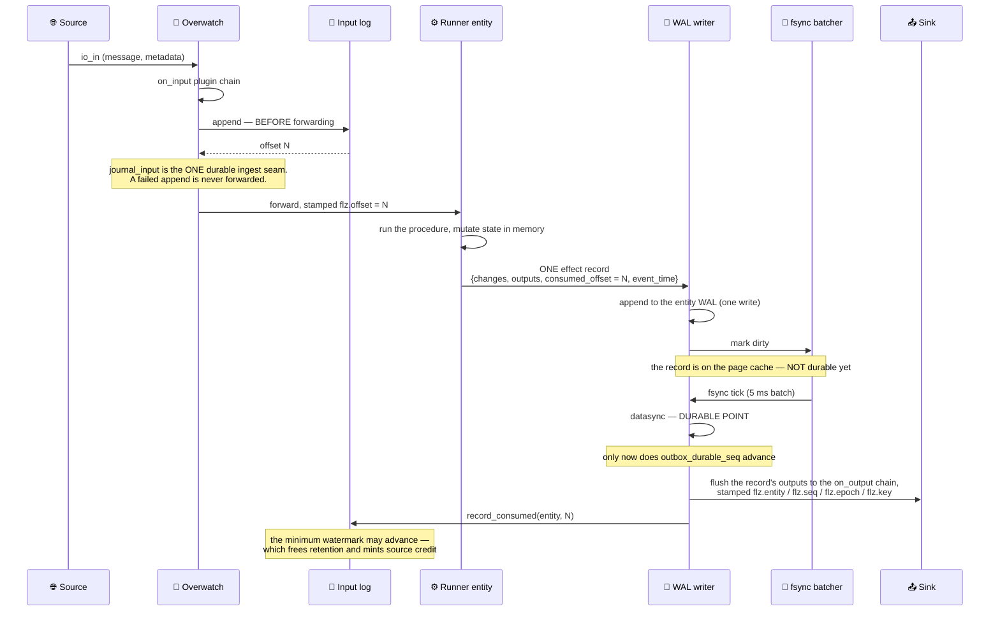

Three orderings in that diagram are invariants, not implementation detail:

- **Append before forward.** `Ingest` holds the single seam where an input becomes
  durable, and it runs *before* the input reaches a runner. A failed append is not
  forwarded — a frame the sender can retry beats an undurable one it believes was accepted.
- **Fsync before flush.** An output never reaches a sink until the record that produced it is
  on disk. State and effect cannot diverge.
- **Flush before offset advance.** The consumed offset moves last, so a crash always resumes
  at or before the input whose effects are already out.

Without the tier, `journal_input/2` is a passthrough, the effect record is a plain change
record, and outputs leave as they are produced. That path is byte-identical to a build that
never heard of the tier — the default costs nothing.

## The WAL record

Every durable file in Flezha — an entity WAL, the input log, the workflow proc journal, the
workflow inbox — is the same framed, CRC-protected, append-only log.

```
┌──────────┬─────────┬────────────┬────────────────┬──────────┐
│ seq u64  │ len u32 │ header 16B │ body           │ crc32    │
│ big-end  │ big-end │            │ (len - 16)     │ big-end  │
└──────────┴─────────┴────────────┴────────────────┴──────────┘
    crc32 covers header ‖ body

header (16 bytes), entity WAL:
  [0]      sdk_lang        (Rust = 1, Java = 2)
  [1..5]   sdk_version     u32 BE — the writing SDK's own released version
  [5..9]   schema_version  u32 BE
  [9]      format_id       1 = postcard state change · 2 = effect record
  [10..12] reserved
  [12..16] crc32(body)
```

A torn tail — a partial record from a crash mid-write — is detected by the CRC on the forward
scan at open and truncated. `RecordFrame.fold_records/3` is the one place that walk lives; every
reader (entity WAL, input log, proc journal, retention rewriter, time-travel) goes through it.

The workflow proc journal reuses byte 0–3 of the header for its **epoch**, which is safe because
byte 9 is the format-id slot and the journal never writes an entity format id there. The input
log writes an append timestamp into bytes 0–7 and deliberately forces byte 9 to zero, so an
input record can never be mistaken for an effect record.

## The atomic effect record

Under the effectively-once tier the SDK stops sending bare state changes. Instead, each
invocation produces **one** record carrying everything that invocation did.

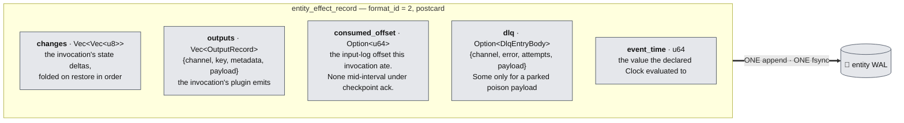

That single record is why the tier's guarantees hold. No partial combination of *state applied*,
*output emitted*, *input acknowledged*, and *poison parked* is ever durable. A crash lands on a
record boundary, and every boundary is consistent.

`event_time` is what makes an event-time → sequence → offset lookup a *read* rather than a
guess: late-input correction resolves its rewind baseline against it, and point-in-time queries
resolve a timestamp target against it. Effect records are never coalesced at drain time — each
one is an atomic unit and stays one.

## When a change becomes durable

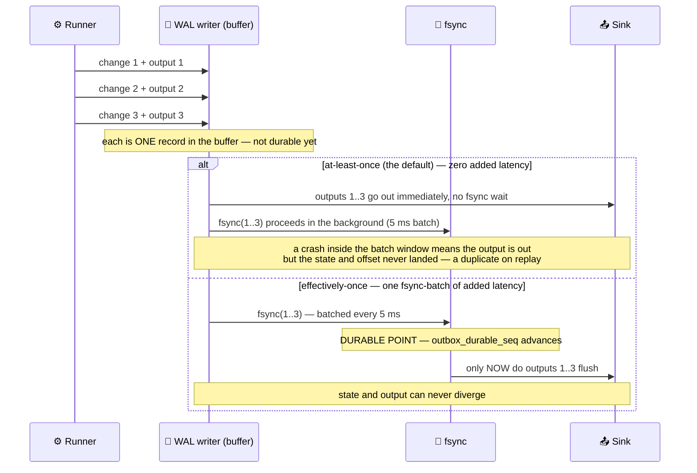

The fsync batcher coalesces every writer's `datasync` into one call per writer per tick
(`:agent_fsync_interval_ms`, default **5 ms**, accepted range 1–1000; it refuses to boot
outside that), and the tick runs only while a writer is dirty. Under the tier, that tick is the added latency — and it is the only added
latency.

Outbox state is three cursors on the writer: `outbox_durable_seq` (how far the fsync has
reached — the gate), `outbox_flushed_seq` (how far the **sinks have confirmed**), and
`outbox_epoch`. All three are persisted to a small `<entity>.outbox.dedup` side-file, so a
restarted controller re-drives exactly the entries that were durable but never confirmed. A
stale cursor widens the re-drive, which sink dedup absorbs; it can never skip.

Dispatch is not delivery. Each flushed output carries an opaque `flz.ack` token
(`Flezha.State.Outbox`); a delivery-guaranteed sink takes a hold on it and answers when its
write is durable, while an output no sink held completes as soon as the chain has run it. The
cursor advances over the leading run of completed entries, so an out-of-order confirmation can
never carry it past output still in flight, and the number of entries inside the chain
unconfirmed is capped (`:outbox_inflight_max`, default 1000) — the flush waits, ingest does
not. Every completed confirmation refills that window, so a burst drains at the sink's rate
rather than one window per retry tick.

The reports are batched, never the facts. One dispatch pass hands its whole window to the
chain as one cast, settles it with one report carrying each entry's holds, and advances the
input-log watermark once to the furthest consumed-offset the pass carried; a sink confirms a
completed batch with one report naming every entry it completed. Per-entry completion, the
leading-run cursor advance, and the dropping of a report for an entry a resettle superseded
are all exactly as they are for single-record reports — a batch is the same facts delivered
at once, which is what takes the per-output message count off the hot path.

A checkpoint-ack operative may go one step further and batch the *records* too:
`outputs_at_checkpoint(max_delay_ms)` holds an interval's outputs with its changes so the
whole interval is one WAL append, which the controller flushes as one dispatch batch after
that record's fsync. That trades output latency for the append — bounded by `max_delay_ms`,
which closes the interval even on an Entity that receives nothing more. It is off unless
declared, because it changes a user-visible property (when an emit becomes visible
downstream) rather than only how many messages carry it.

## Snapshots, compaction, and restore

An entity's WAL is a change log. Left alone it grows forever, so the controller periodically
asks the runner for a full state snapshot and truncates the log beneath it.

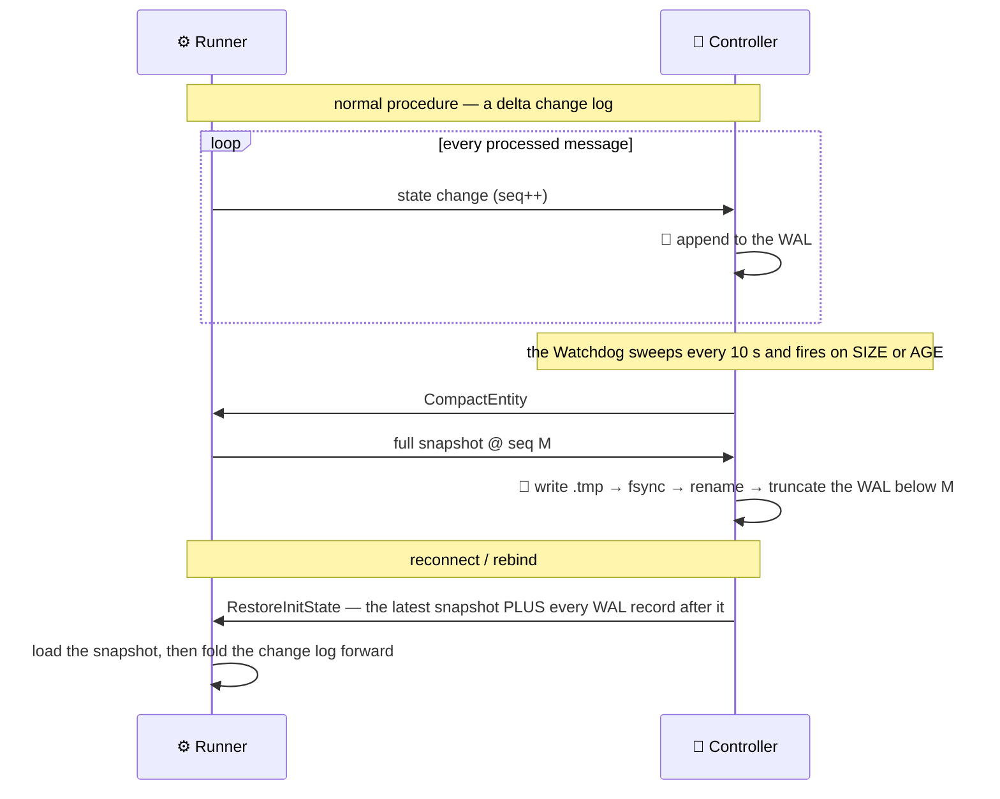

Compaction fires on whichever comes first:

| Trigger | Knob | Default |
| --- | --- | --- |
| WAL size | `:default_compact_after_bytes`, per-procedure override | **8 MiB** |
| WAL age (oldest unsnapshotted record) | `:compact_after_age_ms` | **300 000 ms** (`0` disables) |

The age floor exists for low-throughput operatives, which would otherwise never reach the byte
trigger and would restore by folding a very long log. It is also a **correctness** constraint
for late-input correction: an age floor shorter than the correction window destroys the very
history a rewind needs a baseline inside, so a correcting operative refuses to start when the
two are misconfigured.

> **Restore ships the snapshot plus the whole tail.** There is no "send me only the range I am
> missing" negotiation: the controller does not know what a runner holds, and
> `RestoreInitState` has no sequence-range field. Compaction — physically truncating the log —
> is the only thing that makes a restore smaller.

### Baseline: push or pull

Which way state moves depends on **who holds the history**. Getting this backwards zeroes a
live entity, so the controller decides explicitly rather than assuming.

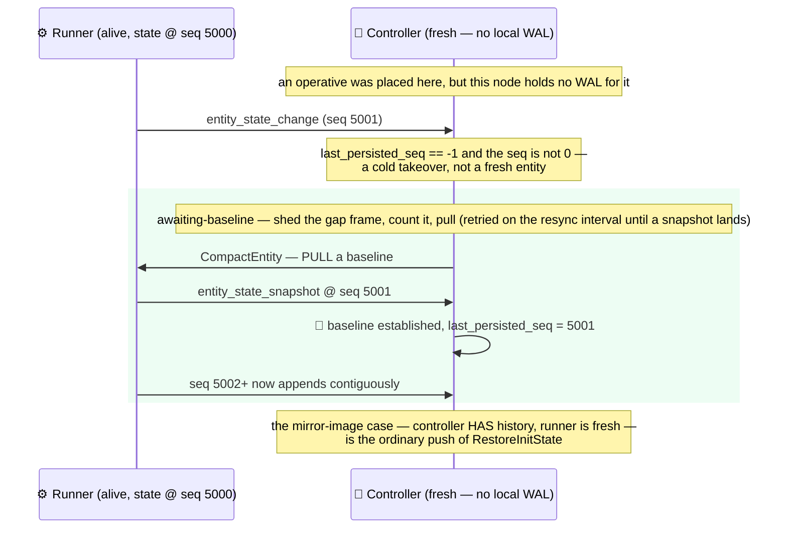

The rule: **controller has history + runner is fresh → push** `RestoreInitState`;
**controller is fresh + runner has state → pull** `CompactEntity`. Backing this is an
empty-payload guard — `Restore.has_persisted_state?/1` treats a zero-byte WAL as *no state*, so
the controller can never push an empty restore that would rebuild a live entity back to
`init_state`.

Deeper detail, including the WAL record format and every configuration knob:
[`state_persistence.md`](../internals/state_persistence.md).

## The minimum watermark and retention

Under the tier, each entity reports the input-log offset it has durably consumed. The
**minimum** across an operative's entities is the only offset that is safely done everywhere.

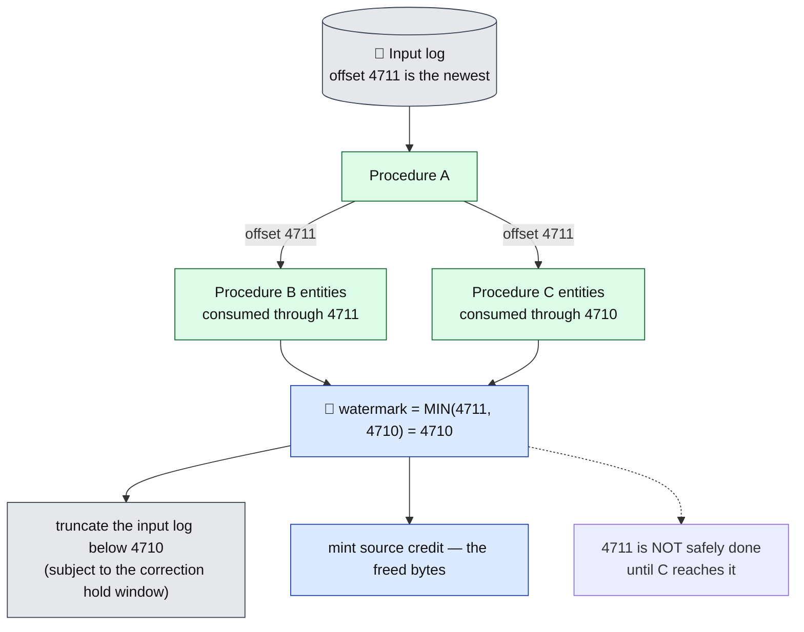

The watermark only ever advances from the **post-fsync** path, so it is a durable fact, not a
hope. It does two jobs: it is the retention floor, and it is what mints source credit
(see [below](#flow-control-the-three-loops)).

A branch that stops consuming freezes it. The retention sweeper notices — a watermark unchanged
since the last sweep, with the log grown past 16 MiB, emits
`[:flezha, :state, :input_log_frozen_watermark]` naming the lagging entity rather than silently
accumulating. The mechanism that *unfreezes* it is the dead-letter queue: after bounded retries
the entity parks the poison payload durably and advances past it.

The truncation floor is `min(watermark, the newest offset older than the hold window)`. The
hold window (`:input_log_hold_window_ms`, default `0`) is what a correcting operative needs — it
is the guarantee that the inputs a correction wants to replay are still on disk.

The cut costs the retained tail, not the log: the input log keeps a sparse offset→position index
(one sample per 256 appends), finds the floor within one span and copies the bytes above it into
the replacement file. The sweeper asks for the cut and never waits on it — the log is on the
effectively-once ingest path, and housekeeping must not hold it, nor die because it is busy.

## The remote durability tier

Everything above is node-local, and by default that is the whole story: a controller that dies
**with its disk** takes its operatives' state — and the registry record of their existence —
with it. The remote durability tier is the answer, and a prod boot must choose one
(`FLEZHA_DURABILITY_BACKEND`; unset refuses to start, explicit `none` is local-only and
byte-identical to a build without the tier). It is **not** a pluggable WAL: the local
write path is untouched, every ack still gates on local fsync, and the local files stay
authoritative. What ships are **immutable artifacts**, at boundaries that already exist.

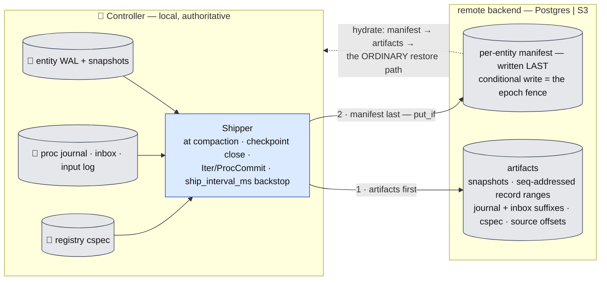

- **Ship triggers are the existing boundaries.** Compaction already produces the snapshot
  artifact; a checkpoint close already defines the stream interval; `IterCommit`/`ProcCommit`
  already define the workflow commit points. One backstop timer (`ship_interval_ms`, default
  30 s) covers entities that hit none of them. No barrier alignment exists or is needed — the
  effect record already binds state and offset per entity, so every entity's shipped cut is
  independently consistent.
- **Manifest-last is the atomicity.** Artifacts upload first; the manifest entry naming them is
  written last. A torn upload leaves orphan blobs recovery never sees (a periodic GC collects
  them by comparing `list()` against manifests). Recovery reads only the manifest and feeds the
  existing restore-and-replay path — there is no second restore implementation.
- **The epoch fence extends outward.** The manifest's conditional write makes the remote store
  an external arbiter: a superseded controller fails its `put_if` and must stop shipping, so two
  controllers can never both own an operative's remote lineage.
- **Per-class sync mode.** A workflow class declaring `durability: :sync_remote` has its barrier
  acks gated on the remote ship — RPO 0, one LAN round-trip per barrier at Hz rates. Stream
  classes are refused sync: at ~100K changes/s it would be a lie. Async shipping never blocks
  the hot path; a stalled shipper raises the alarm-grade `[:flezha, :state, :rpo_exceeded]`
  (surfaced in `flz controller status` and `/healthz`) instead of silently widening the loss
  window.

The backend contract is four blob operations — `put / get / list / put_if` — so backends store
bytes and never re-implement WAL semantics. Boot ordering matters exactly once: on a fresh node
the registry cspec is hydrated **before** the hub opens `registry.dets`, so the orphan reconcile
can see the restored operatives; entity state then hydrates through the ordinary bind. Full
detail: [`remote_durability_tier.md`](../operations/remote_durability_tier.md).

---

## Delivery guarantees

Flezha does not promise exactly-once external effects, because no system can. It promises the
composition that produces the *effect* of exactly-once:

> **at-least-once delivery + a deterministic key + an idempotent sink = effectively-once.**

The end-to-end guarantee is the weakest link in that chain.

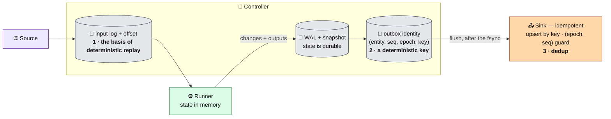

Two sinks ship conforming out of the box. The **Postgres** sink upserts every record of a flush
batch and advances a per-entity progress row in **one transaction**, both guarded by `(epoch,
seq)` monotonicity, so a re-drive or a stale epoch is a byte-exact no-op. The **Kafka** producer
uses `flz.key` as the message key and carries the durable identity as a dedup header.

The tier is opt-in per operative (`effectively_once()` on the channel builder), and it forces
every plugin-bound channel to be `.keyed()` — an unkeyed output has nothing for a sink to dedup
on, so declaring the tier over one is refused at build time.

**The tier does not vary by host language.** The effect record, the offsets it carries, and
the checkpoint interval are built by the shared runner core, so a Java runner and a Rust
runner earn the same guarantee. What a host supplies is its own change bytes and the context
surface the determinism contract needs — `ctx.now()`, `ctx.stable_id()`, `ctx.checkpoint()`,
keyed emit — which both SDKs have. See [`poll_core.md`](../sdk/poll_core.md).

## Determinism

Recovery is re-execution. If user code read the wall clock or minted a random id, a replay would
produce different outputs and dedup would be impossible. So the runtime computes time and
identity, and user code reads them from the context.

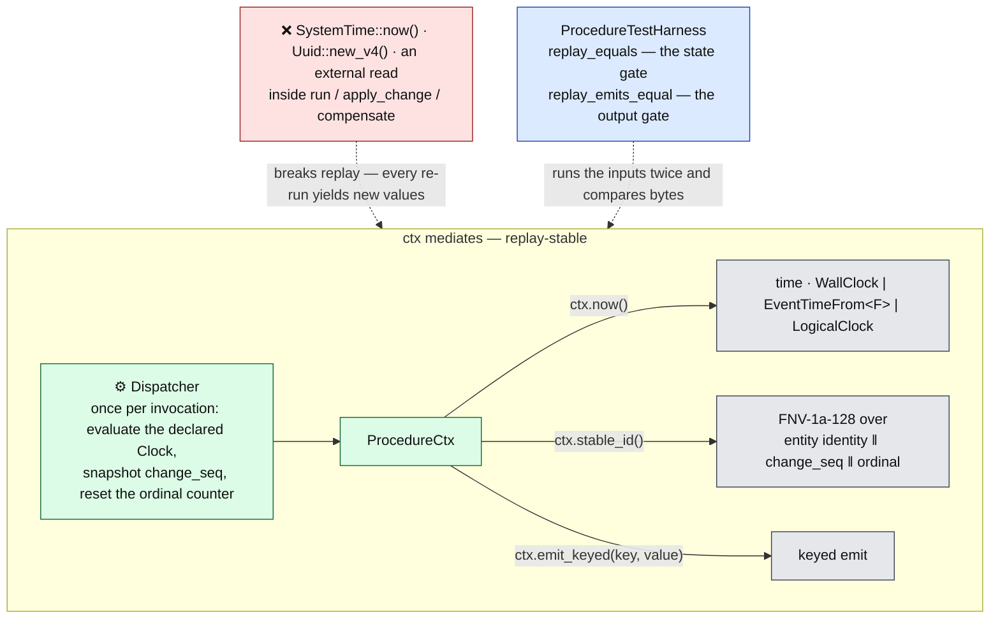

The `Clock` trait is sealed — there are exactly three implementations, and a custom one is a
compile error:

| Clock | Value per invocation |
| --- | --- |
| `WallClock` | epoch milliseconds, read **once** at dispatch entry |
| `EventTimeFrom<F>` | `F::extract(&input)` — the event time carried by the input itself |
| `LogicalClock` | the entity's durable `change_seq` |

`EventTimeFrom` is the only clock that is fully deterministic across a replay, which is why
late-input correction requires it. `LogicalClock` over a stateless procedure is refused at build
time — there is no sequence to serve.

`ctx.stable_id()` replaces a random UUID with a hash of *where and when* the invocation
happened: `FNV-1a-128(entity identity ‖ change_seq (8 bytes BE) ‖ per-invocation ordinal
(4 bytes BE))`, rendered as 32 hex characters. The *n*-th call in an invocation replays to the
same value on the *n*-th call.

## Output identity

There are **two** places identity is minted, and they carry different things.

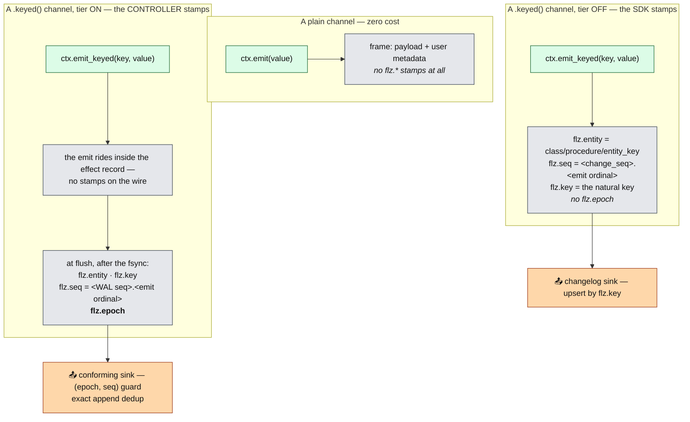

The distinction is a real honesty boundary, not a formality:

- **Tier off**, `flz.key` is a stable natural key and is enough for a **changelog** consumer —
  one that upserts by key (candles, indicators, any derived-state stream). `flz.seq` is *not* an
  exact append-only dedup handle here: two invocations that produce no state change can collide
  on it. And there is **no epoch**, because nothing durable owns one.
- **Tier on**, `flz.seq` becomes the durable outbox sequence — the WAL sequence of the record
  that produced it, plus the ordinal of the emit inside that record — and `flz.epoch` joins it.
  Together they are a sufficient handle for exact append-only dedup.

`flz.` is a reserved metadata namespace. A user emit carrying a `flz.`-prefixed key is rejected
at emit time, so stamps cannot be forged or clobbered. The workflow transactional outbox mints
through the same controller-side function, with `flz.seq = <proc_idx>.<seq_in_proc>`.

## The epoch rule

One rule, two kinds of event.

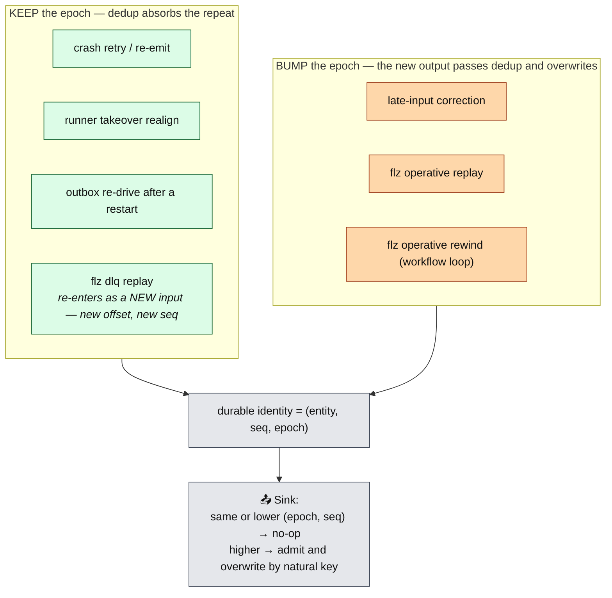

The distinction is *intent*. An accident — a crash, a takeover, a re-drive — must not change
what the world sees, so it reproduces the same identity and the sink swallows it. A deliberate
correction *must* change what the world sees, so it raises the epoch and the sink lets it
through.

`flz dlq replay` sits on the **keep** side and it is worth knowing why: it re-injects the parked
payload as an ordinary new input, so it gets a fresh input-log offset and a fresh WAL sequence.
Its identity is new by construction — there is nothing to overwrite and nothing to bump.

---

## Flow control: the three loops

Data moves in three directions, and each gets the treatment its risk profile deserves. Two park,
one drops — deliberately.

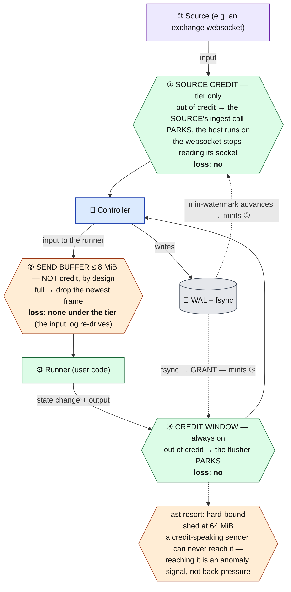

**Green parks, orange drops.** The rule to remember: *against a slow disk we wait; against a
slow or dead runner we never wait.*

**Why ② is not credit.** The core of credit is "park, do not drop" — the sender stops when the
receiver cannot keep up. Runner→controller (③) is exactly the right place for that: if the
durable side cannot fsync fast enough, the runner *should* slow down. But
controller→runner (②) is the opposite: parking there would block the **controller**, which
serves thousands of other operatives, on one wedged runner. So that direction drops its newest
frame past 8 MiB and counts it. It is protection against a dead partner, not against load.

A dropped input frame is **not** loss under the tier: it is already durable in the input log at
its offset, and the crash-resume re-forward will deliver it. And in practice the buffer should
never fill, because loop ① is upstream of it — a stuck entity freezes the watermark, which
starves source credit, which parks the source at the actual origin.

### The runner→controller credit loop

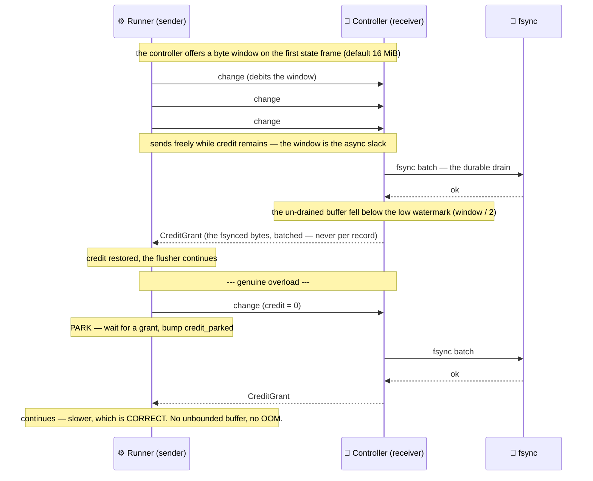

Credit is minted on **fsync**, not on append. That is the whole point: the un-fsynced buffer can
never exceed the window, because the bytes in it are exactly the credit the sender has spent and
not got back. (Bytes that never enter the buffer at all — a deduplicated re-send, a rejected gap,
a refused stale write — are released immediately instead, so every byte is accounted for exactly
once.)

The park is a workflow re-check loop, not an indefinite block, so a lost grant degrades to a
retry rather than a freeze. A sender parked for more than 5 s logs once. `credit_parked` rides
the runner's data heartbeat, so "fed but parked" is distinguishable from "wedged" from the
outside.

The hard bound at 4× the window (64 MiB) still exists as a last-resort shed, but under credit
it is unreachable for a conforming sender — hitting it emits
`[:flezha, :state, :credit_anomaly]`, because it means the sender is not honouring the
protocol.

### The source→controller credit loop

Under the tier, the input log holds its own credit ledger. An `append` debits it. When the
ledger is exhausted the append is **parked** — the log defers its reply — and the
minimum-watermark advance is what drains the ledger and unparks the waiters in arrival order.

The Overwatch never waits on that reply. It hands the append to the log
(`InputLog.append_async/5`), keeps the source's call owed, and forwards the input when the log
answers (`Ingest.journal_reply/2`) — in offset order, answering the calls in call order. So the
park lands on the *source's* call and nothing else: the host keeps running its `{:io_out}`
chains, control calls and timers while credit is exhausted, and it is those chains' sink
confirmations that advance the watermark and mint the credit. A host parked on its own log
could never mint the credit it waits for — a sink outage longer than `window / ingest rate`
would otherwise wedge an operative for good.

This only back-pressures the actual source if the source adapter is *waiting* on that call, so
under the tier the websocket provider switches from a fire-and-forget cast to a blocking call.
A stalled entity therefore stops the socket read at the origin, which is exactly where you want
it stopped.

---

## Ownership and fencing

Exactly one runner session may write an entity's WAL. Ownership changes at the door — a new
connection presenting a known stable identity takes over — and the takeover is ordered:
**unbind the old session before binding the new one**, so an in-flight frame from the old session
dies at the binding rather than in the writer.

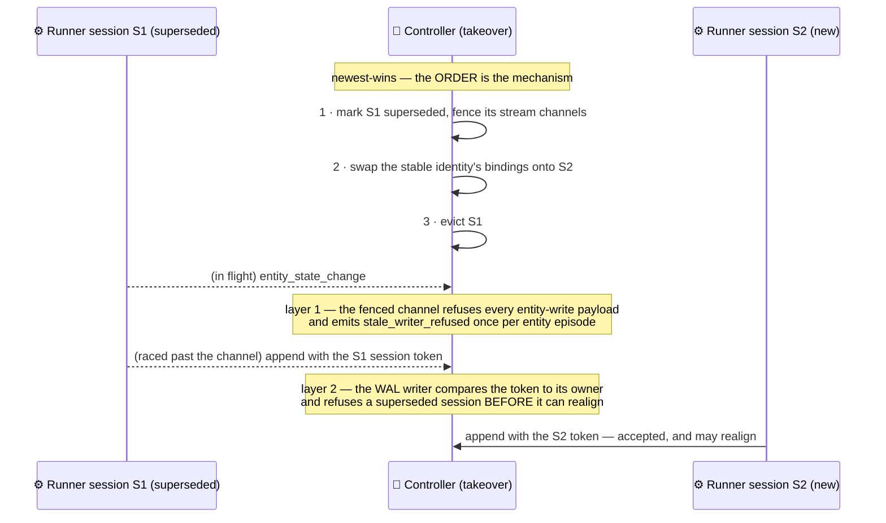

There are **two** fence layers, and the second is a per-write check:

1. **The channel fence.** A superseded session's stream channels are flipped to `fenced?` and
   refuse the seven entity-write payload ids outright.
2. **The WAL owner token.** The session token rides *every* append, and the writer refuses one
   from a session it knows to be superseded. Crucially, this check runs **before** the realign
   decision, which is the entire point — a stale runner must never be allowed to rebase the
   log onto its own lineage.

> The owner pays **no per-write cost**: the token comparison against the current owner
> short-circuits before the superseded-session lookup ever runs. It is a per-write *token*, not
> a per-write *penalty*.

Realign itself is the legitimate version of the same event: a *different, current* runner
emitting a non-contiguous sequence is the signature of a runner pod restart, and the writer
adopts its lineage and bumps the epoch. Full detail:
[`runner_identity.md`](../internals/runner_identity.md).

---

## Health and liveness

The controller's single self-healer is `Flezha.Convergence.Loop`. It runs a declarative pipeline
every 5 s, and immediately on a declared event (an output stall, a runner connect).

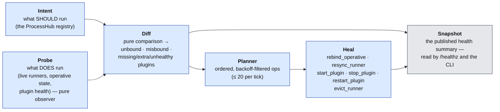

Three guards keep it from over-reacting: an operative must be misbound for **two consecutive
ticks** before a rebind is issued; a failed read reports `:unknown` rather than "gone", and the
diff skips it; and every `{primitive, target}` pair carries an exponential cooldown of
**2 s → 5 s → 10 s → 15 s → 20 s → 30 s → 45 s → 60 s → 90 s → 120 s → 180 s → 300 s**, held at the top. The whole tick body is wrapped — an uncaught error is a skipped
tick, never a crashed loop.

Full architecture: [`convergence_loop.md`](../internals/convergence_loop.md).

### Producing-liveness: fed, and advancing

"Is the channel up" is a lie detector that fails. The honest question is *is work flowing* — and
it has a precondition, because an entity with no input is **supposed** to be flat.

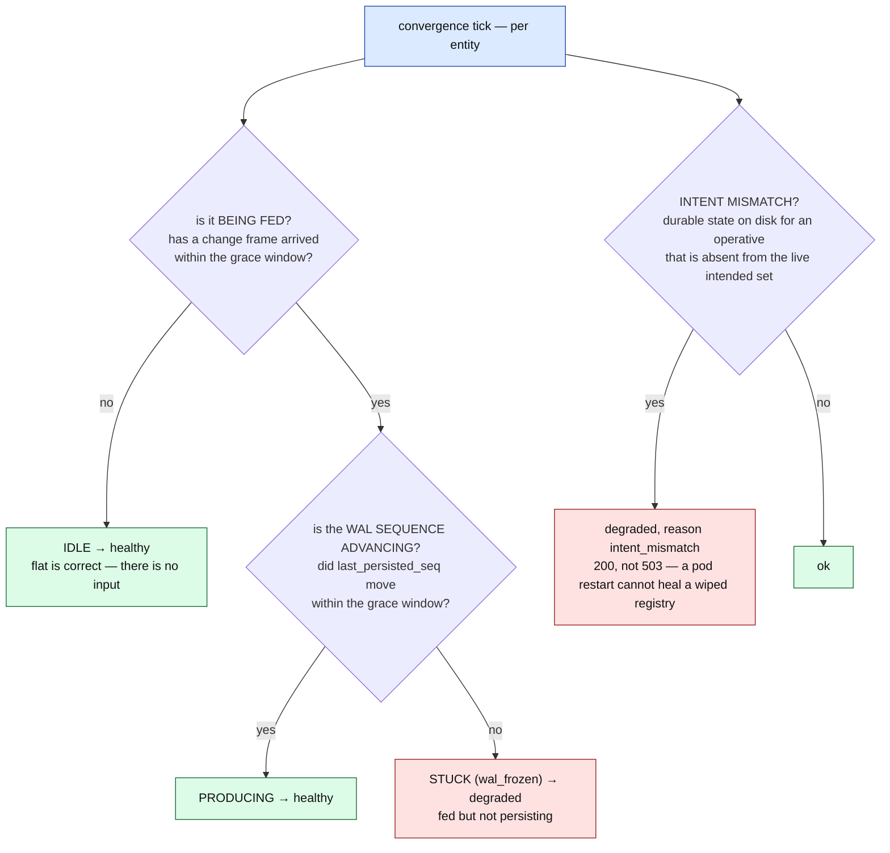

Two clocks on each WAL writer make this cheap: `last_change_seen_at` moves on **every** received
change frame (the *fed* signal, and it moves even for a duplicate or a gap), and
`last_advance_at` moves only when the persisted sequence actually increases (the *progress*
signal). Comparing two timestamps per entity per tick costs nothing on the hot path.

Under the effectively-once tier, two more markers join, and a stuck verdict names which one
froze — the deepest wins, because one root cause freezes the shallower markers as a consequence:

| Verdict | Fires when |
| --- | --- |
| `wal_frozen` | change frames arrive, but the persisted sequence does not advance |
| `watermark_frozen` | the input log grows, but this entity's durable consumed offset does not advance |
| `outbox_flat` | output-bearing records accumulate while the outbox flush cursor stays flat, or dispatched output goes unconfirmed past the grace window |

Each carries its own *is it being fed?* precondition — the input log must have *grown*, the
output records must have *accumulated* — so an idle entity can never read as stuck. The
consumed offset is read **per entity**, not as the operative's minimum: the minimum across
entities *is* that watermark, so any frozen entity still freezes the operative's verdict, and
the verdict names the entity actually responsible.

The `State.Watchdog` sweeps every 10 s and runs four checks, of which the first two are the
liveness pair. Each completed sweep stamps its own freshness into the convergence snapshot, so a
watchdog that wedges without crashing surfaces as `sensor_stale` instead of silently switching
detection off:

| Sweep | Fires when | Action |
| --- | --- | --- |
| Output staleness | fed, but the sequence has not advanced for 60 s | `[:flezha, :state, :output_stall]` and nothing else — the convergence loop ticks on it and applies the resync→rebind ladder. The sweep is a sensor; it invokes no remedy |
| Input silence | produced output before, but has received **nothing** for the window | `[:flezha, :state, :input_silence]` + a warning log. Off by default (`input_silence_timeout_ms` is `0`): silence on the input side is not a fault, and the sweep cannot tell a dead upstream from a source that reports hourly |
| Compaction trigger | the WAL is past its size or age floor | `CompactEntity` |
| Compaction timeout | a requested snapshot has not arrived in 30 s | resync |

The input-silence sweep is skipped for a checkpoint-ack operative, whose silence between
checkpoints **is** its steady state, and for a workflow operative, which legitimately goes quiet
between iterations. The convergence judge holds the same rule for the same observation: a flat
marker with no input-side advance is idle, and idle is healthy.

### Stall localization

When a stream does go silent, a separate classifier answers *which layer wedged*. It compares
two consecutive snapshots of driver, channel, and operative counters and returns the **deepest**
wedged layer, because a wedge downstream explains every symptom above it — then the pipeline
heals that layer and the next tick surfaces whatever remains.

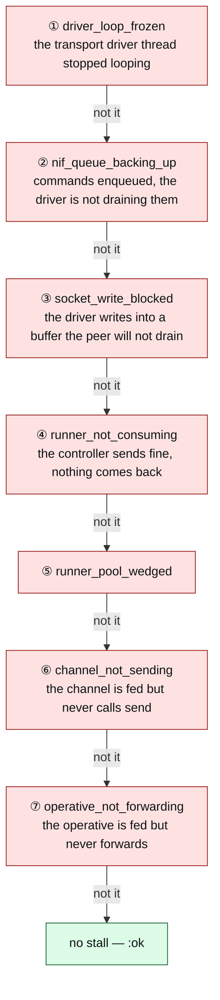

Each verdict carries an *is it being fed?* precondition of its own, so a quiet system does not
read as a wedged one. It emits `[:flezha, :data_plane, :stall_localized]` on a **change** of
verdict, and every verdict has exactly one consumer: a heal primitive where a BEAM-level remedy
exists (wedged runner → evict, wedged connection → resync, wedged operative → rebind), and a
`/healthz` 503 where only a process restart does. Signals, the scope table, the `/proc` fallback,
and the counter set:
[`transport_liveness.md`](../internals/transport_liveness.md).

### The `/healthz` contract

| Status | HTTP | Condition |
| --- | --- | --- |
| `healthy` | 200 | every hub is normal, and every bound operative is producing |
| `recovering` | 200 | a hub is recovering, the registry is restoring, operatives are rebinding within the grace, or a tick is late |
| `degraded` | 200 | operatives are output-stalled, stuck or plugin-unhealthy, an intent mismatch was detected, a data-plane wedge the pipeline owns was localized, or a periodic sensor stopped completing passes |
| `unhealthy` | **503** | **only** when the convergence loop itself has stopped ticking, or the controller's own NIF driver thread is wedged and has stayed wedged |

The endpoint holds no state — it reads the published convergence snapshot and nothing else.

**503 is reserved for what a restart genuinely fixes.** A kubelet restart cannot re-bind an
runner-orphaned operative, cannot repair a wiped registry, and cannot un-stall a data plane
that is legitimately stopped — restarting the pod for any of those destroys a working controller
to fix nothing. Two conditions qualify, and the test is the same for both: *nothing this
controller can do reaches it*. A wedged convergence loop is one. A wedged **controller-fabric**
NIF driver thread (`driver_loop_frozen` / `nif_queue_backing_up`, sustained for
`FLEZHA_FABRIC_503_POLLS` classifier polls, default 3) is the other — every heal the pipeline
could issue travels through that thread, so the orchestrator's restart is the only remedy left.
A wedged *runner* is not in this set: the pipeline evicts and rebinds it, and it stays
`200 degraded`. `FLEZHA_FABRIC_503_POLLS=0` disables the fabric 503 outright. The listener is
opt-in (`FLEZHA_HEALTHZ_ENABLED`, port 9569).

### The `/readyz` contract

The same listener serves a second, separate verdict, because liveness and readiness are
different questions with opposite correct answers in the same window. `/healthz` answers
*should the kubelet restart me?* and stays `200` throughout a planned recovery. `/readyz`
answers *should traffic be routed to me?* and must refuse for exactly that window. Neither
is derived from the other, and `/readyz` reads no arm of the table above.

`Flezha.Boot.Readiness` holds a declared table of readiness preconditions and folds them
into one verdict. Each row carries a key, the verdict it holds the node at while unmet, and
the predicate that decides it; adding a precondition is adding a row.

| Row | Met when |
| --- | --- |
| `boot_sequence_complete` | the supervision tree has started and the boot sequence has finished |
| `hubs_recovered` | no namespace hub is in ProcessHub's recovery state machine |
| `durable_registry_loaded` | the durable registry holds no operative this controller has not reloaded |

`200` only on `:ready`; otherwise `503` with a JSON body naming the verdict
(`booting` / `recovering`), the unmet row keys and the state of every row.

Two properties the rows depend on. **The verdict needs no owning process**: the
boot-sequence fact is a `:persistent_term` cell, so a probe issued while the boot sequence
is still running is answered rather than queued behind the boot's mailbox, and it fails
closed by absence. **Only that one row is recorded** — the other two are evaluated on every
read, so a controller whose bounded boot replay wait elapsed becomes ready when the hub
finally reaches `:normal`, with no restart. A precondition that cannot be read counts as
unmet: no absence of information produces a ready answer.

The readiness endpoint shares the health endpoint's listener, port and
`FLEZHA_HEALTHZ_ENABLED` switch, and introduces no configuration key of its own.
