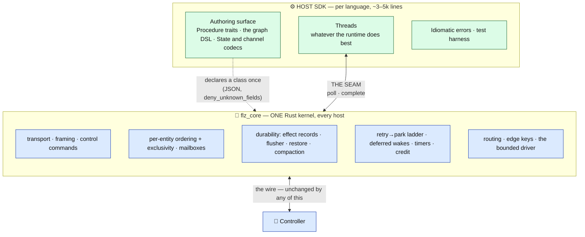
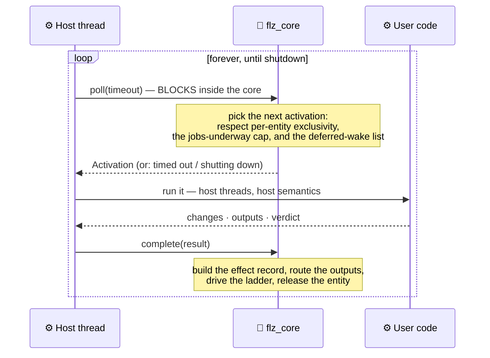
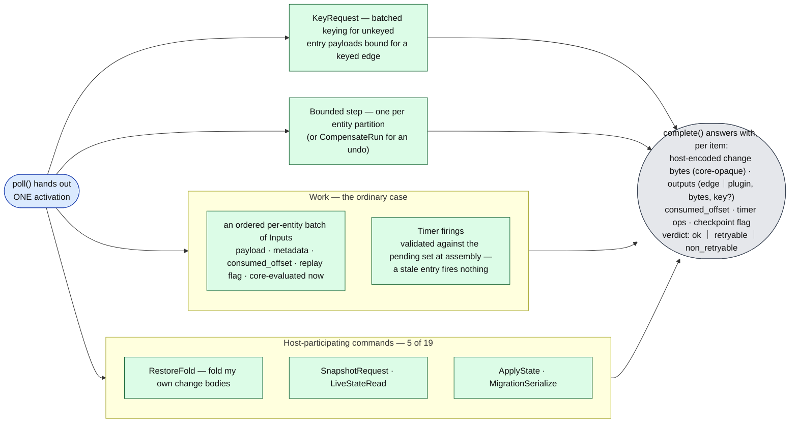
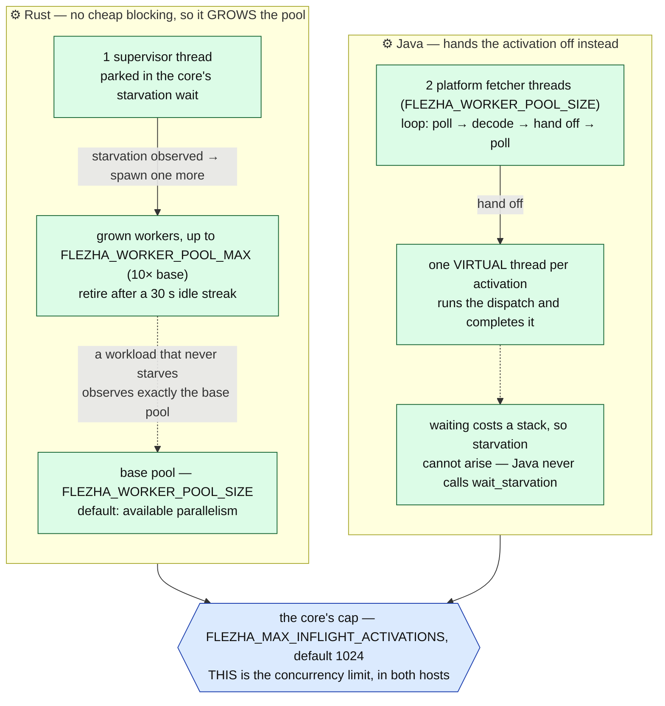
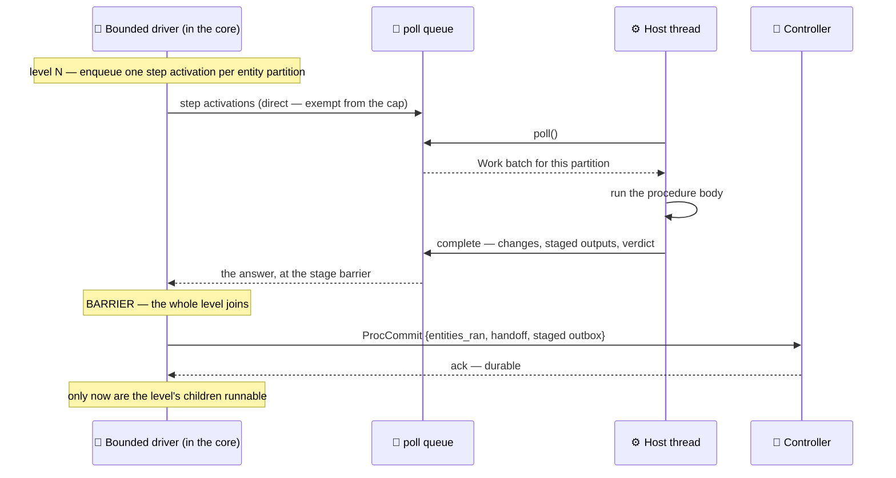
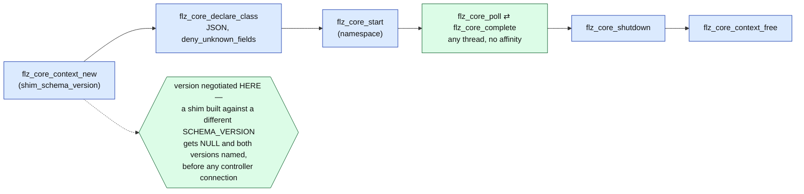

# Inside a runner — the shared kernel and the host SDK

The controller's view of a runner is one box: a process that dials in, accepts operatives, and
ships back state changes and outputs. This page opens that box.

A runner is **two layers, not one**. Transport, ordering, durability, retries, timers, credit,
routing and the bounded driver live in a single Rust kernel, `flz_core`. The host language SDK
— Rust, Java, and whatever comes next — brings the authoring surface a user writes against and
the threads that run their code. The seam between them is one poll loop.

Everything on the [kernel](kernel.md), [unbounded](unbounded_profile.md) and
[bounded](bounded_profile.md) pages is the same regardless of which host SDK is running, and
that is precisely because those mechanisms sit below this seam.

Mechanism-level detail: [`../sdk_poll_core.md`](../sdk_poll_core.md). The authoring surface
itself: [`../operative_architecture.md`](../operative_architecture.md).

---

## The split



**The core never calls into host code and never owns a host thread** (an FFI log callback is
the one exception). That is what lets Python keep asyncio, Go keep goroutines and Java keep JVM
threads without any of them negotiating with the other.

The Rust SDK is the first host and consumes the same kernel as a crate — the dogfood rule that
keeps the boundary from eroding, since a capability reachable in the crate API but not through
the C ABI is a defect rather than a backlog item.

## The poll loop

Three calls. That is the entire invocation surface.



Two properties are worth stating outright, because the next SDK author depends on both:

- **Completing from a different thread than the one that polled is expected**, not merely
  tolerated. It is what lets a host fetch on one thread and run on another.
- **Bring your own fetch threads.** `poll` blocks *inside the core*, so borrowing a shared
  runtime pool for it (libuv's threadpool, a framework's request executor) starves everything
  else that pool serves.

## What crosses the seam

An **Activation** always targets exactly one entity.



The other 14 control commands never surface — a `Ping` generates no activation. The change
bytes in a result are **opaque to the core**: postcard from a Rust host, Kryo from a Java one.
That is the same property that lets the controller store them without decoding.

## The core decides, the SDK brings the threads

This is the governing rule of the boundary.

**The core decides what runs and how much of it.** It picks the next activation, holds
per-entity ordering and exclusivity, owns the retry ladder and durability, and caps how many
work activations may be underway at once. The cap is enforced at handout: at the ceiling `poll`
blocks as if nothing were ready, and the completion that drops below it releases the next one.

**The SDK brings the threads.** The count is a servicing detail, not a limit on concurrency —
that limit is the core's one number. The two shipped hosts differ completely, and neither knows
about the other:



**The fetchers stay platform threads.** `poll` blocks in native code and a native frame pins
its carrier, so virtual fetchers would pin two carriers permanently.

**Starvation means *stuck*, not *busy*.** Queued work counts only once it has sat for a 100 ms
dwell during which **no thread entered `poll` at all**. A saturated runner enters `poll` once
per batch — microseconds apart — so it never trips; only a runner whose every thread is inside
user code shows no entry for the window. Answering saturation with more threads would add
contention to a runner that is merely working.

Starvation is exposed as a blocking wait a host thread may park in, never as a callback: the
core calls no host code, and a host that cannot starve simply never calls it.

**Direct activations are exempt from the cap** — restore folds, snapshot requests and bounded
steps answer a caller already blocked on a rendezvous or a stage barrier, so holding one behind
capped entity work would deadlock that caller. They are also what a queued direct activation
with no thread inside `poll` reports as starvation: a blocked driver must be able to buy a
thread.

## Per-entity exclusivity

The core never hands out two activations for the same entity concurrently. This is the
single-active-drainer gate, expressed at the boundary — and it is why user code needs no locks
around its own State.

```mermaid
sequenceDiagram
    participant T1 as ⚙️ Thread 1
    participant T2 as ⚙️ Thread 2
    participant CORE as 🧠 flz_core

    T1->>CORE: poll()
    CORE-->>T1: Work — entity "BTC", inputs [1,2]
    T2->>CORE: poll()
    Note over CORE: "BTC" has an outstanding activation —<br/>it is not a candidate, no matter how much it has queued
    CORE-->>T2: Work — entity "ETH", inputs [7]
    Note over T1,T2: different entities run in parallel, always
    T1->>CORE: complete("BTC")
    Note over CORE: only NOW is "BTC" a candidate again;<br/>its inputs are delivered in enqueue order across activations
```

Batch assembly owns the rest of the ordering contract: the consumed-floor skip, replay-slice
buffering and event-time-ordered flush, and late-input admission.

**Event-time-clocked classes get one admitted input per activation.** Chained timer
registrations land only at completion, so wider batches would make due-firing interleave depend
on batch timing — and a correction replay must fold firings at the same positions the live run
did. Wall and logical clocks batch freely.

## The ladder, and the list that owns no thread

A completion verdict drives the escape ladder. Nothing about it blocks a thread.


**The backoff blocks no thread.** Reporting the failure returns the completing thread
immediately; the entity's exclusivity gates stay held across the window — nothing else could
drain it during a backoff anyway — and the release-then-reclaim runs when the delay comes due.

That matters under correlated failure: with workers sized to the CPU count, a backoff that
slept the completing worker would, when a shared dependency goes down, put **every** worker to
sleep and stop work that would have succeeded. Shutdown is not delayed either — there is no
sleep left to run out.

Promotion needs a thread in `poll`, so a due entry with every worker inside user code *is*
starvation and reads as such: the starvation wait's deadline considers the nearest due entry,
which is how a host that grows threads gets one there in time to promote the firing.

## A bounded step

The bounded driver is the core's. What the host contributes is the thread that runs one stage
of one entity partition.



A step therefore costs exactly **one** thread — the SDK's — and no core thread waits on a host.
The driver is the only waiter, and its retry timing lives there too. Barriers, the proc
journal, loop modes, suspension and rewind are unchanged driver machinery; see
[`bounded_profile.md`](bounded_profile.md).

One OS driver thread per actively-running bounded instance is a deliberate, measured choice:
it is ~1.4 KiB of an instance's ~73 KiB, and 10 000 blocked instances cost about 0.5% of one
core. The rationale and the measurement are in
[`../resilience/bounded_operative.md`](../resilience/bounded_operative.md).

## The C ABI

A non-Rust host reaches the kernel through `flz_core_ffi`.



Silent runtime skew is impossible by construction. `flz_core_declare_class` takes the
**complete** host-class declaration — the channel graph, entity modes, clock kinds, the
effectively-once tier and its ack granularity, the correction window, the record-header
lang/format bytes, and the bounded lifecycle facts — so a field the core never learned is a
refusal, not a silent degrade.

Ownership is "whoever allocates frees"; activation buffers the core hands out are freed with
`flz_core_buf_free`.

## What stays per-language, forever

The authoring surface (Procedure traits, the graph DSL), State and channel codecs, the poll
loop's integration with the host's concurrency primitives, idiomatic errors, and the testing
harness. An estimated 3–5k lines per SDK — the code that *should* feel native.

Two host-code-on-core-thread seams remain for the crate-consuming Rust host and are invisible
to the C ABI: `TypedBuffer<S>` serializes `S::Change` on the flusher's linger thread, and
erased entry parsers and edge closures evaluate on the wire-reader/routing thread. Both are the
documented in-process forms of what the byte boundary removes for FFI hosts.

---

## Where to go next

- The poll boundary in mechanism detail → [`../sdk_poll_core.md`](../sdk_poll_core.md)
- Authoring an operative → [`../operative_architecture.md`](../operative_architecture.md)
- What the runner ships to the controller → [`kernel.md`](kernel.md)
- The wire protocol → [`../sdk_protocol_spec.md`](../sdk_protocol_spec.md)
- Naming rules for a new SDK → [`../sdk_naming_conventions.md`](../sdk_naming_conventions.md)
