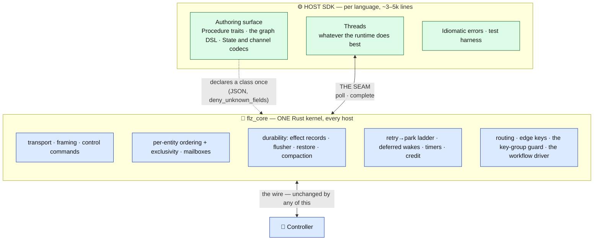
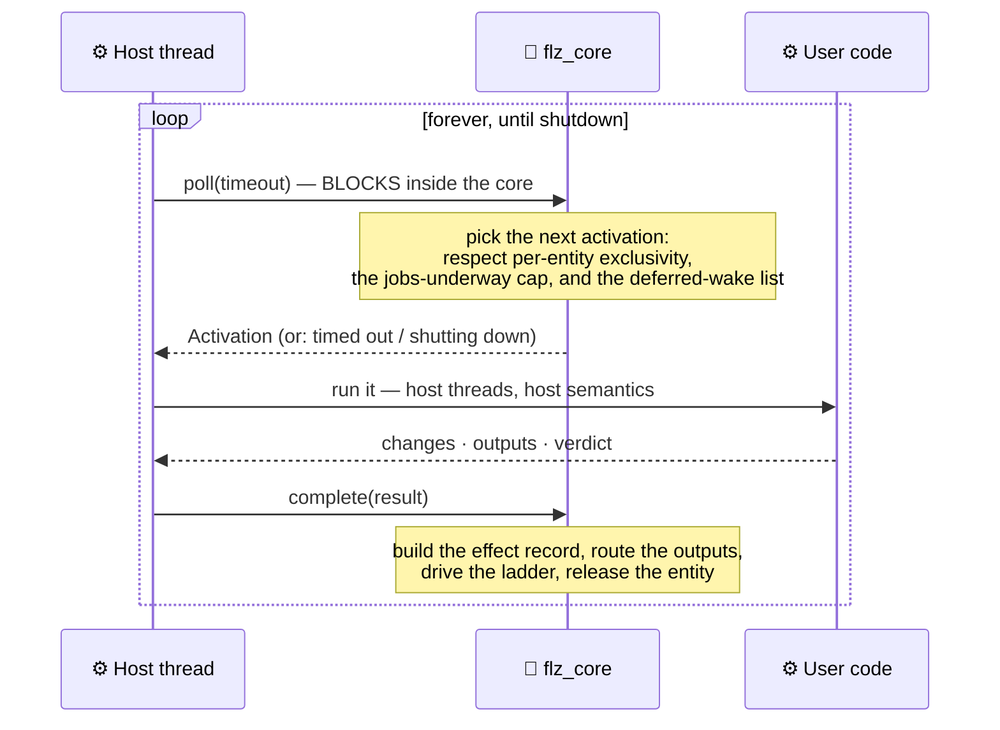
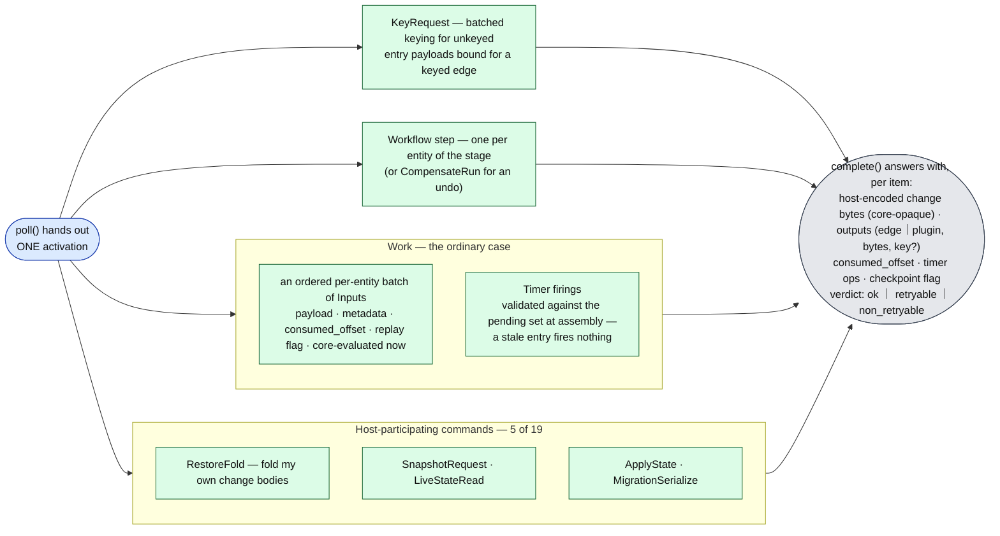
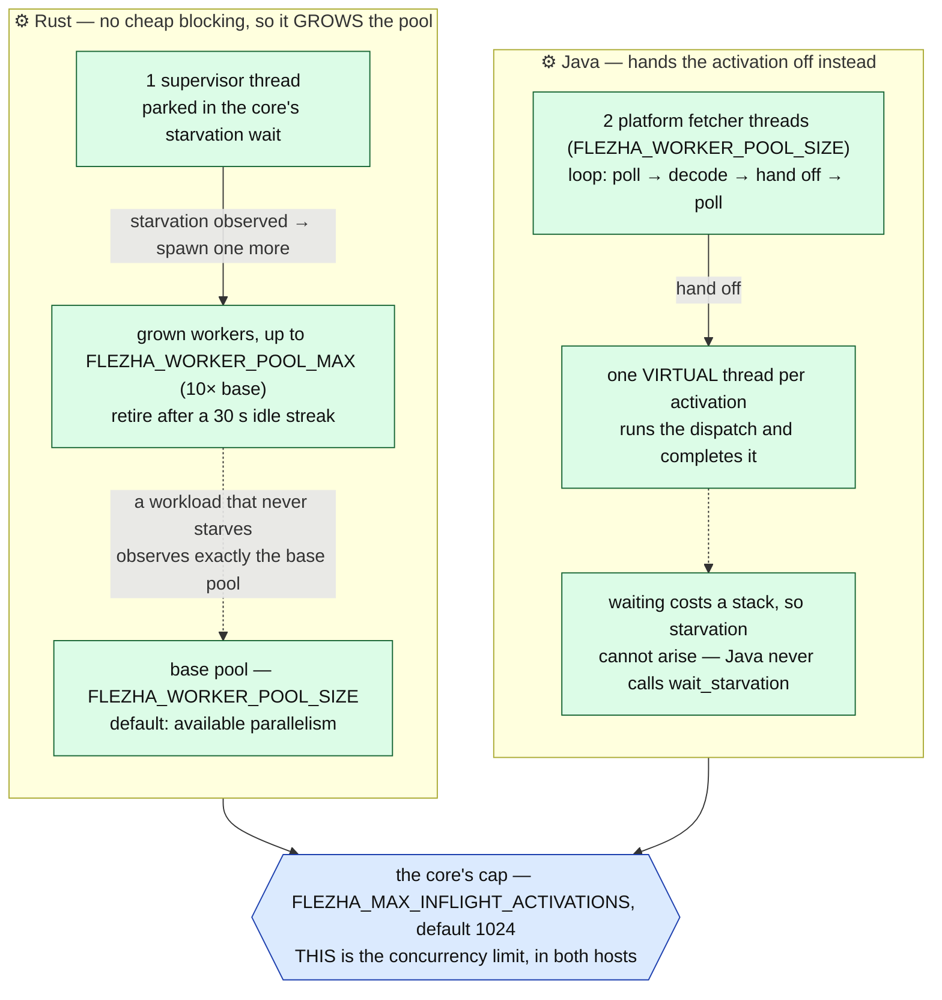
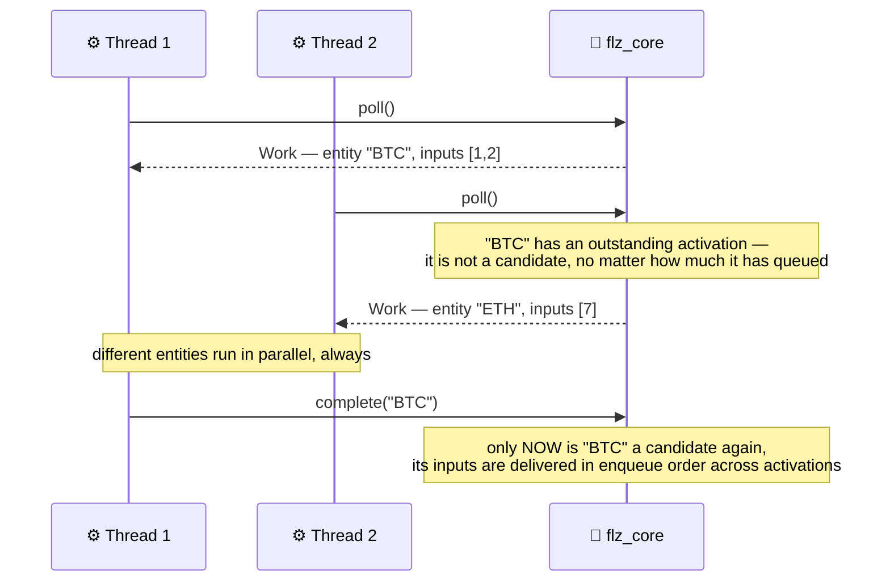
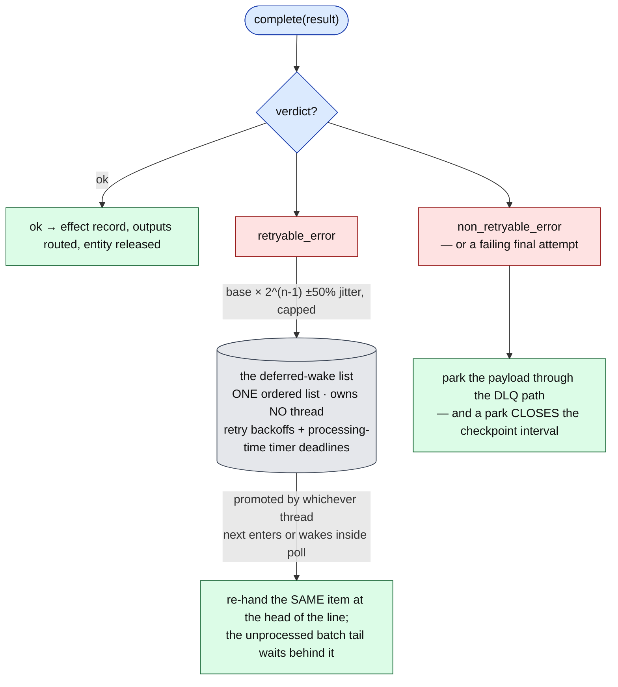
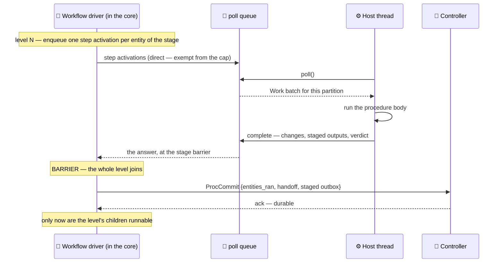
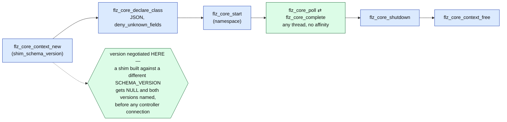

# Inside a runner — the shared kernel and the host SDK

The controller's view of a runner is one box: a process that dials in, accepts operatives, and
ships back state changes and outputs. This page opens that box.

A runner is **two layers, not one**. Transport, ordering, durability, retries, timers, credit,
routing and the workflow driver live in a single Rust kernel, `flz_core`. The host language SDK
— Rust, Java, and whatever comes next — brings the authoring surface a user writes against and
the threads that run their code. The seam between them is one poll loop.

Everything on the [kernel](kernel.md), [stream](stream_profile.md) and
[workflow](workflow_profile.md) pages is the same regardless of which host SDK is running, and
that is precisely because those mechanisms sit below this seam.

Mechanism-level detail: [`poll_core.md`](../sdk/poll_core.md). The authoring surface
itself: [`rust_operative_architecture.md`](../sdk/rust_operative_architecture.md).

---

## The split

**The core never calls into host code and never owns a host thread** (an FFI log callback is
the one exception). That is what lets Python keep asyncio, Go keep goroutines and Java keep JVM
threads without any of them negotiating with the other.

The Rust SDK is the first host and consumes the same kernel as a crate — the dogfood rule that
keeps the boundary from eroding, since a capability reachable in the crate API but not through
the C ABI is a defect rather than a backlog item.

## The poll loop

Three calls. That is the entire invocation surface.

Two properties are worth stating outright, because the next SDK author depends on both:

- **Completing from a different thread than the one that polled is expected**, not merely
  tolerated. It is what lets a host fetch on one thread and run on another.
- **Bring your own fetch threads.** `poll` blocks *inside the core*, so borrowing a shared
  runtime pool for it (libuv's threadpool, a framework's request executor) starves everything
  else that pool serves.

## What crosses the seam

An **Activation** always targets exactly one entity.

The other 14 control commands never surface — a `Ping` generates no activation. The change
bytes in a result are **opaque to the core**: postcard from a Rust host, Kryo from a Java one.
That is the same property that lets the controller store them without decoding.

The [key-group guard](stream_profile.md#partitioned-operatives) also lives below the seam:
`AddOperative` carries a partition member's owned range, and a computed entity key that hashes
outside it takes the park exit on the first frame — so every host gets the mis-route refusal
without writing a line of it.

## The core decides, the SDK brings the threads

This is the governing rule of the boundary.

**The core decides what runs and how much of it.** It picks the next activation, holds
per-entity ordering and exclusivity, owns the retry ladder and durability, and caps how many
work activations may be underway at once. The cap is enforced at handout: at the ceiling `poll`
blocks as if nothing were ready, and the completion that drops below it releases the next one.

**The SDK brings the threads.** The count is a servicing detail, not a limit on concurrency —
that limit is the core's one number. The two shipped hosts differ completely, and neither knows
about the other:

**The fetchers stay platform threads.** `poll` blocks in native code and a native frame pins
its carrier, so virtual fetchers would pin two carriers permanently.

**Starvation means *stuck*, not *busy*.** Queued work counts only once it has sat for a 100 ms
dwell during which **no thread entered `poll` at all**. A saturated runner enters `poll` once
per batch — microseconds apart — so it never trips; only a runner whose every thread is inside
user code shows no entry for the window. Answering saturation with more threads would add
contention to a runner that is merely working.

Starvation is exposed as a blocking wait a host thread may park in, never as a callback: the
core calls no host code, and a host that cannot starve simply never calls it.

**Direct activations are exempt from the cap** — restore folds, snapshot requests and workflow
steps answer a caller already blocked on a rendezvous or a stage barrier, so holding one behind
capped entity work would deadlock that caller. They are also what a queued direct activation
with no thread inside `poll` reports as starvation: a blocked driver must be able to buy a
thread.

## Per-entity exclusivity

The core never hands out two activations for the same entity concurrently. This is the
single-active-drainer gate, expressed at the boundary — and it is why user code needs no locks
around its own State.

Batch assembly owns the rest of the ordering contract: the consumed-floor skip, replay-slice
buffering and event-time-ordered flush, and late-input admission.

**Event-time-clocked classes get one admitted input per activation.** Chained timer
registrations land only at completion, so wider batches would make due-firing interleave depend
on batch timing — and a correction replay must fold firings at the same positions the live run
did. Wall and logical clocks batch freely.

## The ladder, and the list that owns no thread

A completion verdict drives the escape ladder. Nothing about it blocks a thread.

**The backoff blocks no thread.** Reporting the failure returns the completing thread
immediately; the entity's exclusivity gates stay held across the window — nothing else could
drain it during a backoff anyway — and the release-then-reclaim runs when the delay comes due.

That matters under correlated failure: with workers sized to the CPU count, a backoff that
slept the completing worker would, when a shared dependency goes down, put **every** worker to
sleep and stop work that would have succeeded. Shutdown is not delayed either — there is no
sleep left to run out.

Promotion needs a thread in `poll`, so a due entry with every worker inside user code *is*
starvation and reads as such: the starvation wait's deadline considers the nearest due entry,
which is how a host that grows threads gets one there in time to promote the firing.

## A workflow step

The workflow driver is the core's. What the host contributes is the thread that runs one stage
of one entity.

A step therefore costs exactly **one** thread — the SDK's — and no core thread waits on a host.
The driver is the only waiter, and its retry timing lives there too. Barriers, the proc
journal, loop modes, suspension and rewind are unchanged driver machinery; see
[`workflow_profile.md`](workflow_profile.md).

One OS driver thread per actively-running workflow instance is a deliberate, measured choice:
it is ~1.4 KiB of an instance's ~73 KiB, and 10 000 blocked instances cost about 0.5% of one
core. The rationale and the measurement are in
[`../resilience/workflow_operative.md`](../resilience/workflow_operative.md).

## The C ABI

A non-Rust host reaches the kernel through `flz_core_ffi`.

Silent runtime skew is impossible by construction. `flz_core_declare_class` takes the
**complete** host-class declaration — the channel graph, entity modes, clock kinds, the
effectively-once tier and its ack granularity, the correction window, the record-header
lang/format bytes, and the workflow lifecycle facts — so a field the core never learned is a
refusal, not a silent degrade.

Ownership is "whoever allocates frees"; activation buffers the core hands out are freed with
`flz_core_buf_free`.

## What stays per-language, forever

The authoring surface (Procedure traits, the graph DSL), State and channel codecs, the poll
loop's integration with the host's concurrency primitives, idiomatic errors, and the testing
harness. An estimated 3–5k lines per SDK — the code that *should* feel native.

Two host-code-on-core-thread seams remain for the crate-consuming Rust host and are invisible
to the C ABI: `TypedBuffer<S>` serializes `S::Change` on the flusher's linger thread, and
erased entry parsers and edge closures evaluate on the wire-reader/routing thread. Both are the
documented in-process forms of what the byte boundary removes for FFI hosts.

## Running the graph without a controller

A runner does not need a controller to execute a graph. Everything a procedure
does to a value is runner-side: the entry channel's decode and parse ladder,
edge transforms and keying, one Entity per resolved key with its mailbox and
overflow policy, the retry ladder, and the inter-procedure hop —
`route_to_consumers` is a mailbox push, and nothing about it crosses the wire.

**Local mode** is that fact made reachable. It builds the same `StreamInstance`
a deployed runner builds, feeds it through the same dispatch entry a stream
reader uses, and differs in exactly one thing: the outbound sink. A
`FlezhaStream::Local` takes what production writes and hands it to a callback in
process, and a null `state_sink` discards every durable record at the outbound
edge — so the record path still runs and still costs what it costs. There is no
second routing path and no second entity implementation; the difference is
supplied, never branched on.

What is on the controller's side of that line, and therefore absent locally:
durability of any kind (write-ahead log, snapshots, crash-resume, point-in-time
query), effectively-once delivery (an output rides its effect record and the
controller releases it once that record is durable — a declaration that asks for
the tier is refused at local startup, naming it), plugins, placement, migration
and rescale, partitioning (a member's key-group range arrives with
`AddOperative`, so it is not declarable and a local run is unpartitioned by
construction), the dead-letter queue, observability export, authz and
multi-runner scale.

Local mode ships in every SDK. The four that reach the kernel through the C ABI
rather than the JNI glue bind the same six entry points and drive their own poll
loop, which is what runs the procedures; a host with one thread drives that loop
from `runUntilIdle` rather than parking in the core. User-facing walk-through:
[`../quickstart.md`](../quickstart.md).

## One change, every SDK

The kernel has six hosts today: the Rust SDK (the crate), the Java SDK (`flz_core_ffi` over
JNI), the Node SDK (the same crate over N-API), the Ruby SDK (the same crate over magnus), the
Python SDK (the same crate over PyO3) and the PHP SDK — the first to consume the C ABI *as* a C
ABI, through `ext-ffi`, with no compiled veneer of its own (PHP has no stable ABI across minor
versions, so one library per platform is the only distribution that does not multiply by the
PHP matrix).
**The Elixir SDK is the deliberate exception.** It is not a poll
host ([`../sdk/elixir_sdk.md`](../sdk/elixir_sdk.md)): it re-expresses dispatch, overflow, the
retry→park ladder and the partition guard in Elixir and inherits *nothing* from `flz_core`. So
a change below the seam reaches Rust and Java for free and reaches Elixir only when someone
writes it; a change above the seam reaches nobody for free.

The rule, normative for every binding:

- **One change, every SDK.** Anything every SDK carries changes in the same change, in every
  SDK: the authoring and declaration surface (builder, ctx, the `HostClassDecl` keys), the wire
  protocol and its metadata keys, every default (overflow policy, retry ladder, mailbox
  capacity, heartbeat keys), and the fixtures that prove them (the regression and round-trip
  bench factories, the e2e runtime matrix).
  **What a topology may be is no longer one of those things.** A builder records the links its
  author declared and submits the record to `flz_core::host::register::check`, which holds the
  named refusals and the derivation rules once
  ([`../sdk/conformance.md`](../sdk/conformance.md) § The refusal table). So a new refusal is
  one variant and one fixture row, not an edit to seven builders — and the Elixir SDK, which
  inherits nothing, re-expresses the same check against the same fixture and is measured by the
  same conformance run. The rule still binds; what it now rides on is a fixture rather than
  seven diffs.
- **A host that brings its own workers brings their replacement.** Whatever a host's unit of
  work is — a poll thread, a fetcher, a per-Entity process — one that leaves for any reason
  other than shutdown is replaced without operator action, and its departure never consumes
  capacity the host budgets for. Every activation a host takes is answered exactly once
  (complete, fail, or abandon) through a guard that runs on an unwind, never a discipline at
  each return site: per-entity exclusivity means an unanswered activation retires its entity
  for the life of the process. **And it brings a starvation supervisor**: one thread parked in
  `wait_starvation` that starts one more worker per observation, up to a declared ceiling. A
  fixed worker count with no supervisor is a defect of that SDK, not a configuration choice —
  with every worker held such a host processes nothing, recovers from nothing and reports
  nothing (Java shipped that shape and measured 0 of 20 payloads delivered). Rust and Java both
  carry it, keyed alike by `FLEZHA_WORKER_POOL_SIZE` / `FLEZHA_WORKER_POOL_MAX`, and so do
  Node (whose replaceable unit is a dispatch worker thread, which is the reason its multi-loop
  configuration is the recommended production posture — a wedged main thread cannot be
  replaced), Ruby, Python (under *both* its executors — the supervisor's answer is a
  fetch-and-run thread either way, because a stalled event loop cannot rescue itself), and the
  PHP SDK's `SwooleExecutor`. **The PHP SDK's default `SyncExecutor`
  is exempt, by name**: a non-thread-safe PHP process runs one thread of PHP code, so it has
  one loop and no worker set to grow, and its replaceable unit is the process — which the
  orchestrator already owns and the SDK deliberately does not
  ([`../sdk/php_sdk.md`](../sdk/php_sdk.md#choosing-an-executor)). The Elixir SDK is exempt for
  the same reason it is exempt from the seam — a BEAM process per Entity has no worker set to
  starve. And every host reports handout liveness — `inflight` and
  `inflight_oldest_ms` in the data heartbeat — because that is the only thing that makes ONE
  wedged Entity visible while the runner keeps completing work; likewise every overflow outcome
  (`blocked_parks`, `drops_newest`, `drops_oldest`, and the deferred-push pair `pending_pushes`
  / `pending_push_oldest_ms`) rides the same heartbeat, because a drop no operator can count is
  a silent data loss — and neither is backpressure that withholds work, which holds no handout
  for `inflight` to see. The obligations and the seam
  are in [`../sdk/poll_core.md`](../sdk/poll_core.md); `pool_wedge` is a required conformance
  capability precisely so no SDK can carry them on review alone — and the supervisor does not
  satisfy it, since no ceiling outruns user code that never returns.
- **No core call blocks a host thread.** Backpressure is expressed by withholding work from
  the producer, never by holding the producer's caller: the core cannot know how many threads a
  host has, whether it can make more, or whether its "threads" pin a shared carrier, so a park
  that is safe on one host is a permanent stop on another. The converse binds the host: a host
  whose unit of concurrency cannot migrate between threads keeps every blocking ABI call off
  that thread. `flz_core_complete` is what makes that a correctness rule — under the default
  overflow policy it parks until the consumer's mailbox drains, and the consumer drains only
  when its handler runs, so a host that parks the one thread able to run that handler cannot
  recover. The single exception is the
  transport reader's park on the entry path — a core-owned thread with no producing Entity,
  whose stalling is what carries ingress backpressure to the controller. This one reaches Rust
  and Java **below the seam**, because both complete through `flz_core`; the **Elixir SDK needs
  nothing, and that blank is a decision, not an oversight** — `Flezha.SDK.Entity` already
  defers the caller's reply into a `waiters` FIFO instead of blocking a scheduler, which is the
  design `flz_core` was brought up to. Elixir did take the reporting half (`pending_pushes`),
  because that is a heartbeat key and heartbeat keys are a cross-SDK contract.
- **Deferred is named, never silent.** An SDK that cannot carry a capability yet is recorded as
  deferred *by name* — in the change's spec delta and in that SDK's scope matrix
  (that SDK's `conformance.json` `deferred` list, and
  [`../sdk/elixir_sdk.md`](../sdk/elixir_sdk.md#deferred-capabilities-v1-scope))
  — together with the follow-up that owes it. The crate is the dogfood host (a capability the
  crate reaches and the C ABI does not is a defect); one level up the same holds: a capability
  one SDK reaches that another neither reaches nor names as deferred is a defect of the change,
  not a backlog item.
- **Measured on one runtime is proven on one runtime.** A performance change is a controller
  change, a kernel change or a host change — its dev note says which — and a number taken with
  the Rust runner is not a number for Java or Elixir until the same bench has run on them.
- **Every SDK holds one allocated language byte, and a factory is homogeneous in it.** Durable
  `State` and `Change` bodies are per-SDK below the shared 16-byte envelope, and a restore ships
  those bodies verbatim to whichever runner bound the Entity — so an operative is placed only on
  a runner of its factory's language. The byte is an allocated identifier with one table of
  record in `flz_core/src/header.rs`:

  | value | SDK | stamps records |
  |---|---|---|
  | 0 | unspecified — never places | — |
  | 1 | Rust | yes (postcard) |
  | 2 | Java | yes (Kryo) |
  | 3 | Elixir | yes (External Term Format, `format_id` 7) |
  | 4 | Node | yes (MessagePack) |
  | 5 | Ruby | yes (MessagePack) |
  | 6 | PHP | yes (JSON) |
  | 7 | Python | yes (MessagePack) |
  | 8–254 | free, allocated in landing order | — |
  | 255 | reserved | — |

  One value per SDK, taken when that SDK lands; a proposal never asserts a value it has not been
  allocated, and a `flz_core` test refuses a duplicate. Every class declares it (the core refuses
  one that does not), every factory advertisement carries it, and every restore path — typed and
  host — refuses a record stamped with another language rather than handing it to its own codec.
  The homogeneous unit is the **factory**, not the namespace: a namespace holding a Rust class and
  a Java class is normal and each places on its own language. A conformance manifest declares its
  runtime's byte and the gate pins uniqueness, so a new SDK is covered by construction.

Where each SDK stands is not a table anyone maintains by hand. Each SDK's test app declares it
in `test/apps/<sdk>_runner/conformance.json`: the capabilities it defers, by name, and the
fixture ids it registers for the ones it carries. The static gate fails any pull request whose
manifests do not account for every capability, and the nightly publishes a per-runtime
capability report from the run itself. See [`../sdk/conformance.md`](../sdk/conformance.md).

Today: **every FFI SDK carries the whole vocabulary** — Rust, Java, Node, Python, Ruby and
PHP. The Rust app's manifest,
[`test/apps/rust_runner/conformance.json`](../../test/apps/rust_runner/conformance.json), is
the reference every other is checked against, and no veneer manifest defers a capability.
An inter-procedure `codec()` is owed to no veneer at all — the core derives the journal
codec from the channel's kind (`flz_core/src/host/register.rs`) and the declaration carries
no codec key. The Elixir SDK is its own core: it carries `state_persistence`,
`keyed_channels`, `dynamic_entity`, `schema_evolution`, `entity_timers` and
`effectively_once` as re-expressions of the kernel's rules — the record header and the
External Term Format body, the fold, compaction, the live read, the credit window, the
shutdown notification, the identity stamps at its routing seam, the idle reaper with its cap
and eviction trace, the per-Procedure schema declaration with its migrations, the
pending-timer set with its two firing paths and the clock kinds, the effect record with its
staged interval, its consumed-offset floor and its park — and defers correction windows and
the workflow kind, each owed to a re-expression in Elixir. `entry_idle`,
`state_persistence`, `keyed_channels`, `dynamic_entity`, `schema_evolution`, `entity_timers`
and `effectively_once` are carried by all seven and sit in the required set: their mechanisms
live once in the shared core for the six `flz_core` hosts and are re-expressed in the Elixir
SDK.

---

## Where to go next

- Running a graph with no controller → [`../quickstart.md`](../quickstart.md)
- The poll boundary in mechanism detail → [`../sdk/poll_core.md`](../sdk/poll_core.md)
- Authoring an operative → [`../sdk/rust_operative_architecture.md`](../sdk/rust_operative_architecture.md)
- Proving an SDK still works → [`../sdk/conformance.md`](../sdk/conformance.md)
- What the runner ships to the controller → [`kernel.md`](kernel.md)
- The wire protocol → [`protocol_spec.md`](../sdk/protocol_spec.md)
- Naming rules for a new SDK → [`naming_conventions.md`](../sdk/naming_conventions.md)
