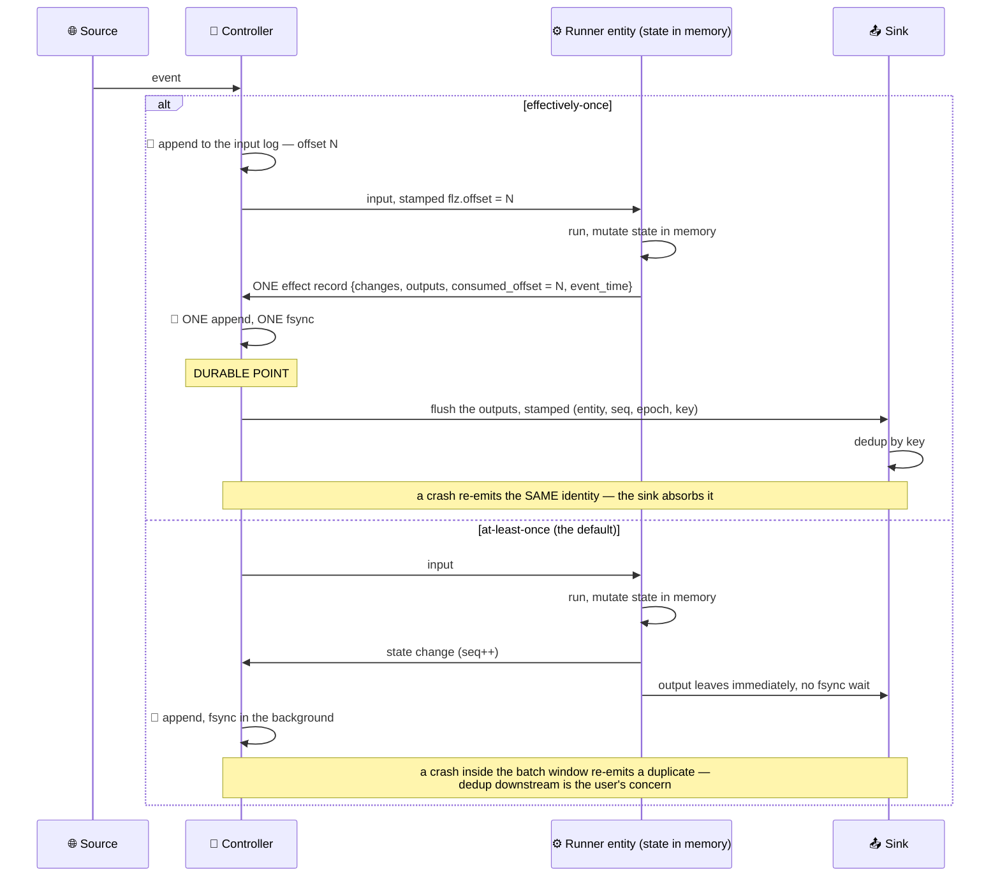
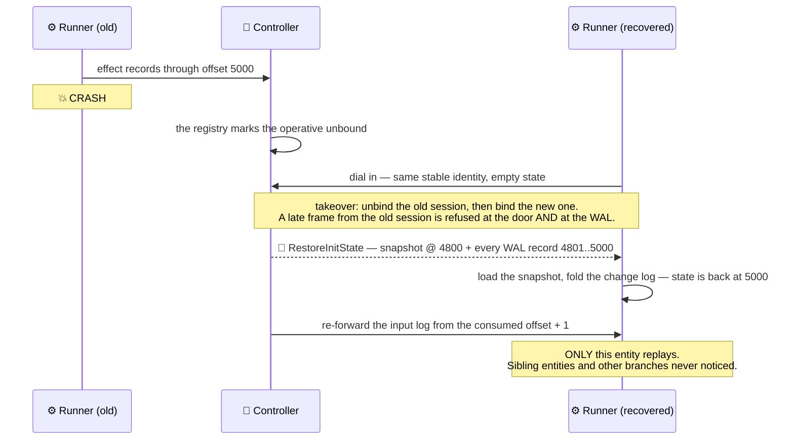
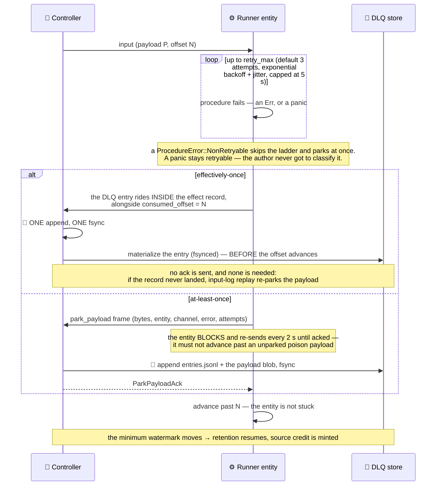
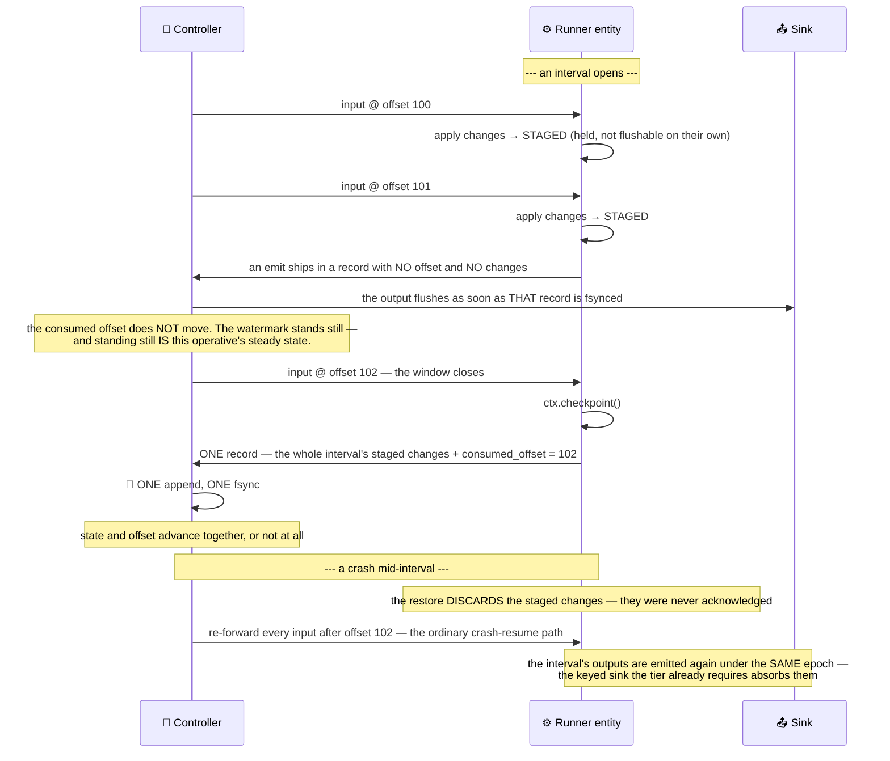
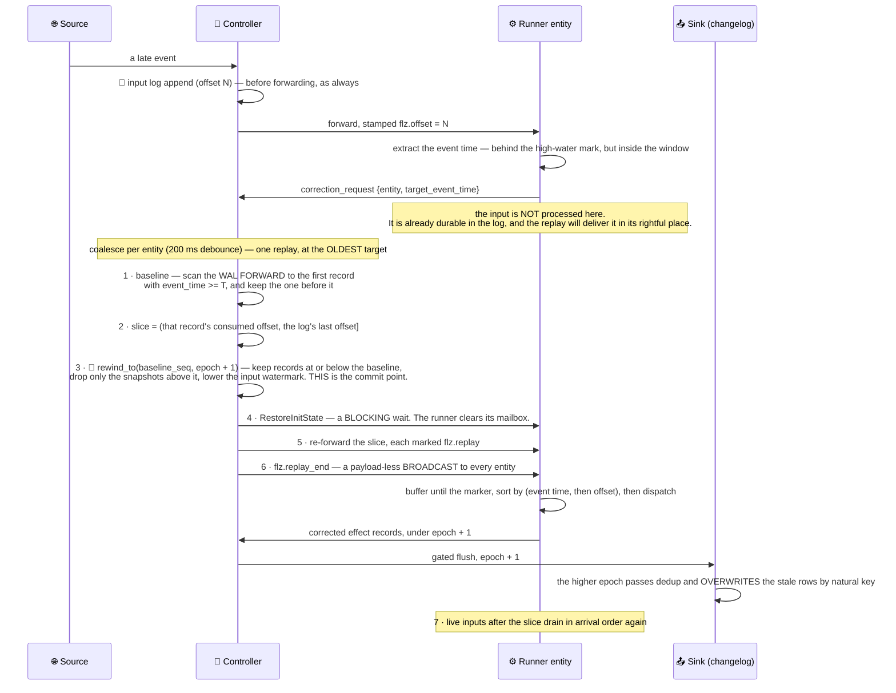
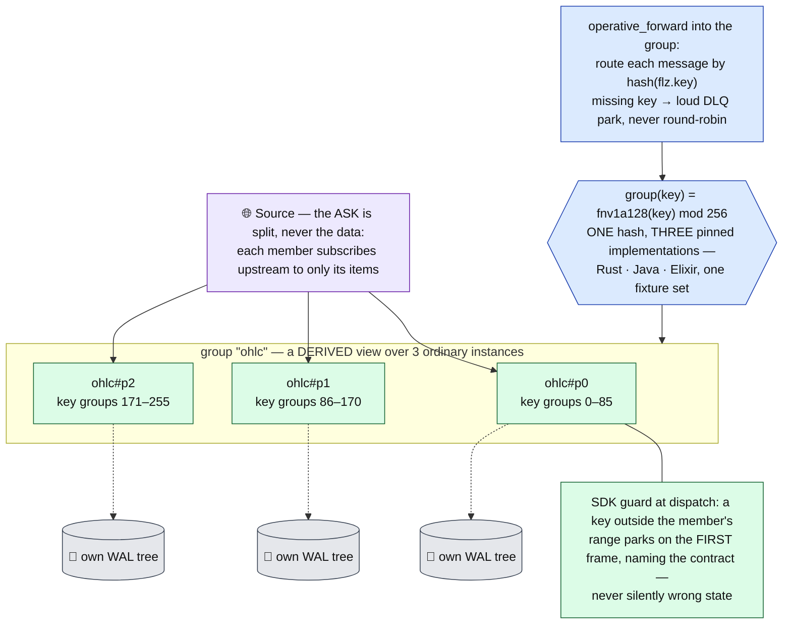

# The stream profile

A stream operative is an endless stream: a live market feed, a click stream, a sensor
firehose. It has no beginning and no end, it processes message by message with no barrier, and
each of its entities recovers on its own without disturbing the others.

It runs on the [kernel](kernel.md) unchanged. What is specific to it is the shape of its
recovery, its escape hatch for a poison payload, its ability to correct the past, its ability
to acknowledge in batches rather than one input at a time, and its ability to run one logical
stream across N machines.

- [Happy path](#happy-path)
- [Per-entity recovery](#per-entity-recovery)
- [Dead-letter queue](#dead-letter-queue)
- [Checkpoint ack-granularity](#checkpoint-ack-granularity)
- [Late-input correction](#late-input-correction)
- [Partitioned operatives](#partitioned-operatives)

---

## Happy path

The same input, both modes, side by side.



The tier trades one fsync batch of latency (5 ms) for the guarantee that state, output, and
progress move together. The default trades that guarantee for zero added latency. Neither is
"the right answer" — it is a per-operative declaration.

## Per-entity recovery

The blast radius of a runner crash is **one entity**. Each entity carries its own WAL, its
own snapshot lineage, and — under the tier — its own consumed offset, so it resumes on its own
without coordinating with anything.



Under the tier that re-forward is exact: the controller knows the last offset each entity
durably consumed, so it replays precisely the unconsumed tail. Without the tier there is no
input log, and recovery restores state only — the inputs that were in flight are gone.

That same re-forward path is reused for two other things. It is how a checkpoint interval is
replayed, and it is how a correction replays its rewound slice — there is only one replay
mechanism in the system, driven from three places.

## Dead-letter queue

A payload that makes user code fail *every* time is poison. Left alone it either wedges the
entity forever — freezing the minimum watermark, so retention stops and source credit dries up
— or it gets swallowed by a catch-all and disappears. Both are unacceptable. The rule is:
**retry, then park it durably, then advance.**



The two paths differ in exactly one way, and it is the point of the tier: with the tier on, the
park and the offset advance are *the same durable record*, so they cannot come apart. With the
tier off they are two procedures, and the ack is what orders them.

Retry lives in the SDK, where the policy is declared. The park is durable on the **controller**,
because runners are disposable and their disks are not part of the durability contract.

**The store.** `app_data/dlq/<operative_class>/<procedure_id>/` holds an `entries.jsonl` plus one
blob per payload, fsynced before the ack. Entries are idempotent on their origin — `entity@offset`
under the tier, a content hash of the payload without it — so a re-park of the same poison is a
no-op rather than a pile of duplicates. Retention is **30 days AND 4 GiB**, whichever bites
first, and every retention deletion logs loudly: that data was never replayed and is now
permanently gone.

**The operator surface** is `flz dlq list | show | replay | drop`. A replay marks the entry
`replaying` and re-injects the payload as an ordinary new input; if no re-park arrives within the
grace window it is treated as a success and the entry is removed, and if it fails again it
re-parks with the generation bumped. Replay is deliberately an *operator* verb — an automatic
replay would simply re-poison the entity. An entry whose input was not byte-representable (an
inter-procedure value) carries no payload and can only be inspected or dropped.

Workflow operatives do not use the DLQ. Their equivalent escape is abort-and-compensate — see
[`workflow_profile.md`](workflow_profile.md#retry-then-abort).

## Checkpoint ack-granularity

The tier acknowledges an input by making its state durable. For most operatives that is exactly
right. But some fold *many* inputs into one meaningful state push — a window that only closes on
its boundary, a batch that only means something complete. For them, per-input acknowledgement is
not merely expensive, it is **incoherent**: the offset would advance with state the operative
never meant to publish, and a restore would resume past inputs the restored state never saw.

Such an operative declares `checkpoint_ack()` and calls `ctx.checkpoint()` where its state is
genuinely coherent.



Four consequences fall out of that, and they are the whole design:

- **Emits still flush as they happen.** Checkpointing moves the *acknowledgement*, not the
  output. Staging the outputs too would buy nothing — the interval's inputs are re-forwarded on
  replay either way, so the outputs are re-emitted either way.
- **A park closes the interval.** A poison input about to be acknowledged into the dead-letter
  queue must never be replayed back onto the procedure, so the park ships the staged state along
  with it. It is also the only correct choice: acknowledging the poison while the state before
  it is not durable would tear.
- **A restore discards the open interval.** Those changes belong to a past that no longer
  exists.
- **The dataflow-stop watchdog skips the operative.** "Produced before, silent since" is a dead
  feed for a normal class and a *normal interval* for this one.

**The interval is the knob you size the system with.** It is simultaneously the input-log
retention floor (truncation never crosses the last checkpoint), the recovery work after a crash,
and the granularity at which source credit is minted — grants arrive in bursts at checkpoint
cadence, and the source parks in between if it exhausts them. Checkpoint rarely and you pay in
disk and recovery time; checkpoint often and you converge on the per-input default. An operative
that *never* checkpoints stops truncating its input log and eventually parks its own source —
which is the same back-pressure any non-consuming entity gets.

`checkpoint_ack()` without `effectively_once()` is refused at build time: there is no durable
offset to hold back, and no durable log to replay from.

## Late-input correction

An event arrives late — after the window it belongs to has already been computed and published.
The state is wrong, and so is everything downstream of it.

The insight that makes this cheap: **there is nothing to splice**. The input was journaled at
its arrival offset *before* anything knew it was late, so the durable log already contains it.
Only the *order* was wrong. Correction is therefore the ordinary restore-and-replay path with
two changes — a rewound baseline, and an event-time-sorted slice. No new control message, no
correction journal, no crash marker.



Four details in there are load-bearing, and each was a bug in an earlier design:

- **The baseline scans forward, not backward.** Walking back to "the first record with an
  earlier event time" stops at an out-of-order straggler — a beyond-window input that was
  processed as an arrival — and leaves the records that overtook the late input in place,
  correcting nothing. Forward to the first record at or after the target, then keep the one
  before it, is the only correct baseline.
- **The rewind happens before the restore.** Reversed, the runner would append corrected
  records onto sequences the stale records still hold, and emit under the old epoch before the
  bump was durable.
- **`flz.replay_end` is a broadcast, not a mark on the last input.** An input routes to exactly
  one entity by key, so a marker riding the last one would strand the slice in every *other*
  entity's buffer forever.
- **The epoch is a parameter, not `current + 1` computed inside the writer.** That is what makes
  a crash-resumed correction idempotent instead of double-bumping — and a double bump would
  leave the first attempt's rows behind at an epoch nothing overwrites.

**A crash mid-correction needs no marker.** Before the rewind commits, nothing durable has
changed: the late input is still in the log, still unconsumed, so the ordinary resume re-forwards
it, the SDK re-classifies it as late, and we end up back here. After the rewind commits, the
on-disk state **is** the baseline and the watermark was lowered to match — so the ordinary
resume replay *is* the correction. Hence the rule: for a correction-declaring operative, **every**
journaled replay is marked and sorted. Crash recovery and deliberate correction share one path.

**An input beyond the window** is handled by a declared policy: `process_as_arrival` (the
default — today's behaviour, and declaring a window must never silently start dropping data) or
`drop`. A beyond-window arrival deliberately does **not** advance the event-time high-water mark.

### Declaring it, and what it refuses

Three preconditions are **authoring facts the engine cannot repair**, and all three are refused
at SDK build time:

| Refused | Why |
| --- | --- |
| `correction_window()` without `effectively_once()` | there is no durable input log to replay from |
| a procedure whose clock is not `EventTimeFrom` | "late" is meaningless without an event time carried by the input |
| a plugin channel that is not `.keyed()` | a corrected output must be able to overwrite the stale one by natural key |

**Retention is not one of them — it is derived.** A correction over a 60 s window *means*
holding 60 s of input log and 60 s of WAL history; that is the definition of the declaration,
not a policy to negotiate with an operator. So a declared window raises both retention floors to
meet itself:

- the **input-log hold window** becomes `max(configured, declared window)`, so truncation never
  removes an input the correction would replay;
- the **snapshot age floor** is never shorter than the window, so compaction always leaves a
  baseline the rewind can land on. (An age floor of `0` disables age-triggered compaction
  entirely — WAL history is then stream, which already satisfies any window, so `0` stays
  `0`.)

An operator who configures a *longer* floor keeps it. Because a one-line declaration can commit
the controller to real disk, a floor that had to be raised is logged and emitted as
`[:flezha, :correction, :retention_derived]` at bind, naming the floor and both values.

### Operator replay

The same machinery, with the baseline chosen by a human instead of by a late input:

```
flz operative replay <operative/procedure/key> --from <seq|timestamp>
```

Deploy a fix, then heal the recent past with it. It rewinds to the given point, replays the
retained window through the current code, and republishes under a bumped epoch — the keyed sink
overwrites the stale rows by natural key.

**One limit worth knowing.** A correction *overwrites* the keys it re-emits. It does not
**retract** a key that the stale run emitted and the corrected run does not. That is safe for
event-time-bucketed keys — a candle, an aggregate, anything whose key is derived from the window
it belongs to — because the corrected run emits the same key set. It is not safe for a key set
that shrinks. Details:
[`../resilience/data_durability.md`](../resilience/data_durability.md#late-input-correction-fix-the-past-and-the-sinks-fix-themselves).

## Partitioned operatives

A stream operative binds to exactly one runner, so entities fan out across one machine's cores
and no further. `--partitions N` is the way past that box: one logical stream materializes as
**N ordinary operative instances** (`ohlc#p0..#p2`), each a full, unmodified operative — its own
Overwatch, registry row, runner binding, input log, state tree, plugins, and DLQ identity.
There is **no group record**: each member's durable start opts self-describe (`group`,
`partition`, `partitions`, key-group range), and every group-level view — the single
`flz operative list` row, `info`'s coverage check — is recomputed from the rows at read time,
so nothing exists that could diverge from the registry. Placement, convergence, rebind,
migration and recovery all operate per member, unchanged.



- **Key groups, not `mod N`.** Keys hash into 256 fixed key groups; each partition owns a
  contiguous range, stored explicitly in its opts and shipped on `AddOperative` — never derived
  from `(p, N)` at read time. A rescale therefore moves whole group slices instead of rehoming
  nearly every key, and a later weighted assignment needs no format change.
- **The routing contract is guarded, not trusted.** The item string a source subscribes with,
  and the `flz.key` a forward routes on, must equal what `key_by` extracts. The SDK checks every
  computed entity key against the member's own range and parks the first violation with an error
  naming the contract; a topology with no keyed entry procedure refuses the partitioned start
  outright (`PartitionsWithoutKeyedProcedure`) — N private copies of one unkeyed entity would be
  N divergent states that all look like "the" state.
- **Sources split the ask.** The websocket subscription source filters its desired item set to
  the member's groups before subscribing (server-side split — total bandwidth equals one
  connection's, divided); `http_poll` renders `{{partition_index}}`/`{{partition_count}}` into
  its URL once at init. `flz plugin enable <group>` fans out over the members with the partition
  opts injected.
- **Rescale is quiesce → move → restart.** `flz operative scale <group> M` waits until sources
  are off, every member's watermark is caught up and the group DLQ is empty; recomputes the
  ranges; moves each rehomed entity's durable file set (same-controller rename, cross-controller
  `WalTransfer` pull); starts M members, which restore through the ordinary bind. Entity
  identity contains the key and no runner, so no storage format changes — a crash mid-rescale
  re-derives the remaining moves from what is on disk.

A hot *single* key is still bounded by one machine — inherent to per-key ordering (Flink is
identical); the documented answer is two-stage aggregation. Partition spread across runners is
statistical (HRW) for now. The full contract — preflight, id budget, quota, coverage
validation, `flz state get <group>/...` resolution:
[`../partitioned_operatives.md`](../partitioned_operatives.md).
