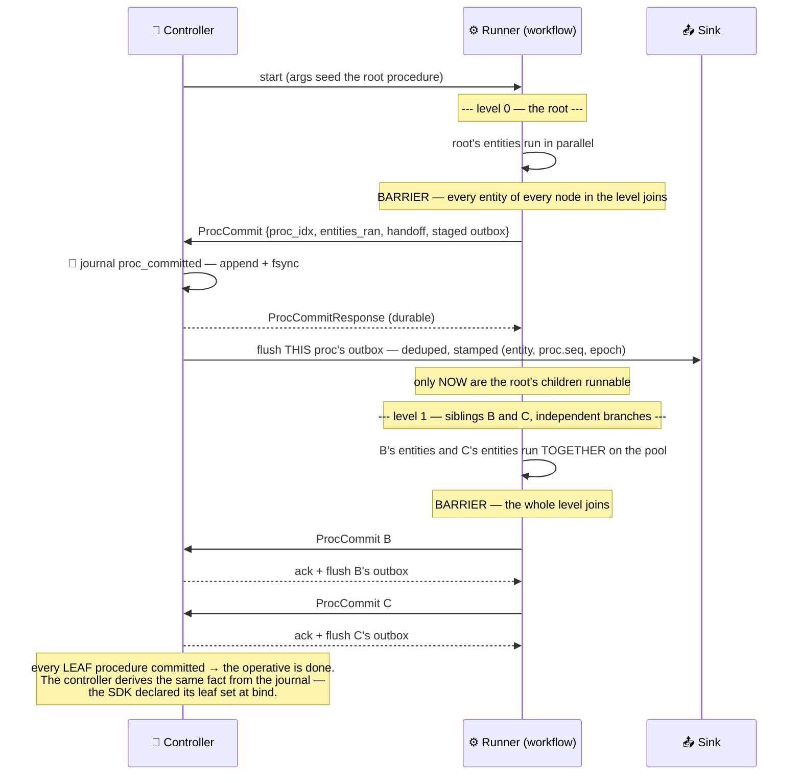
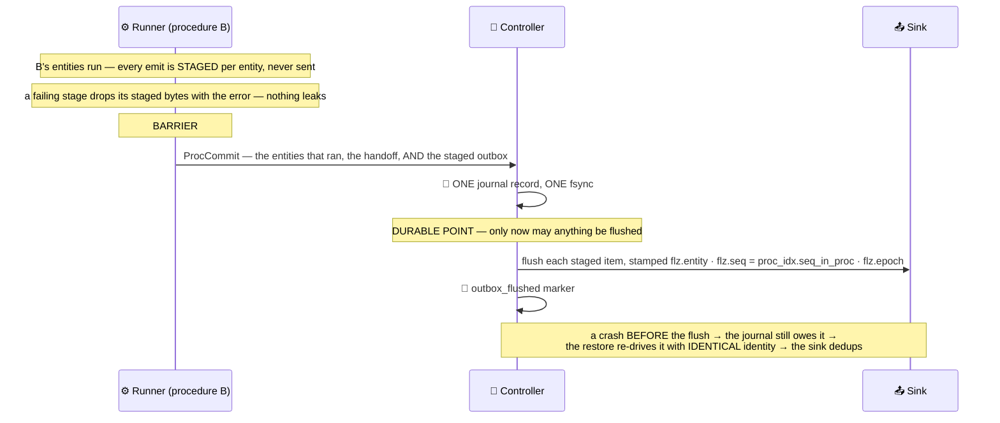
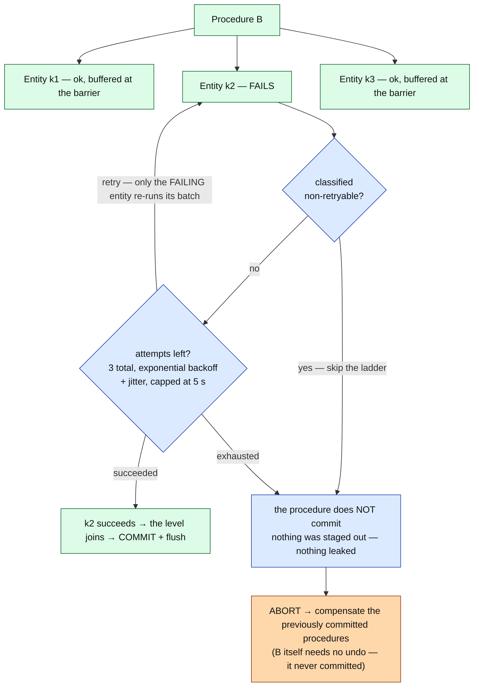
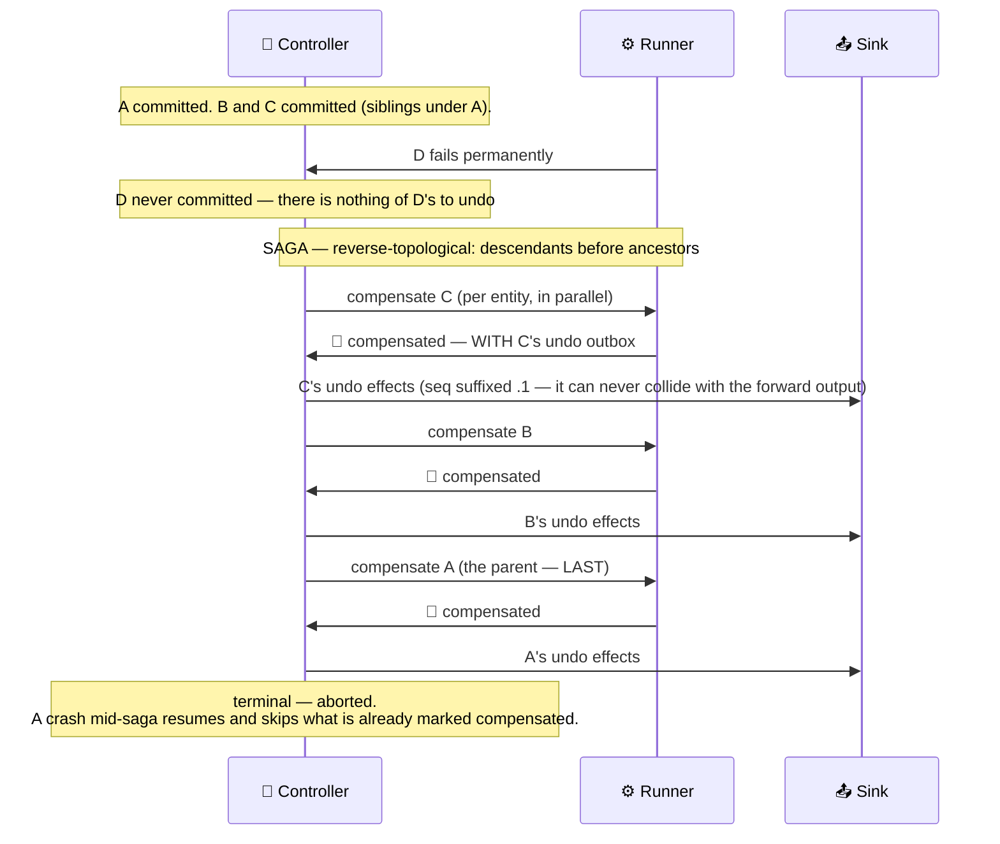
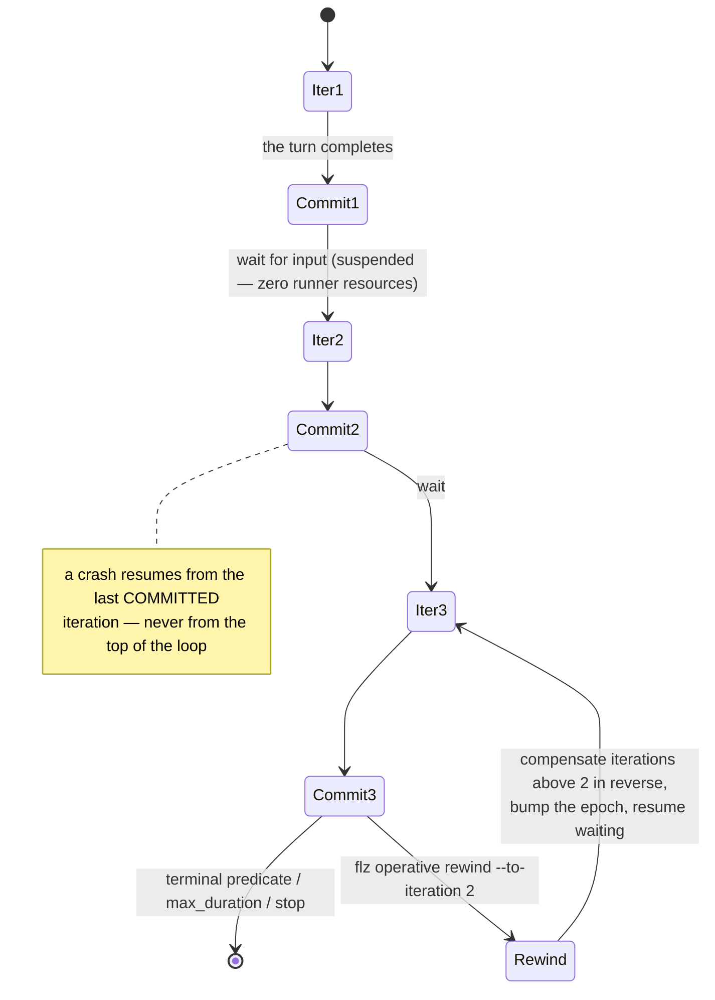
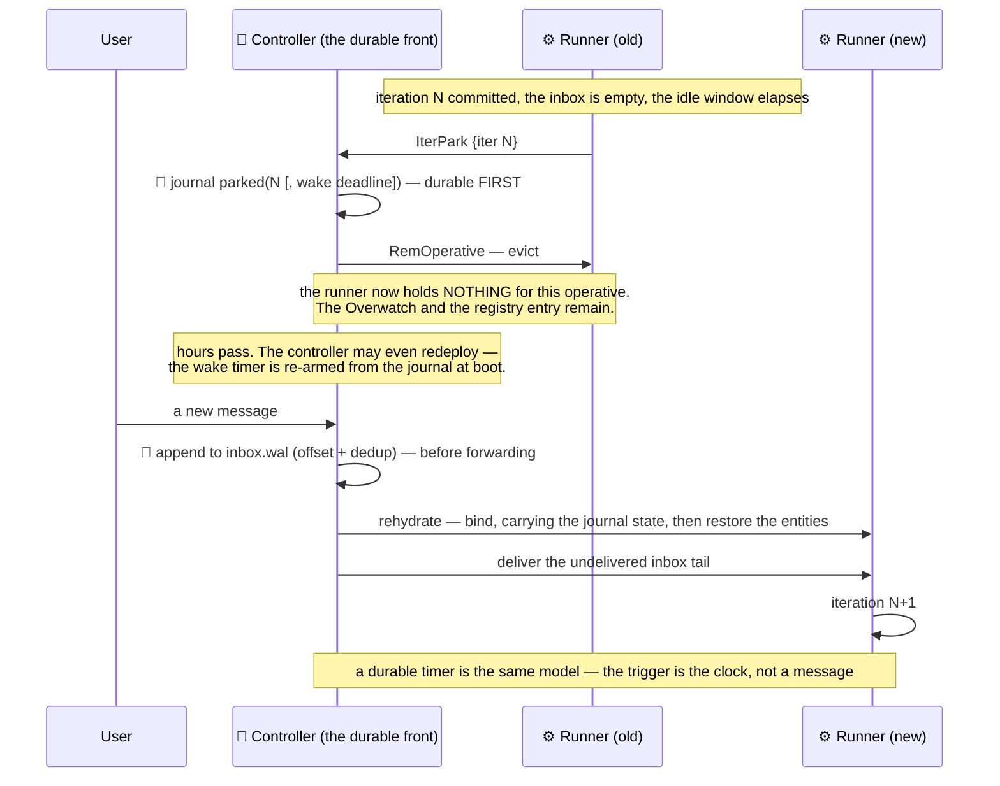
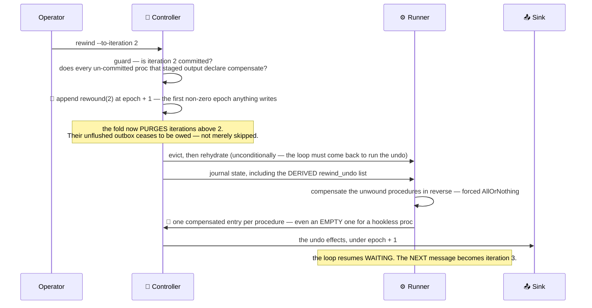

# The workflow profile

A workflow operative is a job with a beginning and an end: an ETL run, a payment saga, an AI chat
session. It authors the same procedures, channels, and entities a stream operative does — the
same per-entity state engine — but it schedules them **topologically**, commits its progress at
every step boundary, can **undo** what it did, and can wait for input for hours while costing
nothing.

- [Structure: a graph of procedures](#structure-a-graph-of-procedures)
- [The proc journal](#the-proc-journal)
- [Happy path: the level barrier](#happy-path-the-level-barrier)
- [The transactional outbox](#the-transactional-outbox)
- [Retry, then abort](#retry-then-abort)
- [Saga compensation](#saga-compensation)
- [The durable loop](#the-durable-loop)
- [Suspension](#suspension)
- [Rewind](#rewind)

---

## Structure: a graph of procedures

A procedure has a single `Output` type, and therefore exactly one output channel. An **edge** is
*(that channel, one of its consumers)* — so a fan-out is simply one channel declaring several
consumers, and a fan-in (a join) is one procedure consuming several channels.

```mermaid
flowchart TB
    IN(["entry channel"]):::src
    A["Extract"]:::exec
    B["Enrich"]:::exec
    C["Archive"]:::exec
    D["Reconcile"]:::exec
    P1["📤 sink"]:::sink

    IN --> A
    A -->|"channel &#34;records&#34;<br/>ONE channel, TWO consumers"| B
    A -->|"the same channel"| C
    B -->|"fan-in — Reconcile ACCUMULATES<br/>both producers' output"| D
    C --> D
    D --> P1

    CYC["❌ a cycle — a procedure's output<br/>reaching its own input — is REFUSED"]:::risk
    D -.-> CYC
    CYC -.-> A

    classDef exec fill:#dcfce7,stroke:#166534,color:#111
    classDef sink fill:#fed7aa,stroke:#9a3412,color:#111
    classDef src fill:#ede9fe,stroke:#6b21a8,color:#111
    classDef risk fill:#fee2e2,stroke:#991b1b,color:#111
```



Routing is **per channel**: a downstream procedure receives exactly the values released on the
channels it consumes. A join is explicit — two streams wiring the same consumer — and the join
procedure **accumulates** every producer's contribution rather than overwriting one with the
other. Branches stay independent mid-flight; where they must meet, they meet at a join.
Registration refuses anything that is not a DAG rooted at the entry, naming the offending node:

| Shape | Refusal |
| --- | --- |
| a procedure's output can reach its own input (a cycle) | `Cycle` |
| one procedure produces two output channels | `MultipleOutputChannels` |
| the entry channel feeds anything other than exactly one procedure | `EntryRoot` |
| a procedure is unreachable from the entry channel | `Disconnected` |
| a handoff-chained loop over a branching topology | `BranchingChainedLoop` |

Within one procedure, entities run in parallel exactly as in stream — single or static
entity mode, per-entity state, per-entity WAL. Dynamic entity mode is refused: a workflow chain
needs a known entity set to know when a procedure is *done*. `--partitions` is refused too —
[partitioning](stream_profile.md#partitioned-operatives) is a stream concern; a workflow scales
by spawning instances.

`run(ctx, args)` is sugar for a single-procedure, single-entity workflow operative — the simplest
case, and the only form with a directly interactive inbox.

The `(operative_class, procedure_id, entity_key)` identity is the same one a stream operative
uses. A workflow operative genuinely has procedures and entities; there are no synthetic
placeholders.

## The proc journal

Workflow durability is a per-instance append-only journal on the same WAL substrate an entity
uses, under a reserved identity so it never surfaces as a phantom entity.

```
<state_root>/<instance_id>/<instance_id>/proc.journal

record header (16 B): [epoch u32 BE][zero]
record body:          [type u8][proc_idx u16 BE][iter u32 BE][payload]
```

| Type | Entry | Carries |
| --- | --- | --- |
| 1 | `proc_committed` | the entities that ran, the handoff batch, and the staged outbox |
| 2 | `outbox_flushed` | a marker: this entry's outbox reached its sinks |
| 3 | `iter_committed` | the iteration's consumed inbox offset and its terminal handoff |
| 4 | `parked` | the iteration the operative is suspended at, and an optional wake deadline |
| 5 | `compensated` | an undo ran — with the undo's own outbox |
| 6 | `rewound` | a marker: everything above this iteration is un-committed |

The journal is **append-only**. `rewound` does not truncate it — one fold applies the markers,
and every reader (what is committed, what is owed, what is compensated, where the loop is) runs
over that fold. The epoch lives in the record header and stays `0` until a rewind bumps it.

## Happy path: the level barrier



Two properties of that barrier are worth being explicit about:

- **Siblings commit before any child runs**, but they are not committed *atomically* — each is
  its own journal-then-ack round trip, in ascending node order. A deep branch can never race
  ahead of a shallow sibling.
- **A failing node poisons its level.** If any node in the level failed, the other completed
  nodes of that level are recorded as having run — so they will be compensated — but they are
  **not committed**, because committing would flush an outbox that must immediately be undone.

The driver blocks on each `ProcCommit` ack for up to 30 s. A refusal or a timeout is terminal and
drives compensation — a step whose durability the controller will not confirm has not happened.

A class declaring `durability: :sync_remote` raises that bar one notch: the controller ships the
journal suffix to the [remote durability tier](kernel.md#the-remote-durability-tier) and awaits
the backend ack *before* replying — so the commit survives losing the controller's disk (RPO 0),
at the cost of one remote round-trip per barrier. The SDK already blocks there; nothing else
changes.

**On a crash, a committed procedure is not re-run.** The journal carries its handoff, so the
resumed driver skips it and seeds the next level from the durable batch. Without the journal —
an opted-out class — the chain re-runs from the top over the restored entity state, which is
why a procedure body is required to be idempotent.

## The transactional outbox

Inside a structured procedure, `ctx.emit` does **not** hit the wire. It stages.



The journal — not memory — decides what is owed, which makes the re-drive idempotent by
construction. A crash between the commit and the flush costs nothing but a duplicate the sink
absorbs.

An **opted-out** class, or one running without a controller (a unit test, a bench), keeps the
direct path: emits go straight to the wire as they happen, exactly as before. `run`-sugar is
always direct — it has no barrier to stage against.

A workflow output carries no `flz.key`: its plugin wire has no natural key to stamp. That is why
the *only* undo the engine can guarantee for a workflow procedure is the procedure's own
`compensate` hook, which is what the rewind guard enforces.

## Retry, then abort

A failing entity gets a ladder before it takes the whole procedure down with it.



Only the failing entity re-runs; its siblings stay buffered at the barrier and are never
re-executed. Each attempt gets a **fresh sink**, so a failed attempt's staged output is dropped
rather than double-emitted. The backoff is cancellation-aware — a stop or a `max_duration` ends
it at once rather than after the sleep.

The retry ladder is strictly **pre-commit**. A journaled procedure is never retried; a crash mid-
ladder resumes as an ordinary uncommitted-procedure re-run with the attempt counter reset. A
panic stays retryable, because the author never got the chance to classify it.

This is the workflow profile's equivalent of the stream dead-letter queue: nothing is written
to a DLQ store, because abort-and-compensate *is* the escape.

## Saga compensation

An abnormal exit unwinds what already committed, in reverse.



Reverse-topological order is not computed — it is **emergent**. The graph is numbered
breadth-first, so a producer's index is always below its consumers', completion order is
therefore topological, and the compensation planner simply reverses it.

Two rules govern what gets undone:

- **`AllOrNothing`** (the default) unwinds the in-flight iteration *and* every committed one.
- **`KeepProgress`** unwinds only the in-flight iteration — completed iterations stand.

A procedure with no `compensate` hook is skipped. A failing hook is logged and the rest of the
plan still runs — a saga is best-effort by contract, and stopping halfway would leave strictly
more inconsistency than continuing.

**The undo record is journaled before the done marker.** A crash between the two re-runs the
(idempotent) hook rather than losing its undo output — the safe side of that trade.

> **A journal-rebuilt procedure's outputs are empty on resume.** A procedure's collected
> inter-procedure output was never durable, so after a crash the compensation hook receives an
> empty output list. A durable compensable procedure must therefore keep its **undo handle in
> entity state**, which *is* restored. That is the at-least-once author contract.

Entity state is unwound by the `compensate` hooks, not by truncating the state WAL. A hookless
procedure leaves its state change in place.

## The durable loop

An operative may run its graph more than once.

| Mode | Behaviour |
| --- | --- |
| `Once` (default) | one pass from the spawn args, then terminate |
| `PerInput` | one iteration per inbox item — the chat / agent turn |
| `Chained` | iteration N+1 is seeded by iteration N's terminal output — converges when the batch comes back empty |



An **iteration boundary** is a bigger commit point than a procedure boundary. One iteration
contains many procedure commits; the iteration boundary is where durable suspension, the
keep-progress rollback unit, and rewind all attach.

At every boundary the SDK ships `IterCommit`, the controller journals **one** `iter_committed`
entry carrying the terminal handoff and the consumed inbox offset, acks, and only then does its
post-ack cleanup: a boundary snapshot per entity, the outbox flush, and the inbox truncate. A
failure in that cleanup costs work, not correctness.

**The durable inbox.** A workflow operative's input is journaled to a per-instance `inbox.wal`
before it is forwarded — the same append-before-forward seam the effectively-once tier uses. A
duplicate (by an explicit message id, else a payload hash, within the undelivered window) is
absorbed and never delivered twice. A failed append is not forwarded.

## Suspension

A loop waiting for input should cost nothing. Between iterations, a workflow operative is
**evicted from its runner entirely** — the Overwatch and the registry entry stay, so a new
message still has somewhere to land, but the runner holds zero resources for it.



Rehydration is **the ordinary bind path**. Crash-resume, migration, and un-park all converge on
it, so there is one code path and one set of bugs. The journal rides that bind
(`AddOperative.proc_journal`) rather than a per-Entity restore, because it is instance-scoped: an
operative whose procedures hold no per-Entity state has nothing to restore, and would otherwise
rehydrate at iteration 0 every time. The wake timer wakes the operative by
appending an empty item to its own inbox, which means two racing wake sources — a message and a
timer — collapse into one rehydration by construction.

At boot, an instance whose journal ends in `parked` **and** which has nothing undelivered enters
suspended without ever binding. Undelivered input outranks the park.

## Rewind

Take a loop back to a committed iteration, and undo everything above it.

```
flz operative rewind <instance> --to-iteration N
```

Rewind is a **marker**, not a truncation. The journal stays append-only.



The undo list is **derived, not marked**: it is the procedures committed before the marker at an
iteration above the target, minus those that already have a `compensated` entry appended *after
their own commit*. That "after its own commit" test is what keeps a re-run distinguishable from
the original it replaced, and what makes a second rewind work. There is no done-marker and no
completeness oracle — a crash mid-rewind resumes with exactly the outstanding work.

**The guard runs before anything durable changes.** A procedure that staged plugin output but
declares no `compensate` hook cannot be unwound — a workflow emit carries no natural key, so a
re-run's output cannot be relied on to overwrite the original. The rewind is refused, naming the
channel.

> **A rewind does not replay inputs.** The inbox is truncated at every iteration commit, so a
> committed turn's message is gone from disk — moving the consumed offset back cannot resurrect
> it. Rewind is **undo-and-continue**: the loop resumes waiting, and the next message becomes
> iteration N+1.

Entity state is unwound by the `compensate` hooks, exactly as in a saga — not by truncating the
state WAL.

---

## The wire

| Message | Tag | Direction |
| --- | --- | --- |
| `ProcCommit` | 28 | SDK → controller, at every procedure boundary |
| `ProcCommitResponse` | 29 | controller → SDK, after the journal fsync |
| `IterCommit` | 30 | SDK → controller, at every iteration boundary |
| `IterCommitResponse` | 31 | controller → SDK, after the journal fsync |
| `IterPark` | 32 | SDK → controller, on suspension (fire and forget) |

Field-level detail: [`../sdk_protocol_spec.md`](../sdk/protocol_spec.md).

## Operator surface

```
flz state journal <operative/instance>    # every journal entry, and whether the graph is complete
flz state inbox   <operative/instance>    # the durable inbox, and how far it is consumed
flz operative info                        # phase: running | suspended
flz operative rewind <instance> --to-iteration N
```

## Host languages

Everything on this page is host-language-neutral. The chain is driven by the shared runner
core, which owns the level barrier, the proc journal handshake, the staged outbox, the
compensation plan, the loop, suspension and rewind. A host SDK supplies the procedure bodies
and the threads that run them — one **step activation** per entity of the stage, handed out under
poll and answered at the barrier the core already owns. Rust runs a step on a pool worker,
Java on a virtual thread; neither owns the chain's position, so there is no per-host resume or
compensation semantics to compare.

Details of that split: [`../sdk_poll_core.md`](../sdk/poll_core.md).

Mechanism-level detail for everything on this page:
[`../resilience/workflow_operative.md`](../resilience/workflow_operative.md).
