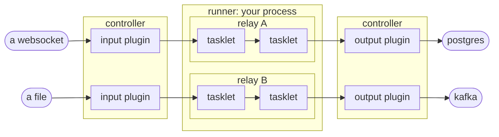

# What is Flezha

Flezha is a durable, distributed runtime for stateless and stateful data processing.

It runs many small, independent pieces of work in parallel, on one machine or
across many. Each piece is a **relay**, running code you write. A relay is a
processing unit that works like a worker: it keeps its own state and carries
data through its tasklets, taking messages in and sending results on. One piece of code can run as one relay or as thousands, one per
user, device, order or job. Flezha decides which machine each relay runs
on, keeps its state on disk, and when a process crashes or a machine goes
away, starts it again elsewhere and carries on from where it stopped.

The same relay carries different forms of data processing. Inside it, your
code is split into **tasklets**, small processing stages of your own, and the
relay wires them into a graph: one after another, so the output of one
feeds the next, side by side, or split apart and joined again. Messages can be
keyed, by user, device or account, so that each key gets its own copy of a
tasklet with its own state, and the copies work in parallel. A larger
system is several relays connected, the results of one becoming the input
of the next.

By setting up relays in different ways, you can model the familiar forms
of data processing with them: streams and ETL pipelines, workflows and
long-running jobs, a service per user or device, or sessions with an AI agent.
The setup decides how a relay behaves: whether it keeps running or ends
when its job is done, whether it keeps state and how safely, whether it runs
as a single copy or as one copy per user or device, and what it reads from and
writes to. The code inside stays plain logic in your own language, and the
form comes from how the relay around it is set up.

Relays are extended with [plugins](../topics/plugins/plugins.md): pieces
you attach to a relay from outside, to add to what it can do without
touching its code. The most common are data connectors, which feed a relay
from a file, an S3 bucket, an HTTP endpoint, a WebSocket, Kafka, RabbitMQ or
Postgres, and deliver its results to another. Other plugins serve a relay
over HTTP, or tell another service by webhook what happens in the system.
Plugins can be added, swapped and removed while the relay runs, and when the
one you need does not exist, you can
[write your own](../topics/plugins/writing_a_plugin.md).

You write the code in Java, Rust, Node, Python, Ruby, PHP or Elixir, and
relays in different languages run side by side in one deployment.

## The pieces



- A **controller** is the brain. It keeps the durable state, decides which
  runner runs what, heals what breaks, and answers the `flz` command line.
  Several controllers can run as [one cluster](../topics/deploying/clustering.md):
  they share the relays between them, and a controller that is stopped
  hands its relays to the others before it exits.
- A **runner** is a process of yours, in any of the seven languages, that runs
  your code. It offers capacity to a controller and does what it is told. One
  controller can have many runners, written in different languages and running
  different code, and a cluster of controllers, each with runners of its own,
  spreads the work over as many machines as you give it. When a runner goes
  away, its relays move to the others.
- A **relay** is what you start and stop. The code you write is its
  template, called a **factory**, and every start makes one more running
  instance of it.
- A **tasklet** is a step inside a relay with your own logic in it. A
  relay passes its data through one or more of them.
- A **cell** is where a tasklet's state lives. A tasklet whose input is keyed,
  by user or by device, gets one cell per key, each with its own state.
- A **plugin** connects a relay to the outside: an input plugin feeds it and an
  output plugin takes what it sends out. They ship with Flezha and attach with one
  command.

## Thousands of relays, each with its own settings

Every relay carries its own settings, and they do not depend on the other
relays running at the same time. A stream that never stops, a workflow that
keeps each step in a remote copy and a session that sleeps when idle can run
side by side on the same machines, each the way its own settings say. These
are the main ones:

- **How it runs.** By default a relay keeps running and handles each
  message as it arrives, the way an ETL pipeline does, until you stop it. With
  steps turned on, it does its work as a chain of steps instead: each finished
  step is on disk before the next one starts, and the relay ends when its
  steps are done.
- **How often the steps run.** Once, for a job such as a payment, or a nightly
  import that `flz schedule` starts on a timetable; once for every message,
  such as one turn per message in a conversation; or pass after pass, each one
  feeding the next, until there is nothing left to do.
- **What a failed step does.** It is retried first. A step that cannot succeed
  either undoes every step before it, or keeps what earlier passes finished
  and undoes only its own pass.
- **Where its work is kept**, the `durable` setting: in memory only, the
  fastest, where a crash starts the work over; on the controller's disk, the
  default, where a crash resumes where it stopped; or in a remote copy as
  well, where a finished piece of work counts as done only once the copy holds
  it, so losing the controller's disk loses nothing.
- **Whether it sleeps when idle.** A relay that waits a long time between
  messages can be written to disk, leave its runner, and wake with its state
  intact when its next message arrives.
- **Whether an output may arrive twice.** By default a message is delivered at
  least once. Outputs that must never arrive twice are sent effectively once.
- **How it is spread out.** A relay can be split into partitions over
  several runners, and its input keyed so that each user or device gets a
  state of its own.

## Every relay has an API

The entry channels a relay declares are its public API, with no extra step: each one's name,
the format it reads, whether it answers, and, when you give them, a description and the
JSON Schema of what it takes. In Java a record is read into the schema:

```java
public record Order(String pair, BigDecimal amount) {}

c.input(Order.class, "place").describe("Places an order").into(Place.class).output("placed");
```

`flz relay info` shows the API of a running relay, with an example call per channel:

```sh
$ ./bin/flz relay info orders-eu
```

```output
API of relay 'orders-eu' (factory 'orders'):
  place  json → answer json
    Places an order
    schema: {"properties":{"amount":{"type":"number"},"pair":{"type":"string"}},"required":["pair","amount"],"type":"object"}
    MCP tool: orders_place
    flz relay call orders-eu --channel place --arg pair=... --arg amount=...
```

An application calls it over HTTP, with the value as the body:

```sh
$ curl -X POST http://127.0.0.1:8765/v1/relays/orders-eu/place \
    -H "Authorization: Bearer $FLEZHA_TOKEN" -d '{"pair":"EUR/USD","amount":1000}'
```

```output
{"amount":1000,"pair":"EUR/USD","status":"placed"}
```

AI agents can call any relay as a tool (tool calling). Every described channel is a tool on
Flezha's MCP endpoint, so an agent connected with `flz mcp` calls `orders_place` with
`{"relay": "orders-eu", "pair": "EUR/USD", "amount": 1000}` and gets the answer back as
structured data. [A relay's API](../topics/basics/relay_api.md) shows it in all seven SDKs.

## What you can build with it

Relays can be set up in different ways, and each setup suits a different
kind of work. These are the kinds they are set up for most often.

### Data pipelines and stream processing

Read from files, HTTP endpoints, WebSockets or another relay, reshape each
message with `map`, `filter`, `flat_map` and `key_by`, and write the results to
Postgres, Kafka or a file. State kept per key survives a crash, per-key timers
give you windows and timeouts, merged channels give you joins, and a message can
be timed by when it happened rather than when it arrived. The input and the
output are plugins, so moving from a file to a live feed is a command, not a
rebuild. [Streams](../topics/basics/streams.md) covers how one is built, and
the tradedesk tutorial builds one.

### Workflows and long-running jobs

A relay that runs in steps does its work one step after another or side by side. Each
finished step is on disk before the next one starts, so a crash in the middle
resumes at the step it reached instead of starting over. A failed step is
retried on a ladder you declare, and a step that cannot succeed undoes the ones
before it. A tasklet can start one workflow per event, and `flz schedule`
starts one on a timetable. [Workflows](../topics/basics/workflows.md) covers how
one is built, and the tradedesk tutorial builds one.

### Stateful services, one per user, device or account

A keyed tasklet gives every key a cell of its own: its own state, its own
queue, one message at a time. One factory runs as thousands of relays, each
independent of the rest. A relay can sleep while it is idle and wake with
its state intact when its next message arrives, so sessions that sit quiet hold
nothing on the runners, and a timer closes one that has gone quiet for good.

### AI agents

An agent turn is a chain of side effects: call a model, act on its answer, and
undo the action if a later step fails. Each of those is a place where a process
can die, and Flezha makes the chain survive it. The conversation is durable
state, a flaky model call is retried and a hopeless one set aside, an action is
undone by a compensation you declare, and a session waits between messages
without holding a runner.
[`durable_agent`](https://github.com/flezha/flezha_python_sdk/tree/main/examples/durable_agent)
is such a loop in Python. Part 3 builds a whole service around one: an HTTP
plugin of its own in front, an agent that streams its answers back, and one
session per user.

### Stateless handlers and the glue between systems

Code that keeps no state gets everything else all the same. It is placed on a
runner and moved when that runner goes away, a failed message is retried, and
one that keeps failing waits in a dead-letter queue, where you can inspect it
and send it through again. Relays can feed each other directly, and
[a plugin of your own](../topics/plugins/writing_a_plugin.md) connects Flezha to any system
you can reach from code.

## What comes with it

- **Durable by default.** Every change your code makes to its state is written
  to the controller's disk as it happens, and a restart resumes instead of
  starting over.
- **Effectively-once delivery** for the outputs that must never arrive twice.
- **Scale out, not up.** Split a relay into partitions, add runners, and run
  several controllers that hand work over to each other when one stops.
- **Seven languages, one engine.** The SDKs share one engine, so ordering,
  retries and durability follow the same rules whichever language you write in,
  and handlers in all seven run side by side.
- **Plugins in the box.** Files and S3 buckets, HTTP polling, WebSocket feeds,
  Kafka, Postgres, and forwarding from one relay to another ship with
  Flezha, attach with one command, and change without touching your code.
- **Authorization on by default.** Every command and every runner has to say
  who it is, with a token or a key of its own, and gets to do only what its
  roles allow, and an audit log records who changed what.
- **Many applications, one cluster.** Namespaces keep each application's
  runners, relays and data apart, each with its own quotas and keys.
- **Operate it from the command line or from your code.** Everything `flz` does
  to a relay, a runner can do through its admin API.
- **Test without a deployment.** Local mode runs a relay's graph in your own
  process, in every SDK.
- **Run it where you run things.** Release binaries, Docker images, Kubernetes,
  or inside an Elixir application of your own.

## What it is not

- **Not a database.** It keeps the state your handlers need and lets you read it
  back, but it is not where other systems store and query their data. It writes
  to Postgres through a plugin.
- **Not a message broker.** It does not replace Kafka as the log other systems
  share. It takes messages in and sends them on through plugins, Kafka among
  them.
- **Not a place that hosts your code.** It does not build, ship or start your
  processes. You run your runners however you run services today, and Flezha
  places the work on them.

## Next

[`try_it.md`](try_it.md) runs a relay in Docker before you build one.
