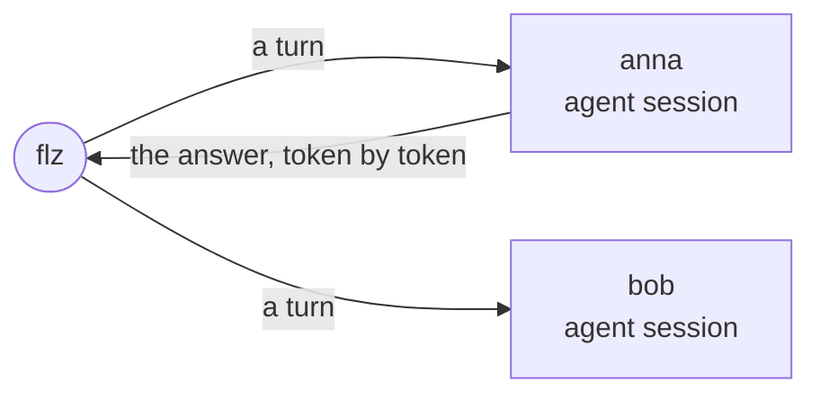

# Advanced topics

Part 3 builds `agentdesk`, a chat in which every conversation is a session of its
own, and many run at once. A session remembers its conversation, answers each message
as it is written, sleeps while nobody talks to it, and can take turns back. The answers
come from a demo model inside the example, a stand-in that repeats one canned sentence,
so nothing outside the example is needed.

Everything runs in Docker containers: a controller and a runner, started with Docker
Compose. The later pages put the sessions behind an HTTP service with a plugin, run
several controllers, add the delivery guarantee, and move the same images to Kubernetes.

> #### What you need {: .tip}
>
> - **Docker, with Docker Compose.** Both the controller and the runner run in
>   containers.
> - **For your runner**, one language: pick the one you want to write it in,
>   and install only what its row lists.
>
> | Language | You need |
> |---|---|
> | Java | Java 21 and Maven |
> | Rust | Rust with Cargo |
> | Node | Node 20 or later with npm |
> | Python | Python 3.11 or later with pip |
> | Ruby | Ruby 3.3 or later with Bundler |
> | PHP | PHP 8.4 or later with `ext-ffi`, and Composer |
> | Elixir | Elixir 1.17 or later with Erlang/OTP |
>
> - **A Kubernetes cluster, such as k3s, and `kubectl`**, for
>   [`kubernetes_deployment.md`](kubernetes_deployment.md).
> - **git**, to get the examples and the HTTP plugin.

| # | Page | What you do |
|---|---|---|
| 1 | [`agent_session.md`](agent_session.md) | Run agentdesk in Docker Compose, start one session per conversation as a bounded operator, and send it a turn with the CLI |
| 2 | [`streamed_answers.md`](streamed_answers.md) | Send the answer token by token while the turn runs, as parts, and watch it with `flz operator listen` |
| 3 | [`sleeping_sessions.md`](sleeping_sessions.md) | Let an idle session sleep with nothing held on the runner, and wake it with the next turn |
| 4 | [`rewinding_a_turn.md`](rewinding_a_turn.md) | Take turns back, and see a failed turn set aside while the session goes on |
| 5 | [`custom_plugins.md`](custom_plugins.md) | Install the HTTP plugin by rebuilding the controller's image, and write a plugin of your own |
| 6 | [`http_gateway.md`](http_gateway.md) | Serve HTTP from a gateway operator that calls each user's session |
| 7 | [`streaming_to_the_browser.md`](streaming_to_the_browser.md) | Stream the answer to a browser |
| 8 | [`token_budget.md`](token_budget.md) | Keep each user's daily token budget in the gateway |
| 9 | [`clustering.md`](clustering.md) | Run several controllers, stop one, and watch its sessions move |
| 10 | [`effectively_once.md`](effectively_once.md) | The delivery guarantee, what it requires and what it costs |
| 11 | [`kubernetes_deployment.md`](kubernetes_deployment.md) | Run the same images on k3s |
