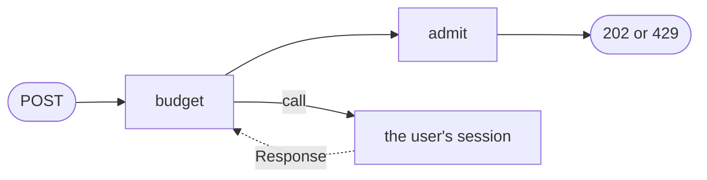

# Operator calls

On this page a POST to `/sessions/<user>/messages` becomes a message for the user's session.
The gateway **calls** the session with it: a call reaches another operator, starts it when it
is not there, and brings its answer back to the caller later, as an input of its own. The
gateway reads those answers to keep each user's daily token budget, and refuses a message
with 429 once the day's budget is used.



## A second way into a session

A call sends the value its chain carries, and the session to call is named by a key read from
that same value. So the gateway sends the user with the text, and the session takes it on an
entry channel of its own, `message`, while `turn` stays as it was for the CLI.

> Write the message, and give `agent` its second entry channel.
> {: .step}

<!-- tabs-open -->

### Java

```java
// Message.java: a message for a user's session, as the gateway sends it.
public record Message(String user, String text) {}
```

In `AgentOperator.channels`, after the `turn` chain:

```java
        c.input(Message.class, "message")                // from the gateway
                .map(String.class, Message::text)
                .into(Reply.class);
```

`into(Reply.class)` names the tasklet the `turn` chain already feeds, so both channels reach
the same `reply`, with the same conversation.

<!-- tabs-close -->

## The route

> Teach the request the second route.
> {: .step}

<!-- tabs-open -->

### Java

In `Request`, beside `listens`:

```java
    boolean sends() {
        return is("POST", "messages");
    }

    Message message() {
        return new Message(user(), Objects.requireNonNullElse(body, ""));
    }
```

The body is the plugin's text of the request body, absent when it is not valid UTF-8.

<!-- tabs-close -->

## The budget

`budget` keeps each user's tokens for the day, one cell per user. It reads two things: the
messages to admit, and the tokens their answers used, which come back from the calls. A
message is admitted while the user is under the budget. The day is taken from `ctx.now()`,
not from the clock, for [`effectively_once.md`](effectively_once.md).

> Write the budget, and the tasklet that answers a message 202 or 429.
> {: .step}

<!-- tabs-open -->

### Java

```java
// Budget.java: each user's tokens for the day, and whether a message is admitted.
@Tasklet.Spec(name = "budget")
public final class Budget implements Tasklet<Budget.Event, Budget.Spent, Budget.Verdict> {

    static final int DAILY_TOKENS = 40;

    public sealed interface Event {                          // what reaches a user's cell
        String user();
    }

    public record Sent(Message message) implements Event {  // a message to admit
        @Override
        public String user() {
            return message.user();
        }
    }

    public record Used(String user, int tokens) implements Event {    // the tokens an answer used
        static Used of(Response<Message, Answer> response) {          // a failed turn used none
            return new Used(response.request().user(), response.ok() ? response.answer().tokens() : 0);
        }
    }

    public record Verdict(Message message, int spent) {
        boolean admitted() {
            return spent < DAILY_TOKENS;
        }
    }

    public static class Spent {                              // what each user's cell remembers
        public String day = "";
        public int tokens;

        int on(String today) {
            return today.equals(day) ? tokens : 0;
        }
    }

    public record Counted(String day, int tokens) implements Change<Spent> {
        @Override
        public void applyTo(Spent spent) {
            spent.tokens = spent.on(day) + tokens;
            spent.day = day;
        }
    }

    @Override
    public void run(Event event, Ctx<Spent, Verdict> ctx) throws TaskletException {
        String today = LocalDate.ofInstant(Instant.ofEpochMilli(ctx.now()), ZoneOffset.UTC).toString();
        switch (event) {
            case Sent sent -> ctx.emit(new Verdict(sent.message(), ctx.state().on(today)));
            case Used used -> ctx.change(new Counted(today, used.tokens()));
        }
    }
}
```

A tasklet takes one type of input, so `budget`'s is `Event`, either a message or the tokens
an answer used. A `Response` carries the request it answers, which is where the user comes
from, and a turn that failed, or took too long, used no tokens.

```java
// Admit.java: 202 when the message goes on, 429 over the budget.
@Tasklet.Spec(name = "admit")
public final class Admit implements Tasklet<Verdict, Void, Http> {

    @Override
    public void run(Verdict verdict, Ctx<Void, Http> ctx) throws TaskletException {
        ctx.emit(verdict.admitted()
                ? Http.of(202, "sent to " + verdict.message().user())
                : Http.of(429, verdict.message().user() + " has used " + verdict.spent() + " of today's "
                        + Budget.DAILY_TOKENS + " tokens"));
    }
}
```

<!-- tabs-close -->

## The call

A message goes to `budget`, keyed by user. Its verdict goes two ways: to `admit`, whose answer
is a second `response()` end, and, when admitted, to a call to the user's session. The
tokens the answer used come back into `budget`.

> Route the messages through the budget and the call, in the gateway's graph.
> {: .step}

<!-- tabs-open -->

### Java

```java
// GatewayOperator.java: answers every request, and calls the session a message is for.
public final class GatewayOperator implements Operator {

    static final long DEADLINE_MS = 60_000;

    @Override
    public String factoryId() {
        return "gateway";
    }

    @Override
    public void channels(ChannelBuilder c) {
        EntryChannel<Request> http = c.input(Request.class, "http");
        http.filter(request -> !request.sends())
                .into(Watch.class)
                .response();                                 // a stream, or 404
        Stream<Verdict> verdicts = http.filter(Request::sends)
                .map(Event.class, request -> new Sent(request.message()))
                .keyBy(Event::user)                          // one cell per user
                .into(Budget.class);
        verdicts.into(Admit.class)
                .response();                                 // 202, or 429 over the budget
        verdicts.filter(Verdict::admitted)
                .map(Message.class, Verdict::message)
                .keyBy(Message::user)                        // the user's session
                .call(CallTarget.factory("agent").channel("message"), Answer.class, DEADLINE_MS)
                .map(Event.class, Used::of)
                .keyBy(Event::user)
                .into(Budget.class);                         // the tokens the answer used
    }
}
```

<!-- tabs-close -->

- **`call` after `keyBy`** reaches the instance of `agent` whose id is the key, the user, and
  starts one with the message as its first input when there is none, so a new user needs no
  `flz operator start`. `channel("message")` is the entry channel it arrives on.
- **The call waits for nothing.** Its outcome comes back later as a `Response`, on the
  gateway's own Response channel, within the deadline at the latest. A graph that reads no
  Response is refused, since every outcome would be kept and read by nobody.
- **Two `response()` ends**: a graph may have several, and whichever answers first answers
  the request. The 202 leaves before the session has read the message, and the answer itself
  reaches the browser on the stream of [`http_gateway.md`](http_gateway.md#stream-an-answer).

[`calls.md`](../../sdk/calls.md#operator-calls-call) is the whole contract.

> Build the runner again and replace its container.
> {: .step}

<!-- tabs-open -->

### Java

```sh
$ mvn -q package
```

<!-- tabs-close -->

```sh
$ docker compose up -d --build --wait runner
```

## Send a message

> Send Anna a message over HTTP.
> {: .step}

```sh
$ curl -si -d 'Hello from the web' localhost:8080/sessions/anna/messages
```

```output
HTTP/1.1 202 Accepted
...
content-type: text/plain; charset=utf-8

sent to anna
```

> Send Carol a message. She has no session yet.
> {: .step}

```sh
$ curl -s -d 'Hi, I am Carol' localhost:8080/sessions/carol/messages
```

```output
sent to carol
```

```sh
$ flz state get carol/reply --namespace agents
```

```output
state get carol/reply:
  change_seq: 1
  state:      {"reply":{"messages":["Hi, I am Carol"]}}
```

The call started Carol's session, and her first message is its first turn. Like the stream,
this route authenticates nobody: anyone who reaches the port can write to any user's session.

## Use up the budget

The budget is 40 tokens a day, and an answer to a one-word message uses 10.

> Send Dave five messages, two seconds apart, and print each status.
> {: .step}

```sh
$ for text in One Two Three Four Five; do curl -s -o /dev/null -w '%{http_code}\n' -d "$text" localhost:8080/sessions/dave/messages; sleep 2; done
```

```output
202
202
202
202
429
```

The fifth did not reach Dave's session. His cell of `budget` holds the count:

```sh
$ flz state get gateway/budget/dave --namespace agents
```

```output
state get gateway/budget/dave:
  change_seq: 4
  state:      {"budget":{"dave":{"day":"2026-09-30","tokens":40}}}
```

Tokens are counted when an answer arrives, so a message sent while the previous answer is
still being written is admitted on the count before it: the budget can be overrun by the
answers in flight, never by more. The budget is the gateway's: a message from the CLI does
not go through it, and is neither counted nor refused.

## Next

[`clustering.md`](clustering.md) runs several controllers, stops one, and watches the
sessions and the gateway move.
