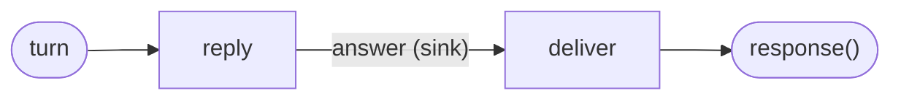

# Streamed answers

A model writes its answer a token at a time, and a long answer takes a while. Rather than
wait for all of it, a reader can watch it grow. On this page the session sends every token
as a **part** while the turn runs, and you watch one stream in from a second terminal.

## What a part is

A part is a preview of the output a tasklet is producing. It leaves at once, while `run` is
still running, and reaches only the session's listeners: not the caller, and nothing about it
is kept. With nobody listening, it is dropped. Parts are numbered from 0 in each attempt, so a
turn that is tried again starts its preview again.

The demo model already hands over each token as it writes it, with a short pause, the way a
model's client streams: `reply` only has to pass them on.

> Send each token of the answer as a part.
> {: .step}

<!-- tabs-open -->

### Java

In `Reply.run`, hand the model `ctx::part` instead of a function that drops the tokens:

```java
        ctx.emit(DemoModel.answer(ctx.state().messages, message, ctx::part));
```

`DemoModel` calls it once per token, while it writes:

```java
        for (int i = 0; i < tokens.length; i++) {
            part.accept(new Answer(tokens[i], i + 1));
            LockSupport.parkNanos(PER_TOKEN.toNanos());
        }
        return new Answer(text, tokens.length);
```

A real model's client would be called here instead, handing each token it streams to
`part` the same way. [`java_sdk.md`](https://github.com/flezha/flezha/blob/main/docs/sdk/java_sdk.md#tasklets)
has the details of parts.

<!-- tabs-close -->

## A sink for the parts

A tasklet sends parts only when its output channel ends in a sink, and `reply`'s ends in the
`response()` end. A channel ends in one sink or one `response()`, never both. So `reply`'s
channel becomes the sink `answer`, which a listener reads, and a second tasklet, `deliver`,
passes the finished answer on to the caller.



> Write `deliver`, and put it between `reply` and the `response()` end.
> {: .step}

<!-- tabs-open -->

### Java

```java
// Deliver.java: hands the finished answer to the caller.
@Tasklet.Spec(name = "deliver")
public final class Deliver implements Tasklet<Answer, Void, Answer> {

    @Override
    public void run(Answer answer, Ctx<Void, Answer> ctx) throws TaskletException {
        ctx.emit(answer);
    }

    // The undo, when a turn is taken back: an answer already given has nothing to take back.
    @Override
    public void compensate(List<Answer> sent, Ctx<Void, Answer> ctx) {}
}
```

`deliver`'s output leaves the session, so a rewind needs an undo from it too, and it declares
an empty one.

In `AgentOperator.channels`:

```java
        c.input(String.class, "turn")
                .into(Reply.class)
                .sink("answer")                          // to whoever listens
                .into(Deliver.class)
                .response();                             // to whoever called
```

<!-- tabs-close -->

> Build the runner again and replace its container.
> {: .step}

<!-- tabs-open -->

### Java

```sh
$ mvn -q package
```

<!-- tabs-close -->

```sh
$ docker compose up -d --build --wait runner
```

## Watch a turn stream

> In a second terminal, from the project's folder with the `flz` alias of
> [`sessions.md`](sessions.md#start-it), listen to Anna's session for five seconds.
> {: .step}

```sh
$ flz operator listen anna --namespace agents --duration-ms 5000
```

> In the first terminal, send Anna a message.
> {: .step}

```sh
$ flz operator call anna --namespace agents --text 'Tell me a story'
```

```output
{"text":"Message 4: you said \"Tell me a story\". I am a demo model.","tokens":13}
```

The caller gets the finished answer, once. The listener sees every token as it was sent,
then the answer on the sink:

```output
answer	{"text":"Message ","tokens":1}	part=0 attempt=1 cell=anna/reply/
answer	{"text":"4: ","tokens":2}	part=1 attempt=1 cell=anna/reply/
answer	{"text":"you ","tokens":3}	part=2 attempt=1 cell=anna/reply/
...
answer	{"text":"demo ","tokens":12}	part=11 attempt=1 cell=anna/reply/
answer	{"text":"model.","tokens":13}	part=12 attempt=1 cell=anna/reply/
answer	{"text":"Message 4: you said \"Tell me a story\". I am a demo model.","tokens":13}	cell=anna/reply/ seq=7.0
```

A part line is the channel, the part, and `part=<n> attempt=<a>`. The last line is the output,
which carries its place in the session's record, `seq`, instead.

## Next

[`custom_plugins.md`](custom_plugins.md) installs the HTTP plugin into the controller's
image.
