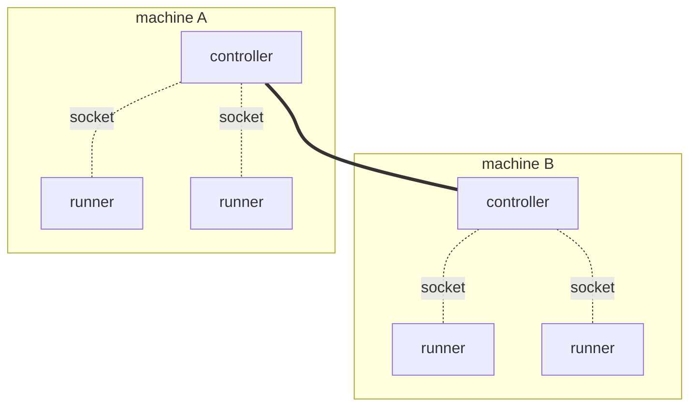

# Deploy a runner

A runner is a program of your own that runs your code. It connects to a
controller, tells it which operatives it can run, and then does the work the
controller gives it. You write it in any of the seven languages, and you start
and stop it yourself, like any other service.

> Check that the controller from
> [`controller_deployment.md`](controller_deployment.md) is still running and
> ready. A runner does its work only once it has connected to one.
> {: .step}

```sh
$ flz boot await
```

```output
boot await: ready
```

## Reach the controller

A runner and its controller talk over a Unix domain socket, so they are on the
same machine. That is the intended shape rather than a limitation: **every
machine that runs runners runs a controller too**, and the runners on it attach
to that local controller through a directory the two share. The controllers then
find each other and behave as one system, so a runner only ever talks to the one
on its own box. The shipped Kubernetes manifests are exactly this, a DaemonSet
with one controller per node.



Dotted lines are Unix domain sockets, and never leave a machine. The solid line
is the controllers clustering.

**QUIC is the other transport, and it is experimental.** It lets a runner cross
a machine boundary: `FLEZHA_TRANSPORT=quic` plus `FLEZHA_QUIC_ADDRESSES`, a
comma separated list of names or addresses, port 4433 by default. It needs
certificates on both ends
([`../operations/authn_authz.md`](../operations/authn_authz.md)) and is far less
exercised than the socket. Prefer the socket.

The rest of this section is the socket.

**The controller prints the answer on every boot:**

```
[flezha] runners attach with FLEZHA_SOCKET_FILES_PATH=/run/user/1000/flezha
```

And one command tells you whether it worked. `flz runner check` walks the exact
ladder a runner walks, needs no runner and no controller, and exits zero only
when a controller answered:

```sh
$ flz runner check
```

```output
controller reachable
  directory  /run/user/1000/flezha (from $XDG_RUNTIME_DIR/flezha)
  checked    /run/user/1000/flezha
             /run/flezha
             /srv/flezha/app_data/sockets
```

How you get there depends on how you started the controller in the previous
guide.

<!-- tabs-open -->

### Binaries

**Nothing to configure.** On one machine, as one user, the runner resolves the
same directory the controller did. Start it and it connects.

That is because both sides walk the same ladder and stop at the first candidate:
`$XDG_RUNTIME_DIR/flezha`, then `/run/flezha`, then `./app_data/sockets`
relative to the working directory. Setting `FLEZHA_SOCKET_FILES_PATH` on both
sides names a directory outright and skips the ladder.

**A different user is the one case that needs work.** Directory traversal is the
authentication boundary here, and the socket directory is `0700`, so another
user cannot reach it. Either run the runner as the controller's user, or start
the controller with `FLEZHA_SOCKET_DIR_GROUP=<group>`, a group both users belong
to, which makes the directory `0750` owned by that group. No setting opens it
wider than that.

### Docker

**The socket is inside the container,** so the only question is how to share
that one directory. Give it a volume of its own, separate from the data volume,
and mount it in both places.

If the runner is also a container, a named volume is the whole answer:

```sh
$ docker run -d --name flezha-controller \
  -v flezha_data:/flezha/app_data \
  -v flezha_sockets:/flezha/app_data/sockets \
  flezha/flezha:0.1.0

$ docker run -d --name my-runner \
  -e FLEZHA_SOCKET_FILES_PATH=/flezha/app_data/sockets \
  -v flezha_sockets:/flezha/app_data/sockets \
  my-runner-image
```

```sh
$ docker exec my-runner flz runner check
```

```output
controller reachable
  directory  /flezha/app_data/sockets (from $FLEZHA_SOCKET_FILES_PATH)
  checked    /flezha/app_data/sockets
```

If the runner runs on the host instead, bind mount a host directory in place of
the named volume:

```sh
$ docker run -d --name flezha-controller \
  -v flezha_data:/flezha/app_data \
  -v /tmp/flz_sock:/flezha/app_data/sockets \
  flezha/flezha:0.1.0

$ FLEZHA_SOCKET_FILES_PATH=/tmp/flz_sock flz runner check
```

**That one has a condition.** The image runs as uid 1000 and the directory it
creates is `0700`, so the host user has to be uid 1000 as well, or the socket is
there and unreachable. Two containers do not have this problem, because both run
as the same uid.

Keep the path short either way: the directory is capped at 60 bytes, because a
runner's data socket address has to fit beside it.

### Kubernetes

TODO.

### Elixir application

**If the runner runs in the same node as the controller, there is no socket at
all.** The Elixir SDK's in-node mode is a function call:

```elixir
children = [{Flezha.SDK, namespace: "default", operatives: [MyOperative], transport: :native}]
```

`:native` is the default, and it is deliberately not taken from the environment:
a controller sets `FLEZHA_TRANSPORT` for its own server, and a runner that
followed that would dial its own node over a socket. A connect from another BEAM
node is refused.

If the runner is its own node instead, it is an ordinary standalone runner and
the **Binaries** tab applies unchanged.

<!-- tabs-close -->

**If it does not connect,** `flz runner check` names the verdict and the fix.
Every verdict, and the two failures that are not verdicts:
[`../troubleshooting/runner_cannot_connect.md`](../troubleshooting/runner_cannot_connect.md).

## The building blocks

The hello world has three pieces: a tasklet, an operative and a runner. They
mean the same thing in all seven languages, so they are described once here and
the code follows in [the next section](#the-code).

### The tasklet

**A processing stage of your own.** Where a step needs more than a one-line
transform, the operative hands the message to a tasklet: typed input and output
and, when you need them, per-key state that survives a restart, timers and
retries.

It emits its result without saying where the result goes. The operative decides
that, so the same tasklet can be rewired without being touched.

Its name is durable. State is stored under that name, so renaming a tasklet in
a new release does not rename anything, it declares a different tasklet.
Choose it once.

The echo's tasklet keeps no state and takes no configuration, which is as
simple as a tasklet gets. State, keys and cells are
[`stream_basics.md`](tradedesk/stream_basics.md).

### The operative

**What you write to move data between steps.** It declares the graph: the
channels data enters on, the steps each message passes through, and the channels
results leave on.

Some steps live in the graph itself. `map`, `filter`, `flatMap` and `keyBy`
reshape, drop, split and key messages right where they are declared, with no
class of their own ([`stream_transforms.md`](https://github.com/flezha/flezha/blob/main/docs/sdk/stream_transforms.md)).
A step that needs your own processing, or state that has to survive, is a
tasklet the graph routes messages into.

The echo has one tasklet, but an operative can chain as many as it needs, the
output of one feeding the next, and split or join the path between them. A
stream does that for as long as it runs, and a workflow runs its tasklets as
the steps of a job that ends.
[`stream_basics.md`](tradedesk/stream_basics.md#several-tasklets-in-one-operative) and
[`workflow_basics.md`](tradedesk/workflow_basics.md#several-tasklets-step-by-step) show
both.

The operative is the unit everything else works in: what the controller starts,
places on a runner, restarts after a crash, and moves when a runner disappears.
It has a durable name of its own, and that is the name you type to start one.

**Channel names are addresses, not labels.** `in` is what
`flz operative send --channel` writes to, and `out` is the name stamped on
everything that channel delivers. Something outside this file uses both, so
changing one is a breaking change rather than a rename.

The graph is checked when the runner starts, so a graph that cannot work is
refused there rather than failing halfway through a run.

### The runner

**A process you run.** It connects to the controller, says which operatives it
can serve, and waits.

It decides nothing: it offers capacity and does what the controller asks.
**Declaring an operative on a runner does not start one.** It says this process
is able to serve it, and starting one is the next guide. One runner can offer
many operatives, and many runners can offer the same one, which is how a
deployment grows.

It takes a namespace, the tenant it belongs to. These guides use `default`
throughout; [`namespaces.md`](tradedesk/namespaces.md) is where it becomes a decision.

If the connection drops, the runner reconnects on its own.

### How the three meet

None of them names the others. You start a runner, the controller learns the
operative can be served, you ask for one by name, and the controller binds it to
a runner that offered it. Messages then arrive on the channel the operative
declared and travel its graph.

## The code

The same three parts, in the same order, in your language. Only what is
particular to that language is explained here; what the parts are for is
[above](#the-building-blocks).

> #### Seven SDKs, one engine {: .info}
>
> The SDKs share one engine rather than reimplementing it seven times. Six sit
> on one kernel written in Rust, `flz_core`: Rust uses it directly, Java through
> JNI, and Node, Python, Ruby and PHP through a C ABI. Elixir writes its own
> kernel and binds only the transport, through a Rust NIF, which is also what
> lets it run inside the controller's own node.
>
> The kernel owns **what runs and when**. It picks the next activation, holds
> per-cell ordering and exclusivity, runs the retry ladder and durability, and
> caps how much work is underway at once. Each SDK owns **the threads to run it
> on**, and brings whatever its own runtime provides.
>
> So the rules the kernel enforces are the same wherever you write: ordering,
> exclusivity, the retry ladder, durability. What differs is the runtime and
> concurrency semantics of the host language, and with them how work spreads
> across cores and how much throughput one process reaches. Those differences
> are real and sometimes large, and each tab below says what they are.

> Get the echo in your language: pick your language's tab below and take the
> whole example linked at its top. It holds the three files explained here,
> plus the project files that build them.
> {: .step}

<!-- tabs-open -->

### Java

The whole example:
[`sdk/java/examples/echo`](https://github.com/flezha/flezha_java_sdk/tree/main/examples/echo).

```java
// Echo.java: the tasklet. The processing stage the graph routes each message into.
@Tasklet(id = "echo")                        // state is saved under this name, so choose it once
public final class Echo {

    public String run(String input) {
        return "echo: " + input;             // what it returns is emitted
    }
}
```

**`@Tasklet` is expanded at compile time.** The SDK's annotation processor
generates `EchoTasklet` from this class, reading the input and output types
from the `run` signature, and the operative names that generated class. `run`
takes no state parameter, so it keeps nothing between messages and journals
nothing. A standalone project lists `flezha-sdk-processor` under
`annotationProcessorPaths`, as the example's `pom.xml` does.

```java
// EchoOperative.java: the operative. The graph, and the unit the controller schedules.
public final class EchoOperative implements StreamOperative {

    @Override
    public String factoryId() {
        return "echo";
    }

    @Override
    public void channels(ChannelBuilder c) {
        c.input(String.class, "in").into(EchoTasklet.class).sink("out");
    }
}
```

One expression declares the whole data path: an entry channel `in` carrying
strings, routed into the tasklet, whose output channel is named `out` and
terminated on the plugin layer. `sink(name)` does both jobs, so naming the
channel again with `named(...)` is refused at registration rather than resolved.

```java
// Main.java: the runner. Connects, offers the operative, and serves.
public static void main(String[] args) throws Exception {
    FlezhaRunner runner = Flezha.createRunner(args.length > 0 ? args[0] : "default")
            .registerFactory(EchoOperative.class)
            .start();

    runner.awaitTermination();
}
```

`start()` connects and hands back the runner, and `awaitTermination()` blocks
until shutdown, which is either a SIGTERM or a `close()` from another thread, `run()` does both in one call. `registerFactory` is the same call
for the workflow kind.

> #### Concurrency in Java {: .info}
>
> **One virtual thread per activation.** Platform *fetcher* threads loop
> `poll -> decode -> hand off -> poll`, and each activation is dispatched on its
> own virtual thread, which encodes the result and completes it. Fetchers stay
> platform threads on purpose: `FlzCore.poll` blocks in native code, and a
> native frame pins its carrier.
>
> A supervisor thread parks in the core's starvation wait and starts another
> fetcher whenever one is observed, up to a ceiling. It is not optional: a
> virtual thread parked inside `complete` holds its fetcher's handout, and with
> every fetcher held the runner processes nothing at all.
>
> What no ceiling can fix is user code that never returns.

### Rust

The whole example:
[`sdk/rust/examples/echo`](https://github.com/flezha/flezha_rust_sdk/tree/main/examples/echo).

```rust
// src/tasklet.rs: the tasklet. The processing stage the graph routes each message into.
use flezha_runner::tasklet;

#[tasklet(id = "echo")]                  // state is saved under this name, so choose it once
pub fn echo(input: String) -> String {
    format!("echo: {input}")             // what it returns is emitted
}
```

**`#[tasklet]` turns the function into a tasklet type**, `Echo`, named after
the function, and that type is what the operative routes into. The input and
output types are read from the signature. There is no `&mut` state parameter, so
it keeps nothing between messages and journals nothing.

```rust
// src/operative.rs: the operative. The graph, and the unit the controller schedules.
pub struct EchoOperative;

impl StreamOperative for EchoOperative {
    fn factory_id() -> &'static str {
        "echo"
    }

    fn channels(c: &ChannelBuilder) {
        c.input::<String>("in")
            .into::<Echo>()
            .sink_named("out");
    }
}
```

`input::<String>("in")` is the entry channel and the type it carries: a `String`
or a `Vec<u8>` passes through as its bytes, and any other type is parsed from
JSON. `sink_named("out")` names the channel it terminates on the plugin layer,
and `sink()` would leave it the tasklet's name. A graph whose types do not
line up is refused when the runner declares it.

```rust
// src/main.rs: the runner. Connects, offers the operative, and serves.
fn main() -> Result<(), Box<dyn std::error::Error>> {
    let namespace = std::env::args().nth(1).unwrap_or_else(|| "default".to_string());

    let runner = Flezha::create_runner(namespace)?;
    runner.register_factory(EchoOperative)?.start()?;

    runner.await_termination()?;
    Ok(())
}
```

`start()` connects and hands back the runner, and `await_termination()` blocks
until shutdown, a SIGTERM or Ctrl-C; `run()` does both in one call. The runner is
bound to a name first because a chained temporary would be dropped, and shut
down, at the end of its statement. Every call answers a `Result`, so a refusal
leaves `main` through `?`. `register_factory` is the same call for the workflow
kind.

> #### Concurrency in Rust {: .info}
>
> **A worker pool sized to the machine.** The base is the available
> parallelism, falling back to 2, and a starvation supervisor grows it up to
> `FLEZHA_WORKER_POOL_MAX`, ten times the base by default. A worker started by
> growth retires after 30 seconds idle.
>
> A `DropNothing` producer parks the worker it ran on, so a pipeline of depth D
> under that policy wants at least `2 x D + 1` threads. A parked producer is not
> inside `poll`, so the work queued behind it is exactly the starvation the pool
> grows on: raising the base only removes the growth latency.

### Node

The whole example:
[`sdk/node/examples/echo`](https://github.com/flezha/flezha_node_sdk/tree/main/examples/echo).

```javascript
// echo_tasklet.mjs: the tasklet. The processing stage the graph routes each message into.
import { defineTasklet } from '@flezha/sdk';

export const EchoTasklet = defineTasklet({
  name: 'echo',                         // state is saved under this name, so choose it once
  run: (input) => `echo: ${input}`,     // what it returns is emitted
});
```

With no `initialState` and no `applyChange`, it keeps nothing between messages
and journals nothing.

```javascript
// echo_operative.mjs: the operative. The graph, and the unit the controller schedules.
import { defineStream } from '@flezha/sdk';

import { EchoTasklet } from './echo_tasklet.mjs';

export default defineStream({
  factoryId: 'echo',
  channels: (c) => {
    c.input('in', { codec: 'text' })
      .into(EchoTasklet)
      .sink('out');
  },
});
```

`{ codec: 'text' }` hands the tasklet the bytes `flz operative send --text`
delivers as a string; an entry that names no codec reads JSON instead. The sink
names no codec, so the tasklet's string leaves as its UTF-8 bytes, and any
value other than a string or bytes would leave as JSON. The module exports what
`defineStream` returned, and that export is what the runner finds.

```javascript
// runner.mjs: the runner. Connects, offers the operative, and serves.
import { createRunner } from '@flezha/sdk';

const runner = createRunner(process.argv[2] ?? 'default');
await runner.registerFactory('./echo_operative.mjs');

await runner.run();
```

The operative is registered by **module specifier**, a path rather than an
imported value, because every dispatch loop imports the module itself. Registering
therefore imports it, which is why it is awaited. A relative specifier resolves
against the working directory. `run()` resolves once the
runner is connected and serving, and the process keeps running until a SIGTERM
or until its standard input closes. `registerFactory` is the same call for the
workflow kind.

> #### Concurrency in Node {: .info}
>
> **Compute parallelism is the dispatch loop count, and it defaults to one.**
> `0` workers means the main event loop, so one handler body runs at a time.
> `.workers(n)` or `FLEZHA_NODE_WORKERS` gives `n` worker threads and compute
> parallelism `n`. Two fetch threads sit in `poll`; raising that number does not
> raise concurrency, because a fetcher never runs user code.
>
> Handlers are registered by **module specifier**, never as imported values, in
> every configuration. A dispatch loop imports the module itself, which is what
> makes turning worker threads on a flag rather than a rewrite.
>
> I/O-bound handlers reach the core's in-flight cap on one loop. Compute-bound
> ones do not, because they hold the loop while they compute, and that is what
> the loop count is for.

### Python

The whole example:
[`sdk/python/examples/echo`](https://github.com/flezha/flezha_python_sdk/tree/main/examples/echo).

```python
# echo_tasklet.py: the tasklet. The processing stage the graph routes each message into.
@flezha.tasklet(name="echo")    # state is saved under this name, so choose it once
def echo(value: str) -> str:
    return f"echo: {value}"  # what it returns is emitted
```

A function becomes a tasklet through the decorator. It declares no state, so it
keeps nothing between messages, and where its result goes is not its business.

```python
# echo_operative.py: the operative. The graph, and the unit the controller schedules.
@flezha.stream_operative("echo")
def echo_operative(c: flezha.Channels) -> None:
    c.input("in", codec="text").into(echo).sink("out")
```

`codec="text"` hands the tasklet the bytes `flz operative send --text` delivers
as a string; an entry that names no codec reads JSON instead. The sink names no
codec, so the tasklet's string goes back out as its UTF-8 bytes, and any value
other than a string or bytes would go out as JSON.

```python
# runner.py: the runner. Connects, offers the operative, and serves.
def main() -> None:
    runner = flezha.create_runner(sys.argv[1] if len(sys.argv) > 1 else "default")
    runner.register_factory(echo_operative)

    runner.start()
    runner.await_termination()
```

`start()` connects and starts serving, and `await_termination()` blocks until
shutdown and then drains; `run()` is the two in one call. Declaring an operative
starts nothing: the controller decides when one runs.

> #### Concurrency in Python {: .info}
>
> **A pool of Python threads**, each looping `poll -> dispatch -> complete` on
> itself, plus one supervisor parked in the core's starvation wait.
>
> Whether handler bodies run in parallel is the interpreter's decision, not the
> SDK's. The compatibility wheel is `abi3` targeting 3.11 and runs everywhere,
> with the GIL bounding handler bodies to one at a time. Free-threaded wheels
> from **3.14t** lift that and let bodies execute in parallel. The runner prints
> which tier it is running in its startup line, so a benchmark is never
> ambiguous about it.

### Ruby

The whole example:
[`sdk/ruby/examples/echo`](https://github.com/flezha/flezha_ruby_sdk/tree/main/examples/echo).

```ruby
# echo_tasklet.rb: the tasklet. The processing stage the graph routes each message into.
class EchoTasklet < Flezha::Tasklet
  tasklet_name "echo"                            # state is saved under this name, so choose it once

  def run(input, _ctx) = "echo: #{input}"        # what it returns is emitted
end
```

Without `tasklet_name` the name is the class name in snake case. Which optional
hooks a tasklet has is read from the methods it defines, so with no
`initial_state` and no `apply_change` it keeps nothing and journals nothing.

```ruby
# echo_operative.rb: the operative. The graph, and the unit the controller schedules.
class EchoOperative < Flezha::StreamOperative
  factory_id "echo"

  channels do |c|
    c.input("in", codec: :text)
     .into(EchoTasklet)
     .sink("out")
  end
end
```

`codec: :text` hands the tasklet the bytes `flz operative send --text` delivers
as a String; an entry that names no codec reads JSON instead. The sink names no
codec, so the tasklet's String goes back out as its bytes, and any other value
would go out as JSON.

```ruby
# runner.rb: the runner. Connects, offers the operative, and serves.
runner = Flezha.create_runner(ARGV[0] || "default").register_factory(EchoOperative)

runner.boot
runner.await_termination
```

`boot` connects and starts serving, and `await_termination` blocks until
shutdown and then drains; `run` is the two in one call. Classes are registered
explicitly: nothing is autoloaded, and what runs is what you named.
`register_factory` is the same call for the workflow kind.

> #### Concurrency in Ruby {: .info}
>
> **Handler bodies are bounded to one core per process.** That is the GVL, and
> this SDK does not work around it.
>
> Everything below the poll seam is genuinely parallel: transport, framing,
> durability, retries, credit, routing and the activation codec all run in Rust
> with the GVL released. The lock bounds your handler body and nothing else.
>
> So the lever for CPU-bound handlers is **process count, not thread count**:
> run more runner processes, and start the operative with `--partitions N` so
> its keys spread across them. Handlers that are 90% I/O saturate a core at
> roughly 2,000 activations per second and the pool grows to cover the wait;
> handlers that are pure Ruby at 5 ms each serve about 200 per second however
> large the pool is.

### PHP

The whole example:
[`sdk/php/examples/echo`](https://github.com/flezha/flezha_php_sdk/tree/main/examples/echo).

```php
// src/EchoTasklet.php: the tasklet. The processing stage the graph routes each message into.
#[Task(name: 'echo')]                   // state is saved under this name, so choose it once
final class EchoTasklet extends Tasklet
{
    public function run(mixed $input, Ctx $ctx): mixed
    {
        return 'echo: ' . $input;       // what it returns is emitted
    }
}
```

Only `run()` is required. Which optional hooks a tasklet has is read from the
methods it overrides, so with no `state` and no `applyChange` it keeps nothing and
journals nothing.

```php
// src/EchoOperative.php: the operative. The graph, and the unit the controller schedules.
#[Operative(factoryId: 'echo')]
final class EchoOperative extends StreamOperative
{
    public static function channels(Builder $c): void
    {
        $c->input('in', codec: ChannelCodec::Text)
            ->into(EchoTasklet::class)
            ->sink('out');
    }
}
```

`ChannelCodec::Text` hands the tasklet the text `flz operative send --text`
sends, checked as UTF-8; an entry that names no codec reads JSON instead. The
sink names no codec, so the tasklet's string goes out as it is, and any other
value would go out as JSON. The attribute carries the declaration and the method
carries the graph.

```php
// runner.php: the runner. Connects, offers the operative, and serves.
require __DIR__ . '/vendor/autoload.php';

$runner = Flezha::createRunner($argv[1] ?? 'default')
    ->registerFactory(EchoOperative::class)
    ->start();

$runner->awaitTermination();
```

`start()` connects, and `awaitTermination()` is where this process serves: PHP has
no threads, so under the default executor nothing is processed until the wait
begins. `run()` does both in one call, and `registerFactory` is the same call for
the workflow kind.

> #### Concurrency in PHP {: .info}
>
> **PHP has no threads, so in-flight concurrency is the number of loops you
> run.** Under the default `SyncExecutor` a loop is a process: 20 simultaneous
> slow calls need 20 processes, which is 20 replicas or 20 systemd instances.
>
> `SwooleExecutor` changes the arithmetic to threads times processes, and it is
> the reason both executors exist. A process carries a PHP interpreter plus
> `flz_core`'s roughly 20 OS threads, so a few dozen to low hundreds per host is
> comfortable and thousands is not. A Swoole thread carries an interpreter and
> no second core runtime, so one process reaches its core count without
> multiplying either. It declares higher requirements, checked when you select
> it rather than at install.
>
> The runner measures this rather than leaving it to be assumed: at shutdown it
> logs the activations it served, the mean body time, and the per-loop
> throughput they imply.

### Elixir

The whole example:
[`sdk/elixir/examples/echo`](../../sdk/elixir/examples/echo).

```elixir
# lib/echo/tasklet.ex: the tasklet. The processing stage the graph routes each message into.
defmodule Echo.Tasklet do
  use Flezha.SDK.Tasklet, name: "echo"     # state is saved under this name, so choose it once

  @impl true
  def run(input, state, ctx) do
    emit(ctx, "echo: " <> input)           # send the result out; the operative picks the channel
    {:ok, state}
  end
end
```

`use Flezha.SDK.Tasklet` declares the tasklet and imports what `run/3` calls
on the ctx, `emit/2` among them. `run/3` answers `{:ok, state}`, and what it
emitted is released only then. With no `state` block it keeps nothing between
messages and journals nothing.

```elixir
# lib/echo/operative.ex: the operative. The graph, and the unit the controller schedules.
defmodule Echo.Operative do
  use Flezha.SDK.StreamOperative, factory_id: "echo"

  @impl true
  def channels(c) do
    c |> input("in") |> into(Echo.Tasklet) |> sink("out")
  end
end
```

The graph is a pipe, and `use` imports the builder it is written with. A binary crosses a channel as it is, so plain text needs no
decoder or encoder here.

```elixir
# lib/echo/application.ex: the runner. Connects, offers the operative, and serves.
defmodule Echo.Application do
  use Application

  @impl true
  def start(_type, _args) do
    namespace = List.first(System.argv(), "default")

    children = [
      {Flezha.SDK, namespace: namespace, operatives: [Echo.Operative], transport: :uds}
    ]

    Supervisor.start_link(children, strategy: :one_for_one)
  end
end
```

The runner is a child of your own supervision tree, so a crash restarts it and it
reconnects under the same identity. `transport: :uds` because this node is not the
controller's: the default, `:native`, is for code inside the controller's own node,
and it is not taken from the environment. The example depends on the `flezha_sdk`
package alone, which starts no controller. `operatives:` takes either kind: the
kind is read from the module, never named by the list.

> #### Concurrency in Elixir {: .info}
>
> **The one SDK with a core of its own.** Dispatch, cells and state are
> Elixir, sharing no code with `flz_core` and re-expressing the same rules.
> Concurrency is therefore the BEAM's: lightweight processes on the VM's
> schedulers, preempted across every core, with a Cell's work ordered through
> its own mailbox (`mailbox_capacity`, 1024 by default).
>
> It is also the only SDK that runs two ways. **In-node** (`transport: :native`,
> the default) it runs inside the controller's own BEAM and the transport is a
> function call rather than a socket, so a connect from another BEAM node is
> refused. **Standalone** (`:uds` or `:quic`) it is its own node speaking the
> binary protocol, and there it reaches the wire through `flz_nif`, the same
> Rust NIF the controller uses. The core above that seam is the same Elixir code
> either way.

<!-- tabs-close -->

## Start it, check it

**You manage runners yourself.** Flezha never starts, stops or restarts a
runner: `flz` has no command for it, and the controller only works with the
runners that connect to it. A runner is an ordinary program, so run it the way
you run your other services: from a terminal, under systemd, in Docker or
Kubernetes, or under any supervisor you already use.

Once it is running, the runner connects to the controller and offers it the
operatives it declares. From then on the controller decides what runs on it.

Three things matter when a supervisor runs it:

- **Stop it with SIGTERM.** The runner shuts down cleanly. Ctrl-C in a terminal
  does the same.
- **Restart it whenever it exits.** Losing the controller is not a reason to
  exit: the runner reconnects on its own, waiting longer between attempts, up to
  30 seconds. It exits when it crashes, and when the controller tells a stuck
  runner to leave, with exit code 70, so that its supervisor starts a fresh one.
- **Keep standard input open for Node, Python, Ruby and PHP.** These runners
  stop when standard input closes, unless it is a terminal, so a supervisor that
  starts them without one stops them at once. `docker run -i` keeps it open, and
  so does `stdin_open: true` in a compose file.

The commands below show one way to start each language's echo runner, from a
terminal on the controller's machine. They are examples, and you are not limited
to them.

> Start the echo runner: open a new terminal on the controller's machine, go to
> your language's echo example folder, and run the command in its tab below.
> {: .step}

<!-- tabs-open -->

### Java

From the echo example's folder, build and start in one line:

```sh
$ mvn -q package && java -jar target/echo.jar
```

The jar carries the SDK, so nothing else goes on the classpath. The first
argument is the namespace, `default` when omitted.

### Rust

From the echo example's folder:

```sh
$ cargo run --release
```

The namespace follows `--`, `default` when omitted: `cargo run --release -- my_app`.

### Node

From the echo example's folder:

```sh
$ npm install && node runner.mjs
```

Start it from that folder, because the operative's module specifier resolves
against the working directory. The first argument is the namespace, `default`
when omitted.

### Python

From the echo example's folder, with Python 3.11 or later:

```sh
$ pip install -r requirements.txt && python3 runner.py
```

The first argument is the namespace, `default` when omitted.
[`sdk/python/examples/echo_deployment`](https://github.com/flezha/flezha_python_sdk/tree/main/examples/echo_deployment)
starts a controller and this runner together with Docker.

### Ruby

From the echo example's folder, with Ruby 3.3 or later:

```sh
$ bundle install && bundle exec ruby runner.rb
```

The first argument is the namespace, `default` when omitted.

### PHP

From the echo example's folder, with PHP 8.4 or later and `ext-ffi`:

```sh
$ composer install && php runner.php
```

The first argument is the namespace, `default` when omitted.

### Elixir

From the echo example's folder:

```sh
$ mix deps.get && mix run --no-halt
```

The namespace follows `--`, `default` when omitted: `mix run --no-halt -- my_app`.

A standalone Elixir runner is your own application, so it starts the way your
application starts. An in-node runner has nothing to start: `Flezha.SDK` is a
child in your application's supervision tree, in the same node as the
controller.

<!-- tabs-close -->

The runner keeps that terminal. Leave it running: the next guide starts work on
it, and [`stop_everything.md`](stop_everything.md) stops it at the end of Part 1.

From another terminal, you can check that it connected:

```sh
$ flz runner list
```

```output
Fetching runners for namespace 'default'...
Runners in namespace 'default':
  - default_23fc85126379
```

Your runner's id in that list means it connected to the controller. If it is
missing, [`../troubleshooting/runner_cannot_connect.md`](../troubleshooting/runner_cannot_connect.md)
names every reason with its fix.

> #### One runner, one namespace {: .info}
>
> A runner process serves exactly one namespace, and at most one runner may run
> in a process: a second one started beside it is refused, naming the namespace
> already running. Serving two namespaces means two processes.
>
> Two runner processes in the same namespace, on one machine, are an ordinary
> way to spread the work, but each needs an identity file of its own. The
> controller binds operatives to a runner's durable identity, which the runner
> reads from `FLEZHA_RUNNER_ID_PATH`, `/var/lib/flezha-runner/id` by default. Two
> processes reading one file present one identity, and the newer one takes the
> older one's work. Give each process its own path, or run them in containers,
> where the default path is separate already.

Nothing runs on it yet. [`running_operatives.md`](running_operatives.md) starts
the first operative.
