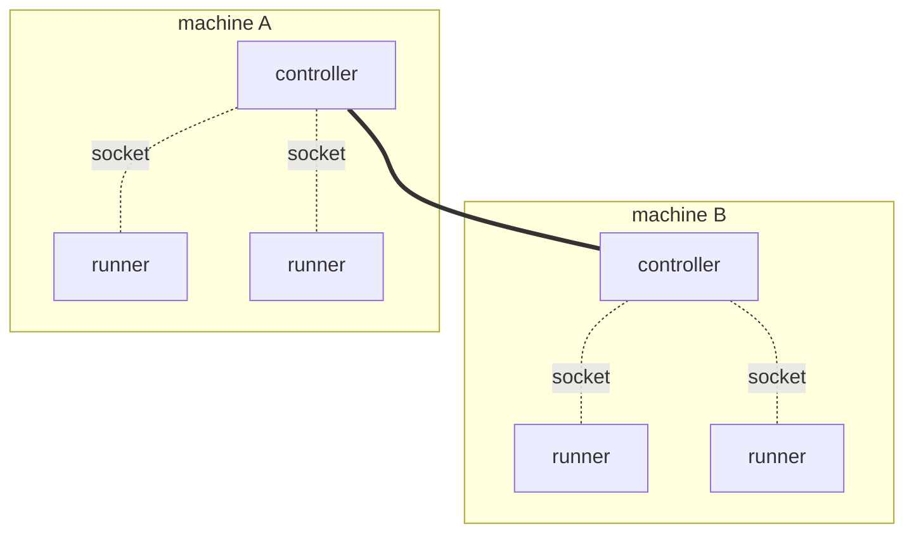

# Deploy a runner

**Before you start:** finish [`controller_deployment.md`](controller_deployment.md).
A runner is useless on its own: it connects to a controller, so you need one
running and reachable before anything here works.

TODO: a draft. Java is the only language filled in, and the last section is
not written yet.

## Reach the controller

A runner and its controller talk over a Unix domain socket, so they are on the
same machine. That is the intended shape rather than a limitation: **every
machine that runs runners runs a controller too**, and the runners on it attach
to that local controller through a directory the two share. The controllers then
find each other and behave as one system, so a runner only ever talks to the one
on its own box. The shipped Kubernetes manifests are exactly this, a DaemonSet
with one controller per node.



Dotted lines are Unix domain sockets, and never leave a machine. The solid line
is the controllers clustering.

**QUIC is the other transport, and it is experimental.** It lets a runner cross
a machine boundary: `FLEZHA_TRANSPORT=quic` plus `FLEZHA_QUIC_ADDRESSES`, a
comma separated list of names or addresses, port 4433 by default. It needs
certificates on both ends
([`../operations/authn_authz.md`](../operations/authn_authz.md)) and is far less
exercised than the socket. Prefer the socket.

The rest of this section is the socket.

**The controller prints the answer on every boot:**

```
[flezha] runners attach with FLEZHA_SOCKET_FILES_PATH=/run/user/1000/flezha
```

And one command tells you whether it worked. `flz runner check` walks the exact
ladder a runner walks, needs no runner and no controller, and exits zero only
when a controller answered:

```sh
$ flz runner check
controller reachable at /run/user/1000/flezha (from $XDG_RUNTIME_DIR/flezha); walked
/run/user/1000/flezha, /run/flezha, ./app_data/sockets. Fix: nothing to fix - the
controller answered
```

How you get there depends on how you started the controller in the previous
guide.

<!-- tabs-open -->

### Binaries

**Nothing to configure.** On one machine, as one user, the runner resolves the
same directory the controller did. Start it and it connects.

That is because both sides walk the same ladder and stop at the first candidate:
`$XDG_RUNTIME_DIR/flezha`, then `/run/flezha`, then `./app_data/sockets`
relative to the working directory. Setting `FLEZHA_SOCKET_FILES_PATH` on both
sides names a directory outright and skips the ladder.

**A different user is the one case that needs work.** Directory traversal is the
authentication boundary here, and the socket directory is `0700`, so another
user cannot reach it. Either run the runner as the controller's user, or start
the controller with `FLEZHA_SOCKET_DIR_GROUP=<group>`, a group both users belong
to, which makes the directory `0750` owned by that group. No setting opens it
wider than that.

### Docker

**The socket is inside the container,** so the only question is how to share
that one directory. Give it a volume of its own, separate from the data volume,
and mount it in both places.

If the runner is also a container, a named volume is the whole answer:

```sh
docker run -d --name flezha-controller \
  -v flezha_data:/flezha/app_data \
  -v flezha_sockets:/flezha/app_data/sockets \
  alfetahe/flezha:0.1.0

docker run -d --name my-runner \
  -e FLEZHA_SOCKET_FILES_PATH=/flezha/app_data/sockets \
  -v flezha_sockets:/flezha/app_data/sockets \
  my-runner-image
```

```sh
$ docker exec my-runner flz runner check
controller reachable at /flezha/app_data/sockets (from $FLEZHA_SOCKET_FILES_PATH);
walked /flezha/app_data/sockets. Fix: nothing to fix - the controller answered
```

If the runner runs on the host instead, bind mount a host directory in place of
the named volume:

```sh
docker run -d --name flezha-controller \
  -v flezha_data:/flezha/app_data \
  -v /tmp/flz_sock:/flezha/app_data/sockets \
  alfetahe/flezha:0.1.0

FLEZHA_SOCKET_FILES_PATH=/tmp/flz_sock flz runner check
```

**That one has a condition.** The image runs as uid 1000 and the directory it
creates is `0700`, so the host user has to be uid 1000 as well, or the socket is
there and unreachable. Two containers do not have this problem, because both run
as the same uid.

Keep the path short either way: the directory is capped at 60 bytes, because a
runner's data socket address has to fit beside it.

### Kubernetes

TODO.

### Elixir application

**If the runner runs in the same node as the controller, there is no socket at
all.** The Elixir SDK's in-node mode is a function call:

```elixir
children = [{Flezha.SDK, namespace: "default", streams: [MyOperative], transport: :native}]
```

`:native` is the default, and it is deliberately not taken from the environment:
a controller sets `FLEZHA_TRANSPORT` for its own server, and a runner that
followed that would dial its own node over a socket. A connect from another BEAM
node is refused.

If the runner is its own node instead, it is an ordinary standalone runner and
the **Binaries** tab applies unchanged.

<!-- tabs-close -->

**If it does not connect,** `flz runner check` names the verdict and the fix.
Every verdict, and the two failures that are not verdicts:
[`../troubleshooting/runner_cannot_connect.md`](../troubleshooting/runner_cannot_connect.md).

## The building blocks

Every Flezha application is built from the same three pieces, whatever it grows
into later. They mean the same thing in all seven languages, so they are
described once here and the code follows in [the next section](#the-code).

### The procedure

**Your code.** One message in, one message out.

It emits its result without saying where the result goes. That is the point: the
operative decides the destination, so the same procedure can be rewired to a
different one without being touched.

Its name is durable. State is stored under that name later, so renaming a
procedure in a new release does not rename anything, it declares a different
procedure. Choose it once.

The hello world keeps no state and takes no configuration, which is as simple as
a procedure gets. State, keys and entities are
[`stream_basics.md`](stream_basics.md).

### The operative

**The wiring, and it holds no logic.** It says which channel feeds which
procedure, and where the output goes.

That is what makes it the unit you deploy. A procedure on its own cannot be,
because nothing knows where its messages come from, so the operative and not the
procedure is what the controller starts, places on a runner, and moves when a
runner disappears. It has a durable name of its own, and that is the name you
type to start one.

**Channel names are addresses, not labels.** `in` is what
`flz operative send --channel` writes to, and `out` is the name stamped on
everything that channel delivers. Something outside this file uses both, so
changing one is a breaking change rather than a rename.

The wiring is checked when the runner starts, so a graph that cannot work is
refused there rather than failing halfway through a run.

### The runner

**A process you run.** It connects to the controller, says which operatives it
can serve, and waits.

It decides nothing: it offers capacity and does what the controller asks.
**Declaring an operative on a runner does not start one.** It says this process
is able to serve it, and starting one is the next guide. One runner can offer
many operatives, and many runners can offer the same one, which is how a
deployment grows.

It takes a namespace, the tenant it belongs to. These guides use `default`
throughout; [`namespaces.md`](namespaces.md) is where it becomes a decision.

If the connection drops, the runner reconnects on its own.

### How the three meet

None of them names the others. You start a runner, the controller learns the
operative can be served, you ask for one by name, and the controller binds it to
a runner that offered it. Messages then arrive on the channel the operative
declared, and your procedure runs.

## The code

The same three parts, in the same order, in your language. Only what is
particular to that language is explained here; what the parts are for is
[above](#the-building-blocks).

> #### Seven SDKs, one engine {: .info}
>
> The SDKs share one engine rather than reimplementing it seven times. Six sit
> on one kernel written in Rust, `flz_core`: Rust uses it directly, Java through
> JNI, and Node, Python, Ruby and PHP through a C ABI. Elixir writes its own
> kernel and binds only the transport, through a Rust NIF, which is also what
> lets it run inside the controller's own node.
>
> The kernel owns **what runs and when**. It picks the next activation, holds
> per-entity ordering and exclusivity, runs the retry ladder and durability, and
> caps how much work is underway at once. Each SDK owns **the threads to run it
> on**, and brings whatever its own runtime provides.
>
> So the rules the kernel enforces are the same wherever you write: ordering,
> exclusivity, the retry ladder, durability. What differs is the runtime and
> concurrency semantics of the host language, and with them how work spreads
> across cores and how much throughput one process reaches. Those differences
> are real and sometimes large, and each tab below says what they are.

<!-- tabs-open -->

### Java

The whole example:
[`sdk/java/examples/echo`](https://github.com/alfetahe/flezha/tree/main/sdk/java/examples/echo).

```java
// The procedure. One message in, one message out.
public final class EchoProcedure
        implements Procedure<String, EchoProcedure.None, String, NoChange, WallClock, Void> {

    // This procedure keeps nothing, so its state type has no components.
    public record None() {}

    @Override
    public String name() {
        return "echo";                       // durable: state is filed under it
    }

    @Override
    public None initState(Optional<String> entityKey, Optional<RestoreInitPayload> initPayload) {
        return new None();                   // cold start for one entity
    }

    @Override
    public void run(String input, StateHandle<None, NoChange> state, ProcedureCtx ctx) {
        ctx.emit("echo: " + input);          // what, never where
    }
}
```

**The six type arguments** are, in order: the input, the per-entity state, the
output, the change type, the clock, and the configuration. The runtime recovers
all six from the `implements` clause at registration, so each has to be a
concrete class there rather than a type variable. `NoChange` is how this one
declares that it records no state changes, and `Void` that it takes no
configuration.

```java
// The operative. The graph, and the unit the controller schedules.
public final class EchoOperative implements StreamOperative {

    @Override
    public String factoryId() {
        return "echo";                       // durable: you start this by name
    }

    @Override
    public void channels(ChannelBuilder c) {
        c.input(String.class, "in").into(EchoProcedure.class).sink("out");
    }
}
```

One expression declares the whole data path: an entry channel `in` carrying
strings, routed into the procedure, whose output channel is named `out` and
terminated on the plugin layer. `sink(name)` does both jobs, so naming the
channel again with `named(...)` is refused at registration rather than resolved.

```java
// The runner. Connects, offers the operative, and serves.
public static void main(String[] args) throws Exception {
    Flezha.createRunner(args.length > 0 ? args[0] : "default")
            .defineStream(EchoOperative.class)
            .run();
}
```

`run()` connects and then blocks until shutdown, which is either a SIGTERM or a
`close()` from another thread. Use `start()` when the calling thread has
something else to do. `defineWorkflow` is the same call for the workflow kind.

> #### Concurrency in Java {: .info}
>
> **One virtual thread per activation.** Platform *fetcher* threads loop
> `poll -> decode -> hand off -> poll`, and each activation is dispatched on its
> own virtual thread, which encodes the result and completes it. Fetchers stay
> platform threads on purpose: `FlzCore.poll` blocks in native code, and a
> native frame pins its carrier.
>
> A supervisor thread parks in the core's starvation wait and starts another
> fetcher whenever one is observed, up to a ceiling. It is not optional: a
> virtual thread parked inside `complete` holds its fetcher's handout, and with
> every fetcher held the runner processes nothing at all.
>
> What no ceiling can fix is user code that never returns.

### Rust

> #### Concurrency in Rust {: .info}
>
> **A worker pool sized to the machine.** The base is the available
> parallelism, falling back to 2, and a starvation supervisor grows it up to
> `FLEZHA_WORKER_POOL_MAX`, ten times the base by default. A worker started by
> growth retires after 30 seconds idle.
>
> A `DropNothing` producer parks the worker it ran on, so a pipeline of depth D
> under that policy wants at least `2 x D + 1` threads. A parked producer is not
> inside `poll`, so the work queued behind it is exactly the starvation the pool
> grows on: raising the base only removes the growth latency.

TODO: the code.

### Node

> #### Concurrency in Node {: .info}
>
> **Compute parallelism is the dispatch loop count, and it defaults to one.**
> `0` workers means the main event loop, so one handler body runs at a time.
> `.workers(n)` or `FLEZHA_NODE_WORKERS` gives `n` worker threads and compute
> parallelism `n`. Two fetch threads sit in `poll`; raising that number does not
> raise concurrency, because a fetcher never runs user code.
>
> Handlers are registered by **module specifier**, never as imported values, in
> every configuration. A dispatch loop imports the module itself, which is what
> makes turning worker threads on a flag rather than a rewrite.
>
> I/O-bound handlers reach the core's in-flight cap on one loop. Compute-bound
> ones do not, because they hold the loop while they compute, and that is what
> the loop count is for.

TODO: the code.

### Python

> #### Concurrency in Python {: .info}
>
> **A pool of Python threads**, each looping `poll -> dispatch -> complete` on
> itself, plus one supervisor parked in the core's starvation wait.
>
> Whether handler bodies run in parallel is the interpreter's decision, not the
> SDK's. The compatibility wheel is `abi3` targeting 3.11 and runs everywhere,
> with the GIL bounding handler bodies to one at a time. Free-threaded wheels
> from **3.14t** lift that and let bodies execute in parallel. The runner prints
> which tier it is running in its startup line, so a benchmark is never
> ambiguous about it.

TODO: the code.

### Ruby

> #### Concurrency in Ruby {: .info}
>
> **Handler bodies are bounded to one core per process.** That is the GVL, and
> this SDK does not work around it.
>
> Everything below the poll seam is genuinely parallel: transport, framing,
> durability, retries, credit, routing and the activation codec all run in Rust
> with the GVL released. The lock bounds your handler body and nothing else.
>
> So the lever for CPU-bound handlers is **process count, not thread count**:
> `flz operative start -p N`. Handlers that are 90% I/O saturate a core at
> roughly 2,000 activations per second and the pool grows to cover the wait;
> handlers that are pure Ruby at 5 ms each serve about 200 per second however
> large the pool is.

TODO: the code.

### PHP

> #### Concurrency in PHP {: .info}
>
> **PHP has no threads, so in-flight concurrency is the number of loops you
> run.** Under the default `SyncExecutor` a loop is a process: 20 simultaneous
> slow calls need 20 processes, which is 20 replicas or 20 systemd instances.
>
> `SwooleExecutor` changes the arithmetic to threads times processes, and it is
> the reason both executors exist. A process carries a PHP interpreter plus
> `flz_core`'s roughly 20 OS threads, so a few dozen to low hundreds per host is
> comfortable and thousands is not. A Swoole thread carries an interpreter and
> no second core runtime, so one process reaches its core count without
> multiplying either. It declares higher requirements, checked when you select
> it rather than at install.
>
> The runner measures this rather than leaving it to be assumed: at shutdown it
> logs the activations it served, the mean body time, and the per-loop
> throughput they imply.

TODO: the code.

### Elixir

> #### Concurrency in Elixir {: .info}
>
> **The one SDK with a core of its own.** Dispatch, entities and state are
> Elixir, sharing no code with `flz_core` and re-expressing the same rules.
> Concurrency is therefore the BEAM's: lightweight processes on the VM's
> schedulers, preempted across every core, with an Entity's work ordered through
> its own mailbox (`mailbox_capacity`, 1024 by default).
>
> It is also the only SDK that runs two ways. **In-node** (`transport: :native`,
> the default) it runs inside the controller's own BEAM and the transport is a
> function call rather than a socket, so a connect from another BEAM node is
> refused. **Standalone** (`:uds` or `:quic`) it is its own node speaking the
> binary protocol, and there it reaches the wire through `flz_nif`, the same
> Rust NIF the controller uses. The core above that seam is the same Elixir code
> either way.

TODO: the code.

<!-- tabs-close -->

## Start it, check it

**A runner is your program, and its life is yours to run.** There is no Flezha
command that starts one and no shape it has to take. Pick the build tool, the
framework, the process manager and the deployment you already use: to the
controller a jar, a `cargo run`, a systemd unit and a pod are the same thing
arriving on the socket.

So the commands below are examples of starting a program, not instructions. They
assume the simplest case, a shell on the same machine as the controller, which
is the Binaries tab in [Reach the controller](#reach-the-controller). Under a
container or an orchestrator the command does not change; who runs it does.

<!-- tabs-open -->

### Java

```sh
java -cp target/my-runner.jar com.example.Main
```

### Rust

```sh
cargo run --release
```

### Node

```sh
node runner.mjs
```

### Python

```sh
python runner.py
```

### Ruby

```sh
ruby runner.rb
```

### PHP

```sh
php runner.php
```

### Elixir

```sh
mix run --no-halt
```

A standalone Elixir runner is its own application, so it starts the way your
application starts. In-node there is nothing to start separately: the SDK runs
under the controller's own supervision tree.

<!-- tabs-close -->

Then ask the controller whether it arrived:

```sh
flz runner list
```

A row for your runner means it connected, proved its namespace if enforcement is
on, and declared the classes it can serve. No row means it never got that far,
and [`../troubleshooting/runner_cannot_connect.md`](../troubleshooting/runner_cannot_connect.md)
names every reason with its fix.

Nothing is running yet. A connected runner is capacity, and
[`running_operatives.md`](running_operatives.md) is what puts work on it.

## Without a controller

TODO.
