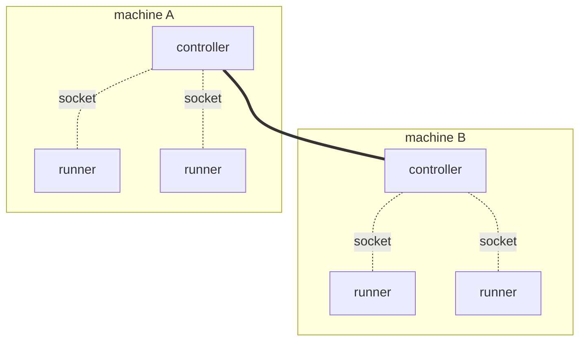

# Deploy a runner

**Before you start:** finish [`controller_deployment.md`](controller_deployment.md).
A runner is useless on its own: it connects to a controller, so you need one
running and reachable before anything here works.

TODO: a draft. Java is the only language filled in, and the last two sections
are not written yet.

## Reach the controller

A runner and its controller talk over a Unix domain socket, so they are on the
same machine. That is the intended shape rather than a limitation: **every
machine that runs runners runs a controller too**, and the runners on it attach
to that local controller through a directory the two share. The controllers then
find each other and behave as one system, so a runner only ever talks to the one
on its own box. The shipped Kubernetes manifests are exactly this, a DaemonSet
with one controller per node.



Dotted lines are Unix domain sockets, and never leave a machine. The solid line
is the controllers clustering.

**QUIC is the other transport, and it is experimental.** It lets a runner cross
a machine boundary: `FLEZHA_TRANSPORT=quic` plus `FLEZHA_QUIC_ADDRESSES`, a
comma separated list of names or addresses, port 4433 by default. It needs
certificates on both ends
([`../operations/authn_authz.md`](../operations/authn_authz.md)) and is far less
exercised than the socket. Prefer the socket.

The rest of this section is the socket.

**The controller prints the answer on every boot:**

```
[flezha] runners attach with FLEZHA_SOCKET_FILES_PATH=/run/user/1000/flezha
```

And one command tells you whether it worked. `flz runner check` walks the exact
ladder a runner walks, needs no runner and no controller, and exits zero only
when a controller answered:

```sh
$ flz runner check
controller reachable at /run/user/1000/flezha (from $XDG_RUNTIME_DIR/flezha); walked
/run/user/1000/flezha, /run/flezha, ./app_data/sockets. Fix: nothing to fix - the
controller answered
```

How you get there depends on how you started the controller in the previous
guide.

<!-- tabs-open -->

### Binaries

**Nothing to configure.** On one machine, as one user, the runner resolves the
same directory the controller did. Start it and it connects.

That is because both sides walk the same ladder and stop at the first candidate:
`$XDG_RUNTIME_DIR/flezha`, then `/run/flezha`, then `./app_data/sockets`
relative to the working directory. Setting `FLEZHA_SOCKET_FILES_PATH` on both
sides names a directory outright and skips the ladder.

**A different user is the one case that needs work.** Directory traversal is the
authentication boundary here, and the socket directory is `0700`, so another
user cannot reach it. Either run the runner as the controller's user, or start
the controller with `FLEZHA_SOCKET_DIR_GROUP=<group>`, a group both users belong
to, which makes the directory `0750` owned by that group. No setting opens it
wider than that.

### Docker

**The socket is inside the container,** so the only question is how to share
that one directory. Give it a volume of its own, separate from the data volume,
and mount it in both places.

If the runner is also a container, a named volume is the whole answer:

```sh
docker run -d --name flezha-controller \
  -v flezha_data:/flezha/app_data \
  -v flezha_sockets:/flezha/app_data/sockets \
  alfetahe/flezha:0.1.0

docker run -d --name my-runner \
  -e FLEZHA_SOCKET_FILES_PATH=/flezha/app_data/sockets \
  -v flezha_sockets:/flezha/app_data/sockets \
  my-runner-image
```

```sh
$ docker exec my-runner flz runner check
controller reachable at /flezha/app_data/sockets (from $FLEZHA_SOCKET_FILES_PATH);
walked /flezha/app_data/sockets. Fix: nothing to fix - the controller answered
```

If the runner runs on the host instead, bind mount a host directory in place of
the named volume:

```sh
docker run -d --name flezha-controller \
  -v flezha_data:/flezha/app_data \
  -v /tmp/flz_sock:/flezha/app_data/sockets \
  alfetahe/flezha:0.1.0

FLEZHA_SOCKET_FILES_PATH=/tmp/flz_sock flz runner check
```

**That one has a condition.** The image runs as uid 1000 and the directory it
creates is `0700`, so the host user has to be uid 1000 as well, or the socket is
there and unreachable. Two containers do not have this problem, because both run
as the same uid.

Keep the path short either way: the directory is capped at 60 bytes, because a
runner's data socket address has to fit beside it.

### Elixir application

**If the runner runs in the same node as the controller, there is no socket at
all.** The Elixir SDK's in-node mode is a function call:

```elixir
children = [{Flezha.SDK, namespace: "my_app", streams: [MyOperative], transport: :native}]
```

`:native` is the default, and it is deliberately not taken from the environment:
a controller sets `FLEZHA_TRANSPORT` for its own server, and a runner that
followed that would dial its own node over a socket. A connect from another BEAM
node is refused.

If the runner is its own node instead, it is an ordinary standalone runner and
the **Binaries** tab applies unchanged.

### Kubernetes

TODO.

<!-- tabs-close -->

**If it does not connect,** `flz runner check` names the verdict and the fix.
Every verdict, and the two failures that are not verdicts:
[`../troubleshooting/runner_cannot_connect.md`](../troubleshooting/runner_cannot_connect.md).

## The hello world

Every SDK ships the same example, so you can read it in one language and
recognise it in another. It is three parts, and every Flezha application has
these same three, whatever it grows into later. What each part is for is the
same in all seven languages, so it is described once here and the code for your
language follows in [the next section](#the-code).

### The procedure

**Your code.** The runtime hands it one message and it emits one message.

It carries a stable name, and that name is durable: per-entity state is filed
under it, so renaming a procedure in a later release does not rename its state,
it declares a different procedure with none of it. Choose the name deliberately
the first time.

It declares its types up front, and the runtime reads them back to decode what
arrives and encode what leaves. The hello world declares that it keeps no state
and takes no configuration, which switches the persistence machinery off
entirely: nothing is journaled, no snapshot is written, and a restart begins
with no history.

Two things it does not do are worth noticing, because they are what makes the
rest possible:

- **It never says where its output goes.** Emitting says what, never where. The
  operative decides the destination, which is why the graph can be rewired
  without this file changing.
- **It never locks anything.** The runtime never runs two messages for the same
  key at the same time, so there is nothing to protect. Messages for different
  keys do run at the same time, possibly on different machines.

There is also a hook that builds the state for one entity, called the first time
a key is seen. It is handed that key, and a payload that is present only when
the entity is arriving from another runner rather than starting cold. On a
resume the runtime restores the newest snapshot and folds the recorded changes
over whatever the hook returns, so it only has to be right for the cold case.

### The operative

**The graph, and it holds no logic at all.** It says which channel feeds which
procedure and where the result is delivered.

A procedure on its own cannot be deployed, because nothing knows where its
messages come from or where its output belongs. The operative supplies exactly
that, which makes it the unit the whole system works in: what the controller
places on a runner, restarts after a crash, moves when a runner disappears, and
splits across several runners when one is not enough.

It carries its own durable identity, separate from the procedure's. That is the
name you type to start one.

The declaration runs once, at registration, and never touches data. Channels are
not constructed directly: each call returns the next handle in the chain, and
the finished graph is validated as a whole before a single message is processed,
so a graph that cannot work is refused at startup rather than halfway through a
run.

**The channel names are addresses, not labels.** The entry channel's name is
what `flz operative send --channel` addresses from outside. The sink's name is
the address stamped on every value the channel delivers, which is what a plugin
filter matches on. Something outside this file is already using both, so
changing either is a breaking change rather than a rename.

### The runner

**A process you run.** It connects to the controller, tells it which operatives
it is able to serve, and then waits.

It decides nothing. It never picks what runs or where; it offers capacity and
does what the controller asks. Declaring an operative on a runner does not start
anything, it says this process is capable of serving that one. One runner can
offer many operatives, and many runners can offer the same one, which is how a
deployment grows.

It takes a namespace, which is the tenant it belongs to. The controller admits
it only if that namespace exists, and, with authorization enforced, only if the
runner can prove it is entitled to it.

Keeping the connection is the runner's own job. If it breaks, the runner
re-dials by itself, retrying forever on a backoff that tops out at 30 seconds,
and it keeps its operatives and their state across the gap rather than starting
over.

### How the three meet

None of them references the others at runtime. You start a runner, the
controller learns the operative exists and can be served, you ask for one by
name, and the controller binds it to a runner that offered it. Messages then
arrive on the channel the operative declared, and your procedure is called.

## The code

The same three parts, in the same order, in your language. Only what is
particular to that language is explained here; what the parts are for is
[above](#the-hello-world).

<!-- tabs-open -->

### Java

The whole example:
[`flezha-sdk-examples/.../examples/echo`](https://github.com/alfetahe/flezha/tree/main/sdk/java/flezha-sdk-examples/src/main/java/com/flezha/examples/echo).

```java
// The procedure. One message in, one message out.
public final class EchoProcedure
        implements Procedure<String, EchoProcedure.None, String, NoChange, WallClock, Void> {

    // This procedure keeps nothing, so its state type has no components.
    public record None() {}

    @Override
    public String name() {
        return "echo";                       // durable: state is filed under it
    }

    @Override
    public None initState(Optional<String> entityKey, Optional<RestoreInitPayload> initPayload) {
        return new None();                   // cold start for one entity
    }

    @Override
    public void run(String input, StateHandle<None, NoChange> state, ProcedureCtx ctx) {
        ctx.emit("echo: " + input);          // what, never where
    }
}
```

**The six type arguments** are, in order: the input, the per-entity state, the
output, the change type, the clock, and the configuration. The runtime recovers
all six from the `implements` clause at registration, so each has to be a
concrete class there rather than a type variable. `NoChange` is how this one
declares that it records no state changes, and `Void` that it takes no
configuration.

```java
// The operative. The graph, and the unit the controller schedules.
public final class EchoOperative implements StreamOperative {

    @Override
    public String factoryId() {
        return "echo";                       // durable: you start this by name
    }

    @Override
    public void channels(ChannelBuilder c) {
        c.input(String.class, "in").into(EchoProcedure.class).sink("out");
    }
}
```

One expression declares the whole data path: an entry channel `in` carrying
strings, routed into the procedure, whose output channel is named `out` and
terminated on the plugin layer. `sink(name)` does both jobs, so naming the
channel again with `named(...)` is refused at registration rather than resolved.

```java
// The runner. Connects, offers the operative, and serves.
public static void main(String[] args) throws Exception {
    Flezha.createRunner(args.length > 0 ? args[0] : "my_app")
            .defineStream(EchoOperative.class)
            .run();
}
```

`run()` connects and then blocks until shutdown, which is either a SIGTERM or a
`close()` from another thread. Use `start()` when the calling thread has
something else to do. `defineWorkflow` is the same call for the workflow kind.

### Rust

TODO.

### Node

TODO.

### Python

TODO.

### Ruby

TODO.

### PHP

TODO.

### Elixir

TODO.

<!-- tabs-close -->

## Start it, check it

TODO.

## Without a controller

TODO.
