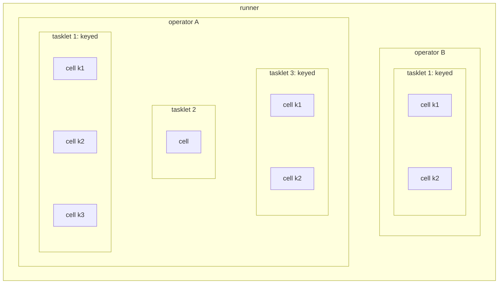

# Running operators

## What an operator is

What you wrote is a **declaration**: a graph from an input to an output, with the
steps in between. It runs nothing by itself. Your runner registers it
as a **factory**, under a **factory id**, and an operator is one running instance created from
that declaration when you ask the controller for one. If the analogy helps, the
declaration is the definition and an operator is a thing made from it.

One declaration backs as many operators as you need, each under a name you
choose and each independent of the rest: its own cells, its own state, its
own placement in the cluster. Ten exchanges to watch is one declaration started
ten times. What the declaration itself is, and why it is the unit the controller
schedules, is in [the runner guide](runner_deployment.md#the-operator).

A runner runs every operator the controller places on it. An operator runs its
tasklets, and each tasklet runs in one or more **cells**: one cell by default,
or one per key when its input is keyed, each with state of its own. `echo` is
the smallest there is, one tasklet in one cell. A bigger runner looks like this:



## The two kinds

An operator's **kind** is fixed when you start it, and it decides when the
thing is over.

**Unbounded operators are always on.** An endless input, no completion, recovery
per cell. `echo` is one, and everything below uses this kind. It runs until
you stop it.

**Bounded operators terminate.** A graph of tasklets, each committing
behind its own barrier before the tasklets it feeds run, ending by itself on
chain completion, when a
tasklet calls `ctx.complete`, or at `max_duration`.
Stopping one by hand ends it early; it is not how one is meant to finish.
[`building_a_workflow.md`](tradedesk/building_a_workflow.md) is the kind's own guide.

## Start one

The runner is connected and has registered the `echo` factory, and nothing is
running yet. Registering a factory says that process is *able* to run operators
made from it.
Starting it is a separate step, and it is the one that creates a running
instance.

> From a third terminal, start an operator from the `echo` factory your runner
> registered, and name it `my_echo`. The controller and your runner from
> [`runner_deployment.md`](runner_deployment.md) have to be running.
> {: .step}

```sh
$ flz operator start echo --id my_echo
```

```output
Started my_echo
```

The command names two ids, and they are not the same kind of thing.

**`my_echo` is the operator id.** You choose it with `--id` when you start the
operator, and it identifies this one operator for as long as it exists. It is
unique within its namespace, and every later command finds the operator by it:
sending it a message, listening to it, stopping it, or attaching a plugin to it
with `--operator_id`. Leave `--id` out and the controller generates one from
the factory id, such as `echo-k7m2qzxw4pd3fn2a`, and prints it.

A start without `--id` that is run again because its answer was lost starts a
second operator, and a second stream runs until it is stopped. Pass `--id` when
a start may be retried: a start of an id that is already running changes nothing
and prints `my_echo is already running, left untouched`.

**`echo` is the factory id.** Every operator class declares exactly one, and
`factoryId()` returns it in your code. A runner registers its classes with the
controller by their factory ids, and `flz operator start` uses the one you give
it to find a runner that can run the class. It is recorded in the controller's
registry and in durable state, so changing it later declares a new class rather
than renaming the old one.

One factory id can back many operators: `flz operator start echo --id eu_echo` and
`flz operator start echo --id us_echo` would be two independent operators of the
same class, each with its own state. Everything after this uses the operator
id.

## Confirm it is bound

You can list the operators in the namespace, with the runner each one is bound
to:

```sh
$ flz operator list
```

```output
Fetching operators for namespace 'default'...
Operators in namespace 'default':

  OPERATOR                         HEALTH    PARTS   NODE                  RUNNER
  my_echo                           healthy   -       flezha@127.0.0.1      default_23fc85126379
```

`RUNNER` is the column that matters. A name there means the controller found a
runner that registered `echo` and bound the instance to it. `(none)`, with
`(unplaced)` under `NODE`, means the instance exists but no runner has been
found to serve it. That almost always means the factory id is spelled one way
in your code and another way on the command line.

## Send one message and see what comes back

> Send `hello world` to `my_echo`. The answer is everything the operator sends
> out during the next two seconds.
> {: .step}

```sh
$ flz operator send my_echo --text 'hello world' --await 2000
```

```output
Delivered to 'my_echo'.
out	echo: hello world
```

The first line is the delivery verdict, and it only says the payload was
accepted. It is answered as soon as the input is durably accepted, before your
tasklet runs, so it tells you nothing about what happened next.

The second line is the output: the channel name, a tab, and the payload your
tasklet emitted. `out` is the name the operator gave that channel with
`.sink("out")`.

`--await 2000` attaches an output listener, delivers the payload, and prints
for two seconds. Read it as **everything this operator emitted during the
window**, not as the answer to your message. A graph is a stream and not a
function: a `filter` can drop your input and print nothing at all, a `flat_map`
or a `key_by` can turn one input into many lines, and an aggregation may emit
minutes later mixed in with earlier inputs. For the hello world those are the
same thing. For a real graph they are not, and the window is the honest
description of both.

## Or watch it from another terminal

```sh
$ flz operator listen my_echo
```

It shows every message the operator sends out, one per line, for 30 seconds.
`--duration-ms` sets a different time, and Ctrl-C stops it sooner. Send from a
second terminal and the lines appear as they arrive:

```
out	echo: hello world
```

Each line is the channel the message left on, a tab, and the message itself. A
message from a keyed channel, one declared with `keyed()`, gets a third column
saying which key it came from and its number in that key's sequence:
`cell=... seq=... key=...`.

Two options help when something looks wrong:

- **`--input`** shows what goes into the operator instead of what comes out. If
  your message appears there but nothing comes out, it arrived and the operator
  produced nothing for it. If it does not appear, it never arrived. A message
  sent without `--channel` shows `-` where the channel would be.
- **`--json`** prints each message as one line of JSON, with the channel, the
  message and everything else attached to it. Use it when a script reads the
  output instead of you.

Listening leaves nothing behind. It stops by itself when the time is up, when
you press Ctrl-C, or when your terminal closes.

## Stopping it, later

`echo` is an unbounded operator, so nothing ends it but you. **Leave it running for
now:** the next guide attaches plugins to it, and
[`stop_everything.md`](stop_everything.md) stops it at the end of Part 1. The
command is:

```sh
$ flz operator stop my_echo
```

Two things about the lifetime surprise people.

**You start an operator once, not once per session.** The controller keeps the
operator list in a durable registry and rehydrates it on boot, so after a
controller restart `my_echo` comes back on its own. Running `start` again is
not how you bring it back.

**Running `start` again on a live id changes nothing, quietly.** It reports
that the existing instance was left untouched, and the options are not
compared. So editing the command to add `--partitions 3` and re-running it
looks like it worked and did nothing at all. Stop the instance first, then
start it with the options you want.

## Or from your own code

Every verb above is also a method on the runner, so an application can start and
stop its own operators without anyone typing `flz`. `runner.admin()` reaches
them, and the controller judges each call as the identity the connection already
proved, so nothing holds a credential and nothing expires.

<!-- tabs-open -->

### Java

```java
FlezhaRunner runner = Flezha.createRunner("default")
        .registerFactory(EchoOperator.class)
        .start();

Admin admin = runner.admin();
admin.startOperator(OperatorSpec.of("echo").id("my_echo"));
admin.send("my_echo", "hello", "in");
admin.stopOperator("my_echo");

runner.awaitTermination();
```

`start()` rather than `run()`, because `run()` is `start()` followed by
`awaitTermination()` and never hands the handle back. Split the two and the
admin calls go between them: nothing extra keeps the process alive, the wait
does, exactly as before.

The echo example carries these lines commented out in its `Main`,
[ready to uncomment](https://github.com/flezha/flezha_java_sdk/tree/main/examples/echo).

### Rust

```rust
let runner = Flezha::create_runner("default")?;
runner.register_factory(EchoOperator)?.start()?;

let admin = runner.admin();
admin.start_operator(&OperatorSpec::new("echo").id("my_echo"))?;
admin.send("my_echo", "hello", "in")?;
admin.stop_operator("my_echo")?;

runner.await_termination()?;
```

`start()` rather than `run()`, for the same reason as in Java. Each call answers
the controller's own result as a `serde_json::Value`, and a refusal as an
`AdminError`.

The echo example carries the calls commented out in its `main.rs`,
[ready to uncomment](https://github.com/flezha/flezha_rust_sdk/tree/main/examples/echo).

### Node

```javascript
const runner = createRunner('default');
await runner.registerFactory('./echo_operator.mjs');
await runner.run();

const admin = runner.admin();
await admin.startOperator('echo', { id: 'my_echo' });
await admin.send('my_echo', 'hello', 'in');
await admin.stopOperator('my_echo');
```

`run()` resolves once the runner is connected and serving, so the calls go after
it and the process keeps serving without a wait of its own. Each call is a promise
of the controller's result.

The echo example carries the calls commented out in its `runner.mjs`,
[ready to uncomment](https://github.com/flezha/flezha_node_sdk/tree/main/examples/echo).

### Python

```python
runner = flezha.create_runner("default")
runner.register_factory(echo_operator)
runner.start()

admin = runner.admin()
admin.start_operator("echo", id="my_echo")
admin.send("my_echo", "hello", "in")
admin.stop_operator("my_echo")

runner.await_termination()
```

`start()` rather than `run()`, for the same reason as in Java. Each call blocks
for the controller's answer.

The echo example carries the calls commented out in its `runner.py`,
[ready to uncomment](https://github.com/flezha/flezha_python_sdk/tree/main/examples/echo).

### Ruby

```ruby
runner = Flezha.create_runner("default").register_factory(EchoOperator)
runner.boot

admin = runner.admin
admin.start_operator("echo", id: "my_echo")
admin.send_to("my_echo", "hello", channel: "in")
admin.stop_operator("my_echo")

runner.await_termination
```

`boot` rather than `run`, because `run` is `boot` followed by
`await_termination`. It is `send_to` rather than `send`, which every Ruby object
already has.

The echo example carries the calls commented out in its `runner.rb`,
[ready to uncomment](https://github.com/flezha/flezha_ruby_sdk/tree/main/examples/echo).

### PHP

```php
$runner = Flezha::createRunner('default')
    ->registerFactory(EchoOperator::class)
    ->start();

$admin = $runner->admin();
$admin->startOperator('echo', id: 'my_echo');
$admin->send('my_echo', 'hello', 'in');
$admin->stopOperator('my_echo');

$runner->awaitTermination();
```

`start()` rather than `run()`, for the same reason as in Java. The calls are
answered at once, but PHP has no threads: a message they send is processed once
`awaitTermination()` starts serving.

The echo example carries the calls commented out in its `runner.php`,
[ready to uncomment](https://github.com/flezha/flezha_php_sdk/tree/main/examples/echo).

### Elixir

```elixir
children = [{Flezha.SDK, namespace: "default", operators: [Echo.Operator], transport: :uds}]
{:ok, _supervisor} = Supervisor.start_link(children, strategy: :one_for_one)

alias Flezha.SDK.Admin
runner = Flezha.SDK.RunnerServer

{:ok, _} = Admin.start_operator(runner, "echo", id: "my_echo")
{:ok, _} = Admin.send_to(runner, "my_echo", "hello", "in")
{:ok, _} = Admin.stop_operator(runner, "my_echo")
```

Functions rather than methods: each takes the runner, here its registered process,
and answers `{:ok, result}` or `{:error, reason}`. The runner is connected once its
child has started, so the calls can follow `Supervisor.start_link/2`.

The echo example carries the calls commented out in its `application.ex`,
[ready to uncomment](../../sdk/elixir/examples/echo/lib/echo/application.ex).

<!-- tabs-close -->

An operator started this way is the cluster's, not the connection's: it
survives the runner disconnecting, and a user sees it in
`flz operator list` and can stop it there.

## Next

An operator with nothing feeding it does nothing.
[`sources_and_sinks.md`](sources_and_sinks.md) attaches a real input and a real
output to it.
