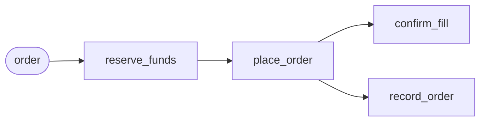

# Building a workflow

On this page we build the desk's workflow. A workflow is a piece of work made
of steps that run in a fixed order, from the first to the last. Here the work
is one order: put the money aside, place the order with the exchange, then
confirm the fill and book the order.

We build it with a bounded operator, because an order has a start and an end.
Once it is filled or refused, there is nothing left to do. A bounded operator is
exactly that: you start it with the work it should do, it runs its steps, and
it stops by itself after the last one. Every order gets one of its own, so a
hundred orders are a hundred small runs that never get in each other's way.

Each step is written down the moment it finishes. If the runner crashes in the
middle of an order, the order carries on from the step it had reached, and the
steps before it do not run again, so the money is not put aside twice. If a
step fails for good, the steps that already ran are undone, last one first: the
order is cancelled, and the money is released. Half an order is worse than
none, and a bounded operator makes sure the desk never keeps one.

## The desk's bounded operator

The desk's bounded operator is called `order_executor`, and one instance of it is
one order. [`building_an_etl_stream.md`](building_an_etl_stream.md) starts one
for every buy, and you can start one by hand.

You write it in six pieces, one section each: the two steps that can be undone,
which reserve the money and place the order; the step that confirms the fill,
which is where an order can fail; the step that books the order; the operator,
which connects the four into the path every order takes; and the runner, which
now registers both factories. Running it comes later, in [`partitioning.md`](partitioning.md).

## A step that can be undone

`reserve_funds` is the first step. It puts the money for the order aside and
gives that reservation an id. Then it hands the order on to the next step,
together with the id.

If the order fails later, the money has to be released again. That is the
step's undo. To release the money, the undo has to know which reservation to
release, so the step writes the id down in its state, its memory, where the
undo can find it.

> Write the step that reserves the money, and releases it on an undo. It goes
> into the same runner project as the ETL stream; the finished project is
> linked at the top of your language's tab.
> {: .step}

<!-- tabs-open -->

### Java

The whole example:
[`sdk/java/examples/tradedesk`](https://github.com/flezha/flezha_java_sdk/tree/main/examples/tradedesk).

```java
// ReserveFunds.java: step one. Puts the money aside, and releases it on an undo.
@Tasklet.Spec(name = "reserve_funds")
public final class ReserveFunds implements Tasklet<OrderTicket, ReserveFunds.Reservation, ReserveFunds.Reserved> {

    public record Reserved(OrderTicket order, String reservationId) {}  // what it hands on

    public static class Reservation {                        // what this step remembers
        public String id = "";
    }

    public record Reserving(String id) implements Change<Reservation> {  // how the id is written down
        @Override
        public void applyTo(Reservation reservation) {
            reservation.id = id;
        }
    }

    // The step: reserve the money under an id, remember the id, and hand the order on.
    @Override
    public void run(OrderTicket order, Ctx<Reservation, Reserved> ctx) throws TaskletException {
        String id = "res-" + ctx.stableId();                 // the same id when the step runs again
        ctx.change(new Reserving(id));
        ctx.emit(new Reserved(order, id));
    }

    // The undo: release the money, by the id the state kept.
    @Override
    public void compensate(List<Reserved> completedOutput, Ctx<Reservation, Reserved> ctx) {
        System.out.println("[undo] released " + ctx.state().id);
    }
}
```

**Flezha calls `run` with the order**, and passes it two things: the input and
the context, as it did for the ETL stream's tasklets.

- `order` is the input, what arrives on the step's channel. For the first step,
  that is the order the instance was started with, an `OrderTicket`.
- `ctx` is the context, the step's way of talking to Flezha. `ctx.change(...)`
  writes the id down in the step's state, the `Reservation` class above, and
  `ctx.state()` reads it back. `ctx.emit(...)` hands a value to the next step,
  and `ctx.stableId()` gives an id that stays the same when the step runs
  again, so a retry does not put the money aside twice.

`Tasklet<OrderTicket, Reservation, Reserved>` names what comes in, what the step
remembers, and what it hands on: a `Reserved`, the order and the id.
`Reserving` is the change that writes the id down, applied by its `applyTo`.

**Flezha calls `compensate` only when the order fails**, and passes it two
things:

- `completedOutput` is what `run` handed on, a list of `Reserved`.
- `ctx` is the context again, and `ctx.state()` is the same state `run` wrote
  the id into.

The id is read from the state, not from `completedOutput`, because after a
crash Flezha brings back the step's state but not what it handed on, so the
list can be empty. Writing a `compensate` is what gives a step an undo, and a
step without one is skipped. It can run twice, when a crash comes in the middle
of an undo, so it has to be safe to repeat.

The operator names the class itself, `ReserveFunds`.
[What `@Tasklet.Spec` declares](building_an_etl_stream.md#keep-each-symbol-s-prices)
lists what the annotation carries. `OrderTicket` is declared with the operator, in
[Several tasklets, step by step](#several-tasklets-step-by-step), because it is
what the whole operator takes.

### Rust

The whole example:
[`sdk/rust/examples/tradedesk`](https://github.com/flezha/flezha_rust_sdk/tree/main/examples/tradedesk).

```rust
// src/reserve_funds.rs: step one. Puts the money aside, and releases it on an undo.
#[derive(Clone, Serialize, Deserialize)]
pub struct Reserved {
    pub order: OrderTicket,
    pub reservation_id: String,
}

#[derive(Default, Serialize, Deserialize)]
pub struct Reservation {
    id: String,
}

#[derive(Serialize, Deserialize)]
pub struct Reserving(String);

impl Change<Reservation> for Reserving {
    fn apply_to(&self, reservation: &mut Reservation) {
        reservation.id = self.0.clone();
    }
}

#[derive(Default)]
pub struct ReserveFunds;

#[tasklet(name = "reserve_funds")]
impl Tasklet for ReserveFunds {
    type Input = OrderTicket;
    type Output = Reserved;
    type State = Reservation;
    type Change = Reserving;

    // The step: reserve the money under an id, remember the id, and hand the order on.
    fn run(&mut self, order: OrderTicket, ctx: &mut Ctx<'_, Self>) -> Result<(), TaskletError> {
        let id = format!("res-{}", ctx.stable_id()); // the same id when the step runs again
        ctx.change(Reserving(id.clone()));
        ctx.emit(Reserved {
            order,
            reservation_id: id,
        })
    }

    // The undo: release the money, by the id the state kept.
    fn compensate(
        &mut self,
        _: Vec<Arc<Reserved>>,
        ctx: &mut Ctx<'_, Self>,
    ) -> Result<(), TaskletError> {
        println!("[undo] released {}", ctx.state().id);
        Ok(())
    }
}
```

**Flezha calls `run` with the order**, and passes it two things: the input and
the context, as it did for the ETL stream's tasklets.

- `order` is the input, what arrives on the step's channel. For the first step,
  that is the order the instance was started with, an `OrderTicket`.
- `ctx` is the context, the step's way of talking to Flezha. `ctx.change(...)`
  writes the id down in the step's state, the `Reservation` struct above, and
  `ctx.state()` reads it back. `ctx.emit(...)` hands a value to the next step,
  and `ctx.stable_id()` gives an id that stays the same when the step runs
  again, so a retry does not put the money aside twice.

The step takes an `OrderTicket`, remembers a `Reservation`, and hands on a
`Reserved`, the order and the id. `Reserving` is the change that writes the id
down, applied by its `apply_to`.

**Flezha calls `compensate` only when the order fails**, and passes it two
things:

- the first is what `run` handed on, a `Vec` of `Reserved`.
- `ctx` is the context again, and `ctx.state()` is the same state `run` wrote
  the id into.

The id is read from the state, not from what was handed on, because after a
crash Flezha brings back the step's state but not what it handed on, so the
list can be empty. Writing a `compensate` is what gives a step an undo, and a
step without one is skipped. It can run twice, when a crash comes in the middle
of an undo, so it has to be safe to repeat.

The operator names the type itself, `ReserveFunds`.
[What `#[tasklet]` writes](building_an_etl_stream.md#keep-each-symbol-s-prices)
lists what the attribute carries. `OrderTicket` is declared with the operator, in
[Several tasklets, step by step](#several-tasklets-step-by-step), because it is
what the whole operator takes.

### Node

TODO: not written yet.

### Python

TODO: not written yet.

### Ruby

TODO: not written yet.

### PHP

TODO: not written yet.

### Elixir

TODO: not written yet.

<!-- tabs-close -->

## Place the order

`place_order` has the same shape. Its `run` gets what `reserve_funds` handed on,
a `Reserved`, places the order with the paper exchange under an id, writes the
id into its state, and hands the order on. Its `compensate` cancels the order
by that id.

> Write the step that places the order, and cancels it on an undo.
> {: .step}

<!-- tabs-open -->

### Java

```java
// PlaceOrder.java: step two. Places the order, and cancels it on an undo.
@Tasklet.Spec(name = "place_order")
public final class PlaceOrder implements Tasklet<Reserved, PlaceOrder.Placement, PlaceOrder.PlacedOrder> {

    public record PlacedOrder(OrderTicket order, String orderId) {}  // what it hands on

    public static class Placement {                          // what this step remembers
        public String orderId = "";
    }

    public record Placing(String orderId) implements Change<Placement> {  // how the id is written down
        @Override
        public void applyTo(Placement placement) {
            placement.orderId = orderId;
        }
    }

    // The step: place the order under an id, remember the id, and hand the order on.
    @Override
    public void run(Reserved reserved, Ctx<Placement, PlacedOrder> ctx) throws TaskletException {
        String orderId = "ord-" + ctx.stableId();
        ctx.change(new Placing(orderId));
        ctx.emit(new PlacedOrder(reserved.order(), orderId));
    }

    // The undo: cancel the order, by the id the state kept.
    @Override
    public void compensate(List<PlacedOrder> completedOutput, Ctx<Placement, PlacedOrder> ctx) {
        System.out.println("[undo] cancelled " + ctx.state().orderId);
    }
}
```

### Rust

```rust
// src/place_order.rs: step two. Places the order, and cancels it on an undo.
#[derive(Clone, Serialize, Deserialize)]
pub struct PlacedOrder {
    pub order: OrderTicket,
    pub order_id: String,
}

#[derive(Default, Serialize, Deserialize)]
pub struct Placement {
    order_id: String,
}

#[derive(Serialize, Deserialize)]
pub struct Placing(String);

impl Change<Placement> for Placing {
    fn apply_to(&self, placement: &mut Placement) {
        placement.order_id = self.0.clone();
    }
}

#[derive(Default)]
pub struct PlaceOrder;

#[tasklet(name = "place_order")]
impl Tasklet for PlaceOrder {
    type Input = Reserved;
    type Output = PlacedOrder;
    type State = Placement;
    type Change = Placing;

    // The step: place the order under an id, remember the id, and hand the order on.
    fn run(&mut self, reserved: Reserved, ctx: &mut Ctx<'_, Self>) -> Result<(), TaskletError> {
        let order_id = format!("ord-{}", ctx.stable_id());
        ctx.change(Placing(order_id.clone()));
        ctx.emit(PlacedOrder {
            order: reserved.order,
            order_id,
        })
    }

    // The undo: cancel the order, by the id the state kept.
    fn compensate(
        &mut self,
        _: Vec<Arc<PlacedOrder>>,
        ctx: &mut Ctx<'_, Self>,
    ) -> Result<(), TaskletError> {
        println!("[undo] cancelled {}", ctx.state().order_id);
        Ok(())
    }
}
```

### Node

TODO: not written yet.

### Python

TODO: not written yet.

### Ruby

TODO: not written yet.

### PHP

TODO: not written yet.

### Elixir

TODO: not written yet.

<!-- tabs-close -->

## A step that can fail

`confirm_fill` asks the paper exchange whether the order filled. The exchange
takes ten seconds to answer, and it fills at most 100 at a time, so a bigger
order is refused: this is the step where an order can fail. The ten seconds are what let
[`durability.md`](durability.md#an-order-in-the-middle-of-a-crash) crash the
runner in the middle of an order.

A step that fails is tried again, three times in all by default, with a short
wait between tries that grows each time. When the tries run out, the order ends
in failure, and every step that had finished is undone, last one first: the
order is cancelled, then the money is released.

When the fill is confirmed, the step ends the order with a result instead of
emitting one: `ctx.complete` gives the order its answer, the symbol, the
quantity and the exchange's id for the order.

> Write the step that confirms the fill.
> {: .step}

<!-- tabs-open -->

### Java

```java
// ConfirmFill.java: asks the exchange whether the order filled, and ends the order with the answer.
@Tasklet.Spec(name = "confirm_fill")
public final class ConfirmFill implements Tasklet<PlacedOrder, Void, Void> {

    private static final int EXCHANGE_MAX = 100;

    @Override
    public void run(PlacedOrder placed, Ctx<Void, Void> ctx) throws TaskletException {
        try {
            Thread.sleep(10_000);                            // the paper exchange takes ten seconds to answer
        } catch (InterruptedException stopped) {
            Thread.currentThread().interrupt();
            throw new TaskletException("stopped while waiting for the exchange");
        }
        int quantity = placed.order().quantity();
        if (quantity > EXCHANGE_MAX) {
            throw new TaskletException(                      // tried again, then the order is undone
                    "the exchange fills at most " + EXCHANGE_MAX + " a time, and this is " + quantity);
        }
        ctx.complete("filled " + placed.order().symbol() + " " + quantity + " as " + placed.orderId());
    }
}
```

A `TaskletException` is retried. The number of tries and the wait are set
where the operator connects the step, with `retryMax` and `retryBackoffMs`;
the desk keeps the defaults.

### Rust

```rust
// src/confirm_fill.rs: asks the exchange whether the order filled, and ends the order with the answer.
const EXCHANGE_MAX: u32 = 100;

#[derive(Default)]
pub struct ConfirmFill;

#[tasklet(name = "confirm_fill")]
impl Tasklet for ConfirmFill {
    type Input = PlacedOrder;

    fn run(&mut self, placed: PlacedOrder, ctx: &mut Ctx<'_, Self>) -> Result<(), TaskletError> {
        std::thread::sleep(Duration::from_secs(10)); // the paper exchange takes ten seconds to answer
        let quantity = placed.order.quantity;
        if quantity > EXCHANGE_MAX {
            return Err(TaskletError::Custom(format!(
                "the exchange fills at most {EXCHANGE_MAX} a time, and this is {quantity}"
            ))); // tried again, then the order is undone
        }
        ctx.complete(format!(
            "filled {} {quantity} as {}",
            placed.order.symbol, placed.order_id
        ))
    }
}
```

An `Err` from `run` is retried. The number of tries and the wait are set where
the operator connects the step, with `retry_max` and `retry_backoff_ms`; the
desk keeps the defaults.

### Node

TODO: not written yet.

### Python

TODO: not written yet.

### Ruby

TODO: not written yet.

### PHP

TODO: not written yet.

### Elixir

TODO: not written yet.

<!-- tabs-close -->

## A step with nothing to undo

`record_order` writes the placed order into the desk's book. It keeps nothing
and hands nothing on. It has no undo either, on purpose: the book records what
the desk tried, and an order that was cancelled again was still tried. When an
order is undone, a step with no `compensate` is skipped.

> Write the step that books the order.
> {: .step}

<!-- tabs-open -->

### Java

```java
// RecordOrder.java: writes the placed order into the desk's book.
@Tasklet.Spec(name = "record_order")
public final class RecordOrder implements Tasklet<PlacedOrder, Void, Void> {

    @Override
    public void run(PlacedOrder placed, Ctx<Void, Void> ctx) {
        System.out.println(
                "[book] " + placed.order().symbol() + " " + placed.order().quantity() + " as " + placed.orderId());
    }
}
```

A `Void` state and a `Void` output keep nothing and hand nothing on, which is
the plainest shape a tasklet has.

### Rust

```rust
// src/record_order.rs: writes the placed order into the desk's book.
#[derive(Default)]
pub struct RecordOrder;

#[tasklet(name = "record_order")]
impl Tasklet for RecordOrder {
    type Input = PlacedOrder;

    fn run(&mut self, placed: PlacedOrder, _: &mut Ctx<'_, Self>) -> Result<(), TaskletError> {
        println!(
            "[book] {} {} as {}",
            placed.order.symbol, placed.order.quantity, placed.order_id
        );
        Ok(())
    }
}
```

With no `type State` and no `type Output` written, it keeps nothing and hands
nothing on, which is the plainest shape a tasklet has.

### Node

TODO: not written yet.

### Python

TODO: not written yet.

### Ruby

TODO: not written yet.

### PHP

TODO: not written yet.

### Elixir

TODO: not written yet.

<!-- tabs-close -->

## Several tasklets, step by step

With the four steps written, the operator connects them. It declares the
steps an order takes, in one expression that reads in the order they run:



The order enters on the channel `order`, as the `OrderTicket` that
`reserve_funds` takes:

```json
{"symbol": "EUR/USD", "quantity": 10}
```

`into` adds a step, as it adds a tasklet to an ETL stream, but a step does not
see a value the moment the step before it emits one. It sees it once that step
has finished and the controller has written that down. So when an order stops
half way, it is known exactly which steps are done.

`branch` splits the path in two. Both arms get the same placed order, and they
run side by side: confirming the fill does not wait for the book, nor the book
for the fill.

There is no `sink`. `confirm_fill` ends the order with a result of its own,
which is the order's answer. None of the channels between the steps has a
name either, so each is named after the step that feeds it, and that is the
name you see in the journal and in an error.

An instance runs its steps once, on the first message it gets, and then it is
over; a second message to it is never read. That is the default, and all an
order needs.

> Write the operator.
> {: .step}

<!-- tabs-open -->

### Java

```java
// OrderExecutorOperator.java: the bounded operator. One instance is one order.
public final class OrderExecutorOperator implements BoundedOperator {

    public record OrderTicket(String symbol, int quantity) {}

    @Override
    @Nonnull
    public String factoryId() {
        return "order_executor";
    }

    @Override
    public void channels(@Nonnull ChannelBuilder c) {
        c.input(OrderTicket.class, "order")
                .into(ReserveFunds.class)                                  // step one
                .into(PlaceOrder.class)                                    // step two, once step one is done
                .branch(
                        fill -> fill.into(ConfirmFill.class),              // two arms, side by side
                        book -> book.into(RecordOrder.class));
    }
}
```

`OrderTicket` is the order an instance is started with: `reserve_funds` takes
it, and `BuyAboveAverage` in the ETL stream sends it when it starts an order.
The four classes it names in `into` are the four steps themselves:
`ReserveFunds`, `PlaceOrder`, `ConfirmFill` and `RecordOrder`.

### Rust

```rust
// src/order_executor.rs: the bounded operator. One instance is one order.
#[derive(Clone, Serialize, Deserialize)]
pub struct OrderTicket {
    pub symbol: String,
    pub quantity: u32,
}

pub struct OrderExecutorOperator;

impl BoundedOperator for OrderExecutorOperator {
    fn factory_id() -> &'static str {
        "order_executor"
    }

    fn channels(c: &ChannelBuilder) {
        c.input::<OrderTicket>("order")
            .into::<ReserveFunds>() // step one
            .into::<PlaceOrder>() // step two, once step one is done
            .branch([
                &|fill| {
                    fill.into::<ConfirmFill>(); // two arms, side by side
                },
                &|book| {
                    book.into::<RecordOrder>();
                },
            ]);
    }
}
```

`OrderTicket` is the order an instance is started with: `reserve_funds` takes
it, and `BuyAboveAverage` in the ETL stream sends it when it starts an order.
The four types it names in `into::<...>()` are the four steps themselves:
`ReserveFunds`, `PlaceOrder`, `ConfirmFill` and `RecordOrder`. Each arm of
`branch` is a closure that gets the same handle.

### Node

TODO: not written yet.

### Python

TODO: not written yet.

### Ruby

TODO: not written yet.

### PHP

TODO: not written yet.

### Elixir

TODO: not written yet.

<!-- tabs-close -->

## The runner

One runner registers both of the desk's factories. Registering `order_executor`
starts no order: it tells the controller this runner can run orders, and each
one is started from the factory later, one per buy. A bounded operator's factory
is registered the same way as an unbounded one's.

> Register the `order_executor` factory on the runner too, before `start()`.
> {: .step}

<!-- tabs-open -->

### Java

```java
// Main.java: the runner. Joins trading and registers both factories.
public static void main(String[] args) throws Exception {
    FlezhaRunner runner = Flezha.createRunner(args.length > 0 ? args[0] : "trading")
            .registerFactory(TradeWatcherOperator.class)
            .registerFactory(OrderExecutorOperator.class)
            .start();

    runner.awaitTermination();
}
```

### Rust

```rust
// src/main.rs: the runner. Joins trading and registers both factories.
fn main() -> Result<(), Box<dyn std::error::Error>> {
    let namespace = std::env::args()
        .nth(1)
        .unwrap_or_else(|| "trading".to_string());

    let runner = Flezha::create_runner(namespace)?;
    runner
        .register_factory(trade_watcher::TradeWatcherOperator)?
        .register_factory(order_executor::OrderExecutorOperator)?
        .start()?;

    runner.await_termination()?;
    Ok(())
}
```

### Node

TODO: not written yet.

### Python

TODO: not written yet.

### Ruby

TODO: not written yet.

### PHP

TODO: not written yet.

### Elixir

TODO: not written yet.

<!-- tabs-close -->

## Next

The desk has both of its operators, and neither has run yet.
[`partitioning.md`](partitioning.md) starts them, and spreads the desk's
symbols over partitions.
