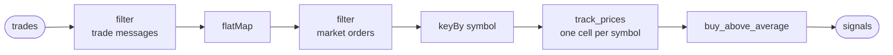

# Building an ETL stream

On this page we build the desk's ETL stream. ETL stands for extract, transform,
load: a pipeline that takes data from one place, changes it into what you need,
and delivers it somewhere else. Here it takes trades from the exchange, works out
which prices are worth buying at, and sends those out.

We build it with an unbounded operator, because trades never stop coming, so the
pipeline should never stop either. An unbounded operator is exactly that: you
start it once, and it keeps running until you stop it. Each trade is handled the
moment it arrives, and each result goes out right away. Each symbol's trades
are handled one at a time, in the order they arrived, so a price is always
compared with the prices before it, while different symbols are handled side by
side. It can also remember what it has seen, which the desk needs to keep each
symbol's recent prices.

## The desk's ETL pipeline stream operator

The desk's ETL pipeline stream operator is called `trade_watcher`. Trades come
in from the exchange, and for each symbol it keeps the last ten prices. When a
new price is 2 % or more above their average, the desk buys: it starts an order.

You write it in four pieces, one section each: the tasklet that keeps each
symbol's prices; the tasklet that decides when to buy; the operator, which
connects the two into the path every trade takes; and the runner, which
registers the operator's factory. Running it comes later in Part 2.

## Keep each symbol's prices

`track_prices` keeps each symbol's last ten prices, its window. A tasklet
remembers things in its cell, and the operator gives every symbol a cell of its
own, so every symbol has its own window: EUR/USD's prices never mix with
USD/JPY's. [Cells](#cells), right after this tasklet, explains what a cell is.

It takes a trade, which is a symbol, a price and an order type. A symbol's
first trade has nothing to be compared with, so it only goes into the window.
Every later trade emits a move: the price, and the average of the prices before
it.

> Write the tasklet that keeps each symbol's window. It goes into the runner
> project you started in
> [`namespaces.md`](namespaces.md#joining-it-from-a-runner); the finished
> project is linked at the top of your language's tab.
> {: .step}

<!-- tabs-open -->

### Java

The whole example:
[`sdk/java/examples/tradedesk`](https://github.com/flezha/flezha_java_sdk/tree/main/examples/tradedesk).

```java
// TrackPrices.java: keeps a symbol's last ten prices, and compares each new one with their average.
@Tasklet.Spec(name = "track_prices")
public final class TrackPrices implements Tasklet<TrackPrices.Trade, TrackPrices.PriceWindow, TrackPrices.Move> {

    @JsonIgnoreProperties(ignoreUnknown = true)              // the exchange sends more than the desk reads
    public record Trade(String symbol, double price, String ord_type) {}
    public record Move(String symbol, double price, double average) {}

    private static final int WINDOW = 10;

    public static class PriceWindow {                        // what each symbol's cell remembers
        public Deque<Double> prices = new ArrayDeque<>();
    }

    public record PriceSeen(double price) implements Change<PriceWindow> {  // how a price joins the window
        @Override
        public void applyTo(PriceWindow window) {
            window.prices.addLast(price);
            if (window.prices.size() > WINDOW) {
                window.prices.removeFirst();
            }
        }
    }

    @Override
    public void run(Trade trade, Ctx<PriceWindow, Move> ctx) throws TaskletException {
        Deque<Double> prices = ctx.state().prices;
        if (!prices.isEmpty()) {                             // a symbol's first trade has nothing to compare with
            ctx.emit(new Move(trade.symbol(), trade.price(), average(prices)));
        }
        ctx.change(new PriceSeen(trade.price()));
    }

    private static double average(Deque<Double> prices) {
        return prices.stream().mapToDouble(Double::doubleValue).average().orElseThrow();
    }
}
```

**Flezha calls `run` once for every trade**, and passes it two things:

- `trade` is the input: one trade, as it arrives on the tasklet's channel.
- `ctx` is the context, the tasklet's way of talking to Flezha. `ctx.state()`
  is this symbol's cell state, what it remembers: the `PriceWindow` above.
  `ctx.emit(...)` hands a `Move` on, and `ctx.change(...)` records a change to
  the state.

`Tasklet<Trade, PriceWindow, Move>` names the three types in that order: what
comes in, what the cell remembers, and what goes out. The first trade of a
symbol emits nothing, because `run` only calls `ctx.emit` when there is an
average to compare with.

**The state changes only through a change.** `PriceSeen` is the one change the
window records: a record that carries the price, with an `applyTo` that adds it
and drops the oldest once there are more than ten. `ctx.change` runs `applyTo`
and writes the change down, and after a crash Flezha runs `applyTo` again for
every change it wrote, which is how the window comes back. Assigning a field of
`ctx.state()` directly would work until the first crash and then be gone.

`Trade`, `Move`, `PriceWindow` and `PriceSeen` sit inside the tasklet, because
nothing else uses them. The annotation on `Trade` is explained with the
operator below, and the box below lists what `@Tasklet.Spec` declares.

> #### What `@Tasklet.Spec` declares {: .info}
>
> Nothing is generated: the class you write is the class the operator names in
> `into(...)`. `@Tasklet.Spec` is read when the runner registers the operator,
> and carries the tasklet's name and settings:
>
> | Member | What it is |
> |---|---|
> | `name` | required: the name the tasklet's state is saved under, so choose it once |
> | `keys` | fixed cell keys, with a `cellsFor` method that routes each input |
> | `capacity`, `maxCells`, `idleTtlSeconds` | the cell's mailbox, the cap on cells, and how long an idle cell lives |
> | `schemaVersion`, `logicalClock` | the version of the saved state, and a clock that counts changes |
>
> A change nested in the tasklet or its state, like `PriceSeen`, is registered
> for saving on its own. Optional hooks, such as a timer's `onTimer` or an
> undo's `compensate`, are declared by writing the method.

### Rust

The whole example:
[`sdk/rust/examples/tradedesk`](https://github.com/flezha/flezha_rust_sdk/tree/main/examples/tradedesk).

```rust
// src/track_prices.rs: keeps a symbol's last ten prices, and compares each new one with their average.
#[derive(Clone, Deserialize)]
pub struct Trade {
    pub symbol: String,
    pub price: f64,
    pub ord_type: String,
}

#[derive(Clone, Serialize, Deserialize)]
pub struct Move {
    pub symbol: String,
    pub price: f64,
    pub average: f64,
}

const WINDOW: usize = 10;

#[derive(Default, Serialize, Deserialize)]
pub struct PriceWindow {
    prices: VecDeque<f64>,
}

#[derive(Serialize, Deserialize)]
pub struct PriceSeen(f64);

impl Change<PriceWindow> for PriceSeen {
    fn apply_to(&self, window: &mut PriceWindow) {
        window.prices.push_back(self.0);
        if window.prices.len() > WINDOW {
            window.prices.pop_front();
        }
    }
}

#[derive(Default)]
pub struct TrackPrices;

#[tasklet(name = "track_prices")]
impl Tasklet for TrackPrices {
    type Input = Trade;
    type Output = Move;
    type State = PriceWindow;
    type Change = PriceSeen;

    fn run(&mut self, trade: Trade, ctx: &mut Ctx<'_, Self>) -> Result<(), TaskletError> {
        let prices = &ctx.state().prices;
        if !prices.is_empty() {
            // a symbol's first trade has nothing to compare with
            let average = prices.iter().sum::<f64>() / prices.len() as f64;
            ctx.emit(Move {
                symbol: trade.symbol,
                price: trade.price,
                average,
            })?;
        }
        ctx.change(PriceSeen(trade.price));
        Ok(())
    }
}
```

**Flezha calls `run` once for every trade**, and passes it two things:

- `trade` is the input: one trade, as it arrives on the tasklet's channel.
- `ctx` is the context, the tasklet's way of talking to Flezha. `ctx.state()`
  is this symbol's cell state, what it remembers: the `PriceWindow` above.
  `ctx.emit(...)` hands a `Move` on, and `ctx.change(...)` records a change to
  the state.

The four associated types name what comes in, what goes out, what the cell
remembers, and the change that records it. The first trade of a symbol emits
nothing, because `run` only calls `ctx.emit` when there is an average to
compare with.

**The state changes only through a change.** `PriceSeen` is the one change the
window records: a struct that carries the price, with an `apply_to` that adds
it and drops the oldest once there are more than ten. `ctx.change` runs
`apply_to` and writes the change down, and after a crash Flezha runs `apply_to`
again for every change it wrote, which is how the window comes back.
`ctx.state()` only lends the state for reading, so assigning one of its fields
does not compile.

`Trade`, `Move`, `PriceWindow` and `PriceSeen` sit in the tasklet's file,
because nothing else uses them. serde ignores the fields of a message that a
struct does not name, so `Trade` reads the three it needs from what the
exchange sends. The box below lists what `#[tasklet]` writes.

> #### What `#[tasklet]` writes {: .info}
>
> No type is generated: the type you write is the type the operator names in
> `into::<...>()`. The attribute only adds to its `impl` block what the block
> leaves out, and takes the tasklet's name and settings as keys:
>
> | Key | What it is |
> |---|---|
> | `name` | required: the name the tasklet's state is saved under, so choose it once |
> | `keys` | fixed cell keys, with a `cells_for` function that routes each input |
> | `capacity`, `max_cells`, `idle_ttl_seconds` | the cell's mailbox, the cap on cells, and how long an idle cell lives |
> | `schema_version`, `logical_clock` | the version of the saved state, and a clock that counts changes |
>
> A block that writes no `type State` keeps nothing. Optional hooks, such as a
> timer's `on_timer` or an undo's `compensate`, are declared by writing the
> function.

### Node

TODO: not written yet.

### Python

The whole example:
[`sdk/python/examples/tradedesk`](https://github.com/flezha/flezha_python_sdk/tree/main/examples/tradedesk).

```python
# track_prices.py: keeps a symbol's last ten prices, and compares each new one with their average.
WINDOW = 10


class Trade(TypedDict):  # the exchange sends more than the desk reads
    symbol: str
    price: float
    ord_type: str


class Move(TypedDict):
    symbol: str
    price: float
    average: float


@flezha.state
@dataclass
class PriceWindow:  # what each symbol's cell remembers
    prices: list[float] = field(default_factory=list)


class PriceSeen(TypedDict):  # how a price joins the window
    price: float


@flezha.tasklet(name="track_prices")
class TrackPrices:
    def run(self, trade: Trade, ctx: flezha.Ctx[PriceWindow, Move]) -> None:
        price = trade["price"]
        if not isinstance(price, int | float):  # JSON checks no types
            raise TypeError(f"the price is not a number: {price!r}")
        prices = ctx.state.prices
        if prices:  # a symbol's first trade has nothing to compare with
            average = sum(prices) / len(prices)
            ctx.emit(Move(symbol=trade["symbol"], price=price, average=average))
        ctx.change(PriceSeen(price=price))

    def apply_change(self, window: PriceWindow, seen: PriceSeen) -> None:
        window.prices.append(seen["price"])
        if len(window.prices) > WINDOW:
            del window.prices[0]
```

**Flezha calls `run` once for every trade**, and passes it two things:

- `trade` is the input: one trade, as it arrives on the tasklet's channel. The
  exchange's JSON arrives as a dict, and the desk reads its `symbol` and
  `price`.
- `ctx` is the context, the tasklet's way of talking to Flezha. `ctx.state` is
  this symbol's cell state, what it remembers: a `PriceWindow`.
  `ctx.emit(...)` hands a `Move` on, and `ctx.change(...)` records a change to
  the state.

`Ctx[PriceWindow, Move]` names what the cell remembers and what goes out, and
`run`'s first parameter names what comes in. A new cell starts from
`PriceWindow()`, the class the context names, so the tasklet writes no
`init_state`. `run` returns nothing: a value leaves only through `ctx.emit`.
The first trade of a symbol emits nothing, because `run` only calls
`ctx.emit` when there is an average to compare with. JSON carries no types, so
`run` checks that the price is a number before it counts it; anything else is
refused, and [`durability.md`](durability.md#the-dead-letter-queue) shows where
such a trade goes.

**The state changes only through a change.** A change is plain data, here the
`PriceSeen` dict, and `apply_change` folds it into the state: it adds the price
and drops the oldest once there are more than ten. `ctx.change` runs
`apply_change` and writes the change down, and after a crash Flezha runs
`apply_change` again for every change it wrote, which is how the window comes
back. `@flezha.state` refuses an assignment to a field of the window made
anywhere else, since it would work until the first crash and then be gone.

`Trade`, `Move` and `PriceSeen` are `TypedDict`s: plain dicts at run time,
which a type checker still checks. The box below lists what
`@flezha.tasklet` declares.

> #### What `@flezha.tasklet` declares {: .info}
>
> Nothing is generated: the decorated class is what the operator names in
> `into(...)`. The decorator takes the tasklet's name and settings:
>
> | Keyword | What it is |
> |---|---|
> | `name` | required: the name the tasklet's state is saved under, so choose it once |
> | `cell_keys` | fixed cell keys, with a `cells_for` method that routes each input |
> | `mailbox_capacity`, `max_cells`, `idle_ttl_seconds` | the cell's mailbox, the cap on cells, and how long an idle cell lives |
> | `schema_version`, `logical_clock` | the version of the saved state, and a clock that counts changes |
>
> Optional hooks, such as `init_state`, a timer's `on_timer` or an undo's
> `compensate`, are declared by writing the method.

### Ruby

The whole example:
[`sdk/ruby/examples/tradedesk`](https://github.com/flezha/flezha_ruby_sdk/tree/main/examples/tradedesk).

```ruby
# track_prices.rb: keeps a symbol's last ten prices, and compares each new one with their average.
class TrackPrices < Flezha::Tasklet
  tasklet_name "track_prices"

  WINDOW = 10

  def init_state(_cell_key) = { prices: [] }                 # what each symbol's cell remembers

  def apply_change(state, change)
    state[:prices] << change[:price]                         # how a price joins the window
    state[:prices].shift if state[:prices].size > WINDOW
  end

  def run(trade, ctx)
    price = trade[:price]
    raise ArgumentError, "the price is not a number: #{price.inspect}" unless price.is_a?(Numeric) # JSON checks no types

    prices = ctx.state[:prices]
    unless prices.empty? # a symbol's first trade has nothing to compare with
      ctx.emit({ symbol: trade[:symbol], price: price, average: prices.sum.fdiv(prices.size) })
    end
    ctx.change({ price: price })
  end
end
```

**Flezha calls `run` once for every trade**, and passes it two things:

- `trade` is the input: one trade, as it arrives on the tasklet's channel. The
  exchange's JSON arrives as a Hash with Symbol keys, and the desk reads its
  `:symbol` and `:price`.
- `ctx` is the context, the tasklet's way of talking to Flezha. `ctx.state` is
  this symbol's cell state, what it remembers: the Hash `init_state` starts it
  as. `ctx.emit(...)` hands a move on, and `ctx.change(...)` records a change
  to the state.

What `run` answers is not output: a value leaves only through `ctx.emit`. The
first trade of a symbol emits nothing, because `run` only calls `ctx.emit` when
there is an average to compare with. JSON carries no types, so `run` checks
that the price is a number before it counts it; anything else is refused, and
[`durability.md`](durability.md#the-dead-letter-queue) shows where such a trade
goes.

**The state changes only through a change.** A change is plain data, here
`{ price: ... }`, and `apply_change` folds it into the state: it adds the price
and drops the oldest once there are more than ten. `ctx.change` runs
`apply_change` and writes the change down, and after a crash Flezha runs
`apply_change` again for every change it wrote, which is how the window comes
back. `ctx.state` can be written directly too, but that would work until the
first crash and then be gone.

The trade, the move and the window are plain Hashes, so nothing else is
declared for them. The box below lists what a tasklet's class body declares.

> #### What a `Flezha::Tasklet` class body declares {: .info}
>
> Nothing is generated: the class you write is the class the operator names in
> `into(...)`. Its class body is read when the runner registers the operator,
> and carries the tasklet's name and settings:
>
> | Declaration | What it is |
> |---|---|
> | `tasklet_name` | required: the name the tasklet's state is saved under, so choose it once. Not `name`, which is the class's own name in Ruby |
> | `cell_keys` | fixed cell keys, with a `cells_for` method that routes each input |
> | `mailbox_capacity`, `max_cells`, `idle_ttl_seconds` | the cell's mailbox, the cap on cells, and how long an idle cell lives |
> | `schema_version`, `logical_clock` | the version of the saved state, and a clock that counts changes |
>
> Optional hooks, such as `init_state`, a timer's `on_timer` or an undo's
> `compensate`, are declared by writing the method.

### PHP

The whole example:
[`sdk/php/examples/tradedesk`](https://github.com/flezha/flezha_php_sdk/tree/main/examples/tradedesk).

```php
// src/TrackPrices.php: keeps a symbol's last ten prices, and compares each new one with their average.
#[Task(name: 'track_prices')]
final class TrackPrices extends Tasklet
{
    private const WINDOW = 10;

    public function initState(?string $cellKey): mixed
    {
        return ['prices' => []];                             // what each symbol's cell remembers
    }

    public function applyChange(mixed &$state, mixed $change): void
    {
        $state['prices'][] = $change['price'];               // how a price joins the window
        if (count($state['prices']) > self::WINDOW) {
            array_shift($state['prices']);
        }
    }

    public function run(mixed $input, Ctx $ctx): void
    {
        if (!is_int($input['price']) && !is_float($input['price'])) {   // JSON checks no types
            throw new \InvalidArgumentException('the price is not a number: ' . json_encode($input['price']));
        }
        $prices = $ctx->state['prices'];
        if ($prices !== []) {                                // a symbol's first trade has nothing to compare with
            $ctx->emit([
                'symbol' => $input['symbol'],
                'price' => $input['price'],
                'average' => array_sum($prices) / count($prices),
            ]);
        }
        $ctx->change(['price' => $input['price']]);
    }
}
```

**Flezha calls `run` once for every trade**, and passes it two things:

- `$input` is the input: one trade, as it arrives on the tasklet's channel. The
  exchange's JSON arrives as an array, and the desk reads its `symbol` and
  `price`.
- `$ctx` is the context, the tasklet's way of talking to Flezha.
  `$ctx->state` is this symbol's cell state, what it remembers: the array
  `initState` starts it as. `$ctx->emit(...)` hands a move on, and
  `$ctx->change(...)` records a change to the state.

`run` returns nothing: a value leaves only through `$ctx->emit`. The first
trade of a symbol emits nothing, because `run` only calls `$ctx->emit` when
there is an average to compare with. JSON carries no types, so `run` checks
that the price is a number before it counts it; anything else is refused, and
[`durability.md`](durability.md#the-dead-letter-queue) shows where such a trade
goes.

**The state changes only through a change.** A change is plain data, here
`['price' => ...]`, and `applyChange` folds it into the state: it adds the price
and drops the oldest once there are more than ten. `$ctx->change` runs
`applyChange` and writes the change down, and after a crash Flezha runs
`applyChange` again for every change it wrote, which is how the window comes
back. `$ctx->state` can be written directly too, but that would work until the
first crash and then be gone.

The trade, the move and the window are plain arrays, so nothing else is
declared for them. The box below lists what `#[Task]` declares.

> #### What `#[Task]` declares {: .info}
>
> Nothing is generated: the class you write is the class the operator names in
> `into(...)`. `#[Task]` is read when the runner registers the operator, and
> carries the tasklet's name and settings:
>
> | Argument | What it is |
> |---|---|
> | `name` | required: the name the tasklet's state is saved under, so choose it once |
> | `cellKeys` | fixed cell keys, with a `cellsFor` method that routes each input |
> | `mailboxCapacity`, `maxCells`, `idleTtlSeconds` | the cell's mailbox, the cap on cells, and how long an idle cell lives |
> | `schemaVersion`, `logicalClock` | the version of the saved state, and a clock that counts changes |
>
> Optional hooks, such as `initState`, a timer's `onTimer` or an undo's
> `compensate`, are declared by writing the method.

### Elixir

TODO: not written yet.

<!-- tabs-close -->

## Cells

A tasklet does its work in cells. A cell is one running copy of the tasklet
with its own state: you write the tasklet once, and each cell runs it on its own
messages and keeps its own memory. A cell handles its messages one at a time, in
the order they arrived, and different cells work side by side.

How many cells a tasklet gets is decided in the operator, not in the tasklet:

- **With `keyBy`,** every key gets a cell of its own, made the first time a
  message with that key arrives. `track_prices` is keyed by symbol, so EUR/USD
  and USD/JPY each get a cell with its own window, and a new symbol gets a new
  cell without anything being declared for it.
- **Without `keyBy`,** a tasklet has a single cell that handles every message.
  That is what `buy_above_average` below gets.

A cell is also what Flezha saves: its state is recorded as it changes, which is
what [`durability.md`](durability.md) brings back after a crash. A namespace caps
how many cells one operator may hold, with `max_cells_per_operator`
([`namespaces.md`](namespaces.md#quotas)).

## A tasklet with no state

`buy_above_average` remembers nothing. The move it gets already carries the
average, so that one value is all it needs to decide. The operator puts no
`keyBy` in front of it, so a single cell handles every symbol, which is fine for a tasklet
that keeps nothing.

For each price 2 % or more above its average it does two things: it starts an
order, and it emits a line saying so. For the other prices it does nothing. The
further a price is above its average, the more it buys: 10 for each percent, so
a price 2.3 % above buys 23, and one 12 % above buys 120.

The order is a workflow, `order_executor`, built as a bounded operator: the kind
for work that runs a set of steps and then ends, such as placing one order. The
tasklet starts one `order_executor` for every buy, and hands it the order as its
first input: the symbol, and how many to buy.
[`building_a_workflow.md`](building_a_workflow.md) builds that workflow.

> Write the tasklet that decides when to buy, and starts the order.
> {: .step}

<!-- tabs-open -->

### Java

```java
// BuyAboveAverage.java: buys when a price is far enough above its average.
@Tasklet.Spec(name = "buy_above_average")
public final class BuyAboveAverage implements Tasklet<Move, Void, String> {

    private static final double BUY_ABOVE_PCT = 2.0;
    private static final int UNITS_PER_PERCENT = 10;

    @Override
    public void run(Move move, Ctx<Void, String> ctx) throws TaskletException {
        double percent = (move.price() - move.average()) / move.average() * 100.0;
        if (percent < BUY_ABOVE_PCT) {
            return;
        }
        int quantity = (int) Math.round(percent * UNITS_PER_PERCENT);   // a stronger move buys more

        ctx.spawnBounded("order_executor", new OrderTicket(move.symbol(), quantity));   // one bounded operator per order

        ctx.emit(String.format(
                "%s %.4f is %.2f%% above its average of %.4f, buying %d",
                move.symbol(), move.price(), percent, move.average(), quantity));
    }
}
```

`Tasklet<Move, Void, String>`: it takes the move, keeps no state, because it
remembers nothing, and emits a line. It does two things per input through the
context: it starts a bounded operator and it emits. `spawnBounded` sends the
order as JSON, and `order_executor` decodes it back into an `OrderTicket`, the
order it takes, declared in [`building_a_workflow.md`](building_a_workflow.md).

### Rust

```rust
// src/buy_above_average.rs: buys when a price is far enough above its average.
const BUY_ABOVE_PCT: f64 = 2.0;
const UNITS_PER_PERCENT: f64 = 10.0;

#[derive(Default)]
pub struct BuyAboveAverage;

#[tasklet(name = "buy_above_average")]
impl Tasklet for BuyAboveAverage {
    type Input = Move;
    type Output = String;

    fn run(&mut self, m: Move, ctx: &mut Ctx<'_, Self>) -> Result<(), TaskletError> {
        let percent = (m.price - m.average) / m.average * 100.0;
        if percent < BUY_ABOVE_PCT {
            return Ok(());
        }
        let quantity = (percent * UNITS_PER_PERCENT).round() as u32; // a stronger move buys more

        let ticket = OrderTicket {
            symbol: m.symbol.clone(),
            quantity,
        };
        let order = serde_json::to_vec(&ticket).map_err(|e| TaskletError::Custom(e.to_string()))?;
        let _ = ctx.spawn_bounded("order_executor", order); // one bounded operator per order

        ctx.emit(format!(
            "{} {:.4} is {:.2}% above its average of {:.4}, buying {}",
            m.symbol, m.price, percent, m.average, quantity
        ))
    }
}
```

It takes the move and emits a line, and writes no `type State`, because it
remembers nothing. It does two things per input through the context: it starts
a bounded operator and it emits. `spawn_bounded` takes the order's bytes, so
the ticket is written as JSON with `serde_json`, and `order_executor` decodes it
back into an `OrderTicket`, the order it takes, declared in
[`building_a_workflow.md`](building_a_workflow.md). The handle it returns
reports whether the order started; dropping it with `let _` still logs a
failure.

### Node

TODO: not written yet.

### Python

```python
# buy_above_average.py: buys when a price is far enough above its average.
BUY_ABOVE_PCT = 2.0
UNITS_PER_PERCENT = 10


@flezha.tasklet(name="buy_above_average")
class BuyAboveAverage:
    def run(self, move: Move, ctx: flezha.Ctx[None, str]) -> None:
        percent = (move["price"] - move["average"]) / move["average"] * 100.0
        if percent < BUY_ABOVE_PCT:
            return
        quantity = round(percent * UNITS_PER_PERCENT)  # a stronger move buys more

        order = OrderTicket(symbol=move["symbol"], quantity=quantity)
        ctx.spawn_bounded("order_executor", order)  # one bounded operator per order

        ctx.emit(
            f"{move['symbol']} {move['price']:.4f} is {percent:.2f}% above its average "
            f"of {move['average']:.4f}, buying {quantity}"
        )
```

`Ctx[None, str]`: it keeps no state, because it remembers nothing, and emits a
line. It does two things per input through the context: it starts a bounded
operator and it emits. `spawn_bounded` sends the order, a dict, as JSON, and
`order_executor` reads it back as the `OrderTicket` its first step takes,
declared in [`building_a_workflow.md`](building_a_workflow.md). The handle it
returns reports whether the order started; the desk does not read it, and never
waits on it, since waiting would hold the price stream up.

### Ruby

```ruby
# buy_above_average.rb: buys when a price is far enough above its average.
class BuyAboveAverage < Flezha::Tasklet
  tasklet_name "buy_above_average"

  BUY_ABOVE_PCT = 2.0
  UNITS_PER_PERCENT = 10

  def run(move, ctx)
    percent = (move[:price] - move[:average]) / move[:average] * 100.0
    return if percent < BUY_ABOVE_PCT

    quantity = (percent * UNITS_PER_PERCENT).round           # a stronger move buys more

    order = { symbol: move[:symbol], quantity: quantity }
    ctx.spawn_bounded("order_executor", order)               # one bounded operator per order

    ctx.emit(format("%<symbol>s %<price>.4f is %<percent>.2f%% above its average of %<average>.4f, buying %<quantity>d",
                    symbol: move[:symbol], price: move[:price], percent: percent,
                    average: move[:average], quantity: quantity))
  end
end
```

It takes the move and emits a line, and writes no `init_state`, because it
remembers nothing. It does two things per input through the context: it starts
a bounded operator and it emits. `spawn_bounded` sends the order, a Hash, as
JSON, and `order_executor` reads it back as the Hash its first step takes,
declared in [`building_a_workflow.md`](building_a_workflow.md). The handle it
returns reports whether the order started; the desk does not read it.

### PHP

```php
// src/BuyAboveAverage.php: buys when a price is far enough above its average.
#[Task(name: 'buy_above_average')]
final class BuyAboveAverage extends Tasklet
{
    private const BUY_ABOVE_PCT = 2.0;
    private const UNITS_PER_PERCENT = 10;

    public function run(mixed $input, Ctx $ctx): void
    {
        $percent = ($input['price'] - $input['average']) / $input['average'] * 100.0;
        if ($percent < self::BUY_ABOVE_PCT) {
            return;
        }
        $quantity = (int) round($percent * self::UNITS_PER_PERCENT);   // a stronger move buys more

        $order = ['symbol' => $input['symbol'], 'quantity' => $quantity];
        $ctx->spawnBounded('order_executor', $order);        // one bounded operator per order

        $ctx->emit(sprintf(
            '%s %.4f is %.2f%% above its average of %.4f, buying %d',
            $input['symbol'],
            $input['price'],
            $percent,
            $input['average'],
            $quantity,
        ));
    }
}
```

It takes the move and emits a line, and writes no `initState`, because it
remembers nothing. It does two things per input through the context: it starts
a bounded operator and it emits. `spawnBounded` sends the order, an array, as
JSON, and `order_executor` reads it back as the array its first step takes,
declared in [`building_a_workflow.md`](building_a_workflow.md). The handle it
returns reports whether the order started; the desk does not read it.

### Elixir

TODO: not written yet.

<!-- tabs-close -->

## Several tasklets in one operator

With both tasklets written, the operator connects them. It declares the path
every trade takes, in one expression that reads in the order the data flows:



Messages enter on the channel `trades`, in the format a typical exchange's
WebSocket API sends: a trade message says `"channel": "trade"` and carries one
or more trades in its `data` list. Four transforms come next: small steps
written right into the path, with no class of their own. Here are three
messages on their way through them:

```json
{"method": "subscribe", "req_id": 1, "result": {"channel": "trade", "symbol": "EUR/USD"}, "success": true}
{"channel": "trade", "type": "update", "data": [
  {"symbol": "EUR/USD", "side": "buy", "price": 1.0850, "qty": 1000, "ord_type": "market", "trade_id": 1, "timestamp": "2026-09-22T10:00:00.000000Z"},
  {"symbol": "EUR/USD", "side": "sell", "price": 1.0851, "qty": 500, "ord_type": "limit", "trade_id": 2, "timestamp": "2026-09-22T10:00:00.000000Z"},
  {"symbol": "EUR/USD", "side": "sell", "price": 1.0853, "qty": 2000, "ord_type": "market", "trade_id": 3, "timestamp": "2026-09-22T10:00:00.000000Z"}
]}
{"channel": "trade", "type": "update", "data": [
  {"symbol": "USD/JPY", "side": "buy", "price": 149.50, "qty": 1000, "ord_type": "market", "trade_id": 4, "timestamp": "2026-09-22T10:00:01.000000Z"}
]}
```

The first `filter` keeps the trade messages. The exchange sends other messages
on the same connection too, such as the first one here, which confirms a
subscription and has no trades in it. It goes no further, and the two trade
messages carry on.

`flatMap` splits each message into its trades. Two messages become four
trades, all on one level, and each goes on alone. A trade keeps only the three
fields the desk reads, and the rest of what the exchange sends is dropped:

```json
{"symbol": "EUR/USD", "price": 1.0850, "ord_type": "market"}
{"symbol": "EUR/USD", "price": 1.0851, "ord_type": "limit"}
{"symbol": "EUR/USD", "price": 1.0853, "ord_type": "market"}
{"symbol": "USD/JPY", "price": 149.50, "ord_type": "market"}
```

The second `filter` keeps the market orders, the trades that went through at
whatever the price was. The limit order is gone:

```json
{"symbol": "EUR/USD", "price": 1.0850, "ord_type": "market"}
{"symbol": "EUR/USD", "price": 1.0853, "ord_type": "market"}
{"symbol": "USD/JPY", "price": 149.50, "ord_type": "market"}
```

`keyBy` changes no message. It decides which cell each one goes to, by its
symbol:

```text
EUR/USD's cell:  {"symbol": "EUR/USD", "price": 1.0850, "ord_type": "market"}
                 {"symbol": "EUR/USD", "price": 1.0853, "ord_type": "market"}
USD/JPY's cell:  {"symbol": "USD/JPY", "price": 149.50, "ord_type": "market"}
```

Each symbol's cell handles its trades in the order they arrived, as
[Cells](#cells) explains, so EUR/USD's 1.0850 comes before its 1.0853. `keyBy`
comes last, right before `into`, because it keys what the transforms above it
produced.

A transform should only look at the message and hand something on. Anything
more, such as keeping prices, is a tasklet.

`into` hands each trade to a tasklet. What a tasklet emits flows on like any
other message, so the next tasklet is added with another `into`.

`sink("signals")` ends the path. A sink is a named exit where results leave the
operator for whatever listens there. A sink can also sit in the middle of a path,
where a value leaves and still carries on to the next tasklet, and a path can
have several. The desk needs only one.

> Write the operator, which connects the two tasklets.
> {: .step}

<!-- tabs-open -->

### Java

```java
// TradeWatcherOperator.java: the unbounded operator. Trades in, signals out.
public final class TradeWatcherOperator implements UnboundedOperator {

    @JsonIgnoreProperties(ignoreUnknown = true)
    public record TradeMessage(String channel, List<Trade> data) {}

    @Override
    @Nonnull
    public String factoryId() {
        return "trade_watcher";
    }

    @Override
    public void channels(@Nonnull ChannelBuilder c) {
        c.input(TradeMessage.class, "trades")
                .filter(message -> "trade".equals(message.channel())) // trade messages only
                .flatMap(Trade.class, TradeMessage::data)            // a message into its trades
                .filter(trade -> "market".equals(trade.ord_type()))  // market orders only
                .keyBy(Trade::symbol)                                // one cell per symbol
                .into(TrackPrices.class)
                .into(BuyAboveAverage.class)
                .sink("signals")
                .sealed();
    }
}
```

`TradeMessage` is the exchange's message: `channel` says what kind of message
it is, and `data` holds its trades. It lives inside the operator, the only
place that reads it. The default JSON decoding refuses a field the
record does not name, so `@JsonIgnoreProperties`, here and on `Trade`, tells it
to drop the exchange's other fields. `into` names the two tasklet classes
above, `TrackPrices` and `BuyAboveAverage`. `sealed()` says the path ends at
`signals`: a later `into` on it no longer compiles.

### Rust

```rust
// src/trade_watcher.rs: the unbounded operator. Trades in, signals out.
#[derive(Clone, Deserialize)]
pub struct TradeMessage {
    #[serde(default)]
    channel: String,
    #[serde(default)]
    data: Vec<Trade>,
}

pub struct TradeWatcherOperator;

impl UnboundedOperator for TradeWatcherOperator {
    fn factory_id() -> &'static str {
        "trade_watcher"
    }

    fn channels(c: &ChannelBuilder) {
        c.input::<TradeMessage>("trades")
            .filter(|message| message.channel == "trade") // trade messages only
            .flat_map(|message| message.data) // a message into its trades
            .filter(|trade| trade.ord_type == "market") // market orders only
            .key_by(|trade| trade.symbol.clone()) // one cell per symbol
            .into::<TrackPrices>()
            .into::<BuyAboveAverage>()
            .sink_named("signals")
            .sealed();
    }
}
```

`TradeMessage` is the exchange's message: `channel` says what kind of message
it is, and `data` holds its trades. It lives in the operator's file, the only
place that reads it. The subscription confirmation has neither field, and
`#[serde(default)]` lets it decode as an empty message so the first `filter`
can drop it; without it, the confirmation would fail to decode and be set
aside. `into::<...>()` names the two tasklet types above, `TrackPrices` and
`BuyAboveAverage`, and `sink_named("signals")` is the sink. `sealed()` says
the path ends at `signals`: a later `into` on it no longer compiles.

### Node

TODO: not written yet.

### Python

```python
# trade_watcher.py: the unbounded operator. Trades in, signals out.
@flezha.unbounded_operator("trade_watcher")
def trade_watcher(c: flezha.Channels) -> None:
    (
        c.input("trades")
        .filter(lambda message: message.get("channel") == "trade")  # trade messages only
        .flat_map(lambda message: message["data"])  # a message into its trades
        .filter(lambda trade: trade["ord_type"] == "market")  # market orders only
        .key_by(lambda trade: trade["symbol"])  # one cell per symbol
        .into(TrackPrices)
        .into(BuyAboveAverage)
        .sink("signals")
        .sealed()
    )
```

The operator is a function over the channel builder, and the decorator names
its factory. The entry names no codec, so each message arrives as the dict its
JSON decodes to, and each transform is a function over that dict. The
subscription confirmation has no `channel`, so the first `filter` reads it with
`.get` and drops it. `flat_map` hands on each trade with every field the
exchange sent; the tasklets read the ones they need. `into` names the two
tasklet classes above, `TrackPrices` and `BuyAboveAverage`, and
`sink("signals")` is the sink. `sealed()` says the path ends at `signals`: a
later `into` on it is a type error.

### Ruby

```ruby
# trade_watcher_operator.rb: the unbounded operator. Trades in, signals out.
class TradeWatcherOperator < Flezha::UnboundedOperator
  factory_id "trade_watcher"

  channels do |c|
    c.input("trades")
     .filter { |message| message[:channel] == "trade" }      # trade messages only
     .flat_map { |message| message[:data] }                  # a message into its trades
     .filter { |trade| trade[:ord_type] == "market" }        # market orders only
     .key_by { |trade| trade[:symbol] }                      # one cell per symbol
     .into(TrackPrices)
     .into(BuyAboveAverage)
     .sink("signals")
  end
end
```

The operator's entry names no codec, so each message arrives as the Hash its
JSON decodes to, with Symbol keys, and each transform is a block over that
Hash. The subscription confirmation has no `:channel`, so the first `filter`
reads `nil` there and drops it. `flat_map` hands on each trade with every field
the exchange sent; the tasklets read the ones they need. `into` names the two
tasklet classes above, `TrackPrices` and `BuyAboveAverage`, and
`sink("signals")` is the sink.

### PHP

```php
// src/TradeWatcherOperator.php: the unbounded operator. Trades in, signals out.
#[Operator(factoryId: 'trade_watcher')]
final class TradeWatcherOperator extends UnboundedOperator
{
    public static function channels(Builder $c): void
    {
        $c->input('trades')
            ->filter(fn (array $message) => ($message['channel'] ?? null) === 'trade') // trade messages only
            ->flatMap(fn (array $message) => $message['data'])                         // a message into its trades
            ->filter(fn (array $trade) => $trade['ord_type'] === 'market')             // market orders only
            ->keyBy(fn (array $trade) => $trade['symbol'])                             // one cell per symbol
            ->into(TrackPrices::class)
            ->into(BuyAboveAverage::class)
            ->sink('signals');
    }
}
```

The operator's entry names no codec, so each message arrives as the array its
JSON decodes to, and each transform is a closure over that array. The
subscription confirmation has no `channel`, so the first `filter` reads it with
`?? null` and drops it. `flatMap` hands on each trade with every field the
exchange sent; the tasklets read the ones they need. `into` names the two
tasklet classes above, `TrackPrices` and `BuyAboveAverage`, and
`sink('signals')` is the sink.

### Elixir

TODO: not written yet.

<!-- tabs-close -->

## The runner

Registering the operator on the runner starts nothing. It tells the controller
that this runner can run operators of the `trade_watcher` type, its factory.
Operators are started from that factory later, with `flz operator start
trade_watcher`, and each one runs on a runner that registered it.

> Register the `trade_watcher` factory on the runner, before `start()`.
> {: .step}

<!-- tabs-open -->

### Java

```java
// Main.java: the runner. Joins trading and offers the prices factory.
public static void main(String[] args) throws Exception {
    FlezhaRunner runner = Flezha.createRunner(args.length > 0 ? args[0] : "trading")
            .registerFactory(TradeWatcherOperator.class)
            .start();

    runner.awaitTermination();
}
```

### Rust

```rust
// src/main.rs: the runner. Joins trading and offers the prices factory.
fn main() -> Result<(), Box<dyn std::error::Error>> {
    let namespace = std::env::args()
        .nth(1)
        .unwrap_or_else(|| "trading".to_string());

    let runner = Flezha::create_runner(namespace)?;
    runner
        .register_factory(trade_watcher::TradeWatcherOperator)?
        .start()?;

    runner.await_termination()?;
    Ok(())
}
```

### Node

TODO: not written yet.

### Python

```python
# runner.py: the runner. Joins trading and offers the prices factory.
def main() -> None:
    namespace = sys.argv[1] if len(sys.argv) > 1 else "trading"
    flezha.configure_logging("info")

    runner = flezha.create_runner(namespace).register_factory(trade_watcher)

    # Blocks until shutdown: a SIGTERM, Ctrl-C, or standard input closing.
    runner.run()
```

`run()` is `start()` followed by `await_termination()`.

### Ruby

```ruby
# runner.rb: the runner. Joins trading and offers the prices factory.
runner = Flezha.create_runner(ARGV[0] || "trading")
               .register_factory(TradeWatcherOperator)
               .boot

# Blocks until shutdown: a SIGTERM, Ctrl-C, or standard input closing.
runner.await_termination
```

`boot` connects and starts serving, and `await_termination` blocks until
shutdown; `run` is the two in one call.

### PHP

```php
// runner.php: the runner. Joins trading and offers the prices factory.
$runner = Flezha::createRunner($argv[1] ?? 'trading')
    ->registerFactory(TradeWatcherOperator::class)
    ->start();

$runner->awaitTermination();
```

### Elixir

TODO: not written yet.

<!-- tabs-close -->

## Next

The desk starts an order for every buy, and the order has nothing to run yet.
[`building_a_workflow.md`](building_a_workflow.md) writes `order_executor`, the
bounded operator that places it.
