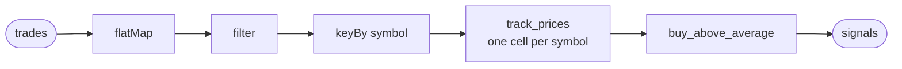

# Building an ETL stream

On this page we build the desk's ETL stream. ETL stands for extract, transform,
load: a pipeline that takes data from one place, changes it into what you need,
and delivers it somewhere else. Here it takes trades from the exchange, works out
which prices are worth buying at, and sends those out.

We build it with an unbounded operator, because trades never stop coming, so the
pipeline should never stop either. An unbounded operator is exactly that: you
start it once, and it keeps running until you stop it. Each trade is handled the
moment it arrives, and each result goes out right away. Each symbol's trades
are handled one at a time, in the order they arrived, so a price is always
compared with the prices before it, while different symbols are handled side by
side. It can also remember what it has seen, which the desk needs to keep each
symbol's recent prices.

## The desk's ETL pipeline stream operator

The desk's ETL pipeline stream operator is called `prices`. Trades come in from
the exchange, and for each symbol it keeps the last ten prices. When a new price
is 2 % or more above their average, the desk buys: it starts an order.

You write it in four pieces, one section each: the tasklet that keeps each
symbol's prices; the tasklet that decides when to buy; the operator, which
connects the two into the path every trade takes; and the runner, which
registers the operator's factory. Running it comes later in Part 2.

## Keep each symbol's prices

`track_prices` keeps each symbol's last ten prices, its window. A tasklet
remembers things in its cell, and the operator gives every symbol a cell of its
own, so every symbol has its own window: EUR/USD's prices never mix with
USD/JPY's. [Cells](#cells), right after this tasklet, explains what a cell is.

It takes a trade, which is a symbol, a price and an order type. A symbol's
first trade has nothing to be compared with, so it only goes into the window.
Every later trade emits a move: the price, and the average of the prices before
it.

> Write the tasklet that keeps each symbol's window. It goes into the runner
> project you started in
> [`namespaces.md`](namespaces.md#joining-it-from-a-runner); the finished
> project is linked at the top of your language's tab.
> {: .step}

<!-- tabs-open -->

### Java

The whole example:
[`sdk/java/examples/tradedesk`](https://github.com/flezha/flezha_java_sdk/tree/main/examples/tradedesk).

```java
// TrackPrices.java: keeps a symbol's last ten prices, and compares each new one with their average.
@Tasklet(id = "track_prices")
public final class TrackPrices {

    @JsonIgnoreProperties(ignoreUnknown = true)              // the exchange sends more than the desk reads
    public record Trade(String symbol, double price, String ord_type) {}
    public record Move(String symbol, double price, double average) {}

    private static final int WINDOW = 10;

    @State
    public static class PriceWindow {                        // what each symbol's cell remembers
        public Deque<Double> prices = new ArrayDeque<>();
    }

    public Optional<Move> run(Trade trade, PriceWindowHandle window) {
        Deque<Double> prices = window.get().prices;

        // A symbol's first trade has nothing to be compared with.
        Optional<Move> move = prices.isEmpty()
                ? Optional.empty()
                : Optional.of(new Move(trade.symbol(), trade.price(), average(prices)));

        window.pushBackPrices(trade.price());
        if (prices.size() > WINDOW) {
            window.popFrontPrices(1);
        }
        return move;
    }

    private static double average(Deque<Double> prices) {
        return prices.stream().mapToDouble(Double::doubleValue).average().orElseThrow();
    }
}
```

**Flezha calls `run` once for every trade**, and passes it two things:

- `trade` is the input: one trade, as it arrives on the tasklet's channel.
- `window` is the state of this symbol's cell, what it remembers. It holds the
  `PriceWindow` class above, and `@State` generates `PriceWindowHandle` around
  it: `window.get()` reads the window, and `pushBackPrices` and
  `popFrontPrices` add a price at the end and drop one from the front.

What `run` returns is what the tasklet emits, here a `Move`. An `Optional`
emits only when a value is present, which is how the first trade emits
nothing.

A `run` always takes its input first, then its state when the tasklet remembers
something. A tasklet that remembers nothing takes only the input, and one that
needs Flezha for more than returning a value takes a context last, as
`buy_above_average` below does.

`Trade`, `Move` and `PriceWindow` sit inside the tasklet, because nothing else
uses them. The annotation on `Trade` is explained with the operator below, and
the box below lists what the annotations generate.

> #### What the Java annotations generate {: .info}
>
> The SDK's annotation processor writes some classes for you when the project
> compiles, named after the classes you annotate:
>
> | You write | It generates | What it is |
> |---|---|---|
> | `@Tasklet` on `TrackPrices` | `TrackPricesTasklet` | the full tasklet, the class the operator names in `into(...)` |
> | `@State` on `PriceWindow` | `PriceWindowHandle` | the parameter `run` takes: `get()` reads the state, and one method per way a field can change |
> | | `PriceWindowChange` | the changes those methods record, which bring the state back after a crash |
>
> The handle's methods depend on each field's type, and carry the field's name:
>
> | A field `prices` that is | Gives the handle |
> |---|---|
> | any type | `setPrices(value)` |
> | a `List` | `setPrices`, and `pushPrices(element)` |
> | a `Deque` | `setPrices`, `pushBackPrices(element)` and `popFrontPrices(n)` |
> | a `Map` | nothing until the field says how its entries change, with `@Journal` |
>
> The annotations are a short form, and you do not have to use them. A class can
> implement `Tasklet` itself and write out what they generate: its six type
> arguments, its state, the changes it records and how each one applies. That
> full form is also how a tasklet declares what the short form cannot, such as
> an `onTimer`. [`full_form_tasklets.md`](../advanced/full_form_tasklets.md) in
> Part 3 covers it.

### Rust

TODO: not written yet.

### Node

TODO: not written yet.

### Python

TODO: not written yet.

### Ruby

TODO: not written yet.

### PHP

TODO: not written yet.

### Elixir

TODO: not written yet.

<!-- tabs-close -->

## Cells

A tasklet does its work in cells. A cell is one running copy of the tasklet
with its own state: you write the tasklet once, and each cell runs it on its own
messages and keeps its own memory. A cell handles its messages one at a time, in
the order they arrived, and different cells work side by side.

How many cells a tasklet gets is decided in the operator, not in the tasklet:

- **With `keyBy`,** every key gets a cell of its own, made the first time a
  message with that key arrives. `track_prices` is keyed by symbol, so EUR/USD
  and USD/JPY each get a cell with its own window, and a new symbol gets a new
  cell without anything being declared for it.
- **Without `keyBy`,** a tasklet has a single cell that handles every message.
  That is what `buy_above_average` below gets.

A cell is also what Flezha saves: its state is recorded as it changes, which is
what [`durability.md`](durability.md) brings back after a crash. A namespace caps
how many cells one operator may hold, with `max_cells_per_operator`
([`namespaces.md`](namespaces.md#quotas)).

## A tasklet with no state

`buy_above_average` remembers nothing. The move it gets already carries the
average, so that one value is all it needs to decide. The operator puts no
`keyBy` in front of it, so a single cell handles every symbol, which is fine for a tasklet
that keeps nothing.

For each price 2 % or more above its average it does two things: it starts an
order, and it emits a line saying so. For the other prices it does nothing.

The order is a workflow, `paper_order`, built as a bounded operator: the kind
for work that runs a set of steps and then ends, such as placing one order. The
tasklet starts one `paper_order` for every buy, and hands it the order as its
first input: the symbol, and how many to buy.
[`building_a_workflow.md`](building_a_workflow.md) builds that workflow.

> Write the tasklet that decides when to buy, and starts the order.
> {: .step}

<!-- tabs-open -->

### Java

```java
// BuyAboveAverage.java: buys when a price is far enough above its average.
@Tasklet(id = "buy_above_average", emits = String.class)
public final class BuyAboveAverage {

    private static final double BUY_ABOVE_PCT = 2.0;
    private static final int LOT = 10;

    public void run(Move move, TaskletCtx ctx) throws TaskletException {
        double percent = (move.price() - move.average()) / move.average() * 100.0;
        if (percent < BUY_ABOVE_PCT) {
            return;
        }

        ctx.spawnBounded("paper_order", new OrderTicket(move.symbol(), LOT));   // one bounded operator per order

        ctx.emit(String.format(
                "%s %.4f is %.2f%% above its average of %.4f, buying %d",
                move.symbol(), move.price(), percent, move.average(), LOT));
    }
}
```

`run` takes the move, its input, and no state, because it remembers nothing.
It also takes the context, because it does two things per input: it starts a
bounded operator and it emits. A `void` method declares no output, so `emits`
names the type it emits. `spawnBounded` sends the order as JSON, and
`paper_order` decodes it back into an `OrderTicket`, the order it takes,
declared in [`building_a_workflow.md`](building_a_workflow.md).

### Rust

TODO: not written yet.

### Node

TODO: not written yet.

### Python

TODO: not written yet.

### Ruby

TODO: not written yet.

### PHP

TODO: not written yet.

### Elixir

TODO: not written yet.

<!-- tabs-close -->

## Several tasklets in one operator

With both tasklets written, the operator connects them. It declares the path
every trade takes, in one expression that reads in the order the data flows:



Messages enter on the channel `trades`, in the format a typical exchange's
WebSocket API sends: each message carries one or more trades in its `data`
list. Three transforms come next: small steps written right into the path,
with no class of their own. Here are two messages on their way through them:

```json
{"channel": "trade", "type": "update", "data": [
  {"symbol": "EUR/USD", "side": "buy", "price": 1.0850, "qty": 1000, "ord_type": "market", "trade_id": 1, "timestamp": "2026-09-22T10:00:00.000000Z"},
  {"symbol": "EUR/USD", "side": "sell", "price": 1.0851, "qty": 500, "ord_type": "limit", "trade_id": 2, "timestamp": "2026-09-22T10:00:00.000000Z"},
  {"symbol": "EUR/USD", "side": "sell", "price": 1.0853, "qty": 2000, "ord_type": "market", "trade_id": 3, "timestamp": "2026-09-22T10:00:00.000000Z"}
]}
{"channel": "trade", "type": "update", "data": [
  {"symbol": "USD/JPY", "side": "buy", "price": 149.50, "qty": 1000, "ord_type": "market", "trade_id": 4, "timestamp": "2026-09-22T10:00:01.000000Z"}
]}
```

`flatMap` splits each message into its trades. Two messages become four
trades, all on one level, and each goes on alone. A trade keeps only the three
fields the desk reads, and the rest of what the exchange sends is dropped:

```json
{"symbol": "EUR/USD", "price": 1.0850, "ord_type": "market"}
{"symbol": "EUR/USD", "price": 1.0851, "ord_type": "limit"}
{"symbol": "EUR/USD", "price": 1.0853, "ord_type": "market"}
{"symbol": "USD/JPY", "price": 149.50, "ord_type": "market"}
```

`filter` keeps the market orders, the trades that went through at whatever the
price was. The limit order is gone:

```json
{"symbol": "EUR/USD", "price": 1.0850, "ord_type": "market"}
{"symbol": "EUR/USD", "price": 1.0853, "ord_type": "market"}
{"symbol": "USD/JPY", "price": 149.50, "ord_type": "market"}
```

`keyBy` changes no message. It decides which cell each one goes to, by its
symbol:

```text
EUR/USD's cell:  {"symbol": "EUR/USD", "price": 1.0850, "ord_type": "market"}
                 {"symbol": "EUR/USD", "price": 1.0853, "ord_type": "market"}
USD/JPY's cell:  {"symbol": "USD/JPY", "price": 149.50, "ord_type": "market"}
```

Each symbol's cell handles its trades in the order they arrived, as
[Cells](#cells) explains, so EUR/USD's 1.0850 comes before its 1.0853. `keyBy`
comes last, right before `into`, because it keys what the transforms above it
produced.

A transform should only look at the message and hand something on. Anything
more, such as keeping prices, is a tasklet.

`into` hands each trade to a tasklet. What a tasklet emits flows on like any
other message, so the next tasklet is added with another `into`.

`sink("signals")` ends the path. A sink is a named exit where results leave the
operator for whatever listens there. A sink can also sit in the middle of a path,
where a value leaves and still carries on to the next tasklet, and a path can
have several. The desk needs only one.

> Write the operator, which connects the two tasklets.
> {: .step}

<!-- tabs-open -->

### Java

```java
// PricesOperator.java: the unbounded operator. Trades in, signals out.
public final class PricesOperator implements UnboundedOperator {

    @JsonIgnoreProperties(ignoreUnknown = true)              // the exchange sends more than the desk reads
    public record TradeMessage(List<Trade> data) {}

    @Override
    public String factoryId() {
        return "prices";
    }

    @Override
    public void channels(ChannelBuilder c) {
        c.input(TradeMessage.class, "trades")
                .flatMap(Trade.class, TradeMessage::data)            // a message into its trades
                .filter(trade -> "market".equals(trade.ord_type()))  // market orders only
                .keyBy(Trade::symbol)                                // one cell per symbol
                .into(TrackPricesTasklet.class)
                .into(BuyAboveAverageTasklet.class)
                .sink("signals")
                .sealed();
    }
}
```

`TradeMessage` is the exchange's message, and it lives inside the operator,
the only place that reads it. The default JSON decoding refuses a field the
record does not name, so `@JsonIgnoreProperties`, here and on `Trade`, tells it
to drop the exchange's other fields. `TrackPricesTasklet` and
`BuyAboveAverageTasklet` are the classes `@Tasklet` generates from the two
tasklets above. `sealed()` says the path ends at `signals`: a later `into` on
it no longer compiles.

### Rust

TODO: not written yet.

### Node

TODO: not written yet.

### Python

TODO: not written yet.

### Ruby

TODO: not written yet.

### PHP

TODO: not written yet.

### Elixir

TODO: not written yet.

<!-- tabs-close -->

## The runner

Registering the operator on the runner starts nothing. It tells the controller
that this runner can run operators of the `prices` type, its factory. Operators
are started from that factory later, with `flz operator start prices`, and each
one runs on a runner that registered it.

> Register the `prices` factory on the runner, before `start()`.
> {: .step}

<!-- tabs-open -->

### Java

```java
// Main.java: the runner. Joins trading and offers the prices factory.
public static void main(String[] args) throws Exception {
    FlezhaRunner runner = Flezha.createRunner(args.length > 0 ? args[0] : "trading")
            .registerFactory(PricesOperator.class)
            .start();

    runner.awaitTermination();
}
```

### Rust

TODO: not written yet.

### Node

TODO: not written yet.

### Python

TODO: not written yet.

### Ruby

TODO: not written yet.

### PHP

TODO: not written yet.

### Elixir

TODO: not written yet.

<!-- tabs-close -->

## Next

The desk starts an order for every buy, and the order has nothing to run yet.
[`building_a_workflow.md`](building_a_workflow.md) writes `paper_order`, the bounded operator
that places it.
