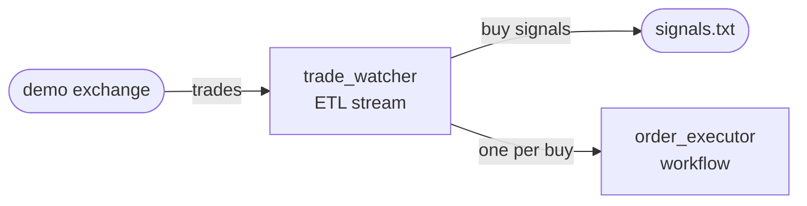

# Going further

Part 2 builds `tradedesk`, a toy trader, and uses it to show what a deployment
needs beyond the first steps: authorization, a namespace of its own, state,
partitions, plugins, and recovery from a crash.

The desk is two operators. `trade_watcher` is an ETL stream, built as an
unbounded operator: it reads trades from a demo exchange, keeps each symbol's
recent prices, and sends out a buy signal when a price is far enough above
their average. Each buy also starts an `order_executor`, a workflow built as a
bounded operator, which takes one order through its steps with paper money and
ends when the order is filled or refused.

Part 2 starts a controller of its own, with authorization on.

> #### What you need {: .tip}
>
> - **For the controller**, a Linux machine on x86-64 to run the release, or
>   Docker to run its image. [`controller_deployment.md`](../controller_deployment.md)
>   shows both.
> - **For your runner**, one language: pick the one you want to write it in,
>   and install only what its row lists.
>
> | Language | You need |
> |---|---|
> | Java | Java 21 and Maven |
> | Rust | Rust with Cargo |
> | Node | Node.js 20 or later, with npm |
> | Python | Python 3.11 or later, with pip |
> | Ruby | Ruby 3.3 or later, with Bundler |
> | PHP | PHP 8.4 or later with `ext-ffi`, and Composer |
> | Elixir | Elixir 1.17 or later |
>
> - **Node.js, with npm**, to run the demo exchange, which
>   [`plugins.md`](plugins.md) starts.
> - **git**, to get the examples and the demo exchange.

| Page | What you do |
|---|---|
| [`authorization.md`](authorization.md) | Keep authorization on, claim the admin, and issue the key tradedesk's runner connects with |
| [`namespaces.md`](namespaces.md) | Give tradedesk a namespace of its own |
| [`building_an_etl_stream.md`](building_an_etl_stream.md) | Build the desk's ETL stream as an unbounded operator: chained tasklets, `flat_map`, `filter`, `key_by`, and state per symbol |
| [`building_a_workflow.md`](building_a_workflow.md) | Build the `order_executor` workflow as a bounded operator: steps, retries and compensation, started by hand |
| [`partitioning.md`](partitioning.md) | Start the desk: `--partitions`, `key_by`, how trades are routed, and `flz operator scale` |
| [`plugins.md`](plugins.md) | Read the demo exchange's trades with the WebSocket plugin, and write the buy signals to a file |
| [`durability.md`](durability.md) | Stop and crash the runner and the controller, read the desk's state back, finish an order a crash interrupted, and handle a message that cannot be read |
