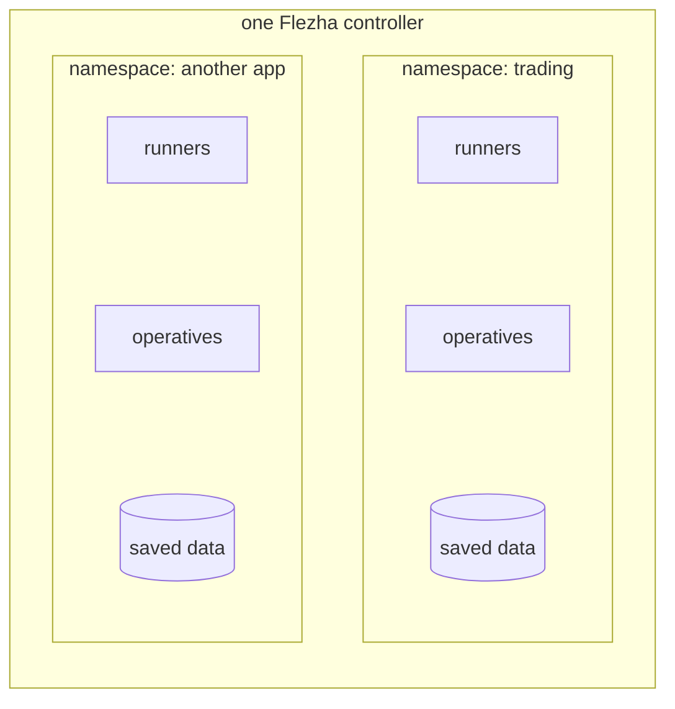

# Namespaces

A namespace is a separate room inside one Flezha controller. Each application
gets its own room: its runners, its operatives and their saved data live there,
and nothing in one room can see or touch what is in another.

Each room also has its own limits, such as how many operatives it may run, so
one application cannot use up everything, and its own keys, so a runner can only
enter the room it has a key for. Both the limits and the keys take effect only
once [authorization](authorization.md) is on, which it is by default, and
Part 2 keeps it on.

In more technical terms, every runner connects into exactly one namespace and
serves operatives only there, and an operative's id has to be unique only within
its namespace. The controller runs a separate hub for each namespace, the
process that decides which runner each operative runs on and moves it when that
runner goes away, and keeps each namespace's saved state in a folder of its own,
`app_data/state/<namespace>/`. The limits are six quotas stored with the
namespace, and the keys are the credentials and tokens issued for it.



## The `default` namespace

Every command that works inside a namespace takes `--namespace`, or `-n` for
short. When you leave it out, the command uses `default`. That is where
everything in Part 1 ran, since none of its commands named a namespace.

`default` is not created for you, so `flz namespace list` does not show it.
With authorization off that does not matter, because a runner can join any
namespace just by naming it, and the controller sets it up when the runner
connects. With authorization on, a runner can join only a namespace created
with `flz namespace create`, and that includes `default`.

We recommend giving every application a namespace of its own, even the first
one, instead of leaving it in `default`. Saved data is kept per namespace and a
namespace cannot be renamed, so moving an application out of `default` later
means leaving its saved data behind.

## Create a namespace

A namespace is created from the command line, with `flz namespace create`.
That writes an entry into the controller's catalog, which is kept on disk, so
the namespace is still there after the controller restarts. The name starts
with a lowercase letter, followed by up to 62 lowercase letters, digits, `-` or
`_`.

The first namespace of our example application, tradedesk, is `trading`.

> Create `trading` in the controller's catalog, with the default limits. It
> needs the admin token from [`authorization.md`](authorization.md) in
> `FLEZHA_TOKEN`, and answers with the entry as the controller stored it.
> {: .step}

```sh
$ flz namespace create trading
```

```output
namespace trading created
namespace: trading
quotas:
  max_entities_per_operative: 1024
  max_mailbox_bytes_total: 268435456
  max_message_rate_per_second: 100000
  max_operatives: 100
  max_runners: 32
  max_state_bytes: 107374182400
```

The numbers under `quotas` are the namespace's limits, at their defaults, and
[Quotas](#quotas) below explains them.

If the admin was never claimed, or this shell has no token, the same command is
refused instead, and the refusal says what is missing:

```output
authz.namespace_create: refused: authorization is enforced but the bootstrap has not been claimed — run `flz auth bootstrap <token>` with the token in app_data/auth/bootstrap.token
```

`flz namespace list` shows every namespace the controller knows about:

```sh
$ flz namespace list
```

```output
Fetching namespaces...
Namespaces:

  NAMESPACE                          RUNNING
  _system                            no
  trading                            no
```

`_system` is the controller's own namespace and is always there. `RUNNING` says
whether a namespace's hub is up, and for `trading` that happens when its first
runner connects.

## Joining it from a runner

Code never creates a namespace. A runner names the one it joins when it is
created, and it can serve operatives only there.

> The next steps need a runner of your own, and this is where you start writing
> it. Part 1's [The code](../runner_deployment.md#the-code) has the whole
> example in your language; here we write only its namespace part, the line
> below, which names `trading`. Nothing connects yet: the runner joins
> `trading` when you run it, with the key from
> [`authorization.md`](authorization.md#give-the-runner-its-key) in
> `FLEZHA_NAMESPACE_SECRET`.
> {: .step}

<!-- tabs-open -->

### Java

```java
FlezhaRunner desk = Flezha.createRunner("trading");
```

### Rust

```rust
let desk = Flezha::create_runner("trading")?;
```

### Node

```javascript
const desk = createRunner('trading');
```

### Python

```python
desk = flezha.create_runner("trading")
```

### Ruby

```ruby
desk = Flezha.create_runner("trading")
```

### PHP

```php
$desk = Flezha::createRunner('trading');
```

### Elixir

```elixir
desk = Flezha.SDK.create_runner("trading", transport: :uds)
```

<!-- tabs-close -->

Once it runs, the runner is listed under `trading`, and `trading` turns
`RUNNING`. The id carries the namespace as its prefix:

```sh
$ flz runner list --namespace trading
```

```output
Fetching runners for namespace 'trading'...
Runners in namespace 'trading':
  - trading_20932a8e7340
```

## Quotas

The six limits, their defaults, and what each one refuses:

| Quota | Default | What it caps |
|---|---|---|
| `max_operatives` | 100 | operatives started in the namespace |
| `max_entities_per_operative` | 1024 | keyed entities one operative may hold, such as symbols in `candles` |
| `max_mailbox_bytes_total` | 256 MiB | the credit window across the namespace's operative mailboxes |
| `max_message_rate_per_second` | 100 000 | stored for now, not yet enforced |
| `max_state_bytes` | 100 GiB | the namespace's state on disk; a start is refused while over it |
| `max_runners` | 32 | runners connected to the namespace at once |

A namespace can take limits of its own the moment it is created, with the same
`--X<field>=<value>` the commands below use: `flz namespace create reporting
--Xmax_operatives=10` sets one and leaves the rest at their defaults.

You can read a namespace's limits:

```sh
$ flz namespace show trading
```

```output
namespace: trading
quotas:
  max_entities_per_operative: 1024
  max_mailbox_bytes_total: 268435456
  max_message_rate_per_second: 100000
  max_operatives: 100
  max_runners: 32
  max_state_bytes: 107374182400
```

And change one:

```sh
$ flz namespace set-quota trading --Xmax_runners=4
```

```output
namespace trading quotas updated
namespace: trading
quotas:
  max_entities_per_operative: 1024
  max_mailbox_bytes_total: 268435456
  max_message_rate_per_second: 100000
  max_operatives: 100
  max_runners: 4
  max_state_bytes: 107374182400
```

`--X<field>=<value>` repeats for several fields, an unknown field or a negative
value is refused, and a change applies to the next start or connect rather
than to anything already running.

The limits hold because authorization is on. With it off, as in Part 1, every
quota check passes.

## Deleting one

The desk keeps `trading`, so try it on another one. Create it:

```sh
$ flz namespace create scratch
```

```output
namespace scratch created
...
```

Delete it:

```sh
$ flz namespace delete scratch
```

```output
namespace scratch deleted
```

Deleting it again is refused, because it is gone:

```sh
$ flz namespace delete scratch
```

```output
error: namespace delete: :not_found
```

Delete removes the catalog entry and its quota counters, and only those. A
namespace with operatives in it must be emptied first, with
`flz operative stop` on each and its runner stopped, because a running
operative is not stopped by the entry going away: it carries on, and the
namespace it runs in is no longer in the listing. Empty it, then delete it.

## Next

The desk has its namespace and nothing in it.
[`workflow_basics.md`](workflow_basics.md) writes `paper_order`, the workflow
that places an order with paper money, and starts one in `trading`.
