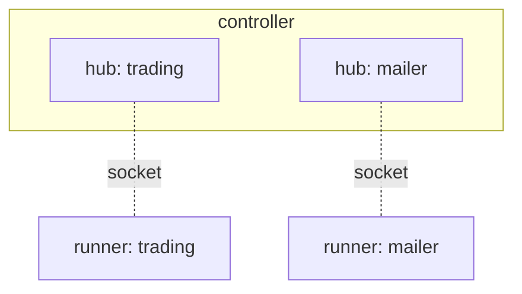

# Namespaces

Part 2.

A namespace is three things at once: a runtime partition with a hub of its own,
a quota boundary carrying six resource limits, and the scope authorization
enforces. Part 1 used `default` and never mentioned it, because an unenforced
controller takes whatever name a runner claims. This is where it becomes a
decision, and [`authorization.md`](authorization.md) is where it becomes a
boundary.

TODO: draft. The `flz` output below was captured against a local controller.
The runner and operative steps wait for the tradedesk code that
[`stream_basics.md`](stream_basics.md) and [`workflow_basics.md`](workflow_basics.md)
write, and the mailer for its own page.

**Before you start:** finish [`setup.md`](setup.md) and leave the stack up.
Every `flz` on this page runs inside the controller container, so read
`flz ...` as:

```sh
docker compose exec controller /flezha/bin/flz ...
```

## Create two

The desk gets a namespace of its own, and so does the mailer that will send a
message for every filled order:

```sh
$ flz namespace create trading
namespace trading created
namespace: trading
quotas:
  max_entities_per_operative: 1024
  max_mailbox_bytes_total: 268435456
  max_message_rate_per_second: 100000
  max_operatives: 100
  max_runners: 32
  max_state_bytes: 107374182400

$ flz namespace create mailer --Xmax_operatives=10
namespace mailer created
namespace: mailer
quotas:
  max_entities_per_operative: 1024
  max_mailbox_bytes_total: 268435456
  max_message_rate_per_second: 100000
  max_operatives: 10
  max_runners: 32
  max_state_bytes: 107374182400
```

Each answer is the entry as the controller stored it: the name and its six
quotas, the defaults where you set nothing. The mailer runs one operative, so
it gets room for ten and no more.

```sh
$ flz namespace list
Fetching namespaces...
Namespaces:

  NAMESPACE                          RUNNING
  _system                            no
  mailer                             no
  trading                            no
```

`_system` is the controller's own namespace. It exists at boot, cannot be
deleted, and no runner can connect to it; the admin you claim in
[`authorization.md`](authorization.md) lives there. `RUNNING` says whether a
hub is up for the name, and nothing has connected yet, so both say `no`.

A name is a lowercase letter followed by up to 62 lowercase letters, digits,
`-` or `_`. The two refusals you will meet:

```sh
$ flz namespace create Trading
error: namespace create: :invalid_namespace_name

$ flz namespace create trading
error: namespace create: :already_exists
```

Both exit 1, so a setup script that misspells a name stops there rather than
carrying on into the wrong namespace.

## What a namespace is

**A partition.** Every operative belongs to one namespace, and so does
everything that hangs off it: its state on disk, under
`app_data/state/<namespace>/`, its place in the cluster, the runners it can be
bound to, its audit records and its metrics. The controller runs one hub per
namespace, the process that places and heals that namespace's operatives, and
a namespace in the catalog gets its hub started at boot, before any runner
arrives. That is the `declared_hubs_started` row `flz boot status` waits for.



**A boundary.** A runner connects into one namespace and can serve operatives
in that one only. An operative sees the operatives of its own namespace and no
other: the forward plugin refuses a target across the line, a spawned workflow
lands in the spawner's namespace, and the administration surface a runner
reaches from code has no field for a namespace at all. Nothing inside `trading`
can name `mailer`, which is the point rather than a limitation. Data still
crosses, the way it would to a system outside Flezha altogether: through the
edge. `trading` writes filled orders to a sink, `mailer` reads them from a
source, and neither knows the other exists. [`plugins.md`](plugins.md) attaches
both ends.

**A quota.** The six numbers above cap what one namespace can take from the
controller. The mailer's ten operatives cannot crowd out the desk, and the
desk's disk cannot fill the mailer's.

**A scope.** Under enforcement, a runner proves its namespace with a credential
issued for it, every token binds a principal to a role in one namespace, and
only `admin@_system` reaches across. [`authorization.md`](authorization.md)
turns that on.

Two namespaces is the right shape here because the mailer is not part of the
desk. It is a shared service: another desk will use it too, someone else may
run it, and its credential, its quota and its restarts are its own. The desk
stays one namespace because `candles` and `paper_order` are one application,
started and stopped together, and a workflow can only be spawned within the
namespace it is spawned from.

## Where the name goes

The name appears in exactly three places, and forgetting the third is the
mistake everyone makes once.

### The runner

A runner names its namespace when it is created, and every operative it
registers is served there. The desk's runner registers the two tradedesk
operatives into `trading`. Hard-code nothing: the echo read the name from its
first argument, and the tradedesk runner does the same.

<!-- tabs-open -->

### Java

```java
Flezha.createRunner("trading")
        .registerFactory(CandlesOperative.class)
        .registerFactory(PaperOrderOperative.class)
        .run();
```

### Rust

```rust
let runner = Flezha::create_runner("trading")?;
runner
    .register_factory(CandlesOperative)?
    .register_factory(PaperOrderOperative)?
    .run()?;
```

### Node

```javascript
const runner = createRunner('trading');
await runner.registerFactory('./candles_operative.mjs');
await runner.registerFactory('./paper_order_operative.mjs');
await runner.run();
```

### Python

```python
runner = flezha.create_runner("trading")
runner.register_factory(candles_operative)
runner.register_factory(paper_order_operative)
runner.run()
```

### Ruby

```ruby
Flezha.create_runner("trading")
      .register_factory(CandlesOperative)
      .register_factory(PaperOrderOperative)
      .run
```

### PHP

```php
Flezha::createRunner('trading')
    ->registerFactory(CandlesOperative::class)
    ->registerFactory(PaperOrderOperative::class)
    ->run();
```

### Elixir

```elixir
children = [
  {Flezha.SDK,
   namespace: "trading",
   operatives: [Tradedesk.Candles, Tradedesk.PaperOrder],
   transport: :uds}
]
```

<!-- tabs-close -->

The mailer's runner is the same shape with `"mailer"` and its one operative,
and it is written when the mailer is. Two runners, two namespaces, one
controller.

The moment the desk's runner connects, `trading` is running, and the runner is
listed under it and nowhere else:

```sh
$ flz namespace list
Fetching namespaces...
Namespaces:

  NAMESPACE                          RUNNING
  _system                            no
  mailer                             no
  trading                            yes

$ flz runner list --namespace trading
Fetching runners for namespace 'trading'...
Runners in namespace 'trading':
  - trading_bb97f434f662
```

The runner id carries the namespace as its prefix, which is how a runner list
across several namespaces reads at a glance.

### The command line

Every `flz operative` and `flz runner` verb works in one namespace, named with
`--namespace`, or `-n` for short, and **`default` when you name none**. Part 1
never typed it because `default` was the only namespace there was. From here
on, every command about the desk carries it:

```sh
flz operative start candles --id candles --namespace trading
flz operative start paper_order --id order_1 --kind workflow --namespace trading
flz operative list --namespace trading
flz operative info candles --namespace trading
flz operative send candles --text '...' --namespace trading
flz operative listen candles --namespace trading
flz operative stop order_1 --namespace trading
```

The mailer's commands carry `--namespace mailer` the same way. What each verb
does is Part 1's [`running_operatives.md`](../running_operatives.md); only the
flag is new, and the operatives themselves are the next two pages.

Leave the flag out and the command runs in `default`, where the desk is not.
The answer is not an error, which is why it catches people:

```sh
$ flz operative info candles
Fetching operative information for namespace 'default'...
No operatives found for namespace 'default'.

$ flz operative info candles --namespace trading
Fetching operative information for namespace 'trading':

Operative: candles
  Kind: stream
  Phase: running
  Health: healthy
  Runner ID: trading_bb97f434f662
  Group ID: trading
  ...
```

Read the first line of every listing. It names the namespace the answer is
about, and "no operatives found" in `default` means you asked the wrong
namespace, not that the desk is down.

Operative ids are unique within a namespace, not across them. A `candles` in
`trading` and a `candles` in `mailer` would be two unrelated operatives, so the
flag is part of the name, not an option.

### Plugins

A plugin has no namespace flag. It attaches to an operative with
`--operative_id`, and the operative's namespace is where the plugin runs,
where its health is read and where `flz plugin disable` is judged. When
[`plugins.md`](plugins.md) attaches the testnet to `candles`, nothing about the
command says `trading`, and nothing needs to.

## Quotas

The six limits, their defaults, and what each one refuses:

| Quota | Default | What it caps |
|---|---|---|
| `max_operatives` | 100 | operatives started in the namespace |
| `max_entities_per_operative` | 1024 | keyed entities one operative may hold, such as symbols in `candles` |
| `max_mailbox_bytes_total` | 256 MiB | the credit window across the namespace's operative mailboxes |
| `max_message_rate_per_second` | 100 000 | stored for now, not yet enforced |
| `max_state_bytes` | 100 GiB | the namespace's state on disk; a start is refused while over it |
| `max_runners` | 32 | runners connected to the namespace at once |

Read one and change one:

```sh
$ flz namespace show trading
namespace: trading
quotas:
  max_entities_per_operative: 1024
  max_mailbox_bytes_total: 268435456
  max_message_rate_per_second: 100000
  max_operatives: 100
  max_runners: 32
  max_state_bytes: 107374182400

$ flz namespace set-quota trading --Xmax_runners=4
namespace trading quotas updated
namespace: trading
quotas:
  max_entities_per_operative: 1024
  max_mailbox_bytes_total: 268435456
  max_message_rate_per_second: 100000
  max_operatives: 100
  max_runners: 4
  max_state_bytes: 107374182400
```

`--X<field>=<value>` repeats for several fields, an unknown field or a negative
value is refused, and a change applies to the next start or connect rather
than to anything already running.

**None of it is enforced yet.** With authorization off, every quota check
passes, so the mailer's ten is a number in a catalog until
[`authorization.md`](authorization.md) turns enforcement on. Setting it now is
still right: the entry is durable, and the limit takes hold the moment the
posture changes, with nothing to revisit.

## Part 1's `default`

Nothing created `default`, and `flz namespace list` did not show it even while
`my_echo` ran there. With authorization off, a runner claiming a name is taken
at its word: the controller starts a hub for whatever it claims, catalogued or
not. The catalog is where you write down the namespaces you mean to have, and
enforcement is what makes it the only ones there are. From then on a runner
needs a credential issued for a catalogued namespace, and a name nobody
created is a refused connection rather than a new hub.

That is the whole difference between Part 1 and this page. You could run the
desk in `default` and it would work. It would also have no quota, no credential
and no line of its own in anything an operator reads.

## Deleting one

The desk keeps both namespaces, so try it on a third:

```sh
$ flz namespace create scratch
namespace scratch created
...

$ flz namespace delete scratch
namespace scratch deleted

$ flz namespace delete scratch
error: namespace delete: :not_found
```

Delete removes the catalog entry and its quota counters, and only those. A
namespace with operatives in it must be emptied first, with
`flz operative stop` on each and its runner stopped, because a running
operative is not stopped by the entry going away: it carries on, and the
namespace it runs in is no longer in the listing. Empty it, then delete it.

## What survives

The catalog is on disk under `app_data`. A controller restart brings back both
namespaces, their quotas and their hubs, before any runner reconnects. Each
namespace's state lives under `app_data/state/<namespace>/`, apart from every
other's, which is what lets [`durability.md`](durability.md) reason about the
desk alone.

## Next

The desk has a namespace and nothing in it.
[`stream_basics.md`](stream_basics.md) writes `candles`, the operative that
turns trades into candles, and starts it there.
