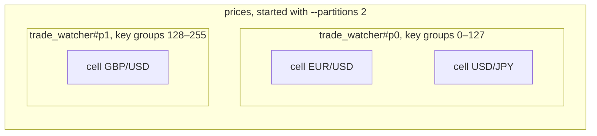
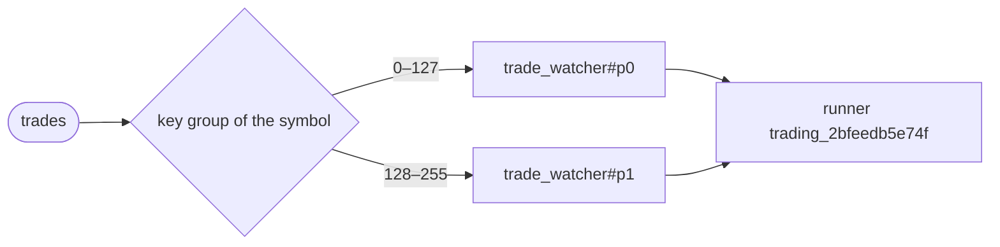

# Partitioning

An operator started the usual way is one instance: all of its symbols and all of
their cells run on one runner. That runner's machine is the limit. When trades
arrive faster than it can handle them, starting more runners does not help,
because the operator can only be in one place.

Partitioning splits the operator into several instances, called partitions.
Each one runs the same code but owns only some of the keys, so every symbol
belongs to exactly one partition, and its trades and its state stay there. The
partitions are placed like any other operator, so with more runners they spread
out, and each one does part of the work. You still handle it as one operator:
you start, list, read and stop `trade_watcher` by its one name.

This page starts the desk, with `trade_watcher` running as two partitions. One
runner is enough for everything here, and the same commands spread the desk over
many runners and many controllers once there are more of them.

## Partitions and cells

[`building_an_etl_stream.md`](building_an_etl_stream.md#cells) gave every
symbol a cell of its own. Partitions work one level up, and the two are easy to
mix up:

| | A cell | A partition |
|---|---|---|
| What it is | one copy of a tasklet with its own state, one per key | one copy of the whole operator, owning part of the keys |
| Made by | `keyBy` in the operator's code | `--partitions` when the operator is started |
| Spreads work | inside one runner: cells run side by side on its cores | across runners and controllers: each partition can run on a different machine |
| For the desk | one per symbol: EUR/USD's window, USD/JPY's window | `trade_watcher#p0` and `trade_watcher#p1`, each with the cells of its own symbols |

So cells are how one runner handles many symbols at once, and partitions are how
a cluster shares them out. Every partition has the same code, and every symbol
still gets its own cell, inside whichever partition owns it:



## Which partition a symbol goes to

It takes three steps, and the same symbol always ends up in the same place:

1. The symbol, what `keyBy` returns, is turned into a number from 0 to 255 by a
   hash. That number is its **key group**.
2. The 256 key groups are split evenly between the partitions. With two,
   `trade_watcher#p0` owns 0–127 and `trade_watcher#p1` owns 128–255.
3. The symbol goes to the partition that owns its key group.

```text
"EUR/USD" → hash → 104 → in 0–127   → trade_watcher#p0
"USD/JPY" → hash →  97 → in 0–127   → trade_watcher#p0
"GBP/USD" → hash → 203 → in 128–255 → trade_watcher#p1
```

You do not choose where a symbol goes; the hash does. With many symbols it
spreads them evenly, but with only a few, two can land together, as EUR/USD and
USD/JPY do here. That is why this page trades GBP/USD as well: without it,
`trade_watcher#p1` would have nothing to do.

## Which runner a partition runs on

Once a partition exists, the controller places it, in two steps:

1. **A controller.** Among the controllers whose runners registered the
   `trade_watcher` factory, one is picked by hashing the partition's name. A
   controller with no such runner is never picked.
2. **A runner on that controller.** Among its runners that registered
   `trade_watcher`, one is picked by hashing again, with a cap so that no
   runner takes more than its fair share.

Both steps are hashes, so the answer is the same every time it is worked out.
With one runner, both partitions share it:



With two runners, each partition would usually get one of its own.

## Start the desk

> Start the desk's runner, from the project you wrote in
> [`building_an_etl_stream.md`](building_an_etl_stream.md) and
> [`building_a_workflow.md`](building_a_workflow.md), with the key from
> [`authorization.md`](authorization.md#give-the-runner-its-key) in place of
> the one here. It connects to `trading` and waits.
> {: .step}

<!-- tabs-open -->

### Java

```sh
$ mvn -q package
$ FLEZHA_NAMESPACE_SECRET=flzt_3j5bftycxn43ivwoxbd2peghazjgtnru5bxqgshvfqcft7lrdsra java -jar target/tradedesk.jar
```

### Rust

```sh
$ FLEZHA_NAMESPACE_SECRET=flzt_3j5bftycxn43ivwoxbd2peghazjgtnru5bxqgshvfqcft7lrdsra cargo run --release
```

### Node

TODO: not written yet.

### Python

```sh
$ pip install -r requirements.txt
$ FLEZHA_NAMESPACE_SECRET=flzt_3j5bftycxn43ivwoxbd2peghazjgtnru5bxqgshvfqcft7lrdsra python3 runner.py
```

A Python runner also stops when its standard input closes, so start it from a
terminal rather than with standard input closed. It prints one line as it
connects, naming its tier and its worker threads:

```output
[flezha] runner up on namespace trading: gil tier, thread executor, 9 threads, base 8 ceiling 80
```

### Ruby

TODO: not written yet.

### PHP

```sh
$ composer install
$ FLEZHA_NAMESPACE_SECRET=flzt_3j5bftycxn43ivwoxbd2peghazjgtnru5bxqgshvfqcft7lrdsra php runner.php
```

A PHP runner also stops when its standard input closes, so start it from a
terminal rather than with standard input closed.

### Elixir

TODO: not written yet.

<!-- tabs-close -->

The runner prints nothing while all is well. From another terminal, with your
admin token in `FLEZHA_TOKEN`, the controller lists it:

```sh
$ flz runner list --namespace trading
```

```output
Fetching runners for namespace 'trading'...
Runners in namespace 'trading':
  - trading_2bfeedb5e74f
```

> Let the runner start orders. `buy_above_average` starts a `order_executor` for
> every buy, and starting an operator from a tasklet needs the `spawner` role.
> {: .step}

```sh
$ flz role bind runner@trading spawner trading
```

```output
bound runner@trading as spawner@trading
runner@trading  spawner@trading
```

> Start `trade_watcher` as two partitions.
> {: .step}

```sh
$ flz operator start trade_watcher --id trade_watcher --partitions 2 --namespace trading
```

```output
Operator trade_watcher started with 2 partitions:
  trade_watcher#p0
  trade_watcher#p1
```

Two partitions on one runner run no faster than one. They
are here to show how the work is split, and they pay off once there are more
runners. Only `trade_watcher` is started by hand. Orders start themselves, one
per buy.

`flz operator info` shows each partition's key groups and the runner it is on:

```sh
$ flz operator info trade_watcher --namespace trading
```

```output
Partition group: trade_watcher (2/2)
  p0  trade_watcher#p0               key groups 0-127  trading_2bfeedb5e74f  healthy
  p1  trade_watcher#p1               key groups 128-255  trading_2bfeedb5e74f  healthy
  coverage: all 256 key groups owned exactly once
...
```

## Send it trades

Trades are sent by hand here, one message at a time, in the exchange's format.
By hand, you name the partition that owns the symbol: `trade_watcher` is the
name of the group, not of an operator that takes messages, so `flz operator send
trade_watcher` answers `operator 'trade_watcher' not found`. The next page
connects the exchange, and there each partition receives its own symbols without
being named.

> Send EUR/USD three trades. The third is more than 2 % above the first two,
> and `--await` waits three seconds for what comes out.
> {: .step}

```sh
$ flz operator send 'trade_watcher#p0' --namespace trading --channel trades --text '{"channel": "trade", "data": [{"symbol": "EUR/USD", "price": 1.0850, "ord_type": "market"}]}'
$ flz operator send 'trade_watcher#p0' --namespace trading --channel trades --text '{"channel": "trade", "data": [{"symbol": "EUR/USD", "price": 1.0853, "ord_type": "market"}]}'
$ flz operator send 'trade_watcher#p0' --namespace trading --channel trades --text '{"channel": "trade", "data": [{"symbol": "EUR/USD", "price": 1.1100, "ord_type": "market"}]}' --await 3000
```

```output
Delivered to 'trade_watcher#p0'.
Delivered to 'trade_watcher#p0'.
Delivered to 'trade_watcher#p0'.
signals	EUR/USD 1.1100 is 2.29% above its average of 1.0852, buying 23
```

A message carries `"channel": "trade"`, which is how the desk tells a trade
message from the exchange's other messages, and only the fields the desk reads;
the exchange's other fields would be ignored anyway. The quotes around
`trade_watcher#p0` keep some shells from reading the `#` as something else.

The buy started an order, which ran its steps and ended. The runner's terminal
shows the line `record_order` prints:

```output
[book] EUR/USD 23 as ord-993c88bfb1bc7474a70cd3db8312b447
```

> Send GBP/USD a trade, to the partition that owns it.
> {: .step}

```sh
$ flz operator send 'trade_watcher#p1' --namespace trading --channel trades --text '{"channel": "trade", "data": [{"symbol": "GBP/USD", "price": 1.3400, "ord_type": "market"}]}'
```

```output
Delivered to 'trade_watcher#p1'.
```

`flz state get` reads a cell by `<operator>/<tasklet>/<key>`, and given the
group's name it finds the partition that owns the key. EUR/USD's window holds
its three prices:

```sh
$ flz state get trade_watcher/track_prices/EUR/USD --namespace trading
```

```output
state get trade_watcher/track_prices/EUR/USD:
  change_seq: 3
  state:      {"track_prices":{"EUR/USD":{"prices":[1.085,1.0853,1.11]}}}
```

Leaving the key off reads every symbol, from every partition:

```sh
$ flz state get trade_watcher/track_prices --namespace trading
```

```output
state get trade_watcher/track_prices:
  change_seq: 3
  state:      {"track_prices":{"EUR/USD":{"prices":[1.085,1.0853,1.11]},"GBP/USD":{"prices":[1.34]}}}
```

## Change the number of partitions

`flz operator scale` changes how many partitions a running group has. The key
groups are split again, and every cell whose symbol now belongs to another
partition moves there with its state. A group with input parked in its
[dead-letter queue](durability.md#the-dead-letter-queue) is not rescaled until
that input is replayed or dropped.

> Scale `trade_watcher` to three partitions.
> {: .step}

```sh
$ flz operator scale trade_watcher 3 --namespace trading
```

```output
Scaling operator group trade_watcher to 3...
Operator trade_watcher rescaled 2 -> 3 (2 cells moved, 0 trees removed):
  trade_watcher#p0
  trade_watcher#p1
  trade_watcher#p2
```

```sh
$ flz operator info trade_watcher --namespace trading
```

```output
Partition group: trade_watcher (3/3)
  p0  trade_watcher#p0               key groups 0-84  trading_2bfeedb5e74f  healthy
  p1  trade_watcher#p1               key groups 85-169  trading_2bfeedb5e74f  healthy
  p2  trade_watcher#p2               key groups 170-255  trading_2bfeedb5e74f  healthy
  coverage: all 256 key groups owned exactly once
...
```

EUR/USD's key group, 104, now belongs to `trade_watcher#p1`, and GBP/USD's, 203,
to `trade_watcher#p2`: those are the two cells that moved. EUR/USD's window came
along:

```sh
$ flz state get trade_watcher/track_prices/EUR/USD --namespace trading
```

```output
state get trade_watcher/track_prices/EUR/USD:
  change_seq: 3
  state:      {"track_prices":{"EUR/USD":{"prices":[1.085,1.0853,1.11]}}}
```

## Next

The desk runs, and its trades are sent by hand.
[`plugins.md`](plugins.md) connects it to the exchange, and each partition
subscribes to its own symbols only.
