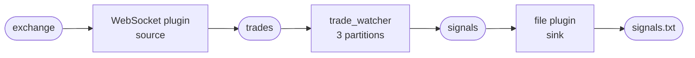

# Using plugins

So far every trade has been typed in by hand. On this page the desk connects to
an exchange: one plugin reads its trades as they happen, and a second one writes
the desk's buy signals to a file. The desk's code does not change.

A plugin is a small piece of Flezha that runs in the controller, at the edge of
an operator. It connects one of the operator's channels to something outside:
a WebSocket, a file, Kafka, a database. A **source** plugin feeds an entry
channel, and a **sink** plugin takes what the operator sends out on a sink.
You have used plugins once already. In Part 1,
[`sources_and_sinks.md`](../sources_and_sinks.md) attached the file plugin to
the echo, both ways, and showed how to list a plugin with `flz operator info`
and turn it off with `flz plugin disable`. Those steps work the same here, so
this page does not repeat them. It goes one level further: how a plugin is set
up, when it is called, and how one fits a real, live feed.



## Start the exchange

The exchange is the testnet, Flezha's demo exchange. It streams made-up trades
for EUR/USD, GBP/USD and USD/JPY over a WebSocket.

> Clone the testnet, a repository of its own, and start it in a terminal of its
> own. It needs Node.js, and it runs until you press Ctrl-C.
> {: .step}

```sh
$ git clone https://github.com/flezha/flezha_testnet.git
$ cd flezha_testnet
$ npm ci
$ npm run build
$ npm run start
```

```output
Loaded testnet config from testnet-config.json: channels [trade, book], 7 tuned symbol(s)
Testnet webSocket server is listening on ws://localhost:4500
```

## How a plugin is set up

Part 1 met the `X` prefix in passing. `flz plugin enable` takes three kinds of
flags, and it helps to tell them apart before the long command below:

| Flag | Belongs to | For example |
|---|---|---|
| `--operator_id`, `--namespace` | the command: which operator the plugin is attached to | `--operator_id=trade_watcher` |
| `--hook` | the command: when the controller calls the plugin | `--hook=on_output` |
| `--X<option>` | the plugin: its own settings, one flag each | `--Xuri=ws://localhost:4500/` |

The `X` is what keeps a plugin's settings apart from the command's own flags:
`--Xchannel` is the plugin's `channel` setting, not an option of `flz`. A value
is plain text, unless it is written as JSON, a list in `[...]` or an object in
`{...}`, in which case the plugin gets it as JSON. Quote such a value, so the
shell passes it as one word.

Every plugin lists its settings, required ones first:

```sh
$ flz plugin help operator_websocket
```

```output
Websocket Plugin Help

USAGE:
    flz plugin enable <plugin_id> operator_websocket [OPTIONS]

REQUIRED PARAMETERS (X-prefixed):
    --Xuri <value>    The websocket endpoint to connect to

OPTIONAL PARAMETERS (X-prefixed):
    --Xplugin_id <value>    Plugin id; defaults to the id it was enabled under
    --Xignore_pattern <value>    Substring marking a frame as a heartbeat rather than data
...
```

## Connect the exchange

The WebSocket plugin opens a connection to the exchange, subscribes to the
symbols it is given, and hands every message it receives to the operator. Every
exchange has its own message for subscribing, so the plugin is given the demo
exchange's as a template, and fills in the symbols itself.

> Attach the WebSocket plugin to `trade_watcher`, reading the three currency pairs
> onto the `trades` channel. It needs the admin token in `FLEZHA_TOKEN` and the
> desk running, as [`partitioning.md`](partitioning.md) left it.
> {: .step}

```sh
$ flz plugin enable exchange operator_websocket \
  --operator_id=trade_watcher --namespace trading \
  --Xuri=ws://localhost:4500/ \
  --Xchannel=trades \
  --Xsubscription_items='["EUR/USD", "GBP/USD", "USD/JPY"]' \
  --Xsubscribe_template='{"method": "subscribe", "params": {"channel": "trade", "symbol": {{items}}}, "req_id": {{req_id}}}' \
  --Xunsubscribe_template='{"method": "unsubscribe", "params": {"channel": "trade", "symbol": {{items}}}, "req_id": {{req_id}}}'
```

```output
Enabling plugin...
Plugin exchange enabled successfully.
```

What each setting does:

| Setting | What it does |
|---|---|
| `uri` | where the exchange is |
| `channel` | the entry channel every message is handed to: `trades`, the one `TradeWatcherOperator` declares |
| `subscription_items` | the symbols to subscribe to, a JSON list |
| `subscribe_template` | the message that subscribes. `{{items}}` becomes a list of symbols, and `{{req_id}}` a number the exchange echoes back to confirm it |
| `unsubscribe_template` | the message that drops symbols, so a list that changes later is followed without reconnecting |

There is no `--hook`. A source is not called by the controller: it holds its
connection open and pushes each message in as it arrives.

## Each partition asks for its own symbols

`trade_watcher` is a group of three partitions, and a plugin enabled on the
group is enabled once on every partition, each copy named after its partition.
The testnet's terminal shows three connections, one per partition, and each
subscribing only what its partition owns:

```output
Testnet client connected on /
Testnet client connected on /
Testnet client connected on /
Subscribing trade/GBP/USD (trade every 1500ms)
Subscribing trade/EUR/USD (trade every 1500ms)
Subscribing trade/USD/JPY (trade every 1500ms)
```

Each copy filters the list by the key groups its partition owns, with the same
hash [`partitioning.md`](partitioning.md#which-partition-a-symbol-goes-to)
routes a trade by. So a trade only ever arrives at the partition that keeps its
symbol's window, and no message is received only to be thrown away.
`flz operator info` shows each copy's subscriptions:

```sh
$ flz operator info trade_watcher --namespace trading
```

```output
...
Operator: trade_watcher#p1
  Kind: unbounded
  Phase: running
  Health: healthy
  Runner ID: trading_3c3e00db7694
  Group ID: trading
  Uptime (ms): 270801
  Default Input Type: 2
  Plugins:
    - exchange#p1: Flezha.Plugin.Provider.Websocket
        last_error: (none)
        inflight: 0
        applied: EUR/USD, USD/JPY
        desired: EUR/USD, USD/JPY
        last_reconcile: %{removed: 0, added: 2, sent: true}
...
```

`desired` is what the plugin was asked for, and `applied` what the exchange has
confirmed. `exchange#p2` shows GBP/USD, and `exchange#p0` nothing:
`trade_watcher#p0` owns none of the three pairs.

## Trades arrive on their own

From here on the desk works by itself. Every price goes into its symbol's
window, and every buy starts an order, which the runner's terminal shows as it
books it:

```output
[book] EUR/USD 32 as ord-8e35b354af95a17c48f5a31db79f5f12
[book] USD/JPY 21 as ord-3d5fdddd0094fb3152e57ef05b02be57
[book] USD/JPY 20 as ord-d97916632aa66bf476f92947c24cb7b4
[book] GBP/USD 38 as ord-84fdc7e4f95a38838fbcb5af0f93196c
```

The windows fill up with the exchange's prices:

```sh
$ flz state get trade_watcher/track_prices --namespace trading
```

```output
state get trade_watcher/track_prices:
  change_seq: -
  state:      {"track_prices":{"EUR/USD":{"prices":[1.08753,1.07444,1.06346,1.06353,1.05102,1.04646,1.04639,1.05715,1.05565,1.04751]},"GBP/USD":{"prices":[1.3921,1.40845,1.40833,1.39296,1.37753,1.34887,1.34884,1.33784,1.33782,1.34824]},"USD/JPY":{"prices":[147.097,147.375,147.371,147.052,147.54,147.537,146.216,146.206,146.212,145.232]}}}
```

## Not every message is a trade

A source plugin hands the operator every message the exchange sends, and the
exchange sends more than trades. Each subscription is confirmed with a message
of its own, on the same connection:

```json
{"method":"subscribe","req_id":1,"result":{"channel":"trade","symbol":"EUR/USD"},"success":true,"time_in":"2026-09-26T18:10:32.384Z","time_out":"2026-09-26T18:10:32.384Z"}
```

That is what the desk's first transform is for, in
[`building_an_etl_stream.md`](building_an_etl_stream.md#several-tasklets-in-one-operator):
it keeps only the messages whose `channel` is `trade`, so a confirmation goes
no further. Without it, the confirmation would reach `flatMap`, which finds no
trades in it and fails, and after three tries it would be set aside in the
dead-letter queue, which [`durability.md`](durability.md#the-dead-letter-queue)
shows. With it, nothing is set aside:

```sh
$ flz dlq list 'trade_watcher#p1' --namespace trading
```

```output
dead-letter queue is empty
```

## Write the signals to a file

Everything `buy_above_average` emits leaves `trade_watcher` on its `signals`
sink. A sink plugin attached to it writes those lines somewhere.

> Attach a file sink to `trade_watcher` that writes every signal to
> `signals.txt` in the plugin folder.
> {: .step}

```sh
$ flz plugin enable signals operator_file_sink \
  --operator_id=trade_watcher --namespace trading \
  --hook=on_output \
  --Xpath=signals.txt \
  --Xchannel_out=signals
```

```output
Enabling plugin...
Plugin signals enabled successfully.
```

`--hook=on_output` means the controller hands the plugin everything the
operator sends out, and `--Xchannel_out=signals` keeps only what leaves on the
`signals` sink. A minute later, the file holds the desk's buys:

```sh
$ head -4 app_data/files/signals.txt
```

```output
EUR/USD 1.0651 is 2.41% above its average of 1.0400, buying 24
EUR/USD 1.0701 is 2.56% above its average of 1.0435, buying 26
EUR/USD 1.0774 is 2.86% above its average of 1.0474, buying 29
EUR/USD 1.0773 is 2.46% above its average of 1.0514, buying 25
```

The sink was enabled once on every partition too, so three copies write to one
file. That is fine for a look at the desk, and it is the one thing to change
for real use: two sinks on one file can mix their batches, so give each writer
a file of its own.

## When the controller calls a plugin

A hook is the moment the controller calls a plugin. A plugin with no hook, like
the exchange above, is never called: it runs by itself.

| Hook | The plugin is called |
|---|---|
| none | never; a source pushes its input in by itself |
| `on_output` | with everything the operator sends out |
| `on_input` | with everything the operator takes in |
| `on_interval` | on a timer, every `interval_ms`, which it requires |

A hook takes settings of its own, written after it with the hook's name and a
dot: `--hook=on_interval --on_interval.interval_ms=5000`.

## Output only reaches a plugin through a sink

A plugin can also be given when an operator is started, with `--plugins` and
the same settings written as JSON. Try it on an order, with a file sink that
should record its steps:

```sh
$ flz operator start order_executor --id order_1 --namespace trading \
  --text '{"symbol": "EUR/USD", "quantity": 10}' --channel order \
  --plugins '[{"id": "order_1_file", "provider": "operator_file_sink", "opts": {"path": "order_1.txt"}, "hooks": [["on_output", {}]]}]'
```

```output
Started order_1
```

The order runs its steps and ends, and the file stays empty:

```sh
$ wc -c app_data/files/order_1.txt
```

```output
0 app_data/files/order_1.txt
```

`order_executor` declares no sink. Its steps hand their values to each other, and
`confirm_fill` ends the order with a result, but nothing leaves it on a sink, so
there is nothing for `on_output` to hand the plugin. An operator decides in its
code what leaves it, with `sink(...)`, and a plugin can only take what does.

## What a plugin promises

- **A source picks up where it was.** The WebSocket plugin keeps the
  subscriptions the exchange confirmed, so after a reconnect, a move to another
  runner or a controller restart it subscribes to the same symbols again.
- **A sink can see a value twice.** After a crash, what the operator sent out
  just before it can be handed to a sink again, so a file can end up with a
  line twice. Delivering every value exactly once takes more, and
  [`effectively_once.md`](../advanced/effectively_once.md) in Part 3 covers it.

## The plugins that ship

| Plugin | Reads | Writes | Reference |
|---|---|---|---|
| File | lines added to a file | one line per value | [`file.md`](../../plugins/file.md) |
| WebSocket | messages from a socket | messages to the same socket | [`websocket_subscription.md`](../../plugins/websocket_subscription.md) |
| HTTP poll | a URL, whenever its answer changes | | [`http_poll.md`](../../plugins/http_poll.md) |
| Kafka | | a Kafka topic | [`kafka_producer.md`](../../plugins/kafka_producer.md) |
| Postgres | | rows in a table | [`postgres_sink.md`](../../plugins/postgres_sink.md) |
| Operator forward | | another operator's input | [`operator_forward.md`](../../plugins/operator_forward.md) |

Writing a plugin of your own is Part 3's
[`custom_plugins.md`](../advanced/custom_plugins.md).

## Next

The desk trades on its own now. [`durability.md`](durability.md) stops and
crashes the runner and the controller, and reads the desk's state back.
