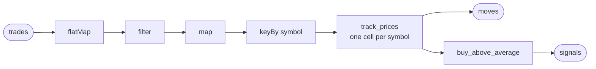

# Unbounded basics

An unbounded operator is started once and runs until you stop it: no run of
it reaches an end on its own. It waits for messages on the entry channels it declares, and each
message travels the path declared for its channel, step by step, the moment it
comes in. Results go out as they are made, not at the end. It is the kind to use
when data keeps coming and should be handled as it arrives: prices from an
exchange, clicks on a website, readings from a sensor. An unbounded operator can also
remember what it has seen, such as a running total.

## The desk's unbounded operator

The desk's unbounded operator is called `prices`. Trades come in from the exchange, and for
each symbol it keeps the last ten prices. When a new price is 2 % or more
above their average, the desk buys: it starts an order.

You write it in four pieces, one section each: the operator, which declares
the path every trade takes; the tasklet that keeps each symbol's prices; the
tasklet that decides when to buy; and the runner that offers the operator.
Running it comes later, in [`durability.md`](durability.md).

## Several tasklets in one operator

The operator declares the path every trade takes, in one expression that
reads in the order the data flows:



Messages enter on the channel `trades`, in the format of Kraken's WebSocket
API: each message carries one or more trades in its `data` list. Four
transforms come next: small steps written right into the path, with no class of
their own. Here are two messages on their way through them:

```json
{"channel": "trade", "type": "update", "data": [
  {"symbol": "EUR/USD", "side": "buy", "price": 1.0850, "qty": 1000, "ord_type": "market", "trade_id": 1, "timestamp": "2026-09-22T10:00:00.000000Z"},
  {"symbol": "EUR/USD", "side": "sell", "price": 1.0851, "qty": 500, "ord_type": "limit", "trade_id": 2, "timestamp": "2026-09-22T10:00:00.000000Z"},
  {"symbol": "EUR/USD", "side": "sell", "price": 1.0853, "qty": 2000, "ord_type": "market", "trade_id": 3, "timestamp": "2026-09-22T10:00:00.000000Z"}
]}
{"channel": "trade", "type": "update", "data": [
  {"symbol": "USD/JPY", "side": "buy", "price": 149.50, "qty": 1000, "ord_type": "market", "trade_id": 4, "timestamp": "2026-09-22T10:00:01.000000Z"}
]}
```

`flatMap` splits each message into its trades. Two messages become four
trades, all on one level, and each goes on alone:

```json
{"symbol": "EUR/USD", "side": "buy", "price": 1.0850, "qty": 1000, "ord_type": "market", "trade_id": 1, "timestamp": "2026-09-22T10:00:00.000000Z"}
{"symbol": "EUR/USD", "side": "sell", "price": 1.0851, "qty": 500, "ord_type": "limit", "trade_id": 2, "timestamp": "2026-09-22T10:00:00.000000Z"}
{"symbol": "EUR/USD", "side": "sell", "price": 1.0853, "qty": 2000, "ord_type": "market", "trade_id": 3, "timestamp": "2026-09-22T10:00:00.000000Z"}
{"symbol": "USD/JPY", "side": "buy", "price": 149.50, "qty": 1000, "ord_type": "market", "trade_id": 4, "timestamp": "2026-09-22T10:00:01.000000Z"}
```

`filter` keeps the market orders, the trades that went through at whatever the
price was. The limit order is gone:

```json
{"symbol": "EUR/USD", "side": "buy", "price": 1.0850, "qty": 1000, "ord_type": "market", "trade_id": 1, "timestamp": "2026-09-22T10:00:00.000000Z"}
{"symbol": "EUR/USD", "side": "sell", "price": 1.0853, "qty": 2000, "ord_type": "market", "trade_id": 3, "timestamp": "2026-09-22T10:00:00.000000Z"}
{"symbol": "USD/JPY", "side": "buy", "price": 149.50, "qty": 1000, "ord_type": "market", "trade_id": 4, "timestamp": "2026-09-22T10:00:01.000000Z"}
```

`map` turns each exchange trade into the desk's own trade, which keeps only
the symbol and the price. The exchange's format goes no further than this:

```json
{"symbol": "EUR/USD", "price": 1.0850}
{"symbol": "EUR/USD", "price": 1.0853}
{"symbol": "USD/JPY", "price": 149.50}
```

`keyBy` changes no message. It decides which cell each one goes to, by its
symbol:

```text
EUR/USD's cell:  {"symbol": "EUR/USD", "price": 1.0850}
                 {"symbol": "EUR/USD", "price": 1.0853}
USD/JPY's cell:  {"symbol": "USD/JPY", "price": 149.50}
```

Every symbol gets a cell of its own. A cell handles its trades one at a time,
in the order they arrived, so EUR/USD's 1.0850 comes before its 1.0853, while
the cells of different symbols work side by side. `keyBy` comes last, right
before `into`, because it keys what the transforms above it produced.

A transform should only look at the message and hand something on. Anything
more, such as keeping prices, is a tasklet.

`into` hands each trade to a tasklet. What a tasklet emits flows on like any
other message, so the next tasklet is added with another `into`.

`sink("moves")` sits in the middle of the path. A sink is a named exit where
results leave the operator for whatever listens there, and the same value still
carries on to the next tasklet. So every move can be seen on `moves`, and only
the decisions to buy reach `signals`.

> Write the operator. It goes into the runner project you started in
> [`namespaces.md`](namespaces.md#joining-it-from-a-runner); the finished
> project is linked at the top of your language's tab.
> {: .step}

<!-- tabs-open -->

### Java

The whole example:
[`sdk/java/examples/tradedesk`](https://github.com/flezha/flezha_java_sdk/tree/main/examples/tradedesk).

```java
// PricesOperator.java: the unbounded operator. Trades in, moves and signals out.
public final class PricesOperator implements UnboundedOperator {

    public record TradeMessage(String channel, String type, List<ExchangeTrade> data) {}
    public record ExchangeTrade(                             // one trade, as the exchange sends it
            String symbol, String side, double price, double qty, String ord_type, long trade_id, String timestamp) {}
    public record Trade(String symbol, double price) {}      // one trade, as the desk reads it
    public record Move(String symbol, double price, double average, int prices) {}

    @Override
    public String factoryId() {
        return "prices";
    }

    @Override
    public void channels(ChannelBuilder c) {
        c.input(TradeMessage.class, "trades")
                .flatMap(ExchangeTrade.class, TradeMessage::data)                   // a message into its trades
                .filter(trade -> "market".equals(trade.ord_type()))                 // market orders only
                .map(Trade.class, trade -> new Trade(trade.symbol(), trade.price())) // the desk's own trade
                .keyBy(Trade::symbol)                                               // one cell per symbol
                .into(TrackPricesTasklet.class)
                .sink("moves")                                                       // every move leaves here, and carries on
                .into(BuyAboveAverageTasklet.class)
                .sink("signals")
                .sealed();
    }
}
```

The records live inside the operator, because nothing else uses them.
`ExchangeTrade` names every field the exchange sends, because the default JSON
decoding refuses a field the record does not name.
`TrackPricesTasklet` and `BuyAboveAverageTasklet` are the classes `@Tasklet`
generates from the two tasklets below. `sealed()` says the path ends at
`signals`: a later `into` on it no longer compiles.

### Rust

TODO: not written yet.

### Node

TODO: not written yet.

### Python

TODO: not written yet.

### Ruby

TODO: not written yet.

### PHP

TODO: not written yet.

### Elixir

TODO: not written yet.

<!-- tabs-close -->

## Keep each symbol's prices

`track_prices` keeps each symbol's last ten prices, its window. A tasklet
remembers things in its cell, and since `keyBy` gave every symbol a cell of its
own, every symbol has its own window: EUR/USD's prices never mix with
USD/JPY's.

A symbol's first trade has nothing to be compared with, so it only goes into
the window. Every later trade emits a move: the price, the average of the
prices before it, and how many prices that average covers.

> Write the tasklet that keeps each symbol's window.
> {: .step}

<!-- tabs-open -->

### Java

```java
// TrackPrices.java: keeps a symbol's last ten prices, and compares each new one with their average.
@Tasklet(id = "track_prices")
public final class TrackPrices {

    private static final int WINDOW = 10;

    @State
    public static class PriceWindow {                        // what each symbol's cell remembers
        public Deque<Double> prices = new ArrayDeque<>();
    }

    public Optional<Move> run(Trade trade, PriceWindowHandle window) {
        Deque<Double> prices = window.get().prices;

        // A symbol's first trade has nothing to be compared with.
        Optional<Move> move = prices.isEmpty()
                ? Optional.empty()
                : Optional.of(new Move(trade.symbol(), trade.price(), average(prices), prices.size()));

        window.pushBackPrices(trade.price());
        if (prices.size() > WINDOW) {
            window.popFrontPrices(1);
        }
        return move;
    }

    private static double average(Deque<Double> prices) {
        return prices.stream().mapToDouble(Double::doubleValue).average().orElseThrow();
    }
}
```

**`@State` marks what a cell remembers.** The class sits inside the tasklet
that uses it. From it the annotation processor generates `PriceWindowHandle`,
the parameter `run` takes: `window.get()` reads the window, and
`pushBackPrices` and `popFrontPrices` add a price at the end and drop one from
the front.

An `Optional` return emits only when a value is present, which is how the first
trade emits nothing.

### Rust

TODO: not written yet.

### Node

TODO: not written yet.

### Python

TODO: not written yet.

### Ruby

TODO: not written yet.

### PHP

TODO: not written yet.

### Elixir

TODO: not written yet.

<!-- tabs-close -->

## A tasklet with no state

`buy_above_average` remembers nothing. The move it gets already carries the
average, so that one value is all it needs to decide. There is no `keyBy` in
front of it, so a single cell handles every symbol, which is fine for a tasklet
that keeps nothing.

For each price 2 % or more above its average it does two things: it starts an
order, and it emits a line saying so. For the other prices it does nothing.

The order is a bounded operator, `paper_order`, and the tasklet starts one for every
buy, handing it the order as its start values: the symbol, and how many to
buy. [`bounded_basics.md`](bounded_basics.md) writes that bounded operator.

TODO: starting a bounded operator from a tasklet changes with the coming bounded operator
rework, so this part is a placeholder until then.

> Write the tasklet that decides when to buy, and starts the order.
> {: .step}

<!-- tabs-open -->

### Java

```java
// BuyAboveAverage.java: buys when a price is far enough above its average.
@Tasklet(id = "buy_above_average", emits = String.class)
public final class BuyAboveAverage {

    private static final ObjectMapper JSON = new ObjectMapper();

    private static final double BUY_ABOVE_PCT = 2.0;
    private static final int LOT = 10;

    public void run(Move move, TaskletCtx ctx) throws TaskletException {
        double percent = (move.price() - move.average()) / move.average() * 100.0;
        if (percent < BUY_ABOVE_PCT) {
            return;
        }

        byte[] ticket;
        try {
            ticket = JSON.writeValueAsBytes(new OrderTicket(move.symbol(), LOT));
        } catch (Exception unserializable) {
            throw new TaskletException("could not encode the order: " + unserializable.getMessage());
        }

        ctx.spawnBounded("paper_order", ticket);            // one bounded operator per order

        ctx.emit(String.format(
                "%s %.2f is %.2f%% above its average of %.2f, buying %d",
                move.symbol(), move.price(), percent, move.average(), LOT));
    }
}
```

`run` takes the context because it does two things per input: it starts a
bounded operator and it emits. A `void` method declares no output, so `emits` names the
type it emits. `spawnBounded` takes the order as JSON; `OrderTicket` is the
order `paper_order` takes, declared with the bounded operator in
[`bounded_basics.md`](bounded_basics.md).

### Rust

TODO: not written yet.

### Node

TODO: not written yet.

### Python

TODO: not written yet.

### Ruby

TODO: not written yet.

### PHP

TODO: not written yet.

### Elixir

TODO: not written yet.

<!-- tabs-close -->

## The runner

> Register the operator on the runner, before `start()`.
> {: .step}

<!-- tabs-open -->

### Java

```java
// Main.java: the runner. Joins trading and offers the operator.
public static void main(String[] args) throws Exception {
    FlezhaRunner runner = Flezha.createRunner(args.length > 0 ? args[0] : "trading")
            .registerFactory(PricesOperator.class)
            .start();

    runner.awaitTermination();
}
```

### Rust

TODO: not written yet.

### Node

TODO: not written yet.

### Python

TODO: not written yet.

### Ruby

TODO: not written yet.

### PHP

TODO: not written yet.

### Elixir

TODO: not written yet.

<!-- tabs-close -->

## Next

The desk starts an order for every buy, and the order has nothing to run yet.
[`bounded_basics.md`](bounded_basics.md) writes `paper_order`, the bounded operator
that places it.
