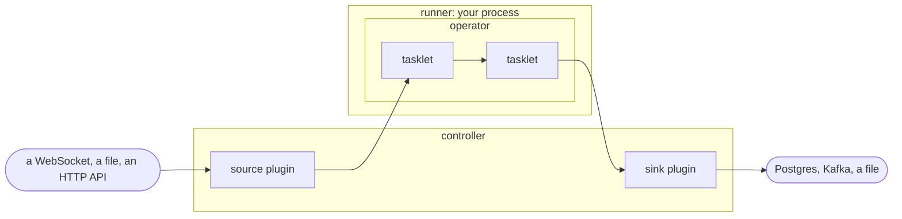

# What is Flezha

Flezha is a general-purpose compute engine, durable and distributed. You write
small handlers, and Flezha runs
them on one machine or across many, keeps what they need to remember, and when
a process crashes or a machine goes away, carries on from where they stopped.
Records come in from somewhere, your code handles each one, and the results go
out somewhere else. You write that code in Java, Rust, Node, Python, Ruby, PHP
or Elixir, and handlers in different languages run side by side in one
deployment.

## The pieces

- A **controller** is the brain. It keeps the durable state, decides which
  runner runs what, heals what breaks, and answers the `flz` command line.
- A **runner** is a process of yours, in any of the seven languages, that runs
  your code. It offers capacity to a controller and does what it is told.
- An **operator** is what you start and stop. The code you write is its
  template, called a **factory**, and every start makes one more running
  instance of it.
- A **tasklet** is a step inside an operator with your own logic in it. An
  operator passes its data through one or more of them.
- A **cell** is where a tasklet's state lives. A tasklet whose input is keyed,
  by user or by device, gets one cell per key, each with its own state.
- A **plugin** connects an operator to the outside: a source feeds it and a
  sink takes what it sends out. They ship with Flezha and attach with one
  command.

## Two kinds of operator

- **A stream never ends.** An unbounded operator runs until you stop it:
  events, clicks or log lines keep arriving, and each one is handled as it
  comes. Any ETL pipeline is one.
- **A job finishes.** A bounded operator does one piece of work with a start and
  an end, as steps in a fixed order: one payment, or a nightly import that
  `flz schedule` starts on a timetable. A failed step is retried, and a step that
  cannot succeed undoes the ones before it.

Both scale the same way. One operator's code can run as thousands of
independent instances, each with its own state, spread over as many machines as
you give it.

## What you can build with it

Flezha is one engine for any code that reacts to messages or runs a piece of
work. Streams, workflows, stateful services and AI agents run on the same
controller, on the same runners and under the same commands, and one deployment
can mix all of them. What usually takes a stream processor, a workflow engine,
a job scheduler and an actor framework, each with its own servers and its own
way of failing, is one system here.

### Data pipelines and stream processing

Read from files, HTTP endpoints, WebSockets or another operator, reshape each
message with `map`, `filter`, `flat_map` and `key_by`, and write the results to
Postgres, Kafka or a file. State kept per key survives a crash, per-key timers
give you windows and timeouts, merged channels give you joins, and a message can
be timed by when it happened rather than when it arrived. The source and the
sink are plugins, so moving from a file to a live feed is a command, not a
rebuild. Part 2 builds one in
[`building_an_etl_stream.md`](tradedesk/building_an_etl_stream.md).

### Workflows and long-running jobs

A bounded operator runs work in steps, one after another or side by side. Each
finished step is on disk before the next one starts, so a crash in the middle
resumes at the step it reached instead of starting over. A failed step is
retried on a ladder you declare, and a step that cannot succeed undoes the ones
before it. A tasklet can start one workflow per event, and `flz schedule`
starts one on a timetable. Part 2 builds one in
[`building_a_workflow.md`](tradedesk/building_a_workflow.md).

### Stateful services, one per user, device or account

A keyed tasklet gives every key a cell of its own: its own state, its own
queue, one message at a time. One factory runs as thousands of operators, each
independent of the rest. An operator can sleep while it is idle and wake with
its state intact when its next message arrives, so sessions that sit quiet hold
nothing on the runners, and a timer closes one that has gone quiet for good.

### AI agents

An agent turn is a chain of side effects: call a model, act on its answer, and
undo the action if a later step fails. Each of those is a place where a process
can die, and Flezha makes the chain survive it. The conversation is durable
state, a flaky model call is retried and a hopeless one set aside, an action is
undone by a compensation you declare, and a session waits between messages
without holding a runner.
[`durable_agent`](https://github.com/flezha/flezha_python_sdk/tree/main/examples/durable_agent)
is such a loop in Python. Part 3 builds a whole service around one: an HTTP
plugin of its own in front, an agent that streams its answers back, and one
session per user.

### Stateless handlers and the glue between systems

Code that keeps no state gets everything else all the same. It is placed on a
runner and moved when that runner goes away, a failed message is retried, and
one that keeps failing waits in a dead-letter queue, where you can inspect it
and send it through again. Operators can feed each other directly, and
[a plugin of your own](advanced/custom_plugins.md) connects Flezha to any system
you can reach from code.

### Where it fits

Some of the products it can be the backend of:

- **Fintech:** payments and transfers as workflows with a compensation for each
  step, and a cell per account.
- **Online games:** play rooms and matches, with a cell per room, moves handled
  in the order they arrive, and timers for turns and timeouts.
- **Real-time systems:** live feeds handled message by message, with state per
  key.
- **IoT:** a cell per device, with its readings folded into its state.
- **E-commerce:** orders and stock reservations as workflows, and a cart per
  customer.
- **SaaS:** a namespace per customer, with its own data, keys and limits.
- **AI products:** an agent session per user, kept as durable state.

## What comes with it

- **Durable by default.** Every change your code makes to its state is written
  to the controller's disk as it happens, and a restart resumes instead of
  starting over.
- **Effectively-once delivery** for the outputs that must never arrive twice.
- **Scale out, not up.** Split an operator into partitions, add runners, and run
  several controllers that hand work over to each other when one stops.
- **Seven languages, one engine.** The SDKs share one engine, so ordering,
  retries and durability follow the same rules whichever language you write in,
  and handlers in all seven run side by side.
- **Plugins in the box.** Files and S3 buckets, HTTP polling, WebSocket feeds,
  Kafka, Postgres, and forwarding from one operator to another ship with
  Flezha, attach with one command, and change without touching your code.
- **Authorization on by default.** Every command and every runner has to say
  who it is, with a token or a key of its own, and gets to do only what its
  roles allow, and an audit log records who changed what.
- **Many applications, one cluster.** Namespaces keep each application's
  runners, operators and data apart, each with its own quotas and keys.
- **Operate it from the command line or from your code.** Everything `flz` does
  to an operator, a runner can do through its admin API.
- **Test without a deployment.** Local mode runs an operator's graph in your own
  process, in every SDK.
- **Run it where you run things.** Release binaries, Docker images, Kubernetes,
  or inside an Elixir application of your own.

## What it is not

- **Not a database.** It keeps the state your handlers need and lets you read it
  back, but it is not where other systems store and query their data. It writes
  to Postgres through a plugin.
- **Not a message broker.** It does not replace Kafka as the log other systems
  share. It takes messages in and sends them on through plugins, Kafka among
  them.
- **Not a SQL engine or a data warehouse.** There is no query language: the
  logic is code in your own language, and the results go wherever your
  analysts already look.
- **Not a key-value store or a cache.** A cell's state belongs to its tasklet
  and changes only through it; other services do not read and write it the way
  they would a cache.
- **Not a place that hosts your code.** It does not build, ship or start your
  processes. You run your runners however you run services today, and Flezha
  places the work on them.
- **Not a file or object store.** It reads and writes files and S3 buckets
  through a plugin, but keeps none of your files itself.

## Next

[`try_it.md`](try_it.md) runs an operator in Docker before you build one.
