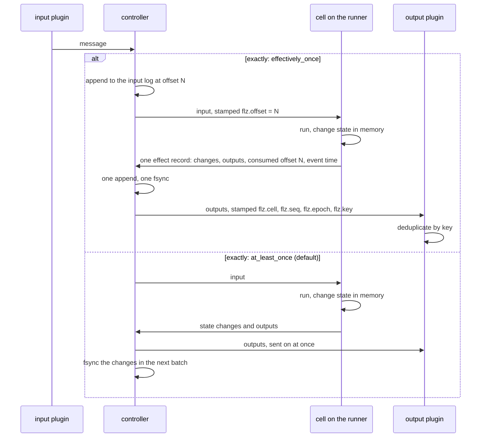
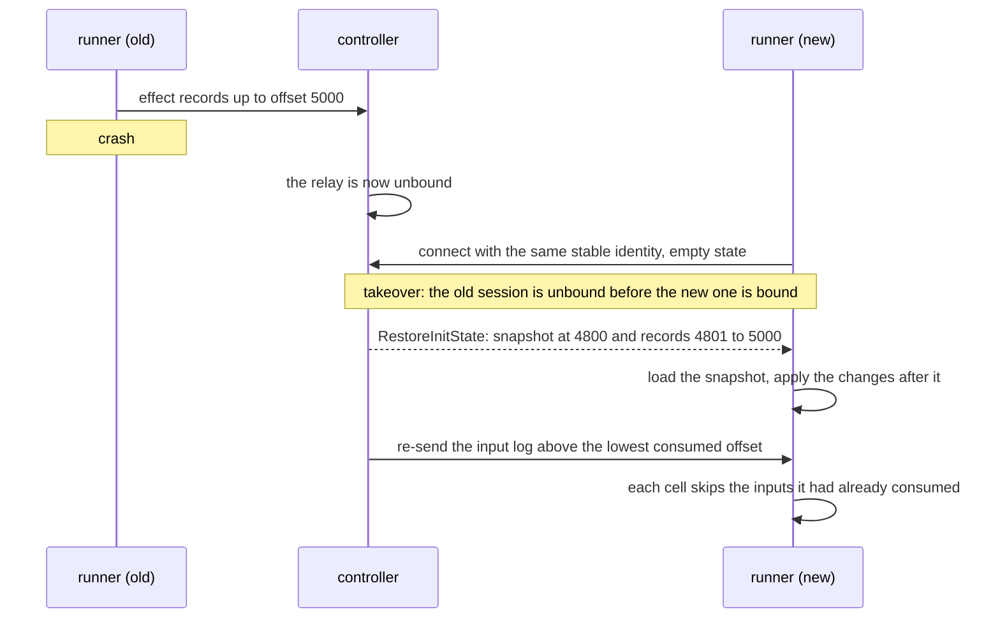
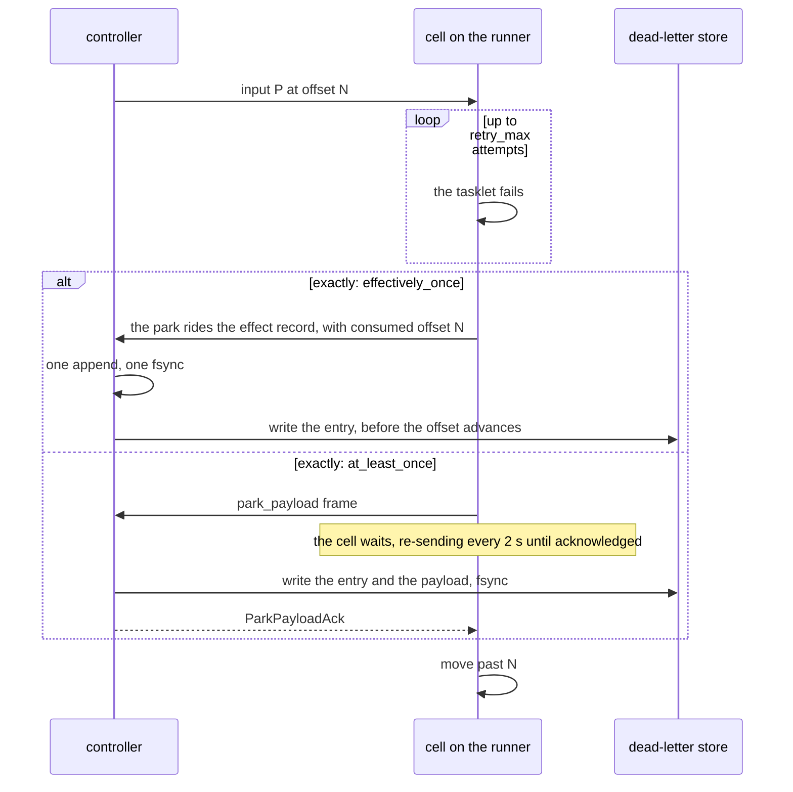
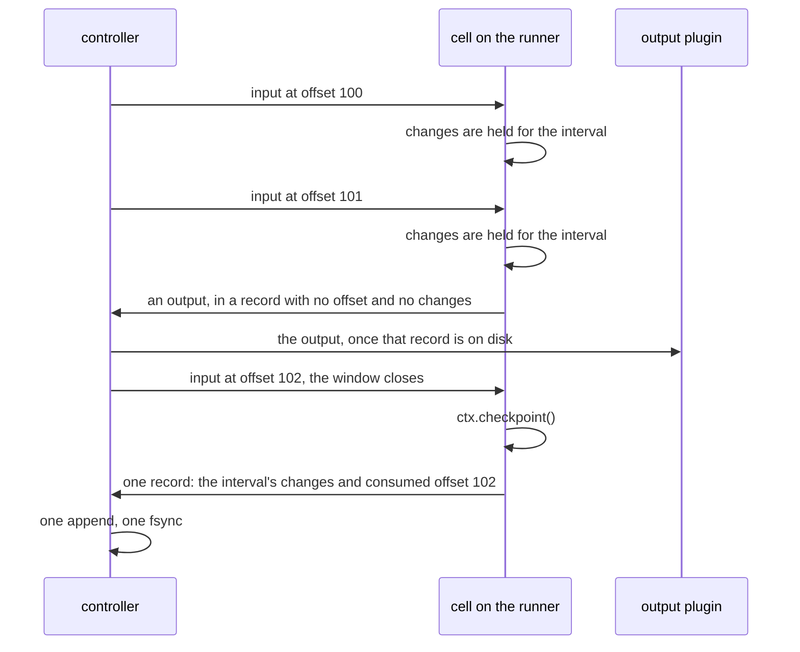
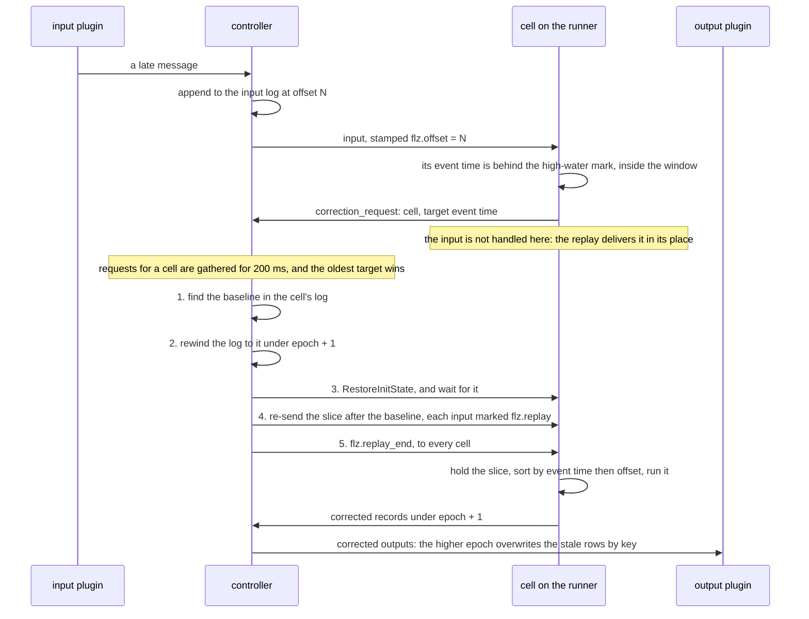
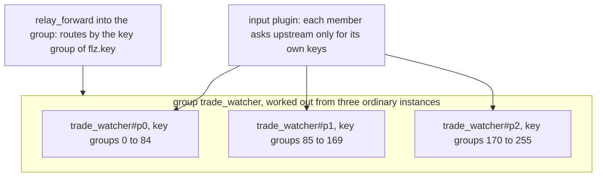

# Running in flow

What `run: flow` adds to a relay. A class that runs in flow, the default,
is a **flow relay**: it takes input for as long as it lives, such as a
price feed, a click stream or readings from devices. It handles each message
as it arrives, with no barrier between tasklets, and each of its cells
recovers on its own.

It runs on the [kernel](kernel.md) unchanged. This page covers what is its
own: how a cell recovers, what happens to a message that always fails, how a
class acknowledges input in batches, how it corrects results that a late
input made wrong, and how one relay is split across several runners. The
user's side of the same features is in
[`../topics/core/effectively_once.md`](../topics/core/effectively_once.md),
[`../topics/core/partitioning.md`](../topics/core/partitioning.md) and
[`../topics/core/durability.md`](../topics/core/durability.md).

**Contents**

1. [The happy path](#the-happy-path)
2. [Per-cell recovery](#per-cell-recovery)
3. [The dead-letter queue](#the-dead-letter-queue)
4. [Checkpoints](#checkpoints)
5. [Late-input correction](#late-input-correction)
   1. [What a correction needs](#what-a-correction-needs)
   2. [Manual replay](#manual-replay)
6. [Partitioned relays](#partitioned-relays)
7. [Limits and gotchas](#limits-and-gotchas)
8. [See also](#see-also)

## The happy path

The class's `exactly` setting decides what happens to one input. Here is the
same input both ways:



On the effectively-once tier, the outputs leave only after the record that
holds them is on disk, so a crash re-sends the same identity and an output that
deduplicates by key drops the repeat. The cost is the wait for one fsync
batch. By default the controller sends outputs on as they arrive and writes
the changes in batches about every 5 ms, so there is no added wait, and a
crash inside a batch can send an output again. The class chooses one or the
other.

## Per-cell recovery

Each cell has its own write-ahead log, its own snapshots and, on the
effectively-once tier, its own consumed offset. When a runner crashes, every
cell it held is restored from its own files, and none of them waits for any
other.



On the tier this replay is exact. The controller re-sends the input log from
the lowest offset any of the relay's cells has consumed, every input
stamped with its offset, and each cell skips what its own records already
cover, so it handles exactly its unconsumed tail. A late frame from the old
session is refused by the write-ahead log, so it cannot change the restored
state. Without the tier there is no input log: recovery restores state only,
and inputs that were in flight are not replayed.

The same re-send path is used for two more things: replaying a checkpoint
interval after a crash, and replaying the slice a correction rewinds. There is
one replay mechanism, in `Flezha.Relay.Replay`, started from three places.

## The dead-letter queue

A payload that makes your code fail every time is poison. Left alone, it
either holds its cell forever, which freezes the watermark (so the input log
stops being truncated and the source runs out of credit), or it is caught and
silently lost. Flezha does neither: **it retries, then parks the payload on
disk, then moves on.**



**Retries.** A failed input is tried up to the edge's `retry_max` (3 attempts
in all by default). Attempt n waits `retry_backoff_ms × 2^(n-1)`, 50 ms by
default, with ±50% jitter and capped at 5 seconds (`crates/flz_core/src/channel.rs`).
A non-retryable error (`TaskletError::NonRetryable` in Rust) skips the
retries and parks at once. In the Rust SDK a panic counts as retryable,
because the author never got to classify it. Retries live in the runner,
where the policy is declared; the park is kept on the controller, because a
runner's disk is not part of the durability contract.

**The two paths.** On the tier, the park and the offset advance are one
record, so they cannot come apart; the controller writes the dead-letter
entry before it moves the consumed offset, because moving the watermark can
truncate the poison input out of the input log. Without the tier they are two
steps, and the acknowledgement orders them: the cell does not move past an
input until the controller has confirmed its park (`crates/flz_core/src/park.rs`).

**The store.** `Flezha.Dlq.Store` keeps
`storage/app/dlq/<relay_class>/<tasklet_id>/entries.jsonl` plus one file per
payload, fsynced before the acknowledgement. An entry's id comes from where
the payload came from: `cell_key@offset` on the tier, the channel and a hash
of the payload without it. So a park sent again after a lost acknowledgement,
or replayed after a crash, lands on the same entry instead of adding a
duplicate. Entries are kept for 30 days and up to 4 GiB in all, whichever
limit is reached first; each entry removed by that limit is logged and emitted
as `[:flezha, :dlq, :retention_dropped]`, because it was never replayed and is
now gone.

**Replaying.** `flz dlq list`, `show`, `replay` and `drop` work on the store. A
replay marks the entry `replaying` and sends the payload to the relay again
as a new input. If no new park arrives within a grace window, the replay
counts as a success and the entry is removed; if it fails again, it parks
again with its `generation` raised. Replay is a command you run on purpose,
because an automatic replay would simply poison the cell again. An entry stored
without its payload bytes can only be shown or dropped. Some inputs park with no attempt at all; the list is in
[the dead-letter queue section of `durability.md`](../topics/core/durability.md#the-dead-letter-queue).

A steps relay answers a lasting failure by undoing its finished steps
instead ([`steps_profile.md`](steps_profile.md#retry-then-abort)); a
`keep_progress` loop parks the failed turn's message.

## Checkpoints

On the tier, an input is acknowledged when the state it produced is on disk.
For most classes that is right. Some classes, though, fold many inputs into
one state that only means something as a whole: a window that closes on its
boundary, a batch that counts only when complete. For them, acknowledging
each input would move the offset past inputs whose state the class never
meant to publish, and a restore would resume past them.

Such a class sets `ack: checkpoint` under `exactly: effectively_once`. The
interval closes after `every` inputs, after `max_delay_ms`, or when the
tasklet calls `ctx.checkpoint()`, whichever comes first
([`relay_settings.md`](../configuration/relay_settings.md)).



What follows from that:

- **Outputs still leave as they are produced**, unless the class also sets
  `outputs: at_checkpoint`, which holds them and ships them inside the
  checkpoint record. Without it, a crash re-sends the interval's outputs under
  the same epoch, and the keyed output the tier requires drops the repeats.
- **A park closes the interval.** The record that parks a poison input also
  carries the state before it, so the parked input is never replayed and the
  state behind it is never lost (`crates/flz_core/src/effect.rs`).
- **A restore drops the open interval.** Its changes were never acknowledged,
  and the inputs behind them are re-sent from the input log.
- **A compaction or a move closes the interval early.** Its record ships before
  the snapshot or the handed-over state is taken, so neither holds an input the
  input log would send again.
- **The stall watchdog skips the class.** For an ordinary class, "wrote before
  and silent since" is a dead feed; for this one it is a normal interval
  (`Flezha.State.Watchdog`).

**The interval is what you size the class with.** The input log is not
truncated past the last checkpoint, recovery replays the open interval, and
source credit comes back when the watermark moves, so in bursts at each
checkpoint. Long intervals cost disk and recovery time; short ones approach
the per-input default. A class that never checkpoints stops truncating its
input log and in time holds back its own source, as any cell that stops
consuming does.

## Late-input correction

An input arrives late: after the window it belongs to has already been
computed and its result sent on. The state is wrong, and so is everything that
was sent from it.

Nothing has to be inserted to fix it. The input was written to the input log
when it arrived, before anything knew it was late, so the log already holds
it; only the order in which it was handled was wrong. A correction is
therefore the ordinary restore-and-replay path with two changes: the cell is
rewound to an earlier point, and the replayed slice is sorted by event time.



The runner sees an event time and the controller does not, so the runner
detects a late input (`crates/flz_core/src/correction.rs`) and the controller runs
the correction (`Flezha.Relay.Replay.run_correction/3`). Four details carry
the design:

- **The baseline is found by scanning forward.** It is the record just before
  the first one whose event time is at or after the target
  (`Flezha.State.WalWriter.correction_baseline/2`). Scanning backward for the
  first earlier event time would stop at an out-of-order input that was
  handled as an arrival, and would leave the records that overtook the late
  input in place.
- **The rewind comes before the restore.** The other way round, the runner
  would write corrected records onto sequence numbers the stale records still
  hold, and send outputs under the old epoch before the new one was on disk.
- **`flz.replay_end` goes to every cell.** An input reaches exactly one cell,
  by its key, so an end marker riding the last input would leave every other
  cell holding its share of the slice forever.
- **The new epoch is passed in, not computed by the writer.** A correction
  that crashed and runs again asserts the same epoch instead of raising it
  twice; a second raise would leave the first attempt's rows at an epoch
  nothing overwrites.

**A crash in the middle of a correction needs no marker.** Before the rewind
is on disk, nothing durable has changed: the late input is still in the log
and still unconsumed, so the ordinary resume re-sends it, the runner finds it
late again, and the correction starts over. After the rewind is on disk, the
cell's state is the baseline and the watermark was lowered to match, so the
ordinary resume replay is the correction. That is why, for a class with a
correction window, every replay is marked and sorted: crash recovery and
correction share one path.

**An input later than the window** follows `beyond_window`:
`process_as_arrival` (the default, so declaring a window never starts
dropping data on its own) or `drop`. Such an input does not move the
event-time high-water mark.

### What a correction needs

A correction window is set with `correction_ms` under
`exactly: effectively_once`, so it always has an input log to replay from.
The rest is checked when the runner registers the class, and refused with a
code from the [error catalogue](../errors.md):

| Refused | Why |
| --- | --- |
| a tasklet whose clock is not event time (`topology.correction_without_event_time`) | "late" means nothing without an event time carried by the input |
| a channel to a plugin that is not keyed (`topology.unkeyed_channel_under_effectively_once`) | a corrected output must overwrite the stale one by its key |
| a dropping overflow policy (`topology.dropping_policy_under_effectively_once`) | a dropped input could not be replayed |
| a zero window (`topology.correction_window_zero`) | there would be nothing to correct |

**Retention follows from the window.** A correction over a 60 s window means
keeping 60 s of input log and 60 s of log history, so a declared window raises
both floors to meet it: the input log's hold window becomes at least the
window, and age-based compaction never keeps less history than the window (an
age floor of `0` turns age-based compaction off and already keeps
everything). A floor the relay configured higher stays. Because one line
of code can commit the controller to real disk, a floor that was raised is
logged and emitted as `[:flezha, :correction, :retention_derived]` when the
relay binds (`Flezha.State.PersistenceResolver`).

### Manual replay

The same transaction, with the baseline chosen by a person instead of by a
late input:

```sh
$ flz relay replay <relay/tasklet/key> --from <seq|time>
```

Deploy a fix, then heal the recent past with it: the command rewinds the cell
to the given point, runs the kept inputs through the current code, and sends
the results under a raised epoch, so a keyed output overwrites the stale rows.

A correction overwrites the keys it sends again. It does not remove a key the
stale run sent and the corrected run does not. That is safe for keys derived
from the window, such as a candle or an aggregate per interval, because the
corrected run sends the same set of keys; it is not safe for a set of keys
that shrinks.

## Partitioned relays

A flow relay is bound to one runner, so its cells spread over that
machine's cores and no further. `--partitions N` goes past that: the relay
becomes **N ordinary instances** (`trade_watcher#p0` to `trade_watcher#p2`),
each with its own Overwatch, registry row, runner, input log, state files,
plugins and dead-letter entries. There is no group record. Each member's
stored start options name its group, its index, the group size and its
key-group range, and every view of the group (the one row in
`flz relay list`, the coverage check in `info`) is worked out from the
members when it is read, so nothing can drift from the registry. Placement,
convergence, rebinding, moving and recovery all work per member, unchanged.



- **Key groups, not `mod N`.** A key hashes into one of 256 fixed key groups
  (FNV-1a-128 of its bytes), and each member owns a contiguous range. The
  range is stored in the member's options and sent in `AddRelay`, never
  worked out again from the index and size (`Flezha.Partition`). A rescale
  therefore moves whole slices of key groups instead of moving almost every
  key, and an uneven split later would need no format change. The hash has
  two implementations, kept equal by one fixture set: `flz_core`
  (`crates/flz_core/src/relay/instance.rs`), used by every SDK, and the
  controller's `Flezha.Relay.KeyGroup`.
- **The routing rule is checked, not trusted.** The item a source subscribes
  with, and the `flz.key` a forward routes on, must equal what `key_by`
  returns. The runner checks every computed cell key against its member's
  range before it creates a cell, and parks the first key outside it with an
  error that names the rule (`crates/flz_core/src/routing.rs`), instead of folding
  part of the traffic into the wrong state. A forward into the group parks a
  message that has no key, or whose key no member owns, rather than guessing
  (`Flezha.Plugin.Provider.RelayForward`).
- **The controller refuses a group it cannot split.** A class with no keyed
  tasklet fed by an entry channel is refused
  (`partitions_without_keyed_tasklet`): N copies of one unkeyed cell would be N
  different states that each look like the state. A steps class is refused
  unless it loops `each: per_input`. Both checks run before any runner is
  asked (`Flezha.Relay.PartitionGroup`).
- **Sources split what they ask for.** The WebSocket subscription source keeps
  only the items its member owns before it subscribes, so the total traffic is
  that of one connection, divided. `http_poll` fills `{{partition_index}}` and
  `{{partition_count}}` into its URL. How plugins attach to a group is in
  [`../topics/core/partitioning.md`](../topics/core/partitioning.md#plugins-on-a-partitioned-relay).
- **A rescale is quiesce, move, restart.** `flz relay scale <group> M`
  stops the group's sources, refuses while any member has dead-letter
  entries, and waits until every member has consumed its input log. It then
  works out the new ranges, moves the files of each cell that changes owner (a
  rename on the same controller, a `Flezha.State.WalTransfer` pull from
  another), and starts M members, which restore through the ordinary bind. A
  cell's identity holds its key and no runner, so no storage format changes,
  and a crash in the middle is repaired by running the command again: each
  move is atomic per cell, and what is left is worked out from the disk. One
  rescale of a group runs at a time across the cluster.

## Limits and gotchas

- **Without the tier, recovery restores state only.** There is no input log to
  replay in-flight inputs from, and a crash can send an output twice.
- **A hot single key is still bound to one machine.** Per-key order requires
  one cell per key; the answer is to aggregate in two stages
  ([`../topics/core/partitioning.md`](../topics/core/partitioning.md#hot-keys-aggregate-in-two-stages)).
- **Partitions spread over runners by hashing**, with a fair-share cap, not by
  measured load.
- **A correction does not remove keys.** A set of output keys that shrinks
  after a correction leaves the stale keys in the output.
- **A class that never checkpoints** stops truncating its input log and in time
  holds back its own source.

## See also

- [`overview.md`](overview.md): the roles and the kernel's rules this page builds on.
- [`kernel.md`](kernel.md): the input log, the effect record, the watermark and the epoch rule in detail.
- [`steps_profile.md`](steps_profile.md): the other way to run, for comparison.
- [`../topics/core/effectively_once.md`](../topics/core/effectively_once.md): turning the tier on, from the user's side.
- [`../topics/core/partitioning.md`](../topics/core/partitioning.md): starting, scaling and feeding a partitioned relay.
- [`../topics/core/durability.md`](../topics/core/durability.md): what a crash costs, and the dead-letter queue from the user's side.
- [Partitioned relays, the full contract](https://github.com/flezha/flezha/blob/main/docs/internal/sdk/partitioned_relays.md): preflight, id budget, quota and coverage checks.
