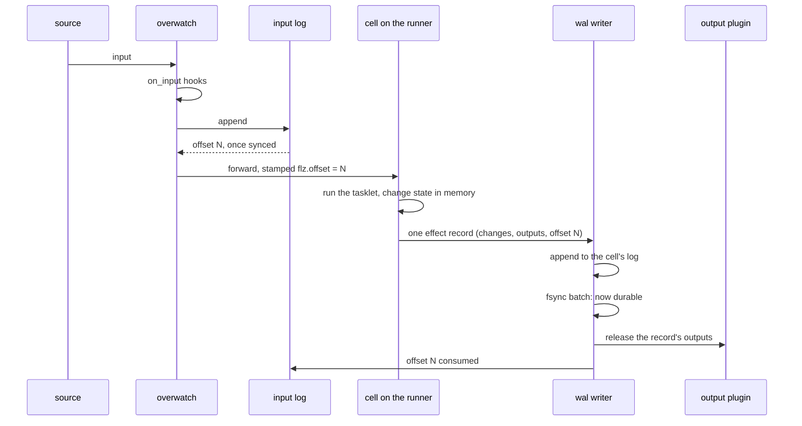
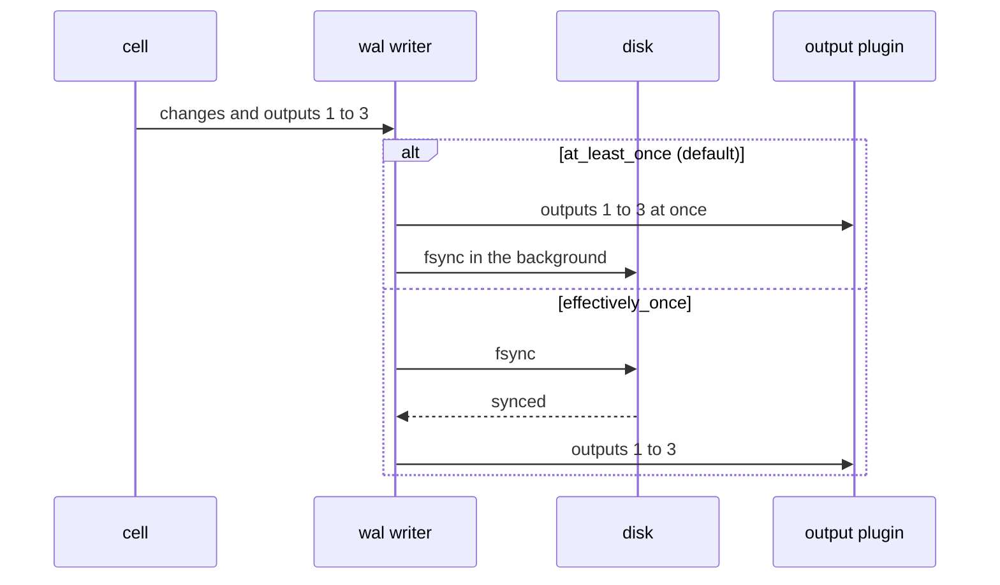
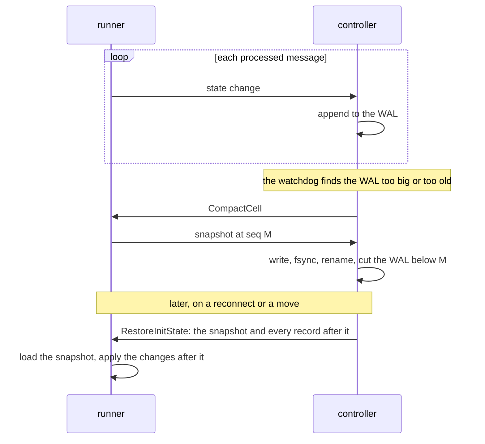
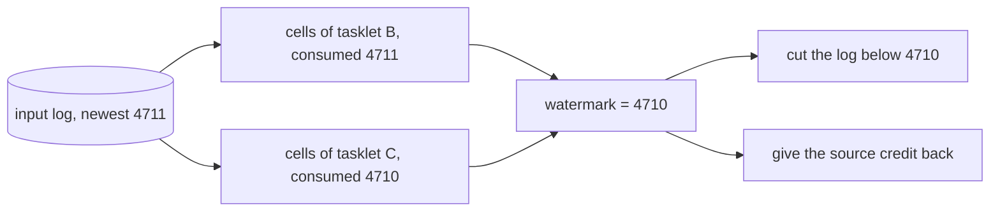
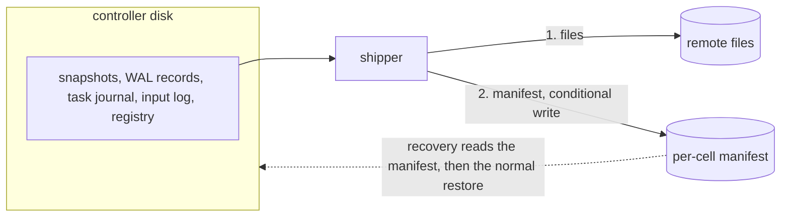
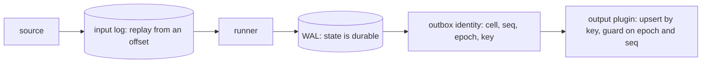
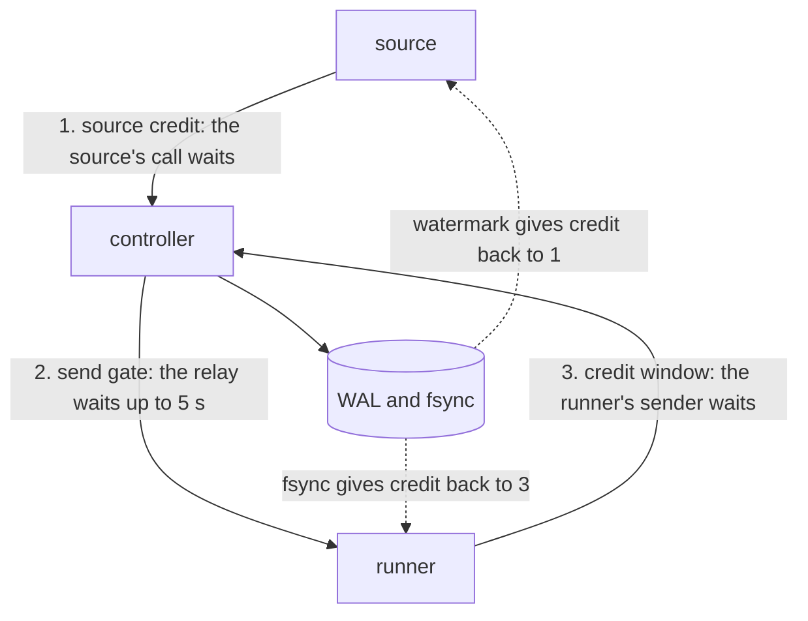
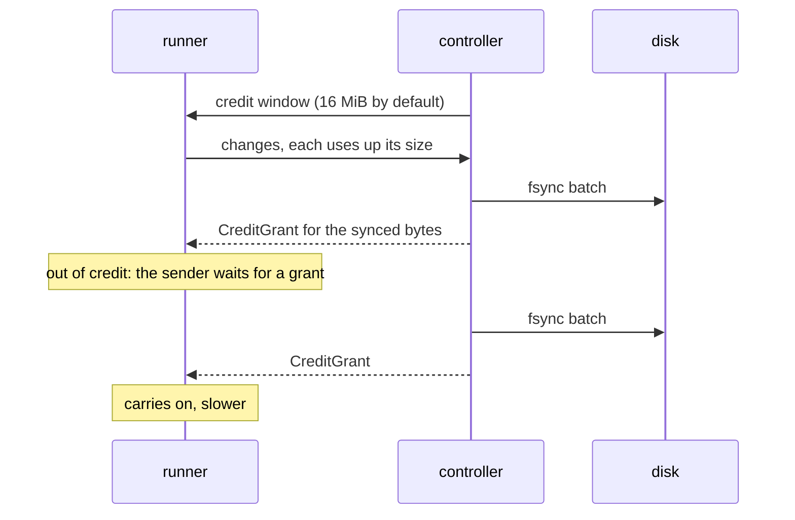
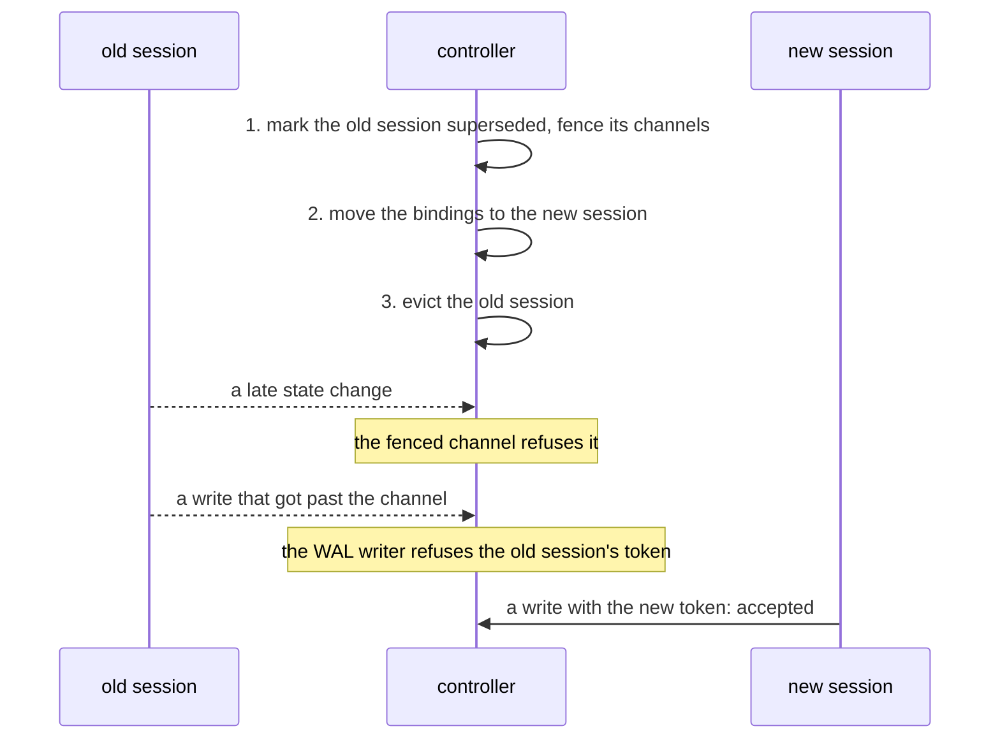
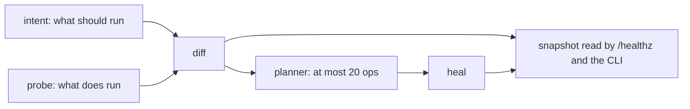

# The durable-compute kernel

This page describes the machinery under every relay: how a change to a cell's state reaches
the controller's disk, how an output gets an identity an output plugin can deduplicate on, how the
controller slows a sender down, who may write a cell's log, and how the controller knows work
is flowing. A flow relay and a steps relay use the same machinery; the pages on
[running in flow](flow_profile.md) and [running in steps](steps_profile.md) cover what each
adds on top.

It is written for contributors and for users who want to know what happens behind
[durability](../topics/core/durability.md) and [state](../topics/core/state.md). Each
section says what happens first, then names the code that does it.

**Contents**

1. [The write path](#the-write-path)
2. [The record format](#the-record-format)
3. [The effect record](#the-effect-record)
4. [When a change is durable](#when-a-change-is-durable)
   1. [The outbox](#the-outbox)
5. [Snapshots and restore](#snapshots-and-restore)
   1. [Push or pull a baseline](#push-or-pull-a-baseline)
6. [The input log and its watermark](#the-input-log-and-its-watermark)
7. [The remote tier](#the-remote-tier)
8. [Delivery guarantees](#delivery-guarantees)
9. [Determinism](#determinism)
10. [Output identity](#output-identity)
11. [The epoch rule](#the-epoch-rule)
12. [Flow control](#flow-control)
    1. [The runner to controller credit loop](#the-runner-to-controller-credit-loop)
    2. [The source credit loop](#the-source-credit-loop)
13. [Ownership and fencing](#ownership-and-fencing)
14. [Health and liveness](#health-and-liveness)
    1. [Fed and advancing](#fed-and-advancing)
    2. [The watchdog](#the-watchdog)
    3. [Finding the stalled layer](#finding-the-stalled-layer)
    4. [The health endpoint](#the-health-endpoint)
    5. [The readiness endpoint](#the-readiness-endpoint)
15. [Limits and gotchas](#limits-and-gotchas)
16. [See also](#see-also)

## The write path

This is one input on its way from a source to an output plugin, for a flow relay with
`exactly: effectively_once`. A steps relay follows the same path, except that its outputs
wait for the stage commit ([running in steps](steps_profile.md#one-outbox)).



The Overwatch is the controller process that owns one relay instance. Three orderings in
the diagram are rules, not details:

- **Append before forward.** An input is written to the input log before it reaches a runner,
  and an append that fails is not forwarded. A sender can retry an input it was refused; it
  cannot recover one it believes was accepted.
- **Fsync before release.** Under `exactly: effectively_once`, an output reaches an output plugin only
  after the record that produced it is on disk, so state and output cannot disagree.
- **Release before the offset moves.** The consumed offset moves last, so a crash resumes at
  or before the input whose outputs are already out.

The append is asynchronous: the Overwatch hands the payload to the log, keeps the caller's
reply owed, and forwards the input when the log answers. Nothing else journals input. This
lives in `Flezha.Relay.Ingest` (`Flezha.Relay.Ingest.journal_reply/2`) and
`Flezha.State.InputLog`.

A relay keeps its input on disk this way in three cases: a flow relay with
`exactly: effectively_once`, a flow relay that sleeps (`sleep_after` set), and a durable
steps relay. Any other relay skips the input log. Outside the tier and steps, cells send
plain change records, and outputs leave as they are produced.

## The record format

A cell's log (its WAL, write-ahead log), the input log and a steps relay's task journal are
all the same kind of file: an append-only list of framed records, each protected by a CRC.

```text
| seq u64 BE | len u32 BE | header 16 B | body (len - 16) | crc32 u32 BE |
  the crc32 covers header and body

header of a cell WAL record:
  [0]       sdk_lang        1 rust, 2 java, 3 elixir, 4 node, 5 ruby, 6 php, 7 python
  [1..5]    sdk_version     u32 BE, the writing SDK's version
  [5..9]    schema_version  u32 BE
  [9]       format_id       1 postcard, 2 effect record, 3 timer ops, 4 kryo,
                            5 msgpack, 6 json, 7 etf
  [10..12]  reserved
  [12..16]  crc32 of the body
```

A reader walks the file from the start. A torn tail, the partial record a crash leaves in the
middle of a write, is cut off. A CRC failure with complete records after it is refused by name,
and the bytes stay on disk: records the controller has acknowledged are never deleted to make a
file parse. The frame and its decoder are `Flezha.State.Frame`
(`lib/flezha/state/frame.ex`); the walks over a file on disk are
`Flezha.State.RecordFrame`.

The other two files use the header differently:

- The **task journal** writes the instance's epoch in bytes 0 to 3, then the entry's identity
  (type, task index, iteration), which lets the writer refuse a re-sent commit
  (`lib/flezha/state/task_journal.ex`).
- The **input log** writes the append time in bytes 0 to 7 and a version in byte 8, and keeps
  byte 9 at zero, so an input record can never be read as an effect record.

## The effect record

Under `exactly: effectively_once`, and for a durable steps relay, a cell does not send bare
state changes. Each invocation of a tasklet produces **one** record holding everything it did:

| Field | What it holds |
| --- | --- |
| `changes` | the invocation's state changes, applied in order on restore |
| `outputs` | its plugin outputs: channel, key, metadata, payload |
| `consumed_offset` | the input-log offset it consumed; empty inside an open checkpoint interval |
| `dlq` | a payload parked in the dead-letter queue, when the invocation gave up on one |
| `event_time` | the value of the tasklet's clock for this invocation |
| `timers` | timers set or removed |
| `edges` | values sent to the next tasklet, with the offset they came from |

The record is one append and one fsync, so no partial mix of "state applied", "output sent",
"input acknowledged" and "payload parked" is ever on disk. A crash lands between two records,
and every such point is consistent.

`event_time` lets late-input correction and point-in-time reads turn a timestamp into a
sequence number by reading the log instead of guessing. The record is defined in
`crates/flz_core/src/effect.rs`.

## When a change is durable

The controller does not fsync each record. A shared batcher syncs every writer that has
something new, every 5 ms by default (`:agent_fsync_interval_ms`, 1 to 1000; a value outside
that range stops the batcher from starting), and the tick runs only while a writer has unsynced
records. The batcher is `Flezha.State.FsyncBatcher`.

What happens to an output inside that window depends on `exactly`:



At least once adds no latency, but a crash inside the window can lose the state change after its
output left, and the replay sends the output again. Effectively once costs one fsync batch of
latency and nothing else.

### The outbox

Under effectively once, each cell's writer keeps its released outputs as an outbox with three
cursors:

- `outbox_durable_seq`: how far the fsync has reached. Outputs up to here may be released.
- `outbox_flushed_seq`: how far the output plugins have **confirmed**.
- the epoch, described in [the epoch rule](#the-epoch-rule).

The confirmed cursor and the epoch, with the last persisted sequence, are kept in a small
`<cell>.outbox.dedup` file beside the WAL; the epoch is written first to a `<cell>.lineage`
file, which keeps it if the two ever disagree. A restarted controller re-sends every output that was
durable but not confirmed. A stale cursor only widens that re-send, which a deduplicating output plugin
absorbs; it never skips an output.

Sending is not delivery. Each released output carries an opaque `flz.ack` token. An output plugin that
guarantees delivery holds the token and answers once its write is durable; an output no output plugin
held completes when the hook chain has run it. The cursor moves over the leading run of
completed entries, so an answer that arrives out of order cannot carry it past an output still
in flight. At most `:outbox_inflight_max` entries (1000 by default) wait unconfirmed; past that
the release waits, while ingest goes on. This is `Flezha.State.Outbox`.

Releases are batched: one pass hands its whole window to the hooks at once, and an output plugin can
confirm a batch in one answer. A batch carries the same facts as single answers would.

A class can also hold its outputs until a checkpoint closes, with `ack: checkpoint` and
`outputs: at_checkpoint` under `exactly.effectively_once`
([configuring a relay](../configuration/relay_settings.md)). The interval's
outputs then ride inside its checkpoint record, one append per interval, at up to
`max_delay_ms` of extra output latency. It is off unless declared, because it changes when a
value becomes visible downstream.

## Snapshots and restore

A cell's WAL is a log of changes, and left alone it grows without end. So the controller asks
the runner for a full snapshot from time to time and cuts the log below it.



Compaction starts on whichever comes first:

| Trigger | Setting | Default |
| --- | --- | --- |
| WAL size | `:default_compact_after_bytes`, or the tasklet's own value | 8 MiB |
| age of the oldest record not in a snapshot | `:compact_after_age_ms` | 300 000 ms (`0` turns it off) |

The age trigger keeps a quiet relay from restoring by replaying a very long log. A class
with a late-input correction window raises its own age floor to that window, so a compaction
never removes the history a correction needs.

A restore sends the latest snapshot and the whole tail after it. `RestoreInitState` has no
field for "send me only what I am missing", and the controller does not know what a runner
holds; only compaction makes a restore smaller.

### Push or pull a baseline

Which way state moves depends on who holds the history, and the controller decides it
explicitly:

| Situation | What happens |
| --- | --- |
| the controller has the WAL, the runner is fresh | the controller **pushes** `RestoreInitState` |
| the controller has no WAL, the runner has live state (a change arrives that is not sequence 0) | the controller drops the frame, **pulls** a snapshot with `CompactCell`, and appends from there |

The pull is retried until a snapshot lands. A zero-byte WAL counts as no state
(`Flezha.State.Restore.has_persisted_state?/1`), so the controller never pushes an empty
restore that would reset a live cell. Deeper detail, with every setting:
[the state persistence guide](https://github.com/flezha/flezha/blob/main/docs/internal/state_persistence.md).

## The input log and its watermark

Each cell of a relay with durable input reports the input-log offset it has durably
consumed. The lowest of those offsets is safe everywhere: every input at or below it is done.



The minimum alone would let one quiet cell hold the log forever: a key that took offset 1 and
nothing since keeps everyone at 1. So the runner also reports a **processed prefix**, a marker
`P` sent after each pass, meaning every input at or below `P` has been processed by every cell
it reached and every record it produced was written. The controller confirms `P` once every
cell writer of the instance has synced past the point the marker arrived at, and a confirmed
`P` replaces the minimum as the floor. After a controller restart the floor falls back to the
minimum until the next confirmation; re-sending from there is safe, because a cell drops an
input it already took.

The watermark moves only after an fsync, so it is a durable fact. It does two jobs: it is the
floor for cutting the log, and it gives the source credit back (see
[the source credit loop](#the-source-credit-loop)).

A branch that stops consuming freezes it. When the watermark has not moved since the last sweep
and the log has grown past 16 MiB, the sweep emits
`[:flezha, :state, :input_log_frozen_watermark]` naming the lagging cell. What unfreezes it is
the dead-letter queue: after its retries a cell parks the bad payload and moves past it.

The log is cut at `min(watermark, newest offset older than the hold window)`. The hold window is
`:input_log_hold_window_ms` (0 by default), raised to a class's correction window when it
declares one, so the inputs a correction replays are still on disk. A cut finds its start
through a sparse index (one sample every 256 records) and copies only what stays. The sweep
asks for the cut and does not wait for it. This lives in `Flezha.State.InputLog`.

## The remote tier

Everything above is on one node's disk. A controller that dies **with its disk** loses its
relays' state, and the registry record that they existed, unless a remote durability
backend holds a copy. `FLEZHA_DURABILITY_BACKEND` names it: Postgres, S3, or a directory (meant
for storage that outlives the cluster, such as an NFS mount). Unset means local only; in
production the controller logs a warning on every boot and reports the posture in
`flz controller status` and `/healthz`.

The tier is not a second WAL. The local write path does not change, every acknowledgement still
waits for the local fsync, and the local files remain the copy the controller runs from. What
ships are immutable files, at points that already exist:



- **Ship points.** A compaction produces a snapshot to ship; a checkpoint closes a flow
  interval; `TaskCommit` and `IterCommit` close a steps stage and iteration. A timer
  (`ship_interval_ms`, 30 s by default) covers cells that reach none of them. Each cell's
  effect record already binds its state to its offset, so each cell's shipped copy is
  consistent on its own.
- **Manifest last.** Files go up first, under content-addressed names; the manifest entry naming
  them is written last. A torn upload leaves files recovery never reads, and a periodic sweep
  removes them. Recovery reads the manifest and then runs the ordinary restore; there is no
  second restore path.
- **The epoch fence reaches outward.** The manifest write is conditional. A controller that lost
  ownership fails it and stops shipping, so two controllers cannot both write one relay's
  remote copy. On the directory backend the conditional write is read-then-write, which two
  writers can race.
- **`durable: remote`.** A class at `remote` has each commit point acknowledged only once the
  remote copy holds it: a steps stage, a flow input, or a flow checkpoint. A flow cell keeps one
  ship in flight and covers the inputs synced meanwhile with the next one, so `ack: checkpoint`
  ships once per interval (`Flezha.State.WalWriter.RemoteGate`). A class at `local` never waits
  for the tier; a shipper that falls behind raises `[:flezha, :state, :rpo_exceeded]`, shown in
  `flz controller status` and `/healthz`.

A backend stores bytes through five operations (`put`, `get`, `list`, `put_if`, `delete`) and
knows nothing about WALs. On a fresh node the registry is restored from the backend before the
process hub opens `registry.dets`, so the restored relays are seen; cell state then comes
back through the ordinary bind. The shipper is `Flezha.State.DurabilityTier.Shipper`. User
view: [durability](../topics/core/durability.md).

## Delivery guarantees

Flezha does not promise exactly-once effects on the outside world. It promises the parts that
together give the same result:

> **at-least-once delivery + a deterministic key + a deduplicating output plugin = effectively once.**



The end-to-end guarantee is only as strong as the weakest part. Two output plugins conform: the built-in
**Postgres** output plugin upserts a whole batch and moves a per-cell progress row in one transaction,
guarded by `(epoch, seq)`, so a re-send or a stale epoch changes nothing; the **Kafka** producer
(the Kafka plugin package) uses `flz.key` as the message key and carries the full identity in a
`flezha.dedup_key` header.

The tier is set per class with `exactly: effectively_once`. It requires every channel that
reaches a plugin to be keyed: an unkeyed output gives an output plugin nothing to deduplicate on, so the
runner refuses the relay at registration
(`topology.unkeyed_channel_under_effectively_once`).

The guarantee does not depend on the language. Every runner builds the effect record in the
shared runner core, `flz_core`. What a language supplies is its own change bytes and the context calls
determinism needs (see [the poll core page](https://github.com/flezha/flezha/blob/main/docs/internal/sdk/poll_core.md)).

## Determinism

Recovery runs the tasklet again. If the tasklet read the wall clock or made a random id, the
second run would give different outputs, and an output plugin could not deduplicate them. So the runtime
computes time and identity once per invocation, and the tasklet reads them from its context:

| Call | What it returns | Stable across a replay because |
| --- | --- | --- |
| `ctx.now()` | the tasklet's clock, read once at the start of the invocation | the clock is one of the three below |
| `ctx.stable_id()` | a 128-bit id, 32 hex characters | it hashes where and when the call happened |
| keyed emit | an output with its natural key | the key comes from the input or the state |

A tasklet declares one of three clocks:

| Clock | Declared by | Value per invocation |
| --- | --- | --- |
| wall | nothing (the default) | epoch milliseconds, read once |
| event time | an `event_time` function over the input | the time carried by the input |
| logical | `logical_clock` | the cell's durable change sequence |

Event time is the only clock that gives the same answer on any replay, which is why late-input
correction requires it. A logical clock on a tasklet with no state is refused at registration,
since there is no sequence to read.

`ctx.stable_id()` is FNV-1a-128 over the cell's identity, the change sequence (8 bytes, big
endian) and the number of the call inside the invocation (4 bytes, big endian). The third call
in an invocation returns the same id on every replay of it. In Rust, the test harness checks
both properties: `replay_equals` runs the inputs twice and compares state,
`replay_emits_equal` compares outputs (`sdk/rust/src/testing/harness.rs`).

## Output identity

An output can carry identity stamps in its metadata, and where they come from depends on the
channel and the tier:

| Channel | Who stamps | Stamps |
| --- | --- | --- |
| plain (not keyed) | nobody | none |
| keyed, tier off | the core, in every SDK | `flz.cell` (class/tasklet/cell key), `flz.seq` = change seq . emit number, `flz.key` |
| keyed, tier on | the controller, when it releases the output after the fsync | `flz.cell`, `flz.seq` = WAL record seq . emit number, `flz.key`, `flz.epoch` |

The difference matters:

- **Tier off**, `flz.key` is a stable natural key, enough for a consumer that upserts by key (a
  table of the latest BTC/USD candle, say). `flz.seq` is not an exact dedup handle here: two
  invocations that change no state can share it. There is no epoch, because nothing durable owns
  one.
- **Tier on**, `flz.seq` names the WAL record that produced the output plus the output's place
  in it, and `flz.epoch` joins it. Together they are enough to deduplicate an append-only stream
  exactly.

`flz.` is reserved. A tasklet that passes metadata with a `flz.` key has the emit refused, so
stamps cannot be forged or overwritten. A durable steps relay's cells write the same effect
record and are stamped by the same controller code.

## The epoch rule

Each cell's writer has an epoch, and the durable identity of an output is
`(cell, seq, epoch)`. An output plugin drops an output whose `(epoch, seq)` is not above what it already
holds, and admits a higher one, overwriting by natural key.

| Event | Epoch | Why |
| --- | --- | --- |
| a retry or re-send from the same runner session | kept | the same identity comes back and the output plugin drops it |
| the outbox re-send after a controller restart | kept | the same |
| `flz dlq replay` | kept | the payload comes back as a new input, with a new offset and a new seq |
| a runner restart that rewrites the cell's history (realign) | raised | the new run replaces the old one |
| late-input correction | raised | the corrected output must replace the old one |
| `flz relay replay` | raised | the same |

The test is intent. An accident must not change what the world sees, so it repeats the same
identity. A deliberate re-run must change it, so it raises the epoch and the output plugin lets it
through. A runner restart counts as a re-run: the writer adopts the new session's history and
raises the epoch (`Flezha.State.WalWriter.Epoch`).

A steps relay's `flz relay rewind` does not move the cell epoch. It raises only the
journal's epoch, which keys the re-run's commits; the re-run's output is a newer record of the
same cell, so its higher `flz.seq` passes the output plugin's guard.

## Flow control

Data moves in three directions, and each is protected differently:



1. **Source credit**, for a relay with durable input. When it runs out, the source's call
   waits. Nothing is lost.
2. **The send gate**, controller to runner. When the transport's buffer to the runner passes 80 %
   of its 8 MiB limit, the gate rises and the sending relay waits, up to `:send_gate_hold_ms`
   (5 s by default). If the buffer has not drained by then, the input is reported undelivered
   (`send_buffer_full`) and is not sent; a relay with durable input still has it in its
   input log. Only that relay waits; the rest of the controller carries on.
3. **The credit window**, runner to controller. When the runner has spent its window, its
   sender waits. Nothing is lost.

Against a slow disk, senders wait. Against a slow or dead runner, the controller waits only up
to a limit, because one stuck runner must not hold the controller that serves every other
relay. The 8 MiB limit stays as a last resort below the gate; a frame dropped there is a
defect, counted and reported as `send_buffer_dropping`. The gate is
`crates/flz_transport/src/transport/send_gate.rs` and `Flezha.Runner.StreamChannel.Gate`.

### The runner to controller credit loop



Credit comes back on **fsync**, not on append, so the unsynced bytes on the controller can never
exceed the window: they are exactly the credit the runner has spent and not got back. Bytes that
never enter that buffer (a duplicate, a rejected gap, a refused stale write) are given back at
once. Grants are batched, never one per record (`Flezha.State.CreditLedger`).

A waiting sender re-checks every 50 ms, so a lost grant costs a short delay rather than a
freeze. It logs once after waiting 5 s, and the runner's heartbeat reports how often it waited
(`credit_parked`), so "fed but waiting" can be told apart from "wedged" (`crates/flz_core/src/credit.rs`).

A hard bound at 4 times the window (64 MiB by default) still exists. A runner that honours its
credit cannot reach it, so reaching it emits `[:flezha, :state, :credit_anomaly]`.

### The source credit loop

Each input log holds its own credit, for every relay with durable input. An append uses
some; when none is left, the log holds back its answer. The watermark moving forward gives the
credit back and answers the waiting appends in the order they came.

The Overwatch never waits on that answer itself. It hands the append to the log
(`Flezha.State.InputLog.append_async/5`), keeps the source's call owed, and forwards the input
when the log answers, in offset order. So only the source's call waits: the Overwatch keeps
running its output hooks, control calls and timers, and it is those hooks' output plugin confirmations
that move the watermark and give the credit back. An Overwatch that waited on its own log could
never earn the credit it waits for.

This slows the real source only if the source waits on its call. The WebSocket plugin does so
for an effectively-once relay: its connection process waits for the answer, so a full log
stops it reading the socket, and the remote end slows down through TCP.

## Ownership and fencing

A relay is owned by the stable identity of the runner it is bound to, and only one session
of that identity may write its cells' WALs. The owner is recorded in `ClassRegistry` beside the
relay's Overwatch, and every path a runner's frame comes in by reads it. A reconnect under
the same identity moves the session, not the ownership, in a fixed order: **the old session is
unbound before the new one is bound**, so a frame still in flight from the old one is refused
at the binding rather than in the writer.



Above the fences is the **identity check**. `Flezha.Runner.StreamChannel.Records.admit/3`
refuses an output, a cell write, a processed-prefix marker or a control frame
(`RelayCompleted`, `IterPark`, `RunnerShutdownNotification`,
`TaskCommit`, `IterCommit`) when the relay's record names another identity as its owner, or,
with no record on this node, when the relay's durable state belongs to another namespace. A
refusal acts on nothing. It is counted on the channel, reported once per session and relay
as `[:flezha, :runner, :foreign_frame_refused]`, and answered with `RemRelay`, so a runner
that was evicted while still alive is told to stop the first time it speaks. An admitted
control frame goes to the Overwatch the record names (`Records.admit_to/3`), not to a fresh
hub lookup, which during a hub merge's hand-over can still name the source node's departing
Overwatch. When the Overwatch the record names has died, the frame goes to no Overwatch: a park
is written as the instance's park record for its next start to find (`Suspend.overwatch/3`).

The identity check cannot tell an old session of the **same** identity from the new one. Two
fences cover that:

1. **The channel fence.** An old session's stream channels are fenced and refuse the seven
   payloads that write to a cell (`cell_state_change`, `cell_effect_record`,
   `cell_state_snapshot`, `delete_cell_state`, `compensation_intent`, `compensation_done`,
   `park_payload`).
2. **The writer's owner token.** Every append carries its session, and the writer refuses one
   from a session it knows is superseded, before it considers a realign, so an old runner can
   never rewrite the log onto its own history. The refusal emits
   `[:flezha, :state, :stale_writer_refused]` once per session.

The owning session pays nothing for this: its first comparison matches and the superseded
lookup never runs.

A realign is the legitimate version of the same event: a different, current session that the
ownership record admits sends a sequence that does not follow on, which is what a restarted
runner does. The writer adopts its history and raises the epoch.

## Health and liveness

The controller has one self-healer, `Flezha.Convergence.Loop`. Every 5 s
(`FLEZHA_CONVERGENCE_TICK_MS`), and at once when a new fact is declared (an output stall, a
sequence gap), it compares what should run with what does and fixes the difference:



The heal step has nine primitives, among them rebinding a relay, resyncing a runner,
starting, stopping or restarting a plugin, and evicting a runner. Three guards keep it from
over-reacting:

- a relay must be misbound for **two ticks in a row** before it is moved;
- a failed read reports `unknown`, not "gone", and the diff skips it;
- every primitive and target has a cooldown that grows from 2 s through 5, 10, 15, 20, 30, 45,
  60, 90, 120 and 180 s to 300 s, and stays there;
- a plugin binding that cannot start until something outside the loop changes (its plugin is
  disabled, or its provider is not loaded) is planned after every other op, and its start
  counts as neither a success nor a failure: it leaves the cooldown alone and never makes the
  loop tick again early. Enabling the plugin brings its bindings up without the loop.

An error inside a tick skips that tick; it does not stop the loop.

### Fed and advancing

"Is the channel up" is the wrong question. The useful one is "is work flowing", and it needs a
precondition, because a cell with no input is **supposed** to be flat:

| Is it fed? (a change arrived within the grace window) | Is the WAL sequence advancing? | Verdict |
| --- | --- | --- |
| no | (not asked) | idle: healthy |
| yes | yes | producing: healthy |
| yes | no | stuck (`wal_frozen`): degraded |

Each WAL writer keeps two timestamps: `last_change_seen_at` moves on every change frame received,
even a duplicate or a gap, and `last_advance_at` moves only when the persisted sequence grows.
Comparing them per cell per tick costs nothing on the hot path. The tick finds the cells from
the live writers, not from the state directory, so relay state left on disk does not slow it.

Under effectively once two more markers are checked, and a stuck verdict names the deepest one
that froze, because one cause freezes the shallower markers too:

| Verdict | When |
| --- | --- |
| `wal_frozen` | change frames arrive, but the persisted sequence does not move |
| `watermark_frozen` | the input log grows, but this cell's consumed offset does not move |
| `outbox_flat` | records with outputs pile up while the confirmed cursor stays flat, or released outputs go unconfirmed past the grace window |

Each has its own "is it fed?" test (the input log grew, output records piled up), so an idle
cell never reads as stuck. The consumed offset is read per cell, so the verdict names the cell
responsible.

A separate check finds an **intent mismatch**: durable state on disk for a relay that is
missing from the set that should run. It reports `degraded`, with `200`, because restarting the
pod cannot repair a wiped registry.

### The watchdog

`Flezha.State.Watchdog` runs every 10 s. It is a sensor: it observes and emits, and the
convergence loop decides the remedy. Each completed pass stamps the health snapshot, so a
watchdog that hangs without crashing shows up as `sensor_stale`.

| Check | When it fires | What it does |
| --- | --- | --- |
| output staleness | fed, but the sequence has not moved for 60 s | emits `[:flezha, :state, :output_stall]`; the loop resyncs, then rebinds |
| input silence | a cell that produced before has received nothing for the window | emits `[:flezha, :state, :input_silence]`; off by default (`input_silence_timeout_ms` is 0) |
| compaction trigger | the WAL passed its size or age floor | sends `CompactCell` |
| compaction timeout | a requested snapshot has not arrived in 30 s | tells the loop, which plans a resync |
| remote RPO | a remote ship has fallen behind | raises the RPO alarm |
| disk quota | a namespace is over its state quota | raises an alarm and refuses new relays there |

The input-silence check skips a checkpoint-ack relay, which writes nothing between
checkpoints, and a sleeping instance, which receives nothing by design.

### Finding the stalled layer

When a data path goes silent, `Flezha.Convergence.StallClassifier` works out which layer
stopped. It compares two snapshots of driver, channel and relay counters and returns the
**deepest** stalled layer, because a stall low down explains every symptom above it. In order:

1. `driver_loop_frozen`: the transport driver thread stopped looping.
2. `nif_queue_backing_up`: commands are queued, but the driver is not taking them.
3. `send_buffer_dropping`: a send buffer dropped a frame at its limit (reported only).
4. `socket_write_blocked`: the driver writes into a buffer the peer does not drain.
5. `runner_not_consuming`: the controller sends, nothing comes back.
6. `runner_pool_wedged`: the runner is alive and fed, but its workers stopped.
7. `channel_not_sending`: a channel is fed but does not send.
8. `relay_not_forwarding`: a relay is fed but does not forward.

Two more verdicts report a cell whose work went missing on the runner and a producer held back
by a slow consumer. Each check has its own "is it fed?" test, so a quiet system does not read as
a stalled one. A change of verdict emits `[:flezha, :data_plane, :stall_localized]`. Where a
remedy exists inside the controller (evict a wedged runner, resync a connection, rebind a
relay) the loop applies it; where only a process restart helps, `/healthz` answers 503.

### The health endpoint

| Status | HTTP | When |
| --- | --- | --- |
| `healthy` | 200 | every hub is normal and every bound relay is producing or idle |
| `recovering` | 200 | a hub is recovering, the registry is restoring, or relays are rebinding within the grace period |
| `degraded` | 200 | relays are stalled, stuck or have unhealthy plugins, an intent mismatch was found, a data-path stall was localized, or a sensor stopped completing passes |
| `unhealthy` | **503** | only when the convergence loop itself has stopped or failed recovery, or the controller's own transport driver thread is wedged and stays wedged |

The endpoint holds no state; it reads the published snapshot.

**503 is kept for what a restart fixes.** Restarting the pod cannot rebind a relay that lost
its runner, repair a wiped registry, or restart a data path that is stopped on purpose; it would
destroy a working controller and fix nothing. Two conditions qualify. A stopped convergence loop
is one. A wedged transport driver thread in the controller (`driver_loop_frozen` or
`nif_queue_backing_up`, for `FLEZHA_FABRIC_503_POLLS` polls in a row, 3 by default) is the
other: every remedy the loop could apply goes through that thread. A wedged **runner** is not in
this set; the loop evicts and rebinds it, and the status stays `degraded`.
`FLEZHA_FABRIC_503_POLLS=0` turns the driver clause off. The listener is off unless
`FLEZHA_HEALTHZ_ENABLED` is set, and listens on port 9569. It is `Flezha.Healthz.Server`.

### The readiness endpoint

The same listener answers `/readyz`, a separate question. `/healthz` asks "should the kubelet
restart me?" and stays 200 through a planned recovery. `/readyz` asks "should traffic come to
me?" and must say no during exactly that window. Neither is derived from the other.

`Flezha.Boot.Readiness` holds a table of conditions and folds them into one answer:

| Condition | Met when |
| --- | --- |
| `boot_sequence_complete` | the boot sequence has finished |
| `hubs_recovered` | no namespace hub is recovering |
| `durable_registry_loaded` | the controller has reloaded every relay in its durable registry |
| `declared_hubs_started` | every declared namespace hub has started |

It answers 200 only when all are met; otherwise 503 with a JSON body naming the verdict
(`booting` or `recovering`) and the unmet conditions. The boot flag is kept in `:persistent_term`,
so a probe sent during boot is answered rather than queued. The other conditions are checked on
every read, so a controller becomes ready as soon as they hold, with no restart. A condition
that cannot be read counts as unmet. The endpoint uses the health endpoint's port and switch
and has no setting of its own.

## Limits and gotchas

- **At least once is the default.** A crash inside the 5 ms fsync window can send an output
  again. Use `exactly: effectively_once` with a deduplicating output plugin when that matters.
- **A restore ships the whole tail after the snapshot.** A cell that rarely compacts restores
  slowly; lower its size or age floor.
- **A frozen watermark holds the input log.** A cell that never consumes keeps the log growing
  until its bad payload is parked.
- **The directory backend cannot fence two writers.** Use Postgres or S3 when two controllers
  could claim the same relay.
- **`/readyz` and `/healthz` are off by default** (`FLEZHA_HEALTHZ_ENABLED`).

## See also

- [`overview.md`](overview.md): the controller, the runners and how they connect.
- [`flow_profile.md`](flow_profile.md): what running in flow adds.
- [`steps_profile.md`](steps_profile.md): the task journal, undo and the durable loop.
- [`runner.md`](runner.md): the shared runner core and how each SDK uses it.
- [`../topics/core/durability.md`](../topics/core/durability.md): what is kept and what a crash can cost, from the user's side.
- [`../topics/core/effectively_once.md`](../topics/core/effectively_once.md): turning the tier on.
- [`../configuration/application_env.md`](../configuration/application_env.md): the settings named on this page.
- [The state persistence guide](https://github.com/flezha/flezha/blob/main/docs/internal/state_persistence.md): file formats and journal layouts.
