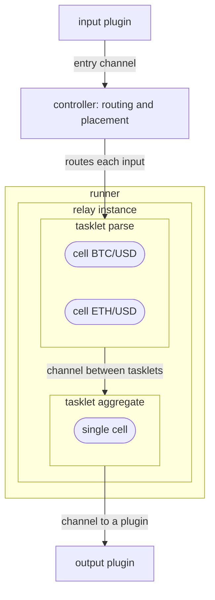
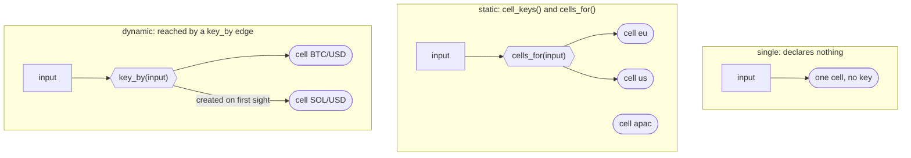
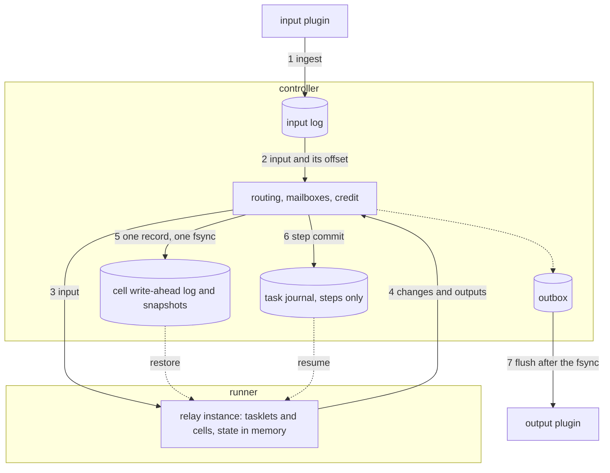
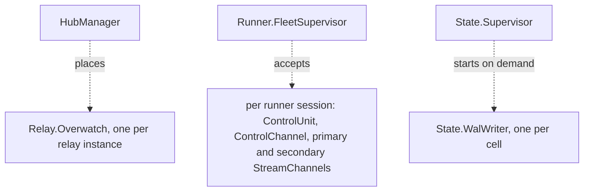
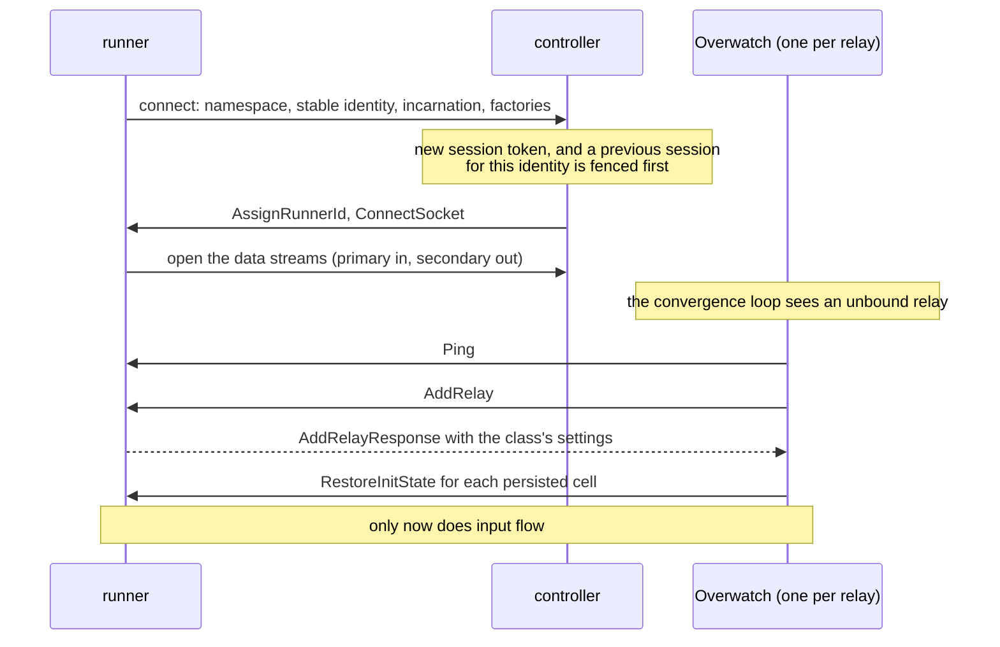

# Architecture overview

Flezha runs many small, independent pieces of work in parallel, on one machine
or across many. Each piece is a relay with its own state and its own
messages ([What is Flezha](../getting_started/what_is_flezha.md) says this from
the user's side). This chapter is for contributors, and for users who want to
know how that works underneath: which process does what, what is written to
disk and when, and what closes each way a run can fail.

This page is the map. It names the roles, the rules the shared kernel keeps,
the processes inside the controller and the files on disk. The other pages of
the chapter take one part each:

| Page | What it covers |
| --- | --- |
| This page | Roles, how work is contained, the kernel's rules, the controller's processes, the on-disk layout, the failure model |
| [`kernel.md`](kernel.md) | What every relay shares: the input log, the atomic effect record, the write-ahead log and snapshots, the outbox, the watermark, output identity, the epoch rule, flow control, the remote durability tier, health |
| [`flow_profile.md`](flow_profile.md) | What `run: flow` adds: per-cell recovery, the dead-letter queue, checkpoints, late-input correction, partitioned relays |
| [`steps_profile.md`](steps_profile.md) | What `run: steps` adds: the tasklet graph, the task journal, the stage commit, undo, the durable loop, sleeping, rewind |
| [`runner.md`](runner.md) | Inside a runner: the shared Rust kernel `flz_core`, the poll boundary, per-cell exclusivity, and what each SDK keeps for itself |

**Contents**

1. [The roles](#the-roles)
2. [How work is contained](#how-work-is-contained)
   1. [The three cell modes](#the-three-cell-modes)
3. [The main components](#the-main-components)
4. [One kernel, two ways to run](#one-kernel-two-ways-to-run)
5. [The kernel's rules](#the-kernel-s-rules)
6. [Inside the controller](#inside-the-controller)
7. [How a runner connects](#how-a-runner-connects)
8. [What is on disk](#what-is-on-disk)
9. [What can go wrong](#what-can-go-wrong)
10. [Limits and gotchas](#limits-and-gotchas)
11. [See also](#see-also)

## The roles

- **Controller**: the Elixir control plane, in `lib/flezha/`. It keeps the
  durable copy of every relay's state, routes input, decides where each
  relay runs and restarts what fails. Several controllers can form a
  cluster over Erlang distribution; a ProcessHub hub per namespace spreads the
  relays across them.
- **Runner**: a process you run, written with one of the seven SDKs (Rust,
  Java, Node, Python, Ruby, PHP, Elixir). It runs your code. A runner always
  dials the controller, never the other way round. It holds state in memory
  only, so it can be replaced at any time: the controller has the copy. Every
  SDK shares one Rust kernel, `flz_core`, for transport, ordering,
  durability, retries and timers. See
  [`runner.md`](runner.md).
- **Relay**: what you start and stop. A **factory** is the class a runner
  registers; an **instance** is one running copy of it.
- **Tasklet**: a processing stage of your own inside a relay.
- **Cell**: one running copy of a tasklet with its own state.
- **Channel**: the typed edge data travels on.
- **Plugin**: a piece attached to a relay from outside. Sources and output plugins
  (a WebSocket, a file, Kafka, Postgres, HTTP) are plugins, and they run on the
  controller.

A cell's durable state lives on one controller node. It is not copied to the
other nodes of a cluster as it is written. When a relay moves to another
node, its state moves with it. Losing a controller together with its disk is
covered by the opt-in
[remote durability tier](kernel.md#the-remote-tier), which ships
copies of the durable files to a remote backend and restores from them on a
fresh node. Without a backend (`FLEZHA_DURABILITY_BACKEND=none`, the default)
the local disk is the only copy.

## How work is contained

The controller places relays on runners. A runner holds relay
instances, a relay holds tasklets, a tasklet holds cells, and channels are
the edges between tasklets:



- **Relay.** Its class's `run` setting says how an instance runs: `flow`,
  the default, or `steps` ([`relay_settings.md`](../configuration/relay_settings.md)).
  A relay started with `--partitions N` becomes N ordinary instances,
  `<id>#p0` to `<id>#p{N-1}`, each owning part of the key space
  ([Partitioned relays](flow_profile.md#partitioned-relays)). A steps
  relay can be partitioned only when it loops `each: per_input`.
- **Tasklet.** It has a typed input and output and, when it needs one, a
  state. It lives as long as its relay.
- **Cell.** Durability is per cell: each cell has its own write-ahead log, its
  own line of snapshots and its own position in the outbox. A cell exists
  whether or not its tasklet has state or a key; a tasklet with no key has one
  cell.
- **Channel.** An entry channel brings input from outside, a channel between
  tasklets carries one stage's output to the next, and a channel to a plugin
  carries output to an output plugin.

### The three cell modes

What a tasklet declares decides how many cells it has and when they are
created. Nothing else about the tasklet changes.



- **Single**: one cell with no key. The default.
- **Static**: a fixed set of keys from `cell_keys()`, every cell present from
  the start. One input can go to several cells, which is why the selector is
  plural (`cells_for`).
- **Dynamic**: one cell per key. The edge's `key_by(input)` sends each input
  to exactly one cell, created the first time its key is seen. Cells stay
  until the tasklet declares `cell_idle_ttl()`; then a cell idle for that long
  is dropped, and a later input with the same key starts a fresh one.

The full vocabulary is in the
[glossary](https://github.com/flezha/flezha/blob/main/docs/internal/glossary.md).

## The main components



Read it as the effectively-once case, where every step is in use. Input is
first written to the input log (1, 2), then routed to the runner (3). The
runner sends back its state changes and outputs (4), within a byte credit the
controller grants. The controller writes the changes, the outputs and the
offset of the input they came from as **one record under one fsync** (5), so
state and output cannot come apart. A steps relay also records each
finished step in its task journal (6). Outputs reach the output plugin only once that
record is on disk (7). After a crash, the controller restores each cell's
state and a steps relay's position (dashed lines).

In the default at-least-once mode there is no input log and outputs are not
held for the fsync: the controller sends them on as they arrive, and writes the
state changes in batches about every 5 ms. A crash can then resend an output.

**The life of a message**, hop by hop in the code. Every frame body is read by
one decoder, `parse_payload_body` in `flz_transport/src/service/payloader.rs`.
On the controller the NIF's `FrameBuffer` (`flz_nif/src/frame_buffer.rs`) cuts
frames from the socket and hands each to `Flezha.Runner.StreamChannel`; the
relay's `Flezha.Relay.Overwatch` writes an input to the input log, when there
is one, and sends it on. The runner reads
it through its transport's `Wire` (`flz_transport/src/transport/mod.rs`), and
`flz_core/src/routing.rs` routes it with one `Delivery` value into the Cell's
mailbox. The poll core (`flz_core/src/poll_core/`) hands the Cell's work out;
for a hosted SDK `flz_core/src/host/handout.rs` turns it into an activation that
carries the Cell's identity bytes once and marks whether each input still needs
its transform. The host's answer settles in `flz_core/src/host/activation.rs`:
its timer operations are judged against the Cell's live timers
(`flz_core/src/timer.rs`), its plugin outputs are stamped
(`output_identity` in `flz_core/src/host/stamp.rs`) and written by
`ship_plugin_output`, and its outputs to the next tasklet are routed with a
`Delivery` again.

## One kernel, two ways to run

| | Flow | Steps |
| --- | --- | --- |
| Shape | takes input for as long as it lives, no barrier between tasklets | runs its tasklets in order, with a barrier after each stage |
| Commit point | one input, or one checkpoint | one finished step |
| Recovery | each cell on its own | from the last committed step |
| A failure that does not go away | the input goes to the dead-letter queue | finished steps are undone (`undo_all`), or the turn is set aside (`keep_progress`) |
| Its own parts | checkpoints, late-input correction, partitions | the task journal, undo, the durable loop, suspension, rewind |

Both share the kernel: the write-ahead log and snapshots, the outbox, credit
flow control, the single-owner write path, and the controller as the durable
copy that lets an idle instance sleep and wake. A steps relay's cells are
persisted exactly like a flow relay's, and a durable steps relay's
input goes through the same input log an effectively-once flow relay uses.

## The kernel's rules

These eight rules hold for every relay, whatever SDK it is written in.

1. **Sources and output plugins are plugins.** The core assumes no particular outside
   system. Kafka, for example, is a plugin package with a consumer and a
   producer. The input log, the write-ahead log, the outbox, the watermark
   and credit do not depend on any plugin.
2. **One atomic record per input.** On the effectively-once tier, each handled
   input produces one checksummed record in the cell's write-ahead log,
   holding the state changes, the outputs to plugins, the consumed input
   offset, a dead-letter entry if the input was parked, the event time, timer
   changes and the values sent to the next tasklet. It is appended and
   fsynced as one unit; outputs leave only after it is on disk. See
   [`kernel.md`](kernel.md#the-effect-record).
3. **The input log is written only when something needs it.** By default
   (`exactly: at_least_once`) there is no input log. It is written for a flow
   class on `exactly: effectively_once`, for a flow class that sets
   `sleep_after`, and for a durable steps relay. Each cell then recovers
   from its own consumed offset.
4. **Output identity and the epoch rule.** An output's identity is
   `flz.cell`, `flz.seq` and `flz.key`; the outbox adds `flz.epoch`. A crash
   retry, a re-send or a runner takeover keeps the epoch, so an output plugin that
   deduplicates drops the repeat. A late-input correction or a manual replay
   raises it, so the corrected output passes the output plugin's check and overwrites
   the stale row by its key. See [`kernel.md`](kernel.md#the-epoch-rule).
5. **One owner writes a cell's log.** A runner has a stable identity that
   survives its restarts, and the controller gives each connection a session
   token. A takeover unbinds the old session before it binds the new one, and
   the write-ahead log refuses a write from a superseded session
   (`{:error, :stale_writer}`), so a stale runner cannot rewrite the log. See
   [`kernel.md`](kernel.md#ownership-and-fencing).
6. **Flow control holds back, it does not drop.** From runner to controller,
   byte credit is given back only when the controller has fsynced the bytes,
   so the amount not yet on disk is limited. A runner out of credit waits. On
   the effectively-once tier a second credit loop holds back the source when
   the slowest cell falls behind, instead of letting the input log grow until
   the disk is full. From controller to runner there is no credit: each stream
   has a send buffer with a gate, and when the runner stops reading, the
   controller holds a frame for a limited time before it reports it
   undeliverable. See [`kernel.md`](kernel.md#flow-control).
7. **The watermark decides retention.** The controller tracks the lowest
   consumed offset across a relay's cells and truncates the input log
   below it, keeping a hold window. A payload that fails every time must not
   freeze the watermark: after its retries it is parked in the dead-letter
   queue and the cell moves past it. See
   [`flow_profile.md`](flow_profile.md#the-dead-letter-queue).
8. **Health means work is moving.** `/healthz` and the convergence loop ask
   whether each cell's log is advancing, and only for cells that are being
   fed, so an idle cell is told apart from a stuck one. Durable state on disk
   for a relay that is not meant to be running makes health degraded. Each
   periodic check records when it last finished, so a check that hangs shows
   as `sensor_stale` rather than switching detection off. See
   [`kernel.md`](kernel.md#health-and-liveness).

## Inside the controller

The controller's top supervisor, `Flezha.Supervisor`, is one flat
`:one_for_one` tree that starts its children in order and stops them in
reverse. The order is one list of rows in `controller_children` of
[`lib/flezha/application.ex`](https://github.com/flezha/flezha/blob/main/lib/flezha/application.ex),
each with the reason it sits where it does. The signal handler comes first,
then the hubs' manager, the runner fleet and cluster formation, then the plugin
side, then the state side (the writers and `Flezha.Dlq.Store`) and the
supervisor of durable work. Only after those come the starter of the declared
hubs, the transports and the runner launcher, so no hub or runner reaches a
writer before it exists, and on a stop the durable work finishes before the
writers close.

Below that tree, three sorts of process come and go:



`Flezha.Relay.Overwatch` is the process at the centre of the control
plane. There is one per relay instance, as a ProcessHub child: it binds a
runner, starts the relay's plugins, writes every incoming input to the
input log when there is one, and receives every output on its way to an output plugin.
`Flezha.State.WalWriter` writes one cell's log and its outbox position.
`Flezha.Convergence.Loop` repairs the fleet: every 5 seconds
(`FLEZHA_CONVERGENCE_TICK_MS`), and at once when something reports a problem,
it compares what should run with what does and acts on the difference. Two
repairs run beside it. Each namespace hub's orphan reconcile, a ProcessHub
recovery round, starts a declared child that runs nowhere and stops one whose
declared entry was removed. And a hub this controller no longer needs is left
by `Flezha.Service.HubManager.stop_hub_if_vacant/1`, asked by the loop and by
the runner fleet's cleanup once no runner of the namespace is left here.

Placement is two choices. ProcessHub picks the **controller node** that hosts
the Overwatch, by hashing over the nodes whose runners registered the
relay's factory. Then a rendezvous hash of the relay id, capped so no
runner takes more than its fair share, picks the **runner**
(`Flezha.Service.RelayManager.Placement`). Who decides what, and how two
deciders acting at once are kept apart, is in
[placement](https://github.com/flezha/flezha/blob/main/docs/internal/architecture/placement.md).

## How a runner connects

A runner dials in with a **stable identity** that survives its restarts, and
an **incarnation**, new each time the process starts. The controller gives the
connection a **session token**. Stream routing keys on the session token;
which runner owns a relay keys on the stable identity. A reconnect with
the same identity and incarnation is the same process coming back, so its
relays stay where they are and only their route moves to the new session.
A new incarnation is a restarted process that runs nothing yet, so each of its
relays is bound to it again and its state restored
(`Flezha.Runner.FleetManager.Session`).



`AddRelay` carries the relay and factory ids, the initial values, the
run, how many cell restores will follow, a steps relay's task-journal
position, and, for a partition member, its index, the group size and the
key-group range it owns. The response carries the class's settings as a map of
strings, read in one place, `Flezha.Relay.ClassRegistry.decode_declarations/2`:
`durable`, `sleep_after_ms`, `max_duration_ms`, `exactly`, `ack`,
`correction_ms`, `compact_after_bytes`, `compensable_tasks`, `leaf_tasks` and
`keyed`. How the class runs, and a steps class's `each` and `on_failure`, come
from the factory's announcement instead, which the controller established
when the runner connected. A missing key takes its default. `keyed` is sent
only when it is false: such a class cannot be partitioned, and the controller
uses that to refuse a partitioned start. Every SDK builds this
map in the core, so a Java class and a Rust class with the same settings send
the same map. Wire detail:
[the SDK protocol specification](https://github.com/flezha/flezha/blob/main/docs/internal/sdk/protocol_spec.md).

## What is on disk

Everything durable lives under `app_data/`. The state root is
`app_data/state` by default (`:state_root`).

```text
app_data/
  state/<namespace>/<relay_class>/
    input.log                      the input log, when the class has one
    effectively_once, ack_checkpoint, run, ...
                                   one small file per setting that is not the default
    <tasklet_id>/
      <cell_key>.wal               the cell's write-ahead log
      <cell_key>.snap.<seq>        its snapshots
      <cell_key>.outbox.dedup      its outbox position
      <cell_key>.lineage           its epoch, kept apart from the outbox position
  state/<namespace>/<instance_id>/<instance_id>/task.journal
                                   a steps instance's task journal
  dlq/<relay_class>/<tasklet_id>/entries.jsonl, <entry_id>.bin
  process_hub/<hub_id>/registry.dets
  audit/, auth/, certs/
```

A cell's state is identified by `(relay_class, tasklet_id, cell_key)`
inside its namespace. The runner is not part of it: a runner is where the
cell runs, not where it is kept, so a restarted runner picks up the state
already on disk. Paths are built in `Flezha.State.Paths`.

A steps instance's task journal uses the same writer as a cell, under the
reserved cell key `_task_journal`, which is why it sits at
`<instance_id>/<instance_id>/`; the cell scan skips it. A steps instance's
class directory is its instance id, so its input log is
`<instance_id>/input.log`.

## What can go wrong

Each risk on the left is closed by one mechanism on the right.

| What could go wrong | What closes it |
| --- | --- |
| A runner crashes and its in-memory state is gone | The write-ahead log and snapshots on the controller; the state is restored on the next bind |
| The controller crashes with changes not yet fsynced | Credit: the amount not yet on disk is limited by the credit window |
| An output leaves before its state is on disk | The effectively-once tier: the flush waits for the fsync |
| The same input is handled twice after a replay | A stable output key, and an output plugin that deduplicates by it |
| The write buffer grows without bound under load | Credit flow control: senders wait, nothing is dropped |
| A poison payload freezes the watermark, or disappears | The dead-letter queue: retry, park on disk, move on |
| A controller with no copy restores a live cell to empty | A baseline pull: the controller asks the runner for a full snapshot (`CompactCell`) instead of sending an empty restore |
| A superseded runner rewrites the log | The single-owner write path: the log refuses a superseded session |
| `/healthz` is green while no data moves | Liveness checks on fed cells, intent mismatch, and stamped sensor freshness |
| A late input arrives after its window was computed | Late-input correction: rewind, replay in event-time order, raise the epoch |
| A controller dies with its disk | The remote durability tier, when a backend is configured |
| A partition member is sent a key it does not own | The key-group check: the first such frame is parked, never folded into state |

In the default at-least-once mode, an output can leave before its state is on
disk and can be sent again after a crash; deduplicating downstream is up to
the user there. The effectively-once tier closes both. What each situation
costs in practice is in
[`../topics/core/durability.md`](../topics/core/durability.md#what-happens-in-each-situation).

## Limits and gotchas

- **State is kept on one controller node.** A second controller is capacity,
  not a backup; only the remote durability tier survives the loss of a disk.
- **Output is at-least-once by default.** The guarantees above that need the
  input log apply only on the effectively-once tier.
- **A factory runs only on runners of its own language.** Durable state bodies
  are encoded per SDK, so a relay is placed only on a runner of its
  factory's SDK ([`runner.md`](runner.md#one-change-every-sdk)).

## See also

- [`kernel.md`](kernel.md): the durable parts both ways of running share.
- [`flow_profile.md`](flow_profile.md): recovery, the dead-letter queue, checkpoints, correction and partitions for a flow relay.
- [`steps_profile.md`](steps_profile.md): journals, undo and the durable loop for a steps relay.
- [`runner.md`](runner.md): inside a runner, and what a new SDK must do.
- [`relay_settings.md`](../configuration/relay_settings.md): the settings tree these pages refer to.
- [`../topics/core/durability.md`](../topics/core/durability.md): what is kept and what a crash can cost, from the user's side.
- [Wire protocol](https://github.com/flezha/flezha/blob/main/docs/internal/sdk/protocol_spec.md): the frames between runner and controller.
