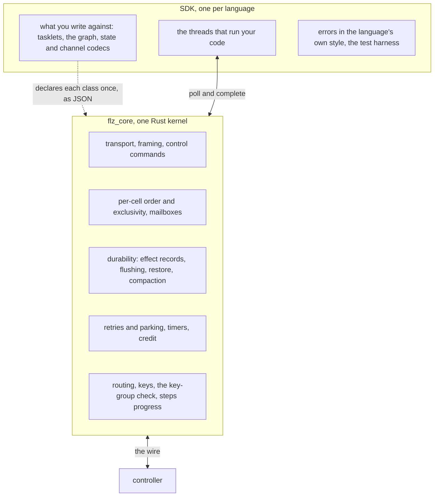
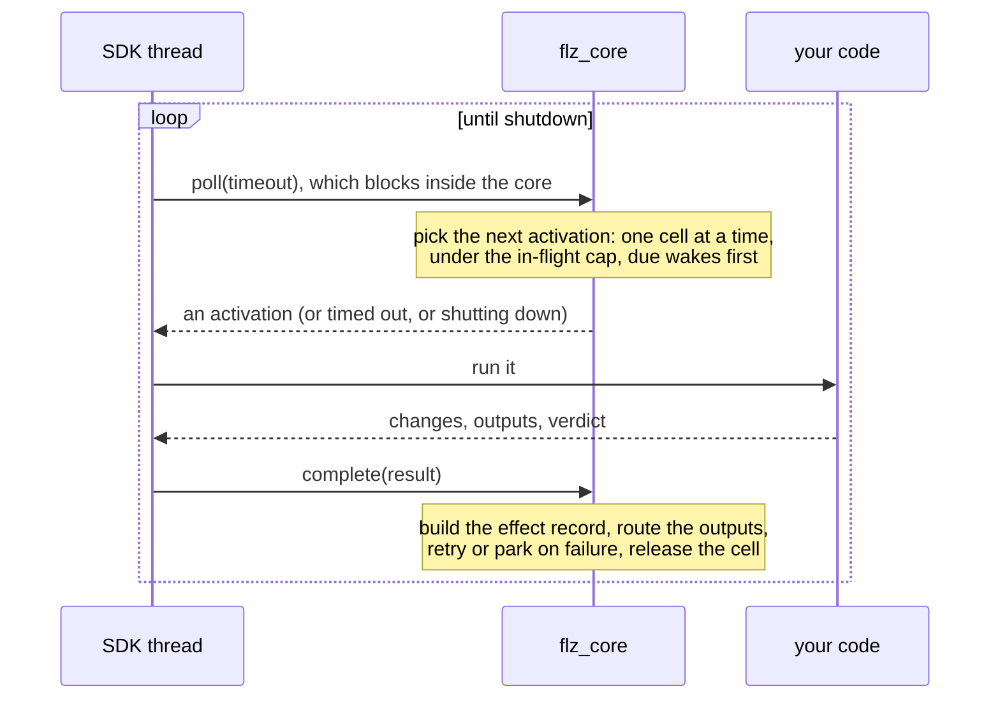
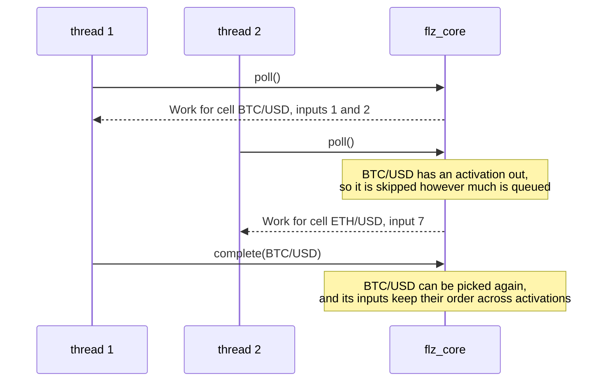
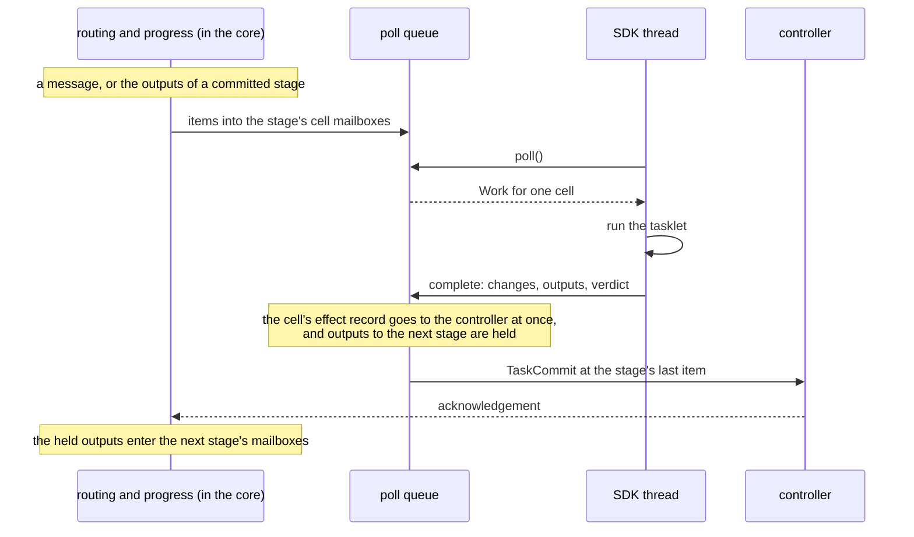

# Inside a runner

To the controller, a runner is one box: a process that dials in, accepts
relays, and sends back state changes and outputs. This page opens that
box. It is for contributors working on an SDK or on the shared kernel, and
for anyone who wants to know why the seven SDKs behave the same.

A runner has **two layers**. Transport, ordering, durability, retries,
timers, credit, routing and a steps relay's progress live in one Rust
kernel, `flz_core`. The SDK for each language brings the surface you write
your code against and the threads that run it. Between them sits one poll
loop. All seven SDKs share `flz_core`. What the
[kernel](kernel.md), [flow](flow_profile.md) and [steps](steps_profile.md)
pages describe works the same in every SDK because it sits below that loop.

**Contents**

1. [The split](#the-split)
2. [The poll loop](#the-poll-loop)
3. [What crosses the boundary](#what-crosses-the-boundary)
4. [The core decides, the SDK brings the threads](#the-core-decides-the-sdk-brings-the-threads)
5. [Per-cell exclusivity](#per-cell-exclusivity)
6. [Retries without a sleeping thread](#retries-without-a-sleeping-thread)
7. [A stage of a steps relay](#a-stage-of-a-steps-relay)
8. [The C ABI](#the-c-abi)
9. [What stays per language](#what-stays-per-language)
10. [Running the graph without a controller](#running-the-graph-without-a-controller)
11. [One change, every SDK](#one-change-every-sdk)
12. [Limits and gotchas](#limits-and-gotchas)
13. [See also](#see-also)

## The split

**The core never calls into SDK code and never owns an SDK thread.** That is
what lets Python keep asyncio and Java keep JVM threads without either
negotiating with the other. The core's notices (a retry, a reconnect, a
refusal, the local-mode banner) reach each SDK's own log without breaking
that rule: Python, Ruby, PHP and Java take them from a queue
(`flz_core_take_notices`) on a thread of their own; Node takes them through
its log callback, Elixir through a process it registers and Rust through
`tracing`. A C host may register `flz_core_set_log_callback`, which is called
on whichever thread wrote the notice.

The Rust SDK uses the kernel as a crate. The other five reach it through the
C ABI in `flz_core_ffi`. A capability the crate reaches but the C ABI does not
counts as a defect, which keeps the boundary from wearing away.

## The poll loop

A host thread asks the core for work, runs it, and hands back the result.
The calls are `poll`, `complete`, and `abandon` for a batch the host never ran.

Two properties matter to anyone writing an SDK:

- **Completing on a different thread from the one that polled is expected.**
  It is what lets a host fetch on one thread and run on another.
- **Bring your own fetch threads.** `poll` blocks inside the core, so running
  it on a shared pool (libuv's threadpool, a framework's request executor)
  starves everything else that pool serves.

## What crosses the boundary

An **activation** targets one cell, or for a relay-wide leave one relay. The types are listed in
`ActivationKind` (`flz_core/src/schema.rs`):

| Activation | What the SDK does with it |
| --- | --- |
| `Work` | run an ordered batch of the cell's inputs (each with its payload, metadata, consumed offset, replay flag and the clock's current value) and timer firings |
| `RestoreFold` | fold persisted changes into a live state |
| `SnapshotRequest` | encode the state for compaction |
| `LiveStateRead` | return the state as JSON for a live read |
| `ApplyState`, `MigrationSerialize` | install a state, or serialize one for a move |
| `KeyRequest` | compute keys (and event times) for entry payloads bound for a keyed edge, in one batch |
| `CompensateRun` | run a steps relay's undo over the outputs a cell recorded |
| `Leave` | drop what it holds for a cell that was evicted, or with `whole_relay` for every cell of a relay that stopped, finished or moved away, so a cell started again under the same name begins at `init_state`; an evicted cell's answer is waited for up to 30 s, by the eviction and by a stop behind it, unless the stop withdraws a leave no host took yet; nothing waits on a relay's |

A stage of a steps relay arrives as ordinary `Work`. Control commands the
SDK need not see, such as a `Ping`, never produce an activation.

The SDK answers with one effect per item: the state changes as bytes it
encoded itself, the outputs (to an edge or a plugin, with an optional key),
the consumed offset, the event time, timer changes, a checkpoint flag, a
dead-letter entry if it parked, and a verdict (`ok`, retryable or
non-retryable). The change bytes are **opaque to the core**: postcard from
Rust, Kryo from Java, MessagePack from Node, Ruby and Python, JSON from PHP.
The controller stores them without decoding them either.

The [key-group check](flow_profile.md#partitioned-relays) also lives below
the boundary. `AddRelay` carries a partition member's key-group range, and
a computed cell key outside it is parked on the first frame, so every SDK on
the core gets the check without writing it.

## The core decides, the SDK brings the threads

This is the rule the boundary is built on.

**The core decides what runs and how much of it.** It picks the next
activation, keeps per-cell order and exclusivity, owns the retries and
durability, and caps how many work activations may be in flight at once
(`FLEZHA_MAX_INFLIGHT_ACTIVATIONS`, 1024 by default). At the cap, `poll`
blocks as if nothing were ready, and the completion that drops below it
releases the next one.

**The SDK brings the threads.** How many it runs is a detail of how it
serves the core, not a limit on concurrency; that limit is the core's cap.
The Rust and Java SDKs do it differently:

| | Rust | Java |
| --- | --- | --- |
| Threads that call `poll` | a base pool of `FLEZHA_WORKER_POOL_SIZE` workers, by default the machine's parallelism | `FLEZHA_WORKER_POOL_SIZE` platform fetcher threads, 2 by default |
| Who runs your code | the worker that polled | one virtual thread per activation, which also completes it |
| When work starves | a supervisor parked in the core's starvation wait adds one worker per observation, up to `FLEZHA_WORKER_POOL_MAX` (10 × the base); extra workers retire after 30 s idle | the same supervisor adds fetchers, up to `FLEZHA_WORKER_POOL_MAX` (10 × the count) |

The Java fetchers stay platform threads because `poll` blocks in native code,
and a native frame pins a virtual thread's carrier.

**Starvation means stuck, not busy.** Queued work counts as starved only
after a 100 ms dwell during which **no thread entered `poll` at all**
(`flz_core/src/poll_core/starvation.rs`). A busy runner enters `poll` once per
batch, microseconds apart, so it never trips; only a runner whose every thread
is inside user code shows no entry for that long. Starvation is a blocking wait
a host thread may park in, never a callback, so the core still calls no SDK
code, and a host that cannot starve never calls it.

**Direct activations are not capped.** Restore folds, snapshot requests and
the other command activations answer a caller that is already waiting, so
holding one behind capped cell work could deadlock that caller. A steps
relay's undo goes through the same queue. A steps relay's stage work is
ordinary cell work, capped like a flow relay's.

## Per-cell exclusivity

The core never hands out two activations for the same cell at once. That is
why your code needs no locks around its own state.

Different cells run in parallel. Batch assembly
(`flz_core/src/poll_core/assembly.rs`) owns the rest of the order: skipping
inputs a cell already consumed, holding a replayed slice until its end marker
and sorting it by event time, and admitting late inputs.

**A class with an event-time clock gets one new input per activation.** A
timer registered while handling an input takes effect only at completion, so
wider batches would make the order of due firings depend on batch timing, and
a correction replay must fire timers at the same points the live run did.
Wall-clock and logical clocks batch freely.

## Retries without a sleeping thread

The verdict in a completion decides what happens next, and none of it blocks a
thread:

- **ok**: the effect record is built, the outputs are routed, the cell is
  released.
- **retryable**: the item goes on the core's deferred-wake list with a backoff
  of `base × 2^(n-1)`, ±50% jitter, capped at 5 s. When it comes due, the same
  item is handed out again at the head of the cell's queue, with the rest of
  the batch behind it.
- **non-retryable**, or a failed last attempt: the payload is parked through
  the dead-letter path ([`flow_profile.md`](flow_profile.md#the-dead-letter-queue)),
  and a park closes an open checkpoint interval.

The **deferred-wake list** (`flz_core/src/poll_core/wake.rs`) is one ordered
list of retry backoffs, processing-time timer deadlines, checkpoint interval
closes, push retries and instance deadlines. It owns no thread: entries are
promoted by whichever thread next enters or wakes inside `poll`.

Reporting a failure returns the completing thread at once. The cell stays
reserved across the backoff, since nothing else could run it then anyway.
That matters when a shared dependency goes down: a backoff that slept the
completing worker would put every worker to sleep and stop work that would
have succeeded. Shutdown does not wait on it either.

Promotion needs a thread in `poll`, so a due entry with every worker inside
user code is starvation and is reported as such. The starvation wait's
deadline takes the nearest due entry into account, which is how a host that
grows threads gets one there in time.

## A stage of a steps relay

A stage runs the way a flow cell does: its items go into its cells' mailboxes
and the poll core hands them out as ordinary work, under the same cap. What is
the steps relay's own is a small record of progress on the instance in the
core, moved forward by events on the threads that bring them; no core thread
belongs to an instance.

A stage costs only the SDK threads that run its items, and nothing waits: the
commit acknowledgement, a retry's backoff, `max_duration_ms` and a park are
events or entries on the deferred-wake list. Barriers, the task journal, loop
modes, suspension and rewind are in [`steps_profile.md`](steps_profile.md).
What an instance costs at scale is measured in
[the steps relay resilience notes](https://github.com/flezha/flezha/blob/main/docs/internal/resilience/steps_relay.md#how-many-instances-a-runner-holds).

## The C ABI

An SDK other than Rust reaches the kernel through `flz_core_ffi`
(`flz_core_ffi/src/lib.rs`). The life of a context:

1. `flz_core_context_new(shim_schema_version)`: the version check happens
   here. An SDK built against a different schema version gets NULL, and
   `flz_core_init_error` names both versions, before any connection to the
   controller.
2. `flz_core_declare_class`, once per class, with the complete class as JSON.
3. `flz_core_start(namespace)`.
4. `flz_core_poll` and `flz_core_complete` (or `flz_core_abandon`), from any
   thread. A host that can starve also calls `flz_core_wait_starvation`.
5. `flz_core_shutdown`, then `flz_core_context_free`.

The class declaration is complete: the channel graph, cell modes, clocks, the
settings tree, the record header's language byte, and the steps facts. Its
JSON is parsed with unknown fields refused (`flz_core/src/host/decl.rs`), so a
field the core does not know is an error, not a silent downgrade.
`flz_core_check_class` returns the same verdict without registering anything,
which is what a conformance run uses.

Whoever allocates a buffer frees it; buffers the core hands out are freed with
`flz_core_buf_free`.

The surface is one table, `veneer::SURFACE` (`flz_core_ffi/src/veneer/mod.rs`):
each row names an entry, its C symbol, whether it can block, and which bindings
reach it. The Python, Ruby and Node bindings list their exports from it, and a
test in the crate holds it equal to what the crate exports, to
`test/fixtures/abi_surface.txt` and, for the rows Java reaches, to
`test/fixtures/jni_surface.txt`. Each SDK keeps its own hand-written
declaration and one test that compares it with the fixture. Adding an entry is
the C function, its veneer function, one row, one fixture line and one wrapper
per SDK.

## What stays per language

The surface you write against (tasklets, the graph builder), the state and
channel codecs, how the poll loop fits the language's concurrency, errors in
the language's own style, and the test harness. This is the code that should
feel native.

Two places remain where the in-process Rust SDK runs its own code on a core
thread, and an FFI host never does: `TypedBuffer<S>` serializes changes on the
flusher's thread, and entry parsers and edge closures run on the thread that
reads the wire and routes. Both are the in-process form of what the byte
boundary removes for the other SDKs.

## Running the graph without a controller

A runner does not need a controller to run a graph. Everything a tasklet does
to a value happens in the runner: decoding and parsing on the entry channel,
edge transforms and keying, one cell per key with its mailbox and overflow
policy, retries, and the hop between tasklets, which is a mailbox push
(`route_to_consumers` in `flz_core/src/routing.rs`) that never crosses the
wire.

**Local mode** uses that. It builds the same `RelayInstance` a deployed
runner builds, feeds it through the same dispatch entry a stream reader uses,
and differs in one thing: where output goes. A `FlezhaStream::Local` passes
what production would write to a callback in the same process, and a null
state output discards every durable record at the outbound edge, so the record
path still runs and still costs what it costs (`flz_core/src/local.rs`).
There is no second routing path and no second cell implementation. Timers work
through the core's own wake list.

What is on the controller's side of that line is absent locally: durability of
any kind, the effectively-once tier (a class that asks for it is refused at
local start, naming it), plugins, placement, moving and rescaling,
partitioning (a member's range arrives with `AddRelay`, so a local run is
unpartitioned), the dead-letter queue, observability export, authorization
and running on several runners.

Every SDK has local mode. The SDKs on `flz_core` reach it through six entry
points (`flz_core_local_start`, `flz_core_local_on_sink`,
`flz_core_local_feed`, `flz_core_local_next_output`,
`flz_core_local_run_until_idle`, `flz_core_local_stop`). The user's side is in
[`running_and_testing.md`](../topics/core/running_and_testing.md#local-mode).

## One change, every SDK

The kernel has seven hosts today. The Rust SDK uses it as a crate. Java, Node,
Ruby, Python and Elixir load `flz_core_ffi` built with a thin binding layer of
its own for each (JNI, N-API, magnus, PyO3, Rustler), each a one-to-one layer
over the C entry points. The PHP SDK calls the C ABI directly through `ext-ffi`, with no
compiled layer of its own, because PHP has no stable binary interface across
minor versions.

So a change below the boundary reaches every SDK at once; a change above the
boundary reaches no SDK by itself.

The rules every SDK follows:

- **One change, every SDK.** Whatever every SDK carries changes in the same
  change, in every SDK: the surface you write against and declare with, the
  wire protocol and its metadata keys, every default (overflow policy, retries,
  mailbox capacity, heartbeat keys), and the fixtures that prove them. What a
  graph may look like is checked in one place: a builder submits the links its
  author declared to `flz_core::host::register::check`
  (`flz_core/src/host/register.rs`), which holds the refusals and the
  derivation rules. A new refusal is one variant and one fixture row, not an
  edit to seven builders.
- **A host that brings its own workers replaces them.** A worker that leaves
  for any reason other than shutdown is replaced without user action. Every
  activation a host takes is answered exactly once (complete, fail or
  abandon) through a guard that also runs when the code unwinds, because an
  unanswered activation keeps its cell reserved for the life of the process.
  A host with a worker set also runs a **starvation supervisor**: one thread
  parked in `wait_starvation` that starts one more worker per observation, up
  to a declared ceiling. Rust, Java, Node, Ruby, Python, Elixir and the PHP
  SDK's `SwooleExecutor` have one. The PHP SDK's default `SyncExecutor` runs one
  loop per process, so its unit of replacement is the process, which the
  orchestrator already restarts. Every host reports `inflight` and
  `inflight_oldest_ms` in its data heartbeat, the only signal that shows one
  stuck cell while the runner keeps completing other work, and every overflow
  outcome (`blocked_parks`, `drops_newest`, `drops_oldest`, `pending_pushes`,
  `pending_push_oldest_ms`), because a drop no one can count is silent data
  loss. `pool_wedge` is a required conformance capability, so no SDK can claim
  this on review alone.
- **No core call holds a host thread for backpressure.** Backpressure holds
  back the producing cell, not the thread that called: a full mailbox puts the
  push in the producer's holdback, and that cell is handed no new work until
  it drains. The core cannot know how many threads a host has or whether its
  threads share a carrier, so a park that is safe on one host could stop
  another for good. The one exception is the transport reader on an entry
  channel, a core thread with no producing cell, whose waiting is what carries
  backpressure back to the controller. Details are in
  [the poll core notes](https://github.com/flezha/flezha/blob/main/docs/internal/sdk/poll_core.md).
- **A capability not carried yet is named.** An SDK that cannot carry a
  capability yet lists it, by name, in the `deferred` list of its conformance
  manifest, together with the change that owes it. A capability one SDK has
  and another neither has nor names is a defect of the change.
- **Measured on one runtime is proven on one runtime.** A number taken with
  the Rust runner says nothing about Java or Elixir until the same bench has
  run there.
- **Each SDK has one language byte, and a factory uses one language.** The
  durable bodies of `State` and `Change` are per SDK, below a shared 16-byte
  header, and a restore sends them unchanged to whichever runner holds the
  cell, so a relay is placed only on a runner of its factory's language.
  The table is in `flz_core/src/header.rs`:

  | Value | SDK | Encoding of its records |
  | --- | --- | --- |
  | 0 | unspecified, never placed | none |
  | 1 | Rust | postcard |
  | 2 | Java | Kryo |
  | 3 | Elixir | External Term Format |
  | 4 | Node | MessagePack |
  | 5 | Ruby | MessagePack |
  | 6 | PHP | JSON |
  | 7 | Python | MessagePack |
  | 8 to 254 | free, given out as SDKs land | none |
  | 255 | reserved | none |

  Every class declares its byte (the core refuses one that does not), every
  factory advertisement carries it, and every restore path refuses a record
  written by another language instead of passing it to its own codec. The
  unit is the **factory**, not the namespace: a namespace with a Rust class
  and a Java class is normal, and each is placed on its own language.

Where each SDK stands is not a table kept by hand. Each SDK's test app
declares it in `test/apps/<sdk>_runner/conformance.json`: the capabilities it
defers, by name, and the fixtures it registers for the ones it carries. The
Rust app's manifest, `test/apps/rust_runner/conformance.json`, is the
reference the others are checked against. Today no manifest, Elixir's
included, defers a capability. See
[the conformance notes](https://github.com/flezha/flezha/blob/main/docs/internal/sdk/conformance.md).

## Limits and gotchas

- **`poll` blocks inside the core.** Run it on threads the SDK owns, never on
  a shared pool.
- **A fixed worker count with no starvation supervisor is a defect**: with
  every worker held by user code, such a host processes nothing and reports
  nothing.
- **A relay runs only on runners of its factory's language**, because
  state bodies are encoded per SDK.

## See also

- [`overview.md`](overview.md): the roles and the kernel's rules.
- [`kernel.md`](kernel.md): what the runner sends to the controller, and what the controller does with it.
- [`flow_profile.md`](flow_profile.md) and [`steps_profile.md`](steps_profile.md): the two ways a relay runs.
- [`running_and_testing.md`](../topics/core/running_and_testing.md#local-mode): running a graph with no controller.
- [Poll core](https://github.com/flezha/flezha/blob/main/docs/internal/sdk/poll_core.md): the poll boundary in full detail.
- [Conformance](https://github.com/flezha/flezha/blob/main/docs/internal/sdk/conformance.md): how an SDK proves it still works.
- [Wire protocol](https://github.com/flezha/flezha/blob/main/docs/internal/sdk/protocol_spec.md): the frames between runner and controller.
- [Naming conventions](https://github.com/flezha/flezha/blob/main/docs/internal/sdk/naming_conventions.md): naming rules for a new SDK.
