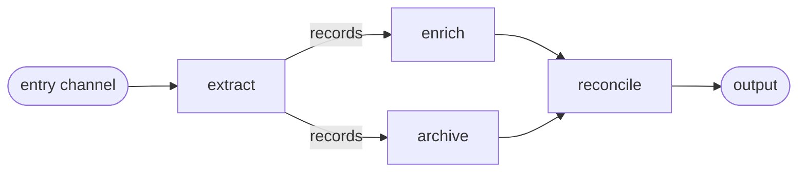
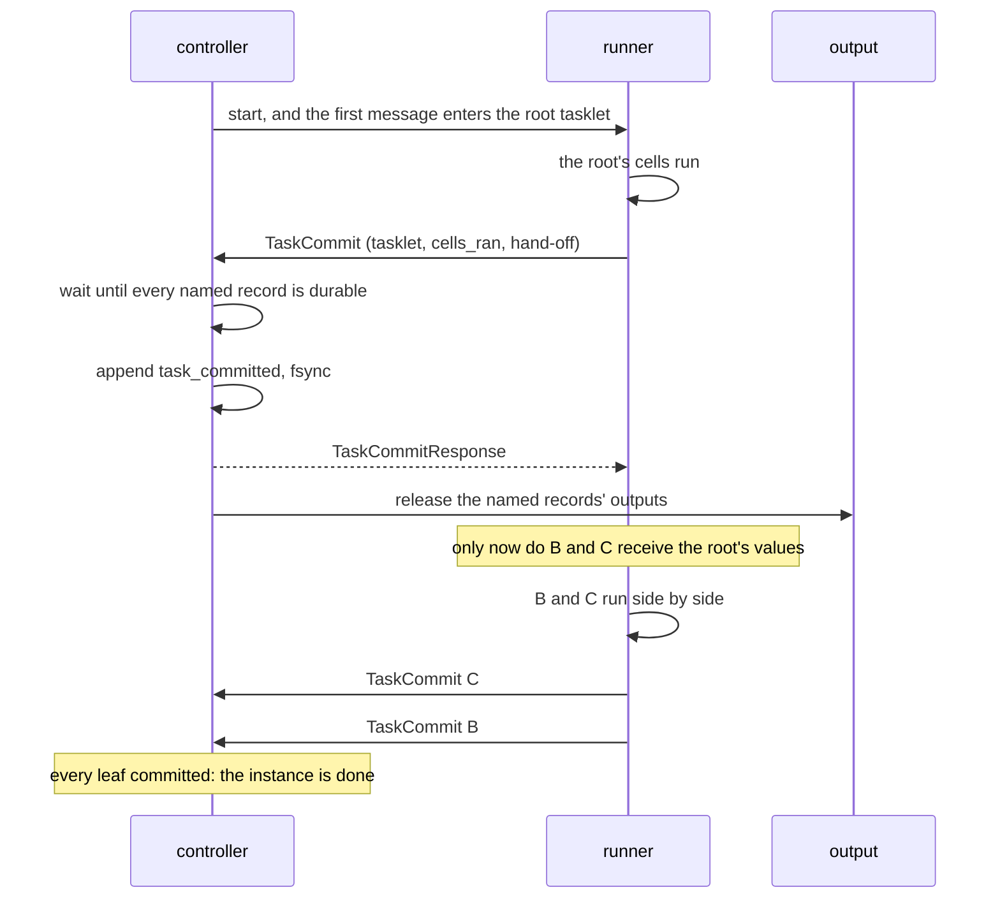
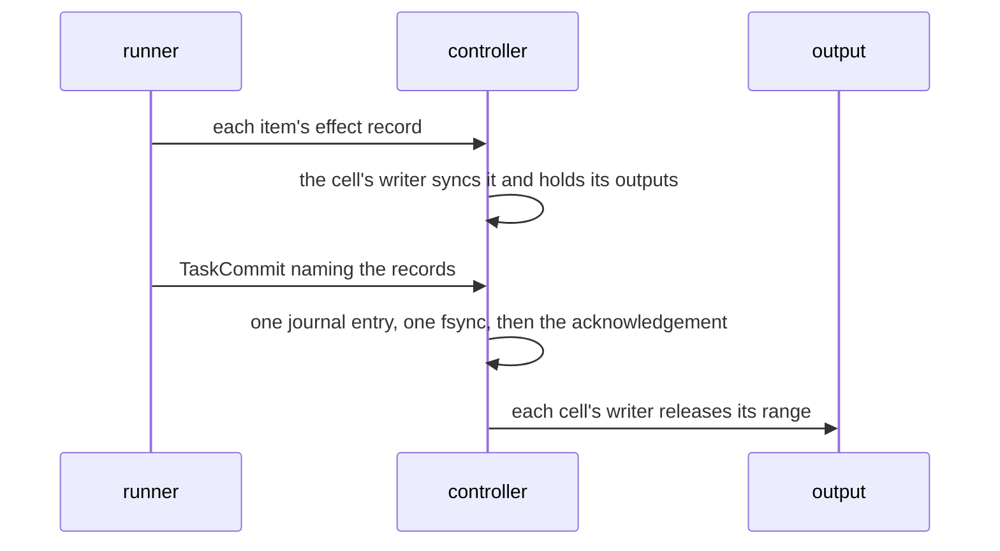
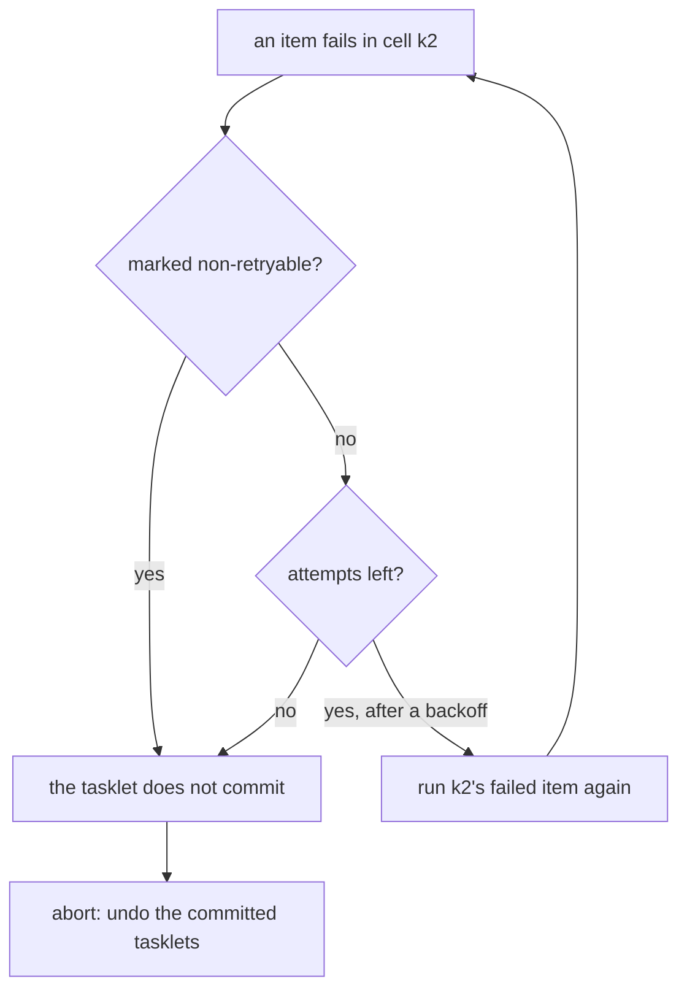
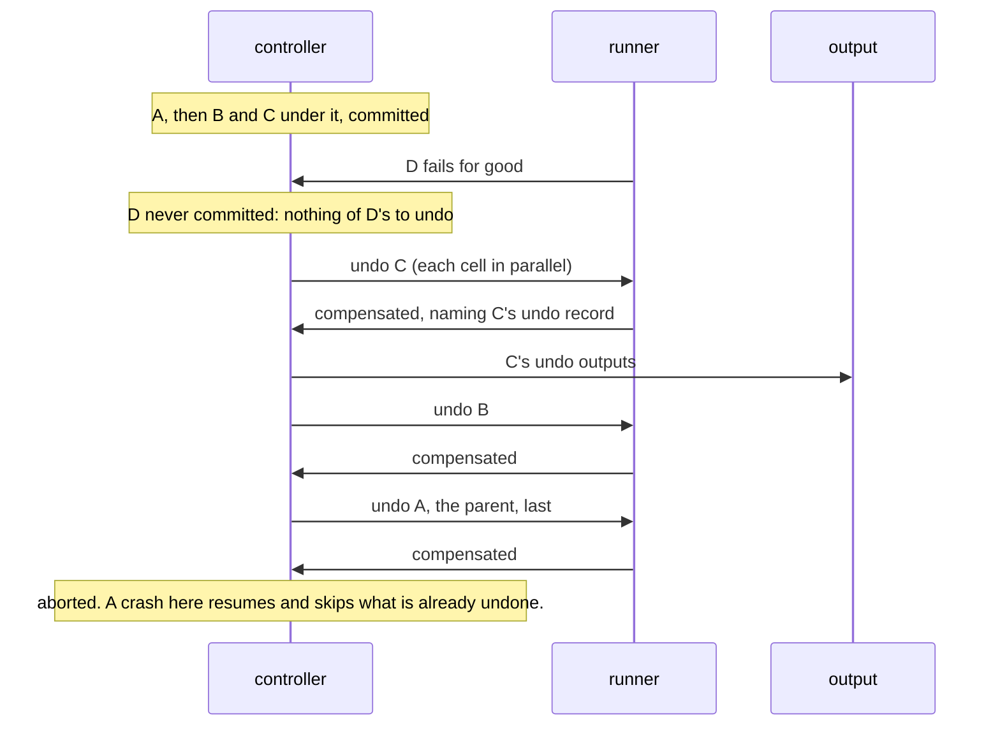
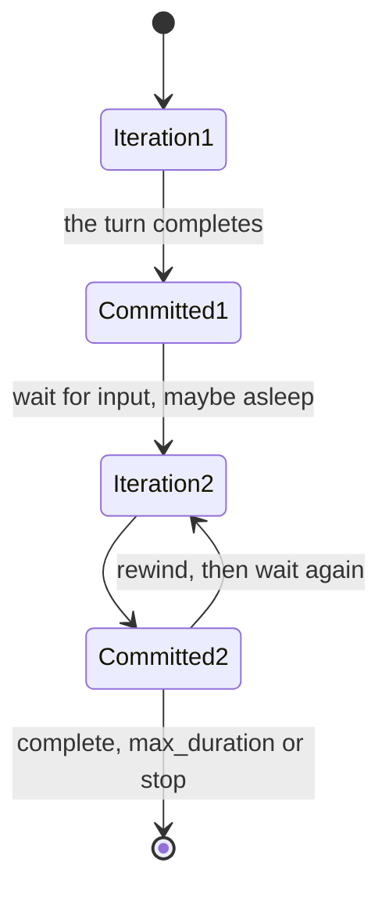
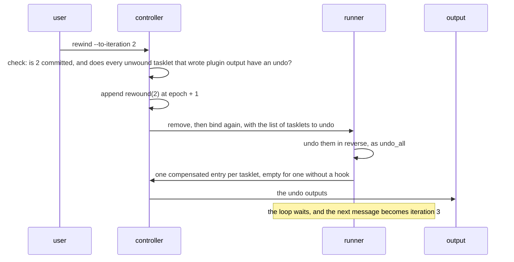

# Running in steps

This page describes what `run: steps` adds to a relay. A class that sets it is a **steps
relay**: a job with a beginning and an end, such as an ETL run, a payment saga or an AI chat
session. The rest of its settings tree says how it runs: `each` for the shape of its loop,
`on_failure` for what a step that fails for good undoes, and `durable` for where its work is
kept ([configuring a relay](../configuration/relay_settings.md)).

A steps relay uses the same tasklets, channels and cells as a flow relay, and the same
[kernel](kernel.md) underneath. What changes is the schedule: it runs its tasklets in graph
order, writes its progress to a journal at every step, can undo what it did, and can wait for
input for hours while holding nothing on a runner. The page is for contributors and for users
who want the mechanism behind the topic page
[`workflows.md`](../topics/core/workflows.md).

**Contents**

1. [A graph of tasklets](#a-graph-of-tasklets)
2. [The task journal](#the-task-journal)
3. [The stage commit](#the-stage-commit)
4. [One outbox](#one-outbox)
5. [Retry, then abort](#retry-then-abort)
6. [Undo](#undo)
7. [The durable loop](#the-durable-loop)
8. [Sleeping](#sleeping)
9. [Rewind](#rewind)
10. [How an instance ends](#how-an-instance-ends)
11. [Messages on the wire](#messages-on-the-wire)
12. [Commands](#commands)
13. [Host languages](#host-languages)
14. [Limits and gotchas](#limits-and-gotchas)
15. [See also](#see-also)

## A graph of tasklets

A tasklet has one output type, and so one output channel. An **edge** is that channel plus one of
its consumers. A fan-out is one channel with several consumers; a fan-in (a join) is one tasklet
that consumes several channels.



A tasklet receives exactly the values sent on the channels it consumes. A join collects every
producer's values rather than letting one overwrite another. Branches run independently until
they meet at a join.

The runner checks the graph when it registers the relay and refuses anything that is not a
graph without cycles, rooted at the entry channels, naming the offending tasklet:

| Shape | Refusal |
| --- | --- |
| a tasklet's output can reach its own input (a cycle) | `topology.cycle` |
| a tasklet produces on two output channels | `topology.multiple_output_channels` |
| a tasklet no entry channel reaches, as in a class with no entry channel | `topology.unreachable_tasklet` |
| no tasklets | `topology.no_tasklets` |
| a `chained` loop over a chain that branches | `topology.branching_chained_loop` |
| a `chained` loop whose last tasklet hands nothing on | `topology.chained_loop_terminal_without_handoff` |

A class may declare several entry channels, and one entry channel may feed several tasklets.
Each entry channel roots its own chain, and a message runs only the chain of the channel it
arrived on. A join where two chains meet waits only for the producers of the chain that is
running, both live and after a crash.

Inside one tasklet, cells work in parallel exactly as in a flow relay: one cell, or one per
key, each with its own state and WAL. A tasklet reached by a keyed edge gets a cell per key,
created when a stage first routes an item to that key and capped by `max_cells` (100 000 by
default); a new key past the cap is dropped and counted in `inputs_dropped_capped_total`. A
stage is done when every cell it sent work to has finished, and its commit names each of those
cells once.

An idle keyed cell is removed after its `cell_idle_ttl()` only between passes, and never while
the class's `on_failure` could still need it: under `undo_all` every cell that ran a tasklet
with an undo is kept until the instance ends, under `keep_progress` only the running pass's
cells are. A stage entry counts its cells in 16 bits, so one pass of one tasklet runs at most
65 535 cells; a class that keys more than that per pass declares a smaller `max_cells`.

A `per_input` steps relay whose entry edge is keyed can be
[partitioned](../topics/core/partitioning.md) into N instances that each end, undo and
commit on their own. A `once` or `chained` one cannot.

Cells are named `(relay class, tasklet, cell key)`, the same as in a flow relay.

## The task journal

A durable steps instance writes its progress to its own append-only journal, in the same framed
format as a cell's WAL ([the record format](kernel.md#the-record-format)), under a reserved
identity so it never appears as a cell.

```text
<state_root>/<namespace>/<instance_id>/<instance_id>/task.journal

record header (16 B): [epoch u32 BE][type u8][task_idx u16 BE][iter u32 BE][zero]
record body:          [type u8][task_idx u16 BE][iter u32 BE][payload]
```

The header carries the entry's identity next to the epoch, which is how the writer refuses a
commit the runner sent twice.

| Type | Entry | Carries |
| --- | --- | --- |
| 1 | `task_committed` | `cells_ran`, the values handed to the next tasklets, the tasklet's completion if it ended the instance, and what triggered the stage |
| 3 | `iter_committed` | the input-log offset the iteration consumed (none for a pass fed by the previous one), its entry channel, its final hand-off, its completion, and any failed turns |
| 5 | `compensated` | an undo ran: `cells_ran` naming the undo records |
| 6 | `rewound` | a marker: every iteration above this one is no longer committed |
| 7 | `input_released` | an input consumed without an iteration commit (one parked unread) |
| 8 | `dead_lettered` | a failed `per_input` turn, parked in the dead-letter queue |

`cells_ran` names, for each cell the stage ran, the range of effect records it wrote in the stage
(`first_seq..seq`, both absent when it wrote none) and the plugin channels those records wrote
on. The journal holds markers only. Cell state and plugin output live in the cells' own effect
records.

Types 2 and 4 are unused. The journal is **append-only**: `rewound` does not cut it. One fold
over the file applies the markers, and every question (what is committed, what is owed, what is
undone, where the loop is) is answered from that fold. The epoch stays 0 until a rewind raises
it. The journal is `Flezha.State.TaskJournal`.

## The stage commit



Each tasklet is its own unit. It commits when its own last item finishes, whether or not a
sibling is still running, and its values reach the next tasklets only once that commit is
acknowledged. A tasklet with several producers (a join) runs once every one of them has
committed. Siblings are therefore never committed together, and in no fixed order. A sibling
that fails after the one beside it committed has the committed one undone, as a deeper failure
would. A tasklet still running when the pass fails is recorded as having run, so it is undone,
but it is **not committed**, because committing would release outputs that must be undone at
once.

The runner does not block on the acknowledgement; its arrival releases the tasklet's values. One
not received within 30 s (`FLEZHA_STEPS_ACK_TIMEOUT_MS`) is sent again under the same identity,
up to three sends in all. A refusal or the last timeout fails the stage and starts the undo: a
step whose durability the controller will not confirm has not happened.

A class with `durable: remote` raises the bar one step: the controller ships the journal entry
to the [remote tier](kernel.md#the-remote-tier) and waits for the backend before it answers,
so the commit survives losing the controller's disk, at the cost of one remote round trip per
stage.

**After a crash, a committed tasklet does not run again.** The journal holds its hand-off, so
the resumed instance skips it and feeds its children from the journal. A class with
`durable: false` keeps no journal; its chain runs again from the top over the restored cell
state, which is why a tasklet must be safe to run twice.

**A resumed instance runs nothing until its state is back.** It waits for every cell restore
the start announced. One that has not landed within 30 s ends the run `error`
(`steps restore gate timed out: 1 of 2 restores landed within 30 s`), and a stop during the
wait ends it `cancelled`. Either way no tasklet and no undo hook runs, and the journal and the
cell state are kept for a later start.

## One outbox

In a durable steps relay, `ctx.emit` writes into the cell's effect record, as a flow cell
does under `exactly: effectively_once`: one record per invocation, holding the state changes
and the plugin outputs ([the effect record](kernel.md#the-effect-record)). The record is on
disk before the stage commit; its outputs wait for the commit.



The cell writer's outbox is the only outbox, for flow and steps alike: the same cursor,
confirmations and restart re-send ([the outbox](kernel.md#the-outbox)). Only the commit point
differs. A flow cell's record is committed by its own fsync; a steps cell's record is committed
by the stage entry that names it. A record no entry will name (a failed stage, a stage a crash
interrupted and ran again, an iteration a rewind removed) is dropped without reaching an output,
so a failed stage leaks nothing. A crash between the commit and the release costs only a
duplicate the output absorbs, since the re-sent output carries the same identity.

A class with `durable: false`, or one running without a controller (a unit test, a benchmark),
writes no record: outputs go out as they are produced.

A steps output carries `flz.key` when its channel is keyed, as in flow.

## Retry, then abort

A failing item gets a few more tries before it takes the tasklet down:



Only the failed item and the items queued behind it in its cell run again. An item that already
finished, and every other cell, is not run again, and a failed attempt's outputs are dropped. By
default a channel allows three attempts in all, with exponential backoff and jitter capped at
5 s; the channel's retry policy can change the count. The backoff is a deferred wake rather than
a sleep, so a stop, a `max_duration` or a sibling's failure cancels it at once. A panic counts as
retryable, because the author had no chance to classify it.

Retries happen only **before** the commit. A committed tasklet is never retried. Attempt counts
are kept in memory, so a crash in the middle of the retries resumes as an ordinary uncommitted
tasklet with the count reset.

A steps relay's answer to a failure that will not go away is abort and undo, where a flow
relay parks the payload in the dead-letter queue. Two cases park here too: a message the entry
channel cannot read, and a failed turn of a `per_input` loop with `on_failure: keep_progress`.
That turn's message is parked under the `_turn` slot with a `dead_lettered` journal entry, the
turn is undone, and the loop takes its next message. The entry keeps the entry channel, the
input-log offset and the exact bytes, so `flz dlq replay` sends it back as a new message. A
crash before the `dead_lettered` entry runs the turn again and parks its message once; a crash
after it runs the undo still owed. A class with `durable: false` parks the turn without its
bytes.

## Undo

When a pass fails for good, the controller undoes what already committed, in reverse:



The reverse order is not computed separately. The graph is numbered in topological order, so a
producer's number is always below its consumers', commits arrive in topological order, and the
undo plan reverses them.

What is undone depends on `on_failure`:

- **`undo_all`** (the default) undoes the running iteration and every committed one.
- **`keep_progress`** undoes only the running iteration; finished iterations stand.

A tasklet with no `compensate` hook is skipped. A failing hook is logged and the rest of the plan
still runs: stopping half way would leave more inconsistency than going on.

**The undo record is journaled before the done marker.** A crash between the two runs the hook
again rather than losing its undo output, so a hook must be safe to run twice. An undo record the
controller refuses is sent again under the same reference id, as one whose ack timed out is, up
to three sends in all. When none is acked the cell gets no done marker, so a resume runs its hook
again, the rest of the plan still runs, and the run ends `error` naming the tasklet and the
controller's answer.

> **After a crash, a tasklet's values are not available to its undo hook.** Values passed between
> tasklets were never durable, so a hook run after a crash receives an empty list. A durable
> tasklet with an undo keeps what it needs to undo (an order id, say) **in its cell state**,
> which is restored.

The cell's state is reversed by the `compensate` hook, not by cutting its WAL. A tasklet without
a hook keeps its state change.

Each member of a [partitioned](../topics/core/partitioning.md) `per_input` relay undoes only
its own passes. A rescale seals every surviving member's journal at its latest committed
iteration, because a cell moved to another member takes its earlier passes with it: after a
rescale, `undo_all` undoes only the iterations committed since, and a rewind below the seal is
refused. A loop whose passes must stay undoable across a rescale is not rescaled.

## The durable loop

A relay can run its graph more than once. `each` decides how:

| `each` | Behaviour |
| --- | --- |
| `once` (default) | one pass over the first message, then the instance ends; a second message is never read |
| `per_input` | one iteration per message: a chat or agent turn |
| `chained` | the first pass over the first message; iteration N+1 is fed by iteration N's final output, on the chain that message started; it ends when that output comes back empty |



An iteration contains many stage commits, and its boundary is where sleeping, the
`keep_progress` rollback and rewind attach. A crash resumes from the last committed iteration,
not from the top of the loop.

At each boundary the runner sends `IterCommit`. The controller journals **one**
`iter_committed` entry with the final hand-off and the consumed input-log offset, answers, and
only then releases the consumed input in the log and asks for the journal to be cut. Only a
class with no tasklet that has an undo is cut, since undo and rewind both work from the
committed history. The boundary takes no snapshot and releases no outputs: each stage's outputs
left at its own commit, and the watchdog's size and age triggers compact a steps relay's cells
as they do a flow relay's. A failure in that clean-up costs work, not correctness.

**The queue.** A message for a running instance is never dropped. It starts a pass when the
instance waits at a committed boundary, and otherwise waits in the instance's queue for the
next one. A `once` instance reads its one message and accepts a second without reading it. A
due cell timer waits in the same queue, in arrival order with messages, and a `chained` loop is
fed its own output only once nothing is queued, so a firing that came due during a pass runs
before the next carry-fed pass.

**Timers.** A tasklet's cell timers fire as passes of their own
([timers](../topics/core/timers.md)). The root's `TaskCommit` names the firing: a crash before
that commit fires the restored timer again into a fresh pass, and a crash after it resumes the
pass from the journal without firing it again.

**The input log.** A durable steps relay's input is written to the same per-instance input
log the effectively-once tier uses, before it is forwarded, and stamped `flz.offset`
([the write path](kernel.md#the-write-path)). A repeat of a `flz.msg_id` the log still holds is
absorbed and never delivered twice; a message without an id is never a duplicate. A failed append
is not forwarded. Each iteration commit raises the instance's floor in its log: the log drops
what is below it, and every bind re-sends what is above it.

## Sleeping

A loop that waits for input should cost nothing. A steps instance whose class sleeps
(`durable: local` or `remote`, with `sleep_after` six hours by default) is **removed from its
runner** once it has waited that long between iterations. Its Overwatch (the controller process
that owns the instance) and its registry entry stay, so a new message still has somewhere to
land. A flow instance whose class sets `sleep_after` sleeps the same way, at iteration 0.

It wakes on its next message or at its earliest pending processing-time timer, and waking is
**the ordinary bind**: the journal state rides in the bind and the cells are restored, as after
a crash or a move to another runner. The sleep is written to disk before the instance leaves its
runner, so a controller restart keeps it. Stopping a sleeping steps relay wakes it with the
stop, so it ends `cancelled` as it would awake. How the controller moves an instance through
these phases is in [the relay lifecycle](https://github.com/flezha/flezha/blob/main/docs/internal/architecture/relay_lifecycle.md).

## Rewind

A rewind takes a loop back to a committed iteration and undoes everything above it:

```sh
$ flz relay rewind <instance> --to-iteration N
```

A rewind is a **marker**, not a cut; the journal stays append-only.



The list of tasklets to undo is **derived, not stored**: the tasklets committed in iterations
above the target, minus those with a `compensated` entry written after their own commit. That
"after its own commit" test tells a re-run apart from the original it replaced, and makes a
second rewind work. A crash in the middle of a rewind resumes with exactly the work still
outstanding. When the instance binds again, outputs of the removed iterations that had not yet
reached an output are dropped.

**The check runs before anything durable changes.** A tasklet that wrote plugin output and has no
`compensate` hook cannot be rewound: a rewind runs nothing again over the removed inputs, so no
later output replaces the original by its key, and the hook is the only undo the engine can
offer. The rewind is refused, naming the channel, which the check reads from the stage entries'
`cells_ran`, not from the cell WALs.

> **A rewind does not replay inputs.** Every iteration commit raises the instance's floor in its
> input log and a rewind never lowers it, so a committed turn's message is not delivered again,
> even while the log still holds it. The loop waits, and the next message becomes iteration N+1.

The rewind raises only the journal's epoch, which keys the re-run's commits; cell epochs do not
move ([the epoch rule](kernel.md#the-epoch-rule)). User view:
[rewinding a turn](../topics/core/sessions.md#rewinding-a-turn).

## How an instance ends

An instance starts from `flz relay start`, a schedule or a running tasklet's
`ctx.spawn_steps`, with `init_values` as its tasklets' initial state. Its first message may ride
the start. It ends on the first of:

- its graph finishing: every leaf tasklet committed;
- a tasklet's `ctx.complete(result)`, honoured once its iteration commits;
- a `chained` loop whose output comes back empty;
- `max_duration` passing;
- `flz relay stop`, carried out by the runner the instance runs on; an instance with no runner
  to wake on is removed at once.

Every one of them ends in one `RelayCompleted` with a status (`ok`, `error` or `cancelled`), an
error and a result. The controller writes the completion record, waits for the outputs still
owed (up to 60 s), and then tears the instance down. A failed run is not started again
automatically. The record and the state are kept for the retention window
(`FLEZHA_STEPS_RETENTION_HOURS`, 72 hours by default), during which `flz relay info` shows the
instance as `finished` with its status, result and finish time
([after it ends](../topics/core/workflows.md#after-it-ends)).

## Messages on the wire

| Message | Tag | Direction |
| --- | --- | --- |
| `TaskCommit` | 28 | runner to controller, at each stage |
| `TaskCommitResponse` | 29 | controller to runner, after the journal fsync |
| `IterCommit` | 30 | runner to controller, at each iteration |
| `IterCommitResponse` | 31 | controller to runner, after the journal fsync |
| `IterPark` | 32 | runner to controller, when an instance goes to sleep, flow or steps (no answer) |

Field-level detail: [the SDK protocol specification](https://github.com/flezha/flezha/blob/main/docs/internal/sdk/protocol_spec.md).

## Commands

```sh
$ flz state journal <relay/instance>   # every journal entry, and whether the graph is complete
$ flz state inbox <relay/instance>     # the input log, flow or steps, and how far it is consumed
$ flz relay info                       # each relay's phase, suspended while it sleeps
$ flz relay rewind <instance> --to-iteration N
```

`flz relay replay` is refused for a steps relay's cell: its baseline is a committed iteration
across every cell of the instance, and a rewind is a loop's way back. The steps path reports
`[:flezha, :state, :task_commit]` and `[:flezha, :state, :iter_commit]` at each barrier, and
`[:flezha, :steps, :completed]`, `[:flezha, :steps, :failed]`, `[:flezha, :steps, :suspended]`,
`[:flezha, :steps, :rehydrating]` and `[:flezha, :steps, :rewind]` as an instance moves.

## Host languages

Nothing on this page depends on the language. In Rust, Java, Node, Python, Ruby and PHP the
shared runner core, `flz_core`, owns the pass: a small record per instance (the iteration, the
tasklets running and done, the outputs held for their commit, the completion) moved forward by
events on whichever thread brings them. A worker finishing a tasklet's last item, the control
channel bringing an acknowledgement or a stop, the data channel bringing a message and a poller
reaching a deadline all advance it. The core owns the journal exchange, the stage's record
ranges, the undo plan, the loop, sleeping and rewind. The SDK supplies the tasklet bodies and the
threads that run them: Rust runs an item on a pool worker, Java on a virtual thread. Neither owns
the chain's position, so every SDK shares one resume and undo behaviour.
Details of the split: [the poll core page](https://github.com/flezha/flezha/blob/main/docs/internal/sdk/poll_core.md)
and [`runner.md`](runner.md).

## Limits and gotchas

- **A tasklet must be safe to run twice.** An uncommitted tasklet runs again after a crash, and a
  class with `durable: false` runs its whole chain again.
- **An undo hook sees no values after a crash.** Keep what the undo needs in cell state.
- **A tasklet that writes plugin output needs a `compensate` hook to be rewound.** Without one the
  rewind is refused.
- **A rewind does not replay inputs.** It undoes and carries on.
- **One pass of one tasklet runs at most 65 535 cells.**
- **Only a `per_input` relay with a keyed entry edge can be partitioned.**

## See also

- [`kernel.md`](kernel.md): the WAL, the effect record, the outbox and the epoch rule this page builds on.
- [`flow_profile.md`](flow_profile.md): the other way a relay runs.
- [`overview.md`](overview.md): the controller, the runners and how they connect.
- [`../topics/core/workflows.md`](../topics/core/workflows.md): steps, undo and crash recovery from the user's side.
- [`relay_settings.md`](../configuration/relay_settings.md): `each`, `on_failure`, `durable` and `sleep_after`.
- [`../topics/core/sessions.md`](../topics/core/sessions.md), [`sessions.md`](../topics/core/sessions.md#rewinding-a-turn), [`../topics/core/partitioning.md`](../topics/core/partitioning.md).
- [The steps relay internals](https://github.com/flezha/flezha/blob/main/docs/internal/resilience/steps_relay.md): the invariants, the crash windows and where the code is.
