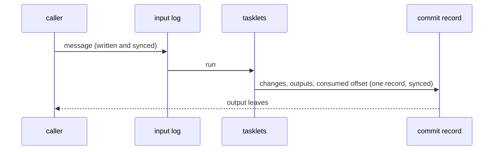

# Effectively once

A message that is lost is a question nobody answers. A message that is handled twice is an
answer given twice, a payment charged twice, tokens counted twice. The delivery guarantee
Flezha calls **effectively once** is that neither happens when a runner or a controller dies
at the wrong moment: a message may be delivered again after a crash, but what handling it
changes and sends counts once.

The guarantee is not free: every message waits for a disk write before it runs. So a
relay that runs in steps and keeps its work has it without asking, and a relay that
runs in flow declares it when it needs it.

**Contents**

1. [How it works](#how-it-works)
2. [Configure it](#configure-it)
3. [Example](#example)
   1. [Read the input log and the journal](#read-the-input-log-and-the-journal)
   2. [Kill the runner in the middle of a message](#kill-the-runner-in-the-middle-of-a-message)
4. [What the tier does](#what-the-tier-does)
5. [Late input: correcting the past](#late-input-correcting-the-past)
6. [What it requires](#what-it-requires)
7. [What it costs](#what-it-costs)
8. [Recorded effects](#recorded-effects)
   1. [Call `ctx.effect`](#call-ctx-effect)
   2. [Which call gets which result](#which-call-gets-which-result)
   3. [At least once at the edge](#at-least-once-at-the-edge)
   4. [One call at a time](#one-call-at-a-time)
   5. [Where nothing is kept](#where-nothing-is-kept)
   6. [Refusals of an effect](#refusals-of-an-effect)
   7. [Limits of an effect](#limits-of-an-effect)
9. [Limits and gotchas](#limits-and-gotchas)
10. [See also](#see-also)

## How it works

The guarantee rests on two records the controller keeps on its disk:

- **The input log.** Every message is written to the relay's input log, and synced, before
  it runs. A crash before the message is consumed runs it again from the log, so nothing in
  flight is lost.
- **The commit record.** What handling a message changes, sends and consumes is recorded as
  one unit. For a steps relay that is the end of each turn in its journal; for a flow
  relay it is one effect record per invocation: the state changes, the plugin outputs and
  the consumed input offset, persisted under one sync. An output leaves only once the record
  behind it is on disk, and a replay finds the record and does not count the message again.



| Relay | Without asking | Guarantee |
| --- | --- | --- |
| runs in steps, keeps its work (`durable: local` or `remote`) | input log and journal | effectively once: a turn runs to its end once; a crash before the end runs it again from the log, and the answer leaves only once the turn's end is written |
| runs in flow, `exactly: at_least_once` (the default) | no input log | at least once: after a crash an output can leave twice, and a message in flight can be lost |
| runs in flow, `exactly: effectively_once` | input log and effect records | effectively once |

**Across relays.** What crosses between two relays, such as a call and its answer, is
effectively once only when both ends keep an input log: the caller for the answer, the callee
for the message. [sending_and_calling.md](sending_and_calling.md#calls) has the table for calls.

## Configure it

A flow relay declares the guarantee in its run settings. The tier has three optional
members:

| Member | Java | Elixir | Default | Meaning |
| --- | --- | --- | --- | --- |
| the tier | `new Run.Flow(new Exactly.EffectivelyOnce())` | `run: {:flow, exactly: :effectively_once}` | at least once | each invocation's changes, outputs and consumed offset as one record |
| `ack` | `.withAck(new Ack.Checkpoint())` | `ack: :checkpoint` or `{:checkpoint, every: n, max_delay_ms: ms, outputs: :at_checkpoint}` | `per_input` | when a consumed input is acknowledged: after every invocation, or only at a checkpoint (an explicit `ctx.checkpoint()`, every `n` inputs, or `max_delay_ms` after the input that opened the interval). Between checkpoints, a crash replays the interval. `outputs` says whether emits leave as produced (the default) or are held until the checkpoint; `max_delay_ms` is required when they are held |
| `correction_ms` | `.withCorrectionMs(ms)` | `correction_ms: ms` | none | a late-input window: an input whose event time is behind the cell's high-water mark by less than the window rewinds the cell and replays the slice in event-time order. Needs an event-time clock and keyed channels |
| `beyond_window` | `.withBeyondWindow(BeyondWindow.DROP)` | `beyond_window: :drop` | `process_as_arrival` | what an input later than the window becomes: processed as if it had just arrived, or dropped |

A declaration that cannot hold is refused when the relay is registered:

| Code | When |
| --- | --- |
| `topology.effectively_once_without_persistence` | the relay is kept in memory only (`durable: false`): the tier is durable state |
| `topology.unkeyed_channel_under_effectively_once` | a channel that ends in a output plugin is not declared `.keyed()`: the tier drops a repeated output by its identity, so a output plugin's channel must be keyed, a channel whose outputs answer calls included. A tasklet with no key of its own names one with its SDK's keyed emit |
| `topology.dropping_policy_under_effectively_once` | a channel declares a dropping overflow policy: a shed input would be lost for good and reported nowhere |

## Example

In the agentdesk example, the sessions run in steps and keep their work, so they have the
guarantee without declaring it. The `gateway` relay, which answers HTTP requests and
counts each user's tokens, runs in flow and declares it, because a count must not be made
twice:

<!-- tabs-open -->

### Java

```java
// GatewayRelay.java: each request and answer on disk before it runs.
    @Override
    public Run run() {
        return new Run.Flow(new Exactly.EffectivelyOnce());
    }
```

Full file: [`GatewayRelay.java`](https://github.com/flezha/flezha_java_sdk/blob/main/examples/agentdesk/src/main/java/com/flezha/examples/agentdesk/GatewayRelay.java)

### Elixir

```elixir
# lib/agentdesk/gateway_relay.ex: each request and answer on disk before it runs.
  use Flezha.SDK.Relay,
    factory_id: "gateway",
    # each request and answer on disk before it runs
    run: {:flow, exactly: :effectively_once}
```

Full file: [`gateway_relay.ex`](https://github.com/flezha/flezha_elixir_sdk/blob/main/examples/agentdesk/lib/agentdesk/gateway_relay.ex)

<!-- tabs-close -->

The tasklet that counts, `budget`, takes the day from `ctx.now()`, not from the system clock:

<!-- tabs-open -->

### Java

```java
// Budget.java: the day comes from the invocation's time value.
        String today = LocalDate.ofInstant(Instant.ofEpochMilli(ctx.now()), ZoneOffset.UTC).toString();
```

Full file: [`Budget.java`](https://github.com/flezha/flezha_java_sdk/blob/main/examples/agentdesk/src/main/java/com/flezha/examples/agentdesk/Budget.java)

### Elixir

```elixir
# lib/agentdesk/budget.ex: the day comes from the invocation's time value.
  defp today(ctx), do: ctx |> now() |> DateTime.from_unix!(:millisecond) |> Date.to_iso8601()
```

Full file: [`budget.ex`](https://github.com/flezha/flezha_elixir_sdk/blob/main/examples/agentdesk/lib/agentdesk/budget.ex)

<!-- tabs-close -->

### Read the input log and the journal

`flz state inbox` shows a relay's input log. For a session named `anna`:

```sh
$ flz state inbox anna --namespace agents
```

```output
durable input log for anna (consumed through 11):

  offset=0 consumed 5 byte(s)
  offset=1 consumed 16 byte(s)
  offset=2 consumed 20 byte(s)
  offset=3 consumed 14 byte(s)
  offset=4 consumed 250 byte(s)
  offset=5 consumed 12 byte(s)
  offset=6 consumed 15 byte(s)
  offset=7 consumed 24 byte(s)
  offset=8 consumed 12 byte(s)
  offset=9 consumed 43 byte(s) channel=message
  offset=10 consumed 20 byte(s)
  offset=11 consumed 29 byte(s) channel=message
```

Every message the session was sent is there: from the CLI on its default entry channel, or
from the gateway's calls on the `message` channel. A message that failed and went to the
dead-letter queue (the 250-byte one) is consumed too.

`flz state journal` shows a steps instance's journal:

```sh
$ flz state journal anna --namespace agents
```

```output
task-journal for instance anna:
...
  seq=17 task_committed task_idx=0 iter=5 epoch=1
    ran: anna/reply/ record=8 channels=answer
    handoff: 1 item(s), 116 byte(s)
      edge: channel_id=1 1 item(s), 116 byte(s)

  seq=18 task_committed task_idx=1 iter=5 epoch=1
    ran: anna/deliver/ record=1 channels=deliver
    handoff: 0 item(s), 0 byte(s)

  seq=19 iter_committed task_idx=0 iter=5 epoch=1
    handoff: 0 item(s), 0 byte(s)
    consumed input-log offset: 7
...
```

A turn is `reply`, then `deliver`, then the turn's end, `iter_committed`, which names the
message it consumed. Rewinds and failed turns are recorded in the journal too.

The gateway's input log holds each HTTP request and each answer its calls bring back:

```sh
$ flz state inbox gateway --namespace agents
```

```output
durable input log for gateway (consumed through 2):

  offset=0 consumed 61 byte(s) channel=http
  offset=1 consumed 100 byte(s) channel=http
  offset=2 consumed 257 byte(s) channel=budget.response
```

`http` is a request, and `budget.response` is the answer of a call, on its way to `budget`,
which counts its tokens.

### Kill the runner in the middle of a message

The runner hosts both the session and the gateway. A user's budget before:

```sh
$ flz state get gateway/budget/anna --namespace agents
```

```output
state get gateway/budget/anna:
  change_seq: 4
  state:      {"budget":{"anna":{"day":"2026-09-30","tokens":36}}}
```

A message over HTTP, and the runner killed a second later:

```sh
$ curl -s -d 'Tell me everything' localhost:8080/sessions/anna/messages && sleep 1 && docker compose kill runner
```

The gateway answered `sent to anna`, and then the runner was gone. Whatever was on its way
(the session's turn, the call's answer or the count) is in an input log. After the runner is
started again and the session has answered:

```sh
$ docker compose start runner
$ flz state get gateway/budget/anna --namespace agents
```

```output
state get gateway/budget/anna:
  change_seq: 6
  state:      {"budget":{"anna":{"day":"2026-09-30","tokens":48}}}
```

The answer used 12 tokens, and they were counted once. The message is in the conversation
once, and the gateway's log shows the request and its answer once each:

```sh
$ flz state inbox gateway --namespace agents
```

```output
...
  offset=2 consumed 257 byte(s) channel=budget.response
  offset=3 consumed 102 byte(s) channel=http
  offset=4 consumed 265 byte(s) channel=budget.response
```

## What the tier does

`exactly: effectively_once` combines at-least-once delivery, a deterministic
key and an idempotent output plugin into effectively-once delivery. Each plugin-bound
channel must be `keyed()`, which registration checks. The tier works the same
in every SDK.

- **Each input is written to the relay's input log before it is forwarded**,
  stamped `flz.offset`, and forwarded once the log has synced it. A repeat of a
  `flz.msg_id` the log still holds is absorbed; a message without an id is
  always appended. The log is trimmed only below the instance's floor, the
  prefix of inputs every cell has processed durably; a floor that does not move
  past the size threshold emits `[:flezha, :state, :input_log_frozen_watermark]`.
- **One atomic record per invocation**: state changes, outputs, the consumed
  offset, a dead-letter entry and event time are written together, in one
  sync, never partly and never merged away.
- **A value handed to the next tasklet is kept in its producer's record**, so
  a value lost with the consumer's mailbox in a crash is delivered again, and a
  consumer that already took it drops it.
- **Outputs reach the output plugins only once their record is on disk**, stamped
  `flz.cell`, `flz.seq`, `flz.epoch` and `flz.key`: enough for exact dedup.
  After a restart, every record past the cell's flushed cursor is sent again,
  in order, under the same identity: never lost, never applied twice at a
  conforming output plugin.
- **The cursor moves on the output plugin's confirmation**, not on dispatch: a Kafka
  produce acknowledged, a Postgres transaction committed, a forward confirmed.
  A batch whose retries run out is parked in the dead-letter queue, and only
  then may the cursor pass it. Output whose plugin chain never reported back,
  and a relay call or answer its delivery still holds, are sent again after
  `:outbox_resettle_ms` (60 s); at most `:outbox_inflight_max` (1 000) are in
  flight per cell. Unconfirmed output shows as
  `outbox_unconfirmed_ms` in the cell's stall status, and reaches the
  convergence loop as the `outbox_flat` verdict.
- **The source slows down rather than the log growing without bound.** Each
  relay has a source credit window (`:source_credit_window_bytes`, 16 MiB by
  default); at zero, the source waits (a WebSocket source stops reading).
- **Classes without the tier pay nothing for it.** Under the tier, a slow or
  unreachable output plugin backs output up on disk, not in memory.

**Conforming output plugins.** The Postgres output plugin upserts each batch into
`flezha_records` (keyed by `flz.key`) and advances its progress row in one
transaction, guarded by `(epoch, seq)`, so repeats and stale epochs do nothing;
an unreachable database delays the flush (callers wait past `queue_max`,
10 000), and the schema is yours to create (`auto_create: false` fails health
naming the missing tables). The Kafka producer uses `flz.key` as the message
key and carries the identity in the `flezha.dedup_key` header
([`../../plugins/kafka_producer.md`](../../plugins/kafka_producer.md)).
**The WebSocket output plugin is not a conforming output plugin**: with `sink_ack_mode: "none"`
(the default) it is at-most-once past the socket, with `"required"`
at-least-once; it can carry `flz.cell` and `flz.seq` in the frame for the
consumer to dedup ([`../../plugins/websocket_subscription.md`](../../plugins/websocket_subscription.md)).

**Checkpoints.** A relay that folds many inputs into one coherent result
declares `ack: checkpoint` and calls `ctx.checkpoint()` where its state is
coherent. The consumed offset then moves only at a checkpoint, with the
interval's changes in one record. Emits still flush as they happen, unless
`outputs: at_checkpoint` holds them for the checkpoint record, which needs
`max_delay_ms` so a quiet cell does not hold an output for ever. `every: n`
closes the interval after `n` inputs. A parked input closes the interval, so a
replay starts after the poison. Recovery restores the last checkpoint and
replays the inputs after it. The interval sizes the input log's retention, the
work after a crash and how often source credit comes back: a relay that
never checkpoints stops trimming its log and eventually stalls its own source.

## Late input: correcting the past

On the tier, a relay with an event-time clock can declare `correction_ms`.
An input that arrives late, behind the cell's event-time high-water but inside
the window, is not run on arrival. Instead the cell is rewound to a baseline
before it, and the inputs since are replayed in event-time order (ties by
offset); outputs are re-sent under a bumped epoch, so a keyed output plugin overwrites
the stale rows. Requests for one cell merge into the one replay that reaches
furthest back. Prerequisites, each refused at build time when missing: the
tier, an event-time clock, and keyed plugin channels.

The input log and compaction keep at least the window, so a correction always
has its inputs and a baseline; a floor raised for it is logged once and
emitted as `[:flezha, :correction, :retention_derived]`. A crash during a
correction needs nothing: the correction simply runs again. An input later
than the window follows `beyond_window`: `process_as_arrival` (the default) or
`drop`; neither moves the high-water back. A correction overwrites the keys it
sends again but does not retract keys it no longer sends; treat the output plugin as
append-with-overwrite. A downstream relay sees corrected outputs as ordinary
keyed updates.

`flz relay replay <relay/tasklet/key> --from <seq|timestamp>` runs the
same rewind from a point you choose, such as after deploying a fix. A point
older than retention is refused with `outside_retention`, naming the earliest
point available.

## What it requires

- **An input log on each end** of whatever crosses between relays: a relay that runs
  in steps and keeps its work has one, a relay that runs in flow declares the guarantee.
- **Tasklets that give the same result for the same input.** A message replayed after a
  crash runs its tasklet again. A tasklet reads the time from `ctx.now()`, one value per
  invocation, and never from the system clock. `ctx.now()` follows the tasklet's clock: wall
  time by default, the event time the tasklet extracts from its input, or a logical clock (the
  change sequence).
- **Keyed output plugins.** On a relay that declares the guarantee, a channel that ends in an output plugin
  plugin must be `.keyed()`, so the output plugin can drop a record it has already written. Requests
  and calls need no key.
- **The controller's disk.** The logs are on it. A durability backend
  ([clustering.md](../deploying/clustering.md)) is what carries them past losing that disk, a little behind
  unless the relay is at `durable: remote`.

## What it costs

Every input and every answer is written and synced to disk before it runs, and an output
leaves only once the record behind it is on disk. So each message waits for a disk write it
would not wait for otherwise, and the input log takes disk space until what it holds is
consumed. A slow disk makes a slow relay. Steps relays pay the same for their own log.
A relay that can lose a message or handle one twice, for example one that only shows a
preview, does not need to pay it. [sending_and_calling.md](sending_and_calling.md#calls) says when an answer
leaves, for each kind of relay.

## Recorded effects

A tasklet that calls something outside its relay (a model, a tool, a payment
service) runs that call again whenever the invocation runs again: after a
crash, on a replay, when a sleeping instance wakes or a relay moves to another
runner. `ctx.effect` runs the call once and keeps its result. When the same
invocation runs again, it returns the kept result and does not call out.

`ctx.effect(name, fn)` asks the runner for a result kept under this call's
identity. If there is one, the call returns it and `fn` does not run. If there
is none, `fn` runs, and its result goes to the controller, which writes it to
the instance's effect log beside its input log and syncs it. Only then does
the call return.

A kept result lives exactly as long as the input it belongs to: when the input
log drops an input below the relay's floor, the results of that input go with
it. The effect log is shipped to the durability backend with the input log,
so a controller that replaces a lost disk still serves them. When an instance
is bound to a runner, the controller sends its kept results first, before
anything runs again.

The result is encoded the way an output with no codec encodes a value: bytes
as they are, a string as UTF-8, anything else as JSON. In Rust and Java it is
the typed value's JSON. Pass a codec to keep a typed result in another form.

### Call `ctx.effect`

<!-- tabs-open -->

### Java

```java
// Quote.java, in run(): ask the pricing model once per input
String quote = ctx.effect("model", String.class, () -> pricing.quote(pair));
ctx.emit(quote);
```

### Rust

```rust
// quote.rs, in run(): ask the pricing model once per input
let quote: String = ctx.effect("model", || pricing.quote(&pair))?;
ctx.emit(quote)?;
```

### Node

```js
// quote.mjs, in run(): ask the pricing model once per input
const quote = await ctx.effect('model', async () => pricing.quote(pair));
ctx.emit(quote);
```

### Python

```python
# quote.py, in run(): ask the pricing model once per input
quote = ctx.effect("model", lambda: pricing.quote(pair))
ctx.emit(quote)
```

### Ruby

```ruby
# quote.rb, in run: ask the pricing model once per input
quote = ctx.effect("model") { pricing.quote(pair) }
ctx.emit(quote)
```

### PHP

```php
// Quote.php, in run(): ask the pricing model once per input
$quote = $ctx->effect('model', fn () => $this->pricing->quote($pair));
$ctx->emit($quote);
```

### Elixir

```elixir
# quote.ex, in run/3: ask the pricing model once per input
with {:ok, quote} <- effect(ctx, "model", fn -> Pricing.quote(pair) end) do
  emit(ctx, quote)
  {:ok, state}
end
```

### Go

```go
// quote.go, in Run: ask the pricing model once per input
quote, err := flezha.Effect(ctx, "model", func() (string, error) { return pricing.Quote(pair) })
if err != nil {
	return err
}
return ctx.Emit(quote)
```

<!-- tabs-close -->

In Python an `async def` function makes the call awaitable
(`await ctx.effect("model", ask)`), and in Node the call is always awaited.
An error `fn` raises reaches the tasklet unchanged, and nothing is kept, so the
next attempt calls out again.

### Which call gets which result

A result is named by where it came from: the Cell, the input the invocation
was taking, whether it ran in `run` or in `compensate`, the name, and how many
calls of that name the invocation made before it. Two consequences:

- Adding a call with another name before an existing one does not move the
  existing one's result. Name each call after what it reaches (`"model"`,
  `"search"`), not after its position.
- Calling one name twice in an invocation keeps two results, and a re-run gets
  them back in the same order.

A name is a non-empty string of at most 255 bytes.

### At least once at the edge

The result is kept when the controller has it on disk. If the runner dies
after `fn` returned and before that, the re-run calls `fn` again: no runtime
can tell whether a call that never answered took effect. Where the outside
service accepts an idempotency key, pass it `ctx.stable_id()`, which a re-run
of the same invocation derives again, so the service can drop the repeat.

A result over `FLEZHA_EFFECT_MAX_BYTES` (4 MiB unless set) is refused rather
than kept. Keep a reference to a large result (a URL, an object key) instead.

### One call at a time

An invocation makes one `ctx.effect` call at a time. A call started while
another of the same invocation is still running (from `fn` itself, a thread,
`Promise.all` or `asyncio.gather`) is refused with `effect.nested`. Make the
calls one after the other, or wrap the concurrent work in one call:

```python
# both searches run together, and their pair is kept as one result
pair = ctx.effect("search", lambda: search_both("EURUSD", "GBPUSD"))
```

### Where nothing is kept

An invocation that took no input-log offset can never run again with the same
input, so `ctx.effect` just runs `fn` and sends nothing:

- local mode,
- a flow relay at the default tier that does not sleep, and a relay with
  `durable: false`,
- an input sent with `runner.send`'s `local` option
  ([`sending_and_calling.md`](sending_and_calling.md#sending-from-runner-code)),
- in a steps relay, a pass a timer fired and the later passes of a chained
  loop, which take no input of their own: a re-run of one of them calls out
  again.

The same tasklet code therefore works everywhere, and keeps results where a
re-run is possible: the [effectively-once tier](effectively_once.md), a relay
that sleeps, and a durable steps relay's message-fed passes.

### Refusals of an effect

| Code | When |
| --- | --- |
| `effect.bad_name` | the name is empty or longer than 255 bytes |
| `effect.nested` | another call of the invocation is still running, `fn` itself included |
| `effect.outside_invocation` | the context is used after its invocation returned |
| `effect.too_large` | the encoded result is over `FLEZHA_EFFECT_MAX_BYTES` |
| `effect.not_recorded` | the controller did not confirm it kept the result in time |

`effect.not_recorded` fails the attempt so the invocation runs again; the
others are not retried. [`errors.md`](../../errors.md) has each message.

### Limits of an effect

- **Results do not cross inputs.** A result belongs to one input's
  invocation. Two inputs that ask the same question call out twice.
- **The kept result is returned as it reads back.** With no codec, a string
  that is valid JSON reads back as that JSON value, on the first run and on a
  re-run alike. Pass a codec when the type matters.
- **Order matters within a name.** A re-run that calls one name in a
  different order gets the results in the old order.
- **Each SDK's test harness checks it, but Elixir's, which refuses an
  outside call with `effect.outside_invocation`.** The harness keeps each result its live pass produced and serves it
  on the replay pass. A function that runs on
  the replay pass, or a kept result the replay never asks for, fails the check
  and names the effect.

## Limits and gotchas

- **An outside call is covered only through `ctx.effect`.** A tasklet that calls an outside
  service directly calls it again on a replay; [`ctx.effect`](#recorded-effects) keeps such a
  call's result, so a re-run reads it instead of calling again.
- **A default flow relay is at least once.** Declare the tier where a repeat or a loss
  matters.
- **Memory-only relays cannot have it** (`topology.effectively_once_without_persistence`).
- **The wall clock is read again on a replay.** With the default clock, `ctx.now()` of a
  replayed invocation is the time of the replay; a result that must not change across a replay
  uses an event-time or logical clock.

## See also

- [Durability and delivery](durability.md): the durability levels and what a crash can lose
  at each.
- [Relay settings](../../configuration/relay_settings.md): the settings tree.
- [Sending and calling](sending_and_calling.md#guarantees): guarantees of calls, and local
  input, which keeps nothing.
- [clustering.md](../deploying/clustering.md): the copy in a durability backend.
- [errors.md](../../errors.md): the `topology.*` refusals and the `effect.*` codes.
- Tutorial: [call_the_session.md](tutorials/call_the_session.html).
