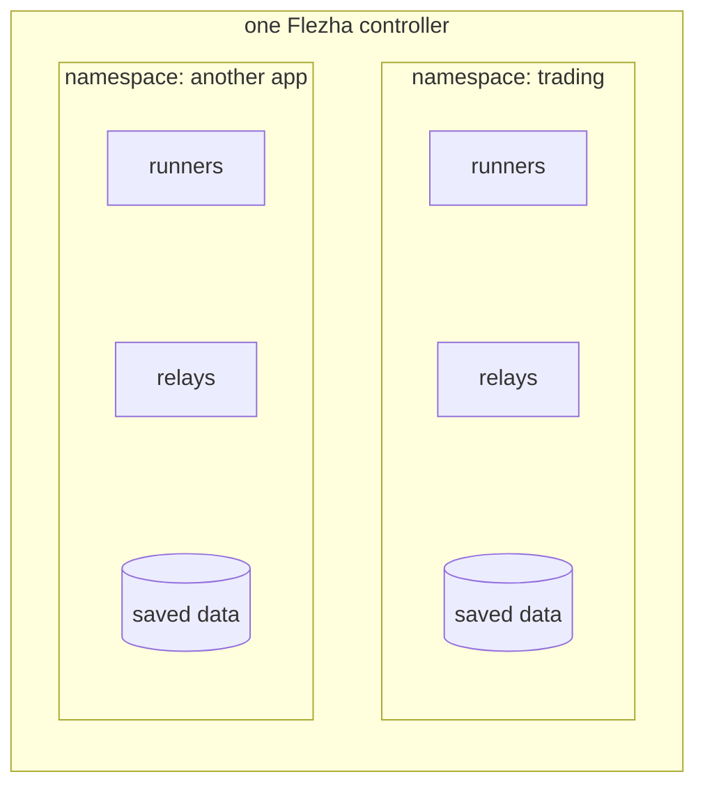

# Namespaces

A namespace is a separate room inside one Flezha deployment. Each application
gets its own: its runners, its relays and their saved data live there, and
nothing in one namespace can see or touch what is in another. Each namespace
also has its own limits, such as how many relays it may run, so one
application cannot use up everything, and its own keys, so a runner can enter
only the namespace it has a key for.

Namespaces are the tenancy boundary: each relay, state file, audit record
and observability signal carries one. Limits and keys take effect when
[authorization](authorization.md) is on, which it is by default in a release.

## How it works



- **A runner connects into exactly one namespace** and serves relays only
  there. A runner process serves one namespace; serving two means two
  processes ([`connecting_a_runner.md`](../deploying/connecting_a_runner.md#one-runner-one-namespace)).
- **A relay id is unique within its namespace**, not across them.
- **Each namespace has a hub of its own**: the process that decides which
  runner each relay runs on, and moves it when that runner goes away.
- **Saved state is kept per namespace**, under `storage/app/state/<namespace>/`.
- **The limits are six quotas** stored with the namespace, and the keys are
  the credentials and tokens issued for it.

`_system` is the controller's own namespace. It is reserved, exists at boot,
and is where the cross-namespace admin lives.

## The `default` namespace

Each command that works inside a namespace takes `--namespace`, or `-n` for
short. Left out, the command uses `default`.

`default` is not created for you, so `flz namespace list` does not show it.
With authorization off that does not matter: a runner can join any namespace
by naming it, and the controller sets it up when the runner connects. With
authorization on, a runner can join only a namespace created with
`flz namespace create`, and that includes `default`.

Give each application a namespace of its own, even the first one. Saved data
is kept per namespace and a namespace cannot be renamed, so moving an
application out of `default` later means leaving its saved data behind.

## Create and list namespaces

`flz namespace create` writes an entry into the controller's catalog, which is
kept on disk, so the namespace survives a restart. A name starts with a
lowercase letter, followed by up to 62 lowercase letters, digits, `-` or `_`
(`[a-z][a-z0-9_-]{0,62}`). With authorization on, creating one needs an admin
token in `FLEZHA_TOKEN`.

```sh
$ flz namespace create trading
```

```output
namespace trading created
namespace: trading
migration: cold
quotas:
  max_cells_per_relay: 1024
  max_mailbox_bytes_total: 268435456
  max_message_rate_per_second: 100000
  max_relays: 100
  max_runners: 32
  max_state_bytes: 107374182400
```

Without a claimed admin, or without a token in the shell, the same command is
refused, and the refusal says what is missing:

```output
error: authorization is enforced and no admin has claimed the bootstrap yet; its token is in storage/app/auth/bootstrap.token on the controller (authz.bootstrap_pending)
hint: flz auth bootstrap < storage/app/auth/bootstrap.token
```

```sh
$ flz namespace list
```

```output
Fetching namespaces...
Namespaces:

  NAMESPACE                          RUNNING
  _system                            no
  trading                            no
```

`RUNNING` says whether a namespace's hub is up; it comes up when the
namespace's first runner connects. A caller sees its own namespace in the
listing and no other; `admin@_system` sees them all. A caller with no
namespace at all, as on a controller with authorization off, sees them all
too.

`create` and `delete` both say whether they changed anything: a name the
catalog already holds is refused `namespace.already_exists` (exit 6), and a
name it does not hold is refused `namespace.not_found` (exit 5). Both go to
standard error, so a teardown script cannot read a typo as a successful
delete.

## Join it from a runner

Code never creates a namespace. A runner names the one it joins when it is
created, and with authorization on it proves it with the namespace's key in
`FLEZHA_NAMESPACE_SECRET` ([`authorization.md`](authorization.md#runner-credentials)).
In the tradedesk example, the runner takes the namespace as its first
argument, `trading` when there is none:

<!-- tabs-open -->

### Java

```java
// Main.java: the runner. Joins trading and registers both factories.
FlezhaRunner runner = Flezha.createRunner(args.length > 0 ? args[0] : "trading")
```

Full file: [`Main.java`](https://github.com/flezha/flezha_java_sdk/blob/main/examples/tradedesk/src/main/java/com/flezha/examples/tradedesk/Main.java).

### Rust

```rust
// src/main.rs: the runner. Joins trading and registers both factories.
let namespace = std::env::args()
    .nth(1)
    .unwrap_or_else(|| "trading".to_string());

let runner = Flezha::create_runner(namespace)?;
```

Full file: [`src/main.rs`](https://github.com/flezha/flezha_rust_sdk/blob/main/examples/tradedesk/src/main.rs).

### Node

```javascript
// runner.mjs: the runner. Joins trading and registers both factories.
const runner = createRunner(process.argv[2] ?? 'trading');
```

Full file: [`runner.mjs`](https://github.com/flezha/flezha_node_sdk/blob/main/examples/tradedesk/runner.mjs).

### Python

```python
# runner.py: the runner. Joins trading and registers both factories.
namespace = sys.argv[1] if len(sys.argv) > 1 else "trading"
...
flezha.create_runner(namespace)
```

Full file: [`runner.py`](https://github.com/flezha/flezha_python_sdk/blob/main/examples/tradedesk/runner.py).

### Ruby

```ruby
# runner.rb: the runner. Joins trading and registers both factories.
runner = Flezha.create_runner(ARGV[0] || "trading")
```

Full file: [`runner.rb`](https://github.com/flezha/flezha_ruby_sdk/blob/main/examples/tradedesk/runner.rb).

### PHP

```php
// runner.php: the runner. Joins trading and registers both factories.
$runner = Flezha::createRunner($argv[1] ?? 'trading')
```

Full file: [`runner.php`](https://github.com/flezha/flezha_php_sdk/blob/main/examples/tradedesk/runner.php).

### Elixir

```elixir
# lib/tradedesk/application.ex: the runner. Joins trading and registers both factories.
namespace = List.first(System.argv(), "trading")
...
{Flezha.SDK,
 namespace: namespace,
 relays: [Tradedesk.TradeWatcher, Tradedesk.OrderExecutor],
 transport: :uds}
```

Full file: [`lib/tradedesk/application.ex`](https://github.com/flezha/flezha_elixir_sdk/blob/main/examples/tradedesk/lib/tradedesk/application.ex).

### Go

```go
// main.go: the runner. Joins trading and registers both factories.
namespace := "trading"
if len(os.Args) > 1 {
	namespace = os.Args[1]
}

runner, err := flezha.CreateRunner(namespace)
```

Full file: [`main.go`](https://github.com/flezha/flezha_go_sdk/blob/main/examples/tradedesk/main.go).

<!-- tabs-close -->

Once it runs, the runner is listed under its namespace, with the namespace as
its id's prefix:

```sh
$ flz runner list --namespace trading
```

```output
Fetching runners for namespace 'trading'...
Runners in namespace 'trading':

  RUNNER                            PID      NODE                  CONNECTED AT          LATE
  trading_20932a8e7340              48213    flezha@127.0.0.1      2026-10-18T09:31:12Z  no
```

## Quotas

| Quota | Default | What it caps |
| --- | --- | --- |
| `max_relays` | 100 | relays started in the namespace; checked at start |
| `max_cells_per_relay` | 1024 | keyed cells one relay may hold; checked at start |
| `max_mailbox_bytes_total` | 256 MiB | the credit window across the namespace's relay mailboxes |
| `max_message_rate_per_second` | 100 000 | stored for now, not enforced |
| `max_state_bytes` | 100 GiB | the namespace's state on disk: a start is refused while over it, and a running namespace raises a latched `[:flezha, :state, :disk_quota_breach]` alarm; writes are not interrupted |
| `max_runners` | 32 | runners connected at once; a refused connect emits `[:flezha, :runner, :quota_refused]` |

A refusal is `quota.exceeded`, with `kind`, `current` and `limit` in its
details. The disk footprint is measured from `storage/app/state/<namespace>/`,
cached for 30 s and rebuilt from disk at boot; the runner count comes from the
live connections. While authorization is not enforced, every quota check
passes.

A namespace can take its own limits when it is created, with
`--X<field>=<value>`, repeated for several fields:

```sh
$ flz namespace create reporting --Xmax_relays=10
```

Read and change them later:

```sh
$ flz namespace show trading
$ flz namespace set-quota trading --Xmax_runners=4
```

```output
namespace trading quotas updated
namespace: trading
migration: cold
quotas:
  max_cells_per_relay: 1024
  max_mailbox_bytes_total: 268435456
  max_message_rate_per_second: 100000
  max_relays: 100
  max_runners: 4
  max_state_bytes: 107374182400
```

An unknown field is refused (`namespace.unknown_quota_field`), and so is a
negative value (`namespace.invalid_quota_value`). A change applies to the next
start or connect, not to what is already running. Quotas can also be set in
the controller's application env, as per-namespace overrides under
`config :flezha, :authn_authz, namespaces: %{"team-orders" => %{max_relays: 50}}`.

## How its relays move

A relay moves to another controller when a controller joins, drains or stops
serving the relay's factory. Each namespace chooses how, with its `migration`
setting:

- **`cold`**, the default: the relay stops on the controller it leaves, then
  starts on the new one, which copies the relay's saved state from the old
  controller before it takes input. Only one copy of the relay runs at any
  time. While it moves, which takes about as long as a restart plus that copy,
  the relay answers nothing. A sender that waits for the answer (a call, a
  confirming source such as Kafka, and every input of an effectively-once
  relay) sends again and loses nothing; an input sent without waiting for an
  answer is lost, as in a crash.
- **`hot`**: the new copy starts and takes the relay's state while the old one
  still runs, and the old one stops once the new one is registered. The relay
  keeps answering during the move, but for that stretch two copies run, and
  input the old copy takes after its state was handed over can be lost.

```sh
$ flz namespace set-migration trading hot
```

```output
namespace trading migration updated
namespace: trading
migration: hot
quotas:
  max_cells_per_relay: 1024
  max_mailbox_bytes_total: 268435456
  max_message_rate_per_second: 100000
  max_relays: 100
  max_runners: 4
  max_state_bytes: 107374182400
```

Any value other than `cold` or `hot` is refused. A namespace without a record,
such as `default` before anyone creates it, moves cold. The setting takes
effect on each controller when the namespace's hub next starts there, normally
at that controller's next restart; until then it keeps moving relays the way
it started with.

## Delete a namespace

```sh
$ flz namespace delete scratch
```

```output
namespace scratch deleted
```

```sh
$ flz namespace delete scratch
```

```output
error: namespace 'scratch' does not exist (namespace.not_found)
hint: flz namespace list
```

Delete removes the catalog entry and its quota counters, and only those, so
it refuses while the namespace still has a relay or a runner attached. Empty
the namespace first: stop each relay with `flz relay stop` and stop its
runners.

```sh
$ flz namespace delete trading
```

```output
error: namespace 'trading' still has relays [candles] and runners [trading-runner-1] attached; stop them before deleting it (namespace.in_use)
hint: flz relay list --namespace trading
```

The refusal exits 6. A deleted namespace stays gone; a namespace whose hub
was merely stopped comes back on the next controller start while its entry
stands.

## Administering from application code

A connected runner can administer the namespace its connection proved: start
and stop relays, enable and disable plugins, read what is running, and send
to its relays. No tasklet has to run, and the application holds no credential
beyond the one its connection already presented.

| | |
| --- | --- |
| Reached from | the runner object, not a tasklet's context |
| Namespace | the connection's, always: the request has no namespace field, so another namespace cannot be named |
| Identity | `runner@<namespace>`, the principal the connection proved |
| Authority | the roles bound to that principal, read on every call |
| Default | `runner`, which grants the connect and nothing else: every call is refused until someone binds a role |
| Expiry | none: a runner credential does not expire, and no other credential is presented |
| Blocking | yes: each call answers the controller's own result |

One command grants it, once per namespace:

```sh
$ flz role bind runner@team-orders app team-orders
```

`flz role unbind` revokes it, effective from the next call rather than the
next reconnect. A namespace bound to `spawner` instead (the role for tasklets
that start workflows) reaches only the start and the send below; adding
`stopper` adds the stop ([`authorization.md`](authorization.md#roles)).

| What | Verb | Arguments after the namespace |
| --- | --- | --- |
| start a relay | `Relay.start` | the spec `flz relay start` takes: `factory_id`, and optionally `id`, `init_values`, `opts`. The run is the factory's, so a written `kind` is refused. Answers `{"id": ..., "outcome": "started" \| "already_running"}` |
| stop a relay | `Relay.stop` | `relay_id` |
| send to a relay | `Relay.send`, reached as `runner.send` ([`sending_and_calling.md`](sending_and_calling.md#sending-from-runner-code)) | `relay_id`, `message`, `channel` (`""` for none), and optionally `msg_id` and `key` |
| enable a plugin | `PluginManager.enable` | the plugin's `name`, then `provider`, `opts` and optionally `single`; with `relay_id` and `hooks` it also binds that relay |
| bind a relay to a plugin | `PluginManager.bind` | `name`, then `relay_id` and optionally `hooks` and `channel` |
| unbind a relay | `PluginManager.unbind` | `name`, then `relay_id` |
| disable a plugin | `PluginManager.disable` | `name` |
| list relays | `Relay.list` | none; one row per relay: its `id`, health, runner and node, and a partition group as one row |
| list plugins | `PluginManager.enabled` | none; one row per plugin enabled in the namespace |
| read cell state | `Relay.cell_state` | `relay_id`, and optionally `cell`: `<tasklet>` for its Cells or `<tasklet>/<cell_key>` for one; absent, every Cell of the relay |

Each SDK spells these as methods on its `control()` handle, except the send,
which is on the runner itself:

| SDK | Reached as | A start reads |
| --- | --- | --- |
| Rust | `runner.control()` | `control.start_relay(&RelaySpec::new("order_worker").id("orders"))` |
| Java | `runner.control()` | `control.startRelay(RelaySpec.of("order_worker").id("orders"))` |
| Node | `runner.control()` | `await control.startRelay('order_worker', { id: 'orders' })` |
| Python | `runner.control()` | `control.start_relay("order_worker", id="orders")` |
| Ruby | `runner.control` | `control.start_relay("order_worker", id: "orders")` |
| PHP | `$runner->control()` | `$control->startRelay('order_worker', id: 'orders')` |
| Elixir | `Flezha.SDK.Control` | `Control.start_relay(runner, "order_worker", id: "orders")` |
| Go | `runner.Control()` | `control.StartRelay("order_worker", "orders", nil, nil)` |

[`running_and_testing.md`](running_and_testing.md#from-application-code) shows
them in the echo runner of each SDK.

The id is optional in each SDK: without one, the controller generates one from
the factory id, such as `order_worker-k7m2qzxw4pd3fn2a`. Each start answers the
same two fields, `id` and `outcome` (`started`, or `already_running` when a
live instance already holds an id you gave), and nothing else; where it runs
is for `flz relay info` to say.

> #### A start that may be retried needs an id {: .warning}
>
> A start without an id that is retried after its answer was lost starts a
> second relay, and a second flow relay runs until it is stopped. Pass an
> id when a start may be retried: a start of an id already running starts
> nothing and answers `already_running`.

Each handle also has a generic `call(verb, args)` for a published function the
typed surface has no method for yet. What succeeds follows from the role's
grants, not from a list in the SDK.

**What it cannot do.** `app` is a strict subset of `ops` for everything but the
connect: it destroys no record and moves no work it did not create, so a
dead-letter drop or replay, a state rotation or deletion, a rewind, a replay
and a rescale are out of reach. So is everything node-wide or about
authorization: installing, upgrading or uninstalling a plugin, stopping the
controller, retuning state retention and every `authz` verb.

**The act is a user's act.** A call from code is judged at the same policy
point, against the same rule, and writes the same audit record its `flz`
equivalent writes, naming `runner@<namespace>` as the principal and `sdk` as
the surface; a read writes no record. Quotas apply unchanged: a start over
`max_relays` is refused with the reason a user would get. A relay
started this way is the cluster's, not the connection's: it survives the
runner disconnecting, and shows in `flz relay list`.

## Limits and gotchas

- **A namespace cannot be renamed**, and its saved data stays with its name.
- **Deleting a namespace does not stop its relays.** Empty it first.
- **`max_message_rate_per_second` is not enforced yet.**
- **Quotas and keys need authorization on.** With it off, any runner joins any
  namespace and every quota passes.
- **A start without an id is not safe to retry**, from the CLI or from code.

## See also

- [`authorization.md`](authorization.md): tokens, roles and runner credentials.
- [`running_and_testing.md`](running_and_testing.md): starting and stopping relays.
- [`connecting_a_runner.md`](../deploying/connecting_a_runner.md): one runner, one namespace.
- [`access_commands.md`](../cli/access_commands.md): `flz namespace` and `flz role`.
- Tutorial: [`open_the_desk.md`](tutorials/open_the_desk.html) creates `trading`.
