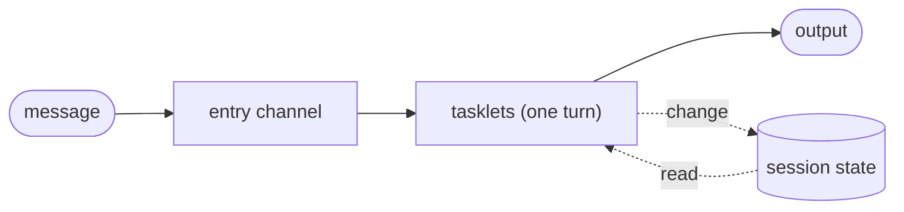
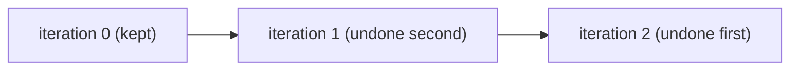
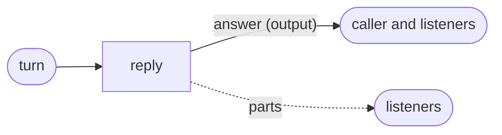

# Sessions

A session is a relay instance that lives for as long as a conversation does: it has a
beginning, it takes one message after another, and it remembers what was said. A chat with a
model, a support case or a user's shopping basket all have that shape.

Flezha has no separate session type. A session is a relay that runs in steps, once per
message it is sent, with its state kept between messages. Each conversation is an instance
of its own, started under its own id, with its own state. Where a workflow instance runs its
steps once and ends, a session runs them again for every message, and each run is a
**turn**.

**Contents**

1. [How it works](#how-it-works)
2. [Configure a session](#configure-a-session)
3. [Example](#example)
   1. [Start a session and talk to it](#start-a-session-and-talk-to-it)
   2. [See a session sleep and wake](#see-a-session-sleep-and-wake)
4. [Rewinding a turn](#rewinding-a-turn)
   1. [An undo for each tasklet](#an-undo-for-each-tasklet)
   2. [A turn that fails alone](#a-turn-that-fails-alone)
   3. [Example: forget the last message](#example-forget-the-last-message)
5. [Streamed answers](#streamed-answers)
   1. [Example: one token at a time](#example-one-token-at-a-time)
   2. [Stream over HTTP](#stream-over-http)
6. [Limits and gotchas](#limits-and-gotchas)
7. [See also](#see-also)

## How it works



- **One instance per conversation.** The relay class is started once per conversation,
  each time with its own id (for example the user's name). The instances share the class's
  graph and nothing else.
- **One turn per message.** A message that arrives on the entry channel runs the chain once.
  The instance then waits for its next message. Turns are numbered from 0; each one is an
  **iteration** of the instance, which [sessions.md](#rewinding-a-turn) uses.
- **State between turns.** A tasklet keeps the conversation in its state through changes,
  exactly as any tasklet keeps state ([state.md](state.md)). The next turn reads
  the state the previous one left.
- **An answer to the sender.** When the message came from a call, for example `flz relay call`
  or another relay's call, the turn's first output goes back to the caller, and on to the
  output's plugins and listeners ([sending_and_calling.md](sending_and_calling.md#calls)).
- **An idle session sleeps.** A session waiting for its next message still holds a place on
  its runner, and with many sessions that adds up. So an instance that keeps its state on
  the controller sleeps when it has been idle for a while: it leaves its runner, the
  controller keeps its state, and its next message wakes it on whichever runner is there.

## Configure a session

A session is a relay that runs in steps with `each` set to per input. Its durability
setting says where its state is kept and when an idle instance sleeps.

| Setting | Java | Elixir | Meaning |
| --- | --- | --- | --- |
| Run in steps, once per message | `Run.steps(Each.PER_INPUT)` | `run: {:steps, each: :per_input}` | One turn per message, the instance waits between turns |
| Keep the state on the controller's disk | `Durable.local()` | `durable: :local` | The default; the state outlives a runner |
| Sleep after an idle interval | `new Durable.Local(Duration.ofSeconds(10))` | `durable: {:local, sleep_after: 10_000}` | An instance idle that long sleeps |
| Never sleep | `new Durable.Local(new Durable.SleepAfter.Never())` | `durable: {:local, sleep_after: false}` | The instance keeps its runner place |

When the class says nothing about sleeping, the run decides: a steps instance sleeps after
six hours idle, a flow instance never sleeps. `sleep_after` exists only on `local` and
`remote` durability; an instance kept in memory only (`durable: false`) has nothing to wake
from, so it does not sleep. [relay_settings.md](../../configuration/relay_settings.md)
has the whole settings tree.

By default a failed turn ends the whole session and undoes every turn, as a failed step ends a
workflow instance. A conversation usually wants to lose only the failed turn:
[sessions.md](#a-turn-that-fails-alone) shows the failure mode
that does that.

## Example

In the agentdesk example, the relay `agent` is a session: one per user, named after the
user. The tasklet `reply` answers each message with a demo model and keeps the conversation,
the list of messages so far, in its state. The model sees the conversation, so its answer can
say which message this is.

<!-- tabs-open -->

### Java

```java
// Reply.java: answers a message with the demo model, and keeps the conversation.
@Tasklet.Spec(name = "reply")
public final class Reply implements Tasklet<String, Reply.Conversation, Reply.Answer> {

    public record Answer(String text, int tokens) {}

    public static class Conversation {                       // what the session remembers
        public List<String> messages = new ArrayList<>();
    }

    public record Said(String message) implements Change<Conversation> {
        @Override
        public void applyTo(Conversation conversation) {
            conversation.messages.add(message);
        }
    }
    ...
    @Override
    public void run(String message, Ctx<Conversation, Answer> ctx) throws TaskletException {
        ctx.emit(DemoModel.answer(ctx.state().messages, message, ctx::part));
        ctx.change(new Said(message));
    }
```

Full file: [`Reply.java`](https://github.com/flezha/flezha_java_sdk/blob/main/examples/agentdesk/src/main/java/com/flezha/examples/agentdesk/Reply.java)

```java
// AgentRelay.java: one conversation, one turn per message.
public final class AgentRelay implements Relay {

    @Override
    public String factoryId() {
        return "agent";
    }

    @Override
    public Run run() {
        return new Run.Steps(
                Each.PER_INPUT,                          // one turn per message
                OnFailure.KEEP_PROGRESS);                // a failed turn fails alone
    }

    @Override
    public Durable durable() {
        return new Durable.Local(Duration.ofSeconds(10)); // an idle session sleeps after 10 s
    }

    @Override
    public void channels(ChannelBuilder c) {
        c.input(String.class, "turn")
                .into(Reply.class)
                .output("answer");                       // to whoever called, and whoever listens
```

Full file: [`AgentRelay.java`](https://github.com/flezha/flezha_java_sdk/blob/main/examples/agentdesk/src/main/java/com/flezha/examples/agentdesk/AgentRelay.java)

### Elixir

```elixir
# lib/agentdesk/reply.ex: answers a message with the demo model, and keeps the conversation.
defmodule Agentdesk.Reply do
  use Flezha.SDK.Tasklet, name: "reply"

  alias Agentdesk.DemoModel

  # What the session remembers.
  state do
    field(:messages, :list, default: [])
  end

  defchange said(conversation, message) do
    %{conversation | messages: conversation.messages ++ [message]}
  end
  ...
  @impl true
  def run(message, conversation, ctx) do
    with {:ok, answer} <- DemoModel.answer(conversation.messages, message, &part(ctx, &1)) do
      emit(ctx, answer)
      {:ok, said(conversation, ctx, message)}
    end
  end
```

Full file: [`reply.ex`](https://github.com/flezha/flezha_elixir_sdk/blob/main/examples/agentdesk/lib/agentdesk/reply.ex)

```elixir
# lib/agentdesk/agent_relay.ex: one conversation, one turn per message.
defmodule Agentdesk.AgentRelay do
  use Flezha.SDK.Relay,
    factory_id: "agent",
    # one turn per message; a failed turn fails alone
    run: {:steps, each: :per_input, on_failure: :keep_progress},
    # an idle session sleeps after 10 s
    durable: {:local, sleep_after: 10_000}
  ...
  @impl true
  def channels(c) do
    c
    |> input("turn", codec: :text)
    |> into(Reply)
    # to whoever called, and whoever listens
    |> output("answer")
```

Full file: [`agent_relay.ex`](https://github.com/flezha/flezha_elixir_sdk/blob/main/examples/agentdesk/lib/agentdesk/agent_relay.ex)

<!-- tabs-close -->

An answer is its text and the number of tokens the model used for it. `DemoModel` stands in
for a model's client: it answers each message with one canned sentence, so nothing outside the
example is needed. Its third argument receives each token as it is written, which
[sessions.md](#streamed-answers) uses. The lines elided above add an undo
([sessions.md](#rewinding-a-turn)).

### Start a session and talk to it

A session is started like any relay, with an id: the id names the conversation.

```sh
$ flz relay start agent --id anna --namespace agents
```

```output
Started anna
```

`flz relay call` sends one message and waits for the first output the turn sends to its output
([sending_and_calling.md](sending_and_calling.md#calls) is its contract):

```sh
$ flz relay call anna --namespace agents --text 'Hello'
$ flz relay call anna --namespace agents --text 'What can you do?'
```

```output
{"text":"Message 1: you said \"Hello\". I am a demo model.","tokens":10}
{"text":"Message 2: you said \"What can you do?\". I am a demo model.","tokens":13}
```

The second answer knows about the first message. A session started for another user, say
`bob`, has a conversation of its own and starts again at message 1.

### See a session sleep and wake

After its idle interval, the controller reports the instance as `suspended`: it keeps the
session's state, and no runner holds it.

```sh
$ flz relay info anna --namespace agents
```

```output
...
Relay: anna
  Run: steps (each: per_input, on_failure: keep_progress)
  Durable: local (sleep_after: 10s)
  Phase: suspended
  Health: suspended
  Runner ID: 
...
```

The next message wakes it, on the same runner or another one, with its conversation:

```sh
$ flz relay call anna --namespace agents --text 'Are you still there?'
```

```output
{"text":"Message 3: you said \"Are you still there?\". I am a demo model.","tokens":13}
```

How an instance sleeps and wakes: [the relay lifecycle](https://github.com/flezha/flezha/blob/main/docs/internal/architecture/relay_lifecycle.md).

## Rewinding a turn

A conversation sometimes has to go back. A user edits a message sent a while ago, or an
answer went wrong, and the conversation should continue from an earlier turn as if the later
ones had not happened. And sometimes a single turn fails, because the model refused or timed
out, and only that turn should be lost, not the conversation.

Flezha covers both for a relay that runs in steps once per message, such as a
session: `flz relay rewind` takes the instance back to an earlier turn, and
the failure mode `keep_progress` lets a failed turn fail alone.

Each message a session runs is one **iteration**, numbered from 0. When an iteration ends,
the controller records it as committed in the instance's journal.

**A rewind** takes the instance back to a committed iteration. It keeps that iteration and
every earlier one, and undoes every later one, newest first, through each tasklet's
`compensate`. The messages it undoes are not run again; the loop resumes at the next
iteration with the next message that arrives.



A rewind is refused when it cannot undo what it would have to:

| Code | When |
| --- | --- |
| `relay.rewind_uncovered` | a tasklet whose output left the instance (through an output) between the target and now declares no `compensate` |
| `relay.iteration_not_committed` | the target iteration has not committed, so there is no boundary to rewind to |

A steps instance is taken back only as a whole: `flz relay replay` of one of its cells is
refused with `relay.replay_steps`, whose hint is the rewind.

**A failed turn.** What a failure undoes is the run's `on_failure` setting:

| `on_failure` | A failed turn |
| --- | --- |
| `undo_all` (the default) | every completed tasklet of every turn is undone in reverse through its `compensate`, and the instance ends |
| `keep_progress` | finished iterations are kept and only the failed one is undone; in a per-input loop the failed turn's message goes to the dead-letter queue and the instance takes its next message |

### An undo for each tasklet

A tasklet's undo is its `compensate`. It receives the outputs the tasklet sent in the
iteration being undone and the tasklet's state, and records a change that takes the
iteration's effect back. A tasklet whose output leaves the instance needs one for a rewind
to pass, even when there is nothing to take back: it then declares an empty one.

### A turn that fails alone

`on_failure: keep_progress`, which the example's `agent` relay declares, lets a
failed turn fail alone ([above](#example)).

### Example: forget the last message

In the agentdesk example, the session's tasklet `reply` keeps the conversation as a list of
messages. Its undo forgets the last message of the conversation, and prints which one, so the
undos can be seen in the runner's log.

<!-- tabs-open -->

### Java

```java
// Reply.java: the undo, a change that forgets the last message.
    public record Unsaid() implements Change<Conversation> {
        @Override
        public void applyTo(Conversation conversation) {
            conversation.messages.removeLast();
        }
    }
    ...
    // The undo, when a turn is taken back: the conversation forgets its message.
    @Override
    public void compensate(List<Answer> sent, Ctx<Conversation, Answer> ctx) {
        System.out.println("[undo] forgot \"" + ctx.state().messages.getLast() + "\"");
        ctx.change(new Unsaid());
    }
```

Full file: [`Reply.java`](https://github.com/flezha/flezha_java_sdk/blob/main/examples/agentdesk/src/main/java/com/flezha/examples/agentdesk/Reply.java)

### Elixir

```elixir
# lib/agentdesk/reply.ex: the undo, a change that forgets the last message.
  defchange unsaid(conversation) do
    %{conversation | messages: Enum.drop(conversation.messages, -1)}
  end
  ...
  # The undo, when a turn is taken back: the conversation forgets its message.
  @impl true
  def compensate(_answers, conversation, ctx) do
    IO.puts(~s([undo] forgot "#{List.last(conversation.messages)}"))
    {:ok, unsaid(conversation, ctx)}
  end
```

Full file: [`reply.ex`](https://github.com/flezha/flezha_elixir_sdk/blob/main/examples/agentdesk/lib/agentdesk/reply.ex)

<!-- tabs-close -->

#### Take turns back

A session named `anna` that has run three turns holds three messages:

```sh
$ flz state get anna/reply --namespace agents
```

```output
state get anna/reply:
  change_seq: 3
  state:      {"reply":{"messages":["Hello","What can you do?","Are you still there?"]}}
```

Taking it back to iteration 0 keeps the first message:

```sh
$ flz relay rewind anna --to-iteration 0 --namespace agents
```

```output
Relay 'anna' rewound to iteration 0. Iterations above it were compensated; the loop resumes at 1.
```

The runner ran the two undos, newest first. In the example's Docker Compose setup:

```sh
$ docker compose logs runner | grep undo
```

```output
runner-1  | [undo] forgot "Are you still there?"
runner-1  | [undo] forgot "What can you do?"
```

```sh
$ flz state get anna/reply --namespace agents
```

```output
state get anna/reply:
  change_seq: 5
  state:      {"reply":{"messages":["Hello"]}}
```

The undos are changes of their own, so `change_seq` grows. The next message continues from
the first one:

```sh
$ flz relay call anna --namespace agents --text 'Where were we?'
```

```output
{"text":"Message 2: you said \"Where were we?\". I am a demo model.","tokens":12}
```

#### Fail a turn

The demo model reads at most 200 characters, and refuses a longer message with an error that
is not worth retrying (a non-retryable tasklet error, so the turn is not tried again):

```sh
$ flz relay call anna --namespace agents --text "$(printf '%0250d' 0)"
```

```output
error: relay 'anna' dead-lettered the call's input as 'anna/_turn/fd471f7e0b872ddf': tasklet `reply` failed after 1 attempt(s): non-retryable tasklet error: the demo model reads at most 200 characters, and this message has 250 (call.failed)
hint: flz dlq list anna
```

The message is kept in the dead-letter queue, where it can be read, replayed or dropped
([durability.md](durability.md)). The session goes on, and the failed message is
not part of the conversation:

```sh
$ flz relay call anna --namespace agents --text 'Sorry, go on'
```

```output
{"text":"Message 3: you said \"Sorry, go on\". I am a demo model.","tokens":12}
```

## Streamed answers

A model writes its answer a token at a time, and a long answer takes a while. Rather than
wait for all of it, a reader can watch it grow. A tasklet does that by sending **parts**
while it runs: previews of the output it is producing, which leave at once and reach whoever
listens to the relay. The finished output still leaves once, as it always does.

Parts work for any long-running tasklet whose progress is worth showing: a model's tokens, a
report's sections, a long computation's progress.

- **A part is a preview of the tasklet's own output.** It is encoded exactly as an output on
  that channel would be, and it leaves the runner at once, while `run` is still running.
- **Only listeners see parts.** A part reaches the relay's listeners (`flz relay
  listen`, or the HTTP plugin's event stream below). It does not reach the caller, an output
  plugin never receives it, and nothing about it is kept or replayed. With nobody listening,
  it is dropped.
- **Sending never waits.** A part that cannot leave at once is dropped and counted. A replayed
  input sends no parts.
- **Parts are numbered per attempt.** The runtime numbers the parts of each attempt from 0
  and stamps the attempt, the cell and the channel, so a turn that is tried again starts its
  preview again.
- **The output channel must end in an output.** A tasklet sends parts only when its output
  channel ends in an output; a `call(...)` end is not one. The same output's finished output answers
  a caller, so one tasklet both streams and answers.



| Code | When |
| --- | --- |
| `part.no_output` | a tasklet sent a part, but its output channel has no output |
| `part.outside_invocation` | a part was sent through a context whose invocation has already returned |

In Java a tasklet sends a part with `ctx.part(value)`; in Elixir with `part(ctx, value)`. The
value has the type of the tasklet's output.

### Example: one token at a time

In the agentdesk example, `reply` hands the demo model a function that sends each token as a
part (`ctx::part` in the [session example](#example)), and its channel ends in the output
`answer`. The demo model calls it once per token, with a short pause, the
way a model's client streams.

<!-- tabs-open -->

### Java

```java
// DemoModel.java: the demo model hands over each token as it writes it.
        for (int i = 0; i < tokens.length; i++) {
            part.accept(new Answer(tokens[i], i + 1));
            LockSupport.parkNanos(PER_TOKEN.toNanos());
        }
        return new Answer(text, tokens.length);
```

Full file: [`DemoModel.java`](https://github.com/flezha/flezha_java_sdk/blob/main/examples/agentdesk/src/main/java/com/flezha/examples/agentdesk/DemoModel.java)

A real model's client would be called here instead, handing each token it streams to `part`
the same way.

### Elixir

```elixir
# lib/agentdesk/demo_model.ex: the demo model hands over each token as it writes it.
      for {token, i} <- Enum.with_index(tokens, 1) do
        part.(%Answer{text: token, tokens: i})
        Process.sleep(@per_token_ms)
      end
```

Full file: [`demo_model.ex`](https://github.com/flezha/flezha_elixir_sdk/blob/main/examples/agentdesk/lib/agentdesk/demo_model.ex)

A real model's client would be called here instead, handing each token it streams to `part`
the same way.

<!-- tabs-close -->

#### Watch a turn stream

`flz relay listen` prints what a relay emits, parts included, for as long as its
window lasts (`--duration-ms`, 30000 by default). Listening to a session named `anna` for
five seconds:

```sh
$ flz relay listen anna --namespace agents --duration-ms 5000
```

A message sent to the session meanwhile, from another terminal:

```sh
$ flz relay call anna --namespace agents --text 'Tell me a story'
```

```output
{"text":"Message 4: you said \"Tell me a story\". I am a demo model.","tokens":13}
```

The caller gets the finished answer, once. The listener sees every token as it was sent,
then the answer on the output:

```output
answer	{"text":"Message ","tokens":1}	part=0 attempt=1 cell=anna/reply/
answer	{"text":"4: ","tokens":2}	part=1 attempt=1 cell=anna/reply/
answer	{"text":"you ","tokens":3}	part=2 attempt=1 cell=anna/reply/
...
answer	{"text":"demo ","tokens":12}	part=11 attempt=1 cell=anna/reply/
answer	{"text":"model.","tokens":13}	part=12 attempt=1 cell=anna/reply/
answer	{"text":"Message 4: you said \"Tell me a story\". I am a demo model.","tokens":13}	cell=anna/reply/ seq=7.0
```

A part line is the channel, the part, and `part=<n> attempt=<a>`. The last line is the output,
which carries its place in the session's record, `seq`, instead. With `--json` each frame is
one object whose `kind` is `output`, `input`, `part` or `dead_lettered`.

### Stream over HTTP

A browser follows an answer as it is written over server-sent events, through the HTTP
server plugin ([http_server.md](../../plugins/http_server.md)). The plugin is installed in
the controller's image ([installing_plugins.md](../plugins/installing_plugins.md)) and enabled on a
relay that answers HTTP requests.

> #### Not a production setup {: .warning}
>
> The agentdesk example runs with authorization off, and the HTTP plugin authenticates
> nobody: anyone who can reach the port can read any session's answers. The plugin page's
> [security section](../../plugins/http_server.md#security) says what the plugin guards and
> what it leaves to the relay.

#### A request is an input

The plugin turns every HTTP request into one input of the relay it is enabled on, as a
JSON envelope: the method, the path, the body and a few more fields. The first output that
input causes on an output of the relay is the HTTP answer: a status and a body, or the name of a
relay to stream. The plugin has no routes of its own: the relay's graph
routes on the method and the path.

When the answer names a relay to stream, for example `{"stream":"anna"}`, the plugin
attaches a listener to that relay and keeps the response open: every part and every
output on the relay's outputs is written as one event, as it happens, until the client goes
away. The relay that answered the request is not in that path; it only named the session.

In the agentdesk example, a relay called `gateway` carries the plugin. It answers
`GET /sessions/<user>/events` with the user's session, named after the user, and any other
request it does not route elsewhere with 404.

<!-- tabs-open -->

### Java

```java
// Request.java: one HTTP request, as the plugin hands it to the gateway.
@JsonIgnoreProperties(ignoreUnknown = true)                  // the envelope carries more than the gateway reads
public record Request(String method, String path, String body) {

    private static final Pattern ROUTE = Pattern.compile("/sessions/([a-z][a-z0-9_-]{0,63})/(messages|events)");
    ...
    boolean listens() {
        return is("GET", "events");
    }

    String user() {
        return route(1);
    }
    ...
    private boolean is(String verb, String what) {
        return method.equals(verb) && route(2).equals(what);
    }

    private String route(int part) {                         // "" when the path is not a route
        Matcher route = ROUTE.matcher(path);
        return route.matches() ? route.group(part) : "";
    }
}
```

Full file: [`Request.java`](https://github.com/flezha/flezha_java_sdk/blob/main/examples/agentdesk/src/main/java/com/flezha/examples/agentdesk/Request.java)

The pattern accepts only a short lower-case name as the user, because the user names a
session.

```java
// Http.java: the gateway's answer to a request.
@JsonInclude(JsonInclude.Include.NON_NULL)
public record Http(Integer status, String body, String stream) {

    static Http of(int status, String body) {
        return new Http(status, body, null);
    }

    static Http stream(String session) {
        return new Http(null, null, session);
    }
}
```

Full file: [`Http.java`](https://github.com/flezha/flezha_java_sdk/blob/main/examples/agentdesk/src/main/java/com/flezha/examples/agentdesk/Http.java)

Unset fields are left out, because the plugin refuses an answer with a key it does not know.

```java
// Watch.java: a session's events, or 404.
@Tasklet.Spec(name = "watch")
public final class Watch implements Tasklet<Request, Void, Http> {

    @Override
    public void run(Request request, Ctx<Void, Http> ctx) throws TaskletException {
        // keyed by the user: an output of an effectively-once relay needs a key
        ctx.emitKeyed(
                request.user(), request.listens() ? Http.stream(request.user()) : Http.of(404, "no such route"));
    }
}
```

Full file: [`Watch.java`](https://github.com/flezha/flezha_java_sdk/blob/main/examples/agentdesk/src/main/java/com/flezha/examples/agentdesk/Watch.java)

```java
// GatewayRelay.java: every request that does not send a message goes to watch.
        EntryChannel<Request> http = c.input(Request.class, "http");
        http.filter(request -> !request.sends())
                .into(Watch.class)
                .keyed()
                .output();                                   // a stream, or 404
```

Full file: [`GatewayRelay.java`](https://github.com/flezha/flezha_java_sdk/blob/main/examples/agentdesk/src/main/java/com/flezha/examples/agentdesk/GatewayRelay.java)

### Elixir

```elixir
# lib/agentdesk/request.ex: one HTTP request, as the plugin hands it to the gateway.
defmodule Agentdesk.Request do
  defstruct [:method, :path, :body]

  @route ~r"^/sessions/([a-z][a-z0-9_-]{0,63})/(messages|events)$"

  # The envelope carries more than the gateway reads.
  def decode(json) do
    case Jason.decode(json) do
      {:ok, %{"method" => method, "path" => path} = envelope} ->
        {:ok, %__MODULE__{method: method, path: path, body: envelope["body"]}}

      _other ->
        {:error, "not a request envelope"}
    end
  end
  ...
  def listens?(request), do: is?(request, "GET", "events")

  def user(request), do: route(request, 1)
  ...
  defp is?(request, verb, what), do: request.method == verb and route(request, 2) == what

  # "" when the path is not a route.
  defp route(request, part) do
    case Regex.run(@route, request.path) do
      nil -> ""
      groups -> Enum.at(groups, part)
    end
  end
end
```

Full file: [`request.ex`](https://github.com/flezha/flezha_elixir_sdk/blob/main/examples/agentdesk/lib/agentdesk/request.ex)

The pattern accepts only a short lower-case name as the user, because the user names a
session.

```elixir
# lib/agentdesk/watch.ex: a session's events, or 404.
defmodule Agentdesk.Watch do
  use Flezha.SDK.Tasklet, name: "watch"

  alias Agentdesk.Request

  @impl true
  def run(request, state, ctx) do
    # keyed by the user: an output of an effectively-once relay needs a key
    emit_keyed(
      ctx,
      Request.user(request),
      if Request.listens?(request) do
        %{stream: Request.user(request)}
      else
        %{status: 404, body: "no such route"}
      end
    )

    {:ok, state}
  end
end
```

Full file: [`watch.ex`](https://github.com/flezha/flezha_elixir_sdk/blob/main/examples/agentdesk/lib/agentdesk/watch.ex)

An answer is the JSON object the plugin expects: a status and a body, or the session to
stream. The plugin refuses an answer with a key it does not know.

```elixir
# lib/agentdesk/gateway_relay.ex: every request that does not send a message goes to watch.
    http = input_with(c, "http", &Request.decode/1)

    http
    |> filter(&(not Request.sends?(&1)))
    |> into(Watch)
    |> keyed()
    # a stream, or 404
    |> output()
```

Full file: [`gateway_relay.ex`](https://github.com/flezha/flezha_elixir_sdk/blob/main/examples/agentdesk/lib/agentdesk/gateway_relay.ex)

<!-- tabs-close -->

The other branch of the gateway, `POST /sessions/<user>/messages`, sends the session a message
through a call: [sending_and_calling.md](sending_and_calling.md#calls) covers it.

#### Enable the plugin

The gateway runs for as long as the application does, one request after another, so it runs
in flow, the default. Start it with an id, then enable the HTTP plugin and bind it to the
gateway in the same command:

```sh
$ flz relay start gateway --id gateway --namespace agents
```

```output
Started gateway
```

```sh
$ flz plugin enable web http_server --relay_id=gateway --namespace agents --hook=on_terminate --Xport=8080 --Xbind=0.0.0.0 --Xchannel=http
```

```output
Enabling plugin...
Plugin web enabled.
Plugin web bound to gateway.
```

`--Xchannel=http` is the entry channel every request arrives on. Inside a container the plugin
must listen on every address, `0.0.0.0`: its default, loopback, cannot be reached from outside
the container. The agentdesk example's Compose file publishes the port on the host's loopback
only, so only that machine reaches it. [http_server.md](../../plugins/http_server.md#options)
lists the plugin's other options.

A path the gateway does not know:

```sh
$ curl -si localhost:8080/sessions/anna
```

```output
HTTP/1.1 404 Not Found
...
content-type: text/plain; charset=utf-8

no such route
```

#### Read a stream

Opening a session's stream for five seconds:

```sh
$ curl -sN --max-time 5 localhost:8080/sessions/anna/events
```

While it is open, a message sent to the session from another terminal:

```sh
$ flz relay call anna --namespace agents --text 'Tell me more'
```

```output
{"text":"Message 6: you said \"Tell me more\". I am a demo model.","tokens":12}
```

The stream shows every token as the demo model wrote it, then the answer:

```output
:

event: part
data: {"attempt":1,"channel":"answer","part":0,"payload":"{\"text\":\"Message \",\"tokens\":1}"}

event: part
data: {"attempt":1,"channel":"answer","part":1,"payload":"{\"text\":\"6: \",\"tokens\":2}"}

...

event: output
data: {"channel":"answer","payload":"{\"text\":\"Message 6: you said \\\"Tell me more\\\". I am a demo model.\",\"tokens\":12}"}
```

The first line, `:`, is a comment the plugin writes when the stream opens, and again whenever
the stream has been quiet for a while, which keeps proxies from closing it. A failed turn is a
`dead_lettered` event, and the plugin page's [streams section](../../plugins/http_server.md#streams)
lists every event. A browser reads the same stream with `EventSource`, and that section has
the few lines that show a growing answer.

## Limits and gotchas

- **A wake takes time, and the call pays for it.** The time a sleeping session takes to wake
  counts against the call's deadline.
- **Start each session with an id.** The id is what later messages and calls address. A
  start without an id gets a generated name, and a start retried after a lost reply starts a
  second instance ([running_and_testing.md](running_and_testing.md)).
- **A failed turn ends the session by default.** Without `on_failure: keep_progress`, a turn
  that fails undoes every turn and ends the instance; see
  [A turn that fails alone](#a-turn-that-fails-alone).
- **A session in memory forgets.** With `durable: false` a crash starts the conversation
  over, and the instance does not sleep.
- **Rewound messages are gone from the turn order.** A rewind does not run the undone
  messages again; a client that wants them answered again sends them again.
- **An undo cannot recall what already left.** An answer already sent to a caller or a
  listener stays sent; `compensate` only takes back what the instance itself keeps, and
  whatever the tasklet can reach (an external system's own cancel call, for example).
- **Every tasklet with output that left needs a `compensate`,** even an empty one, or the
  rewind is refused with `relay.rewind_uncovered`.
- **Only committed iterations are targets.** A turn still running is not a boundary.
- **Parts are not durable.** A part can be dropped (no listener, or it could not leave at
  once), a replay sends none, and a retried attempt starts again at part 0. A client shows
  parts as a preview and treats the output as the answer.
- **A caller never sees parts.** `flz relay call` and a relay's call get the finished
  output only.
- **The streaming tasklet's channel must end in an output,** or the part is refused with
  `part.no_output`. That output's finished output also answers a caller.
- **The HTTP stream starts at the live edge.** No event id is written, so a client that
  reconnects misses what was sent while it was away.

## See also

- [Sending and calling](sending_and_calling.md): send a session a message from another relay.
- [Workflows](workflows.md), [State](state.md), [Durability and delivery](durability.md).
- [Relay settings](../../configuration/relay_settings.md): the whole settings tree.
- [http_server.md](../../plugins/http_server.md): the HTTP plugin's options, envelopes,
  statuses, streams, security and deployment.
- [`relay_commands.md`](../cli/relay_commands.md#flz-relay) for `flz relay start`, `call`,
  `info`, `listen` and `rewind`.
- Tutorials: [start_a_session.md](tutorials/start_a_session.html),
  [take_a_turn_back.md](tutorials/take_a_turn_back.html),
  [stream_an_answer.md](tutorials/stream_an_answer.html),
  [serve_http.md](tutorials/serve_http.html).
