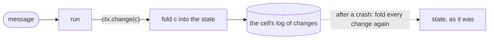

# State

A tasklet can remember things between messages: a running total, a window of
recent prices, the id of a reservation it may have to release. That memory is
its **state**, and it belongs to one **cell**. Flezha keeps a cell's state
durable by recording every change to it, so after a crash, a restart or a move
to another runner, the state comes back as it was.

State is optional. A tasklet that declares none keeps nothing between messages
and records nothing, which is the cheapest shape a tasklet has.

## How it works

A stateful tasklet declares two things: the **state** each cell starts from,
and the **changes** that modify it. A change is a small record of one
mutation, such as "this price joined the window", with a fold that applies it
to the state.



1. `run` reads the cell's state and records a change through the context
   (`ctx.change`).
2. The SDK folds the change into the state at once, and writes the change to
   the cell's log on the controller.
3. From time to time the controller asks for a snapshot of the whole state
   and drops the changes it covers, so the log does not grow without end.
4. When the cell is restored, Flezha starts from the tasklet's initial state,
   applies the latest snapshot, and folds every later change again, in order.

Recording a change is the only way state survives. A field written directly,
outside a change, is in memory only: it works until the first crash and is
then gone. Each SDK guards against that as far as its language lets it (see the
example below).

## Cells

A tasklet does its work in cells. A cell is one running copy of the tasklet
with its own state: you write the tasklet once, and each cell runs it on its
own messages and keeps its own memory. A cell handles its messages one at a
time, in the order they arrived, and different cells work side by side.

How many cells a tasklet gets is decided in the relay, not in the tasklet:

- **With `keyBy`** on the edge that feeds it, every key gets a cell of its own,
  made the first time a message with that key arrives
  ([`streams.md`](streams.md#keys-and-cells)).
- **Without it,** a tasklet has a single cell that handles every message.
- **With fixed cell keys** declared on the tasklet (`cell_keys` or
  `cellKeys`, with a `cellsFor` function that routes each input), it has that
  set of cells and no other.

A cell is what Flezha saves. A namespace caps how many cells one relay may
hold, with `max_cells_per_relay` ([`namespaces.md`](namespaces.md#quotas)),
and a tasklet caps its own dynamic cells with `max_cells` (100 000 by default;
new keys past it are dropped). An idle dynamic cell can be evicted after
`idle_ttl_seconds`; eviction deletes its state for good.

## Rules for state and changes

- **The fold must be pure and deterministic.** Replaying the changes is how
  state comes back after a crash, a retry, a rewind and on the
  effectively-once tier. A fold, or a `run`, that reads the clock, a random
  number or an outside system rebuilds a state the live run never had. Read
  time from `ctx.now()`, which follows the tasklet's declared clock, and take
  ids from `ctx.stableId()` (`stable_id`), which stays the same when a step
  runs again.
- **`ctx.change` is the one recorded mutation path**: one fold, one record.
- **Record deltas, not whole values.** A change to one entry of a map, or to
  one end of a collection, keeps each record one entry long. Recording a whole
  growing collection on every message makes every record as large as the
  collection. The usual shapes are in
  [the authoring contract](https://github.com/flezha/flezha/blob/main/docs/internal/sdk/authoring_contract.md#31-keyed-and-collection-changes).
- **Coalescing is opt-in, in the Rust SDK.** A Rust change that declares a
  `coalesce_key` collapses with the other changes sharing that key within one
  flush window, keeping the most recent. That suits "the current value of X",
  and is wrong for "+1" deltas. Changes without a key, and every change in the
  other SDKs, are kept as written.
- **Three clocks** serve `ctx.now()`: the wall clock (the default, read once
  per invocation), event time (read off each input, declared by writing an
  `event_time` function) and a logical clock (the cell's change counter,
  declared with `logical_clock`; it needs a real change type).
- **Timers are state too.** A timer's registration, cancellation and firing
  are records in the same log, so pending timers come back with the cell
  ([`timers.md`](timers.md)).

## Example: a window of prices

In the tradedesk example, `track_prices` keeps each symbol's last ten prices.
The relay keys it by symbol, so each symbol has a cell, and each cell its
own window. Each trade records one change, "this price was seen", whose fold
adds the price and drops the oldest once there are more than ten.

<!-- tabs-open -->

### Java

```java
// TrackPrices.java: keeps a symbol's last ten prices, and compares each new one with their average.
@Tasklet.Spec(name = "track_prices")
public final class TrackPrices implements Tasklet<TrackPrices.Trade, TrackPrices.PriceWindow, TrackPrices.Move> {
    ...
    public static class PriceWindow {                        // what each symbol's cell remembers
        public Deque<Double> prices = new ArrayDeque<>();
    }

    public record PriceSeen(double price) implements Change<PriceWindow> {  // how a price joins the window
        @Override
        public void applyTo(PriceWindow window) {
            window.prices.addLast(price);
            if (window.prices.size() > WINDOW) {
                window.prices.removeFirst();
            }
        }
    }

    @Override
    public void run(Trade trade, Ctx<PriceWindow, Move> ctx) throws TaskletException {
        Deque<Double> prices = ctx.state().prices;
        if (!prices.isEmpty()) {                             // a symbol's first trade has nothing to compare with
            ctx.emit(new Move(trade.symbol(), trade.price(), average(prices)));
        }
        ctx.change(new PriceSeen(trade.price()));
    }
    ...
}
```

Full file: [`TrackPrices.java`](https://github.com/flezha/flezha_java_sdk/blob/main/examples/tradedesk/src/main/java/com/flezha/examples/tradedesk/TrackPrices.java).

`Tasklet<Trade, PriceWindow, Move>` names what comes in, what the cell
remembers, and what goes out. A new cell's state is the state class's no-arg
constructor, unless the tasklet writes `initState(Optional<String> cellKey)`;
a state class with neither fails registration. A change is a record
implementing `Change<State>`, and its `applyTo` is the only method meant to
write a state field. `Void` as the state keeps nothing.

**Java does not stop a direct write.** `ctx.state()` returns the live object,
so `ctx.state().prices = ...` compiles and runs, and is never recorded. Such a
write survives a graceful shutdown and a live move (both ship the live object)
and is lost by every restore, so it disappears exactly when a runner crashes.
The test harness's `replayEquals()`, run in CI, is what catches it.

### Rust

```rust
// src/track_prices.rs: keeps a symbol's last ten prices, and compares each new one with their average.
#[derive(Default, Serialize, Deserialize)]
pub struct PriceWindow {
    prices: VecDeque<f64>,
}

#[derive(Serialize, Deserialize)]
pub struct PriceSeen(f64);

impl Change<PriceWindow> for PriceSeen {
    fn apply_to(&self, window: &mut PriceWindow) {
        window.prices.push_back(self.0);
        if window.prices.len() > WINDOW {
            window.prices.pop_front();
        }
    }
}
...
#[tasklet(name = "track_prices")]
impl Tasklet for TrackPrices {
    type Input = Trade;
    type Output = Move;
    type State = PriceWindow;
    type Change = PriceSeen;
    ...
}
```

Full file: [`src/track_prices.rs`](https://github.com/flezha/flezha_rust_sdk/blob/main/examples/tradedesk/src/track_prices.rs).

`ctx.state()` lends the state for reading only, and `ctx.change(c)` applies
`c.apply_to` and records it, so a direct field write does not compile. A block
that writes no `type State` keeps nothing; with no `type Change` the change
type is `NoChange` and nothing is recorded. A change enum is encoded by
variant index, so a new variant goes at the end.

### Node

```javascript
// track_prices.mjs: keeps a symbol's last ten prices, and compares each new one with their average.
initState: () => ({ prices: [] }), // what each symbol's cell remembers

applyChange: (state, change) => {
  state.prices.push(change.price); // how a price joins the window
  if (state.prices.length > WINDOW) state.prices.shift();
},
...
ctx.change({ price });
```

Full file: [`track_prices.mjs`](https://github.com/flezha/flezha_node_sdk/blob/main/examples/tradedesk/track_prices.mjs).

A change is plain data, here `{ price }`, and `applyChange` folds it into the
state. `ctx.state` is read-only: assigning to one of its fields throws, naming
the field.

### Python

```python
# track_prices.py: keeps a symbol's last ten prices, and compares each new one with their average.
@flezha.state
@dataclass
class PriceWindow:  # what each symbol's cell remembers
    prices: list[float] = field(default_factory=list)


class PriceSeen(TypedDict):  # how a price joins the window
    price: float
...
        ctx.change(PriceSeen(price=price))

    def apply_change(self, window: PriceWindow, seen: PriceSeen) -> None:
        window.prices.append(seen["price"])
        if len(window.prices) > WINDOW:
            del window.prices[0]
```

Full file: [`track_prices.py`](https://github.com/flezha/flezha_python_sdk/blob/main/examples/tradedesk/track_prices.py).

A new cell starts from `PriceWindow()`, the class `Ctx[PriceWindow, Move]`
names, so the tasklet writes no `init_state`. `@flezha.state` refuses an
assignment to a field of the window made anywhere but in `apply_change`.

### Ruby

```ruby
# track_prices.rb: keeps a symbol's last ten prices, and compares each new one with their average.
def init_state(_cell_key) = { prices: [] }                 # what each symbol's cell remembers

def apply_change(state, change)
  state[:prices] << change[:price]                         # how a price joins the window
  state[:prices].shift if state[:prices].size > WINDOW
end
...
ctx.change({ price: price })
```

Full file: [`track_prices.rb`](https://github.com/flezha/flezha_ruby_sdk/blob/main/examples/tradedesk/track_prices.rb).

`ctx.state` can be written directly too, but that write is not recorded: it
works until the first crash and is then gone.

### PHP

```php
// src/TrackPrices.php: keeps a symbol's last ten prices, and compares each new one with their average.
public function initState(?string $cellKey): mixed
{
    return ['prices' => []];                             // what each symbol's cell remembers
}

public function applyChange(mixed &$state, mixed $change): void
{
    $state['prices'][] = $change['price'];               // how a price joins the window
    if (count($state['prices']) > self::WINDOW) {
        array_shift($state['prices']);
    }
}
...
$ctx->change(['price' => $input['price']]);
```

Full file: [`src/TrackPrices.php`](https://github.com/flezha/flezha_php_sdk/blob/main/examples/tradedesk/src/TrackPrices.php).

`$ctx->state` can be written directly too, but that write is not recorded: it
works until the first crash and is then gone.

### Elixir

```elixir
# lib/tradedesk/track_prices.ex: keeps a symbol's last ten prices, and compares each new one with their average.
state do
  # What each symbol's cell remembers.
  field(:prices, :list, default: [])
end

# How a price joins the window.
defchange price_seen(window, price) do
  %{window | prices: Enum.take(window.prices ++ [price], -@window)}
end
...
{:ok, price_seen(window, ctx, price)}
```

Full file: [`lib/tradedesk/track_prices.ex`](https://github.com/flezha/flezha_elixir_sdk/blob/main/examples/tradedesk/lib/tradedesk/track_prices.ex).

`defchange price_seen(window, price)` is written once and generates both
halves: the fold, and the recorder `price_seen(window, ctx, price)`, which
runs the fold, records `{:price_seen, price}` and answers the new state for
`run/3` to return. A state is an immutable value, so there is no other way to
change it that could slip past the record. The `state` block generates the
decoding of a state read back from the controller.

<!-- tabs-close -->

## Where the state is kept

The class's `durable` setting ([`relay_settings.md`](../../configuration/relay_settings.md))
decides where a cell's log lives, for a stream and a workflow alike. It is
fixed on an instance when it starts: a change to the class applies from the
next stop and start.

| `durable` | The cell's state |
| --- | --- |
| `local` (default) | logged on the controller's disk, snapshotted, restored on every rebind |
| `remote` | as `local`, and each commit point is acknowledged only once the remote durability backend holds it |
| `false` | in memory only: no log, no snapshot, no restore on a rebind; a live read answers that persistence is off |

How each level behaves when something fails is
[`durability.md`](durability.md).

## Reading a cell's state

`flz state get` reads a cell's current state from the controller:

```sh
$ flz state get anna/reply --namespace agents
```

```output
state get anna/reply:
  change_seq: 3
  state:      {"reply":{"messages":["Hello","What can you do?","Are you still there?"]}}
```

`change_seq` counts the changes the cell has recorded. A cell of an instance
that sleeps, or of a class kept in memory, cannot be read this way. The other
`flz state` commands, such as a point-in-time read, are in [`relay_commands.md`](../cli/relay_commands.md#flz-state).

## Per-tasklet settings

| Setting | Rust | Java | Elixir | Default |
| --- | --- | --- | --- | --- |
| Schema version: bump it on a change to the state or change types that is not purely additive. A restore refuses a version above the running one, or below the readable floor, by name | `Tasklet::SCHEMA_VERSION` | `@Tasklet.Spec(schemaVersion = n)` | `schema_version/0`, with `min_readable_schema_version/0` as the floor | 1 |
| Log size at which the controller asks for a snapshot | `Tasklet::compact_after_bytes()` | `@Tasklet.Spec(compactAfterBytes = n)` | `compact_after_bytes/0` | 8 MiB |
| Pending-timer cap per cell; past it, the item fails with `runtime.timer_cap_exceeded` (in Rust, the call) | `Tasklet::max_timers_per_cell()` | `@Tasklet.Spec(maxTimersPerCell = n)` | `max_timers_per_cell/0` | 10 000 |
| Wait between flushes of recorded changes | `FLEZHA_FLUSH_LINGER_MS` | `FLEZHA_FLUSH_LINGER_MS` | none: records ship at the end of each invocation | 5 ms |

The Node, Python, Ruby, PHP and Go SDKs carry the same settings under their own
spellings (`schemaVersion` / `schema_version` / `SchemaVersion` on the tasklet's declaration),
listed on each SDK's reference page. When the class's tasklets declare
different `compact_after_bytes`, the smallest one applies. How to change a
state or change type after it has been deployed, with `migrate_state` and
`migrate_change`, is in
[the authoring contract](https://github.com/flezha/flezha/blob/main/docs/internal/sdk/authoring_contract.md#30-changing-a-state-or-change-type-after-it-has-been-deployed).

## Java: how state is encoded

The Java SDK encodes state and changes with Kryo, and each tasklet gets its own
codec with registration required, so an unregistered type fails at the first
flush (`StateSerializeException.UnregisteredClass`, naming the class and both
fixes).

By default the types are discovered: the state class, each member class of
the tasklet class (declared in a class body, at any depth), of a class above
it, or of the state class that implements `Change`, and each non-JDK class
their fields reach. A local or anonymous class is not found. Each type takes an
id derived from its name, so adding a change record moves no other id; two
classes deriving one id fail registration, naming both. A type nested in the
tasklet class is named by the tasklet's `@Tasklet.Spec` name and its path
inside the class, so renaming or moving the tasklet class keeps every id.

A tasklet that writes `kryoTypes()` owns its ids from the first save: the list
replaces discovery, ids follow list order, and only appending to it is safe.
Switching an existing tasklet between discovery and a list moves every id, so
it needs a `schemaVersion` bump and `migrateState` / `migrateChange`.

A tasklet needs a public no-arg constructor. A tasklet that writes `eventTime`
and also declares `logicalClock = true`, or a logical clock over a `Void`
state, is refused at registration (`topology.unservable_clock`). Recorded
change bytes travel with the result of the invocation, so a long invocation (a
GC pause included) delays its records.

## Testing the replay

Every SDK ships a test harness that runs a tasklet as the runtime
does and checks that replaying its recorded changes rebuilds the same state.
[Check a tasklet on its own](running_and_testing.md#check-a-tasklet-on-its-own)
names each one.

## Limits and gotchas

- **A direct write is lost on a crash** in Java, Ruby and PHP, where the
  language does not stop it. Rust, Node, Python and Elixir refuse it. Go's
  `ctx.State()` is a copy, so only a write through a map, slice or pointer in it is lost.
- **Eviction is destructive.** A dynamic cell evicted after its idle time loses
  its state, its log and its snapshot.
- **Keep large data small.** Every change is a log record; record deltas.
- **A restore is refused, not guessed.** A log written by another SDK, a
  schema version from the future or below the floor, or a damaged record stops
  the restore by name.
- **Renaming a tasklet** declares a new one: state is stored under its name.

## See also

- [`streams.md`](streams.md#keys-and-cells): keys, and how they make cells.
- [`workflows.md`](workflows.md): why a step keeps its undo handle in state.
- [`durability.md`](durability.md): what each `durable` level keeps through a crash.
- [`timers.md`](timers.md), [`partitioning.md`](partitioning.md).
- [The state persistence guide](https://github.com/flezha/flezha/blob/main/docs/internal/sdk/state_persistence.md): how the SDKs carry it out.
- [The SDK authoring contract](https://github.com/flezha/flezha/blob/main/docs/internal/sdk/authoring_contract.md): changing a deployed state type.
- Tutorial: [`watch_the_trades.md`](tutorials/watch_the_trades.html) builds `track_prices`.
