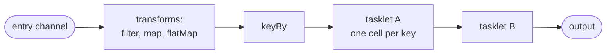
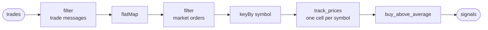
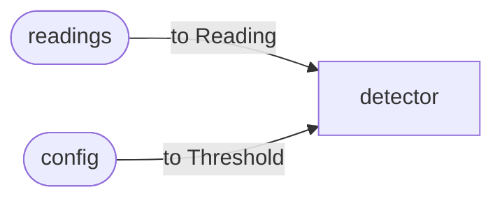

# Streams

A stream is a relay that runs in flow, the default run: you start it once,
and it handles each message the moment it arrives, for as long as it runs. It
suits an endless input, such as trades from an exchange, events from a queue
or rows from a change feed. An ETL stream (extract, transform, load) is the
typical case: take data from one place, change it into what you need, and
deliver it somewhere else.

A stream's graph is a path: messages enter on a channel, pass through
transforms and tasklets, and leave on outputs. Each result goes out as soon as it
is ready. Messages with the same key are handled one at a time, in the order
they arrived, while different keys are handled side by side, and each key can
keep state of its own.

**Contents**

1. [How it works](#how-it-works)
2. [Transforms](#transforms)
3. [Keys and cells](#keys-and-cells)
4. [Example: watching trades](#example-watching-trades)
5. [Describing an entry channel](#describing-an-entry-channel)
6. [Outputs](#outputs)
7. [Edge options](#edge-options)
8. [Merged inputs](#merged-inputs)
   1. [How to declare one](#how-to-declare-one)
   2. [What a merge promises](#what-a-merge-promises)
   3. [When a mapping fails](#when-a-mapping-fails)
   4. [Merges in a steps relay](#merges-in-a-steps-relay)
9. [Starting work from a stream](#starting-work-from-a-stream)
10. [Refusals](#refusals)
11. [Limits and gotchas](#limits-and-gotchas)
12. [See also](#see-also)

## How it works



- **An entry channel** is where messages come in: from a plugin such as a
  WebSocket or Kafka source, from `flz relay send`, or from another
  relay. Its name is an address that outside things use.
- **Transforms** are small steps written into the path, with no class of their
  own: `filter` drops messages, `map` reshapes one into another, `flatMap`
  splits one into several.
- **`keyBy`** decides which cell of the next tasklet each message goes to.
- **`into`** hands each message to a tasklet. What a tasklet emits flows on
  like any other message, so the next tasklet is added with another `into`.
- **An output** is a named exit where results leave the relay for whatever
  listens there: a plugin, `flz relay listen`, another relay.

A stream's commit point is one input. Each input's state changes and outputs
are recorded as it is handled, so after a crash the stream carries on from the
last input it finished. How much can repeat or be lost depends on the class's
`durable` and `exactly` settings ([`durability.md`](durability.md)).

## Transforms

`map`, `filter`, `flat_map` (`flatMap`) and `key_by` (`keyBy`) are edge
methods: they sit on the channel between two nodes, not in a tasklet. A
stateless reshaping step costs one line instead of a tasklet, and the key is
visible where the graph is wired rather than inside the consumer.

Everything declared between one `into` and the next is fused into one step on
that edge, so a value crosses a mailbox once, at the next tasklet, however
many transforms it passed. There is nothing to configure about this.

**A transform runs where messages are routed**, once per value, on the thread
that routes them. Two rules follow:

- **Pure and total.** A transform runs again when inputs are replayed after a
  crash. One that reads the clock or a counter rebuilds a state the live run
  never had.
- **Cheap.** An expensive transform holds up routing for every consumer of
  that channel. Real work belongs in a tasklet behind `keyBy`, which spreads it
  over cells.

A transform should only look at the message and hand something on. Anything
more, such as keeping prices, is a tasklet.

**A transform that throws** does not stop routing. In a stream, the value
takes the channel's retry ladder (`retry_max`, `retry_backoff_ms`) and, when
the attempts run out, goes to the dead-letter queue; the other consumers are
still served and later inputs keep flowing. In Java the transform runs inside
an activation, so a throw is that activation's failure. In a workflow there is
no dead-letter queue: a transform that throws fails the step that produced the
value, with no retry, and the workflow undoes what it did
([`workflows.md`](workflows.md)).

## Keys and cells

A tasklet does its work in cells, each with its own state
([`state.md`](state.md)). How many cells a tasklet gets is decided on the
edge that feeds it:

- **With `keyBy`,** every key gets a cell of its own, made the first time a
  message with that key arrives, without anything being declared for it.
- **Without it,** the tasklet has a single cell that handles every message.

Keying is declared per edge and not inherited: a plain `into` after a keyed
tasklet leaves the next tasklet with one cell. That is right for a tasklet that
keeps nothing per key; one that does needs its own `keyBy`, or one cell would
hold every key at once.

The key function sees the value after the transforms before it, and it is
total: it names a cell for every value and cannot decline one. Drop values
with a `filter` before the key, which is also why `keyBy` comes last, right
before `into`.

Each cell handles its messages one at a time, in the order they arrived. So
per key, a message always sees the state the earlier messages of that key
left. Different cells work side by side.

## Example: watching trades

In the tradedesk example, `trade_watcher` takes trades from an exchange. A
trade message says `"channel": "trade"` and carries one or more trades in its
`data` list; the same connection also carries other messages, such as the
confirmation of a subscription. The relay keeps the trade messages, splits
each into its trades, keeps the market orders, and keys them by symbol into
`track_prices`, which keeps each symbol's last ten prices. `buy_above_average`
then decides whether to buy, and its lines leave on the output `signals`.



<!-- tabs-open -->

### Java

```java
// TradeWatcherRelay.java: the stream. Trades in, signals out.
@JsonIgnoreProperties(ignoreUnknown = true)
public record TradeMessage(String channel, List<Trade> data) {}
...
@Override
public void channels(@Nonnull ChannelBuilder c) {
    c.input(TradeMessage.class, "trades")
            .filter(message -> "trade".equals(message.channel())) // trade messages only
            .flatMap(Trade.class, TradeMessage::data)            // a message into its trades
            .filter(trade -> "market".equals(trade.ord_type()))  // market orders only
            .keyBy(Trade::symbol)                                // one cell per symbol
            .into(TrackPrices.class)
            .into(BuyAboveAverage.class)
            .output("signals");
}
```

Full file: [`TradeWatcherRelay.java`](https://github.com/flezha/flezha_java_sdk/blob/main/examples/tradedesk/src/main/java/com/flezha/examples/tradedesk/TradeWatcherRelay.java).

`map` and `flatMap` take the type they produce as an explicit `Class`, here
`Trade.class`, because erasure cannot recover it from a lambda; `filter` and
`keyBy` need none. The default JSON decoding refuses a field the record does
not name, so `@JsonIgnoreProperties` tells it to drop the exchange's other
fields.

### Rust

```rust
// src/trade_watcher.rs: the stream. Trades in, signals out.
#[derive(Clone, Deserialize)]
pub struct TradeMessage {
    #[serde(default)]
    channel: String,
    #[serde(default)]
    data: Vec<Trade>,
}
...
fn channels(c: &ChannelBuilder) {
    c.input::<TradeMessage>("trades")
        .filter(|message| message.channel == "trade") // trade messages only
        .flat_map(|message| message.data) // a message into its trades
        .filter(|trade| trade.ord_type == "market") // market orders only
        .key_by(|trade| trade.symbol.clone()) // one cell per symbol
        .into::<TrackPrices>()
        .into::<BuyAboveAverage>()
        .output_named("signals");
}
```

Full file: [`src/trade_watcher.rs`](https://github.com/flezha/flezha_rust_sdk/blob/main/examples/tradedesk/src/trade_watcher.rs).

The subscription confirmation has neither field, and `#[serde(default)]` lets
it decode as an empty message so the first `filter` can drop it; without it,
the confirmation would fail to decode and be set aside. `into::<P>()` checks at
compile time that `P` takes what the edge carries.

### Node

```javascript
// trade_watcher_relay.mjs: the stream. Trades in, signals out.
channels: (c) => {
  c.input('trades')
    .filter((message) => message.channel === 'trade') // trade messages only
    .flatMap((message) => message.data) // a message into its trades
    .filter((trade) => trade.ord_type === 'market') // market orders only
    .keyBy((trade) => trade.symbol) // one cell per symbol
    .into(TrackPrices)
    .into(BuyAboveAverage)
    .output('signals');
},
```

Full file: [`trade_watcher_relay.mjs`](https://github.com/flezha/flezha_node_sdk/blob/main/examples/tradedesk/trade_watcher_relay.mjs).

The entry names no codec, so each message arrives as the object its JSON
decodes to, and each transform is a function over that object. The
confirmation has no `channel`, so the first `filter` reads `undefined` there
and drops it.

### Python

```python
# trade_watcher.py: the stream. Trades in, signals out.
(
    c.input("trades")
    .filter(lambda message: message.get("channel") == "trade")  # trade messages only
    .flat_map(lambda message: message["data"])  # a message into its trades
    .filter(lambda trade: trade["ord_type"] == "market")  # market orders only
    .key_by(lambda trade: trade["symbol"])  # one cell per symbol
    .into(TrackPrices)
    .into(BuyAboveAverage)
    .output("signals")
)
```

Full file: [`trade_watcher.py`](https://github.com/flezha/flezha_python_sdk/blob/main/examples/tradedesk/trade_watcher.py).

The entry names no codec, so each message arrives as the dict its JSON decodes
to. The confirmation has no `channel`, so the first `filter` reads it with
`.get` and drops it.

### Ruby

```ruby
# trade_watcher_relay.rb: the stream. Trades in, signals out.
channels do |c|
  c.input("trades")
   .filter { |message| message[:channel] == "trade" }      # trade messages only
   .flat_map { |message| message[:data] }                  # a message into its trades
   .filter { |trade| trade[:ord_type] == "market" }        # market orders only
   .key_by { |trade| trade[:symbol] }                      # one cell per symbol
   .into(TrackPrices)
   .into(BuyAboveAverage)
   .output("signals")
end
```

Full file: [`trade_watcher_relay.rb`](https://github.com/flezha/flezha_ruby_sdk/blob/main/examples/tradedesk/trade_watcher_relay.rb).

Each message arrives as the Hash its JSON decodes to, with Symbol keys. The
confirmation has no `:channel`, so the first `filter` reads `nil` there and
drops it.

### PHP

```php
// src/TradeWatcherRelay.php: the stream. Trades in, signals out.
public static function channels(Builder $c): void
{
    $c->input('trades')
        ->filter(fn (array $message) => ($message['channel'] ?? null) === 'trade') // trade messages only
        ->flatMap(fn (array $message) => $message['data'])                         // a message into its trades
        ->filter(fn (array $trade) => $trade['ord_type'] === 'market')             // market orders only
        ->keyBy(fn (array $trade) => $trade['symbol'])                             // one cell per symbol
        ->into(TrackPrices::class)
        ->into(BuyAboveAverage::class)
        ->output('signals');
}
```

Full file: [`src/TradeWatcherRelay.php`](https://github.com/flezha/flezha_php_sdk/blob/main/examples/tradedesk/src/TradeWatcherRelay.php).

Each message arrives as the array its JSON decodes to. The confirmation has no
`channel`, so the first `filter` reads it with `?? null` and drops it.

### Elixir

```elixir
# lib/tradedesk/trade_watcher.ex: the stream. Trades in, signals out.
@impl true
def channels(c) do
  c
  |> input("trades")
  |> filter(&(&1["channel"] == "trade"))
  |> flat_map(& &1["data"])
  |> filter(&(&1["ord_type"] == "market"))
  |> key_by(& &1["symbol"])
  |> into(Tradedesk.TrackPrices)
  |> into(Tradedesk.BuyAboveAverage)
  |> output("signals")
end
```

Full file: [`lib/tradedesk/trade_watcher.ex`](https://github.com/flezha/flezha_elixir_sdk/blob/main/examples/tradedesk/lib/tradedesk/trade_watcher.ex).

The entry channel reads JSON, its default codec, so each transform is a
function over the map a message decodes to. `use Flezha.SDK.Relay` imports
the builder, so the pipe needs no module prefix.

<!-- tabs-close -->

Three messages on their way through this path:

```json
{"method": "subscribe", "req_id": 1, "result": {"channel": "trade", "symbol": "EUR/USD"}, "success": true}
{"channel": "trade", "type": "update", "data": [
  {"symbol": "EUR/USD", "side": "buy", "price": 1.0850, "qty": 1000, "ord_type": "market", "trade_id": 1, "timestamp": "2026-09-22T10:00:00.000000Z"},
  {"symbol": "EUR/USD", "side": "sell", "price": 1.0851, "qty": 500, "ord_type": "limit", "trade_id": 2, "timestamp": "2026-09-22T10:00:00.000000Z"},
  {"symbol": "EUR/USD", "side": "sell", "price": 1.0853, "qty": 2000, "ord_type": "market", "trade_id": 3, "timestamp": "2026-09-22T10:00:00.000000Z"}
]}
{"channel": "trade", "type": "update", "data": [
  {"symbol": "USD/JPY", "side": "buy", "price": 149.50, "qty": 1000, "ord_type": "market", "trade_id": 4, "timestamp": "2026-09-22T10:00:01.000000Z"}
]}
```

The first `filter` drops the subscription confirmation. `flatMap` turns the two
trade messages into four trades, each going on alone. The second `filter`
drops the limit order. `keyBy` changes no message; it sends each to its
symbol's cell:

```text
EUR/USD's cell:  {"symbol": "EUR/USD", "price": 1.0850, "ord_type": "market"}
                 {"symbol": "EUR/USD", "price": 1.0853, "ord_type": "market"}
USD/JPY's cell:  {"symbol": "USD/JPY", "price": 149.50, "ord_type": "market"}
```

EUR/USD's 1.0850 is handled before its 1.0853, because one cell handles its
messages in order. `track_prices` keeps its window in the cell
([`state.md`](state.md#example-a-window-of-prices)), and `buy_above_average`,
fed by a plain `into`, has one cell for every symbol, which is fine for a
tasklet that keeps nothing.

## Describing an entry channel

An entry channel can say what it is for and what it takes: `describe("...")` in
Java and Rust, a `description` option in Node, Python, Ruby, PHP and Elixir, and
for a JSON channel a JSON Schema with `schema(...)` or a `schema` option. Java,
Python and PHP read the schema from the input type, and Rust with its `schemars`
feature. Both are part of the relay's API, which `flz relay info <id>` shows and
an AI agent sees as a tool ([`sending_and_calling.md`](sending_and_calling.md#describe-a-channel)). A
schema that is not a JSON object with a `type` is refused at registration
(`topology.schema_invalid`).

## Outputs

`output(name)` ends a path on a named exit. An output can also sit in the middle of
a path: a value leaves there and still carries on to the next tasklet, and a
path can have several outputs. A second output on one channel is refused at
registration. The output's name is stamped on everything it delivers, so like an
entry channel's name it is an address: changing it is a breaking change.

An output names the channel it ends: in Rust, `output_named("signals")` names it and
`output()` leaves it the tasklet's name. Naming the same channel again with
`named(...)` is refused (`topology.channel_named_twice`). Where results go
from an output (a file, Kafka, an HTTP endpoint, a listener) is the plugin
attached to it ([`plugins.md`](../plugins/plugins.md)).

## Edge options

The channel that feeds a tasklet carries its delivery settings, for a stream
and a workflow alike:

| Option | Default | What it does |
| --- | --- | --- |
| `on_full(policy)` (`onFull`) | `DropNothing` | What a full cell mailbox does: `DropNothing` slows the producer to the consumer's rate, `DropNewest` and `DropOldest` discard. Nothing is dropped by default. |
| `retry_max(n)` (`retryMax`) | 3 | Attempts before a failing input is parked in the dead-letter queue. `0` is refused (`topology.retry_max_zero`). |
| `retry_backoff_ms(ms)` (`retryBackoffMs`) | 50 | Base of the exponential wait between attempts; the wait holds no thread. |
| `keyed()` | off | Every plugin output must carry a natural key. Requires an output; required on every plugin channel under `effectively_once`. |
| `key_by(f)` (`keyBy`) | none: one cell | Route by a key function. |

A cell's mailbox holds 1024 messages unless the tasklet sets
`mailbox_capacity` or the environment sets `FLEZHA_MAILBOX_CAPACITY`. The
[configuration reference](../../configuration/relay_settings.md#channel-and-edge-options) has
the full table.

## Merged inputs

A tasklet takes one type of input, and `into` connects it to one channel. Some tasklets need
more than one stream: a stream of data and a stream of settings for it, a join of two computed
streams, or an enrichment path. A **merge** feeds one tasklet from two or more channels.

You declare the tasklet's input as a type of your own with one case per source (a sum type, a
sealed interface, a tagged map), and subscribe each source channel to it with a mapping that
turns the source's value into that type. The tasklet itself does not change: its dispatch, its
state, its retries and dead letters, and its emits all see the one input type.

A merge is part of the relay's wiring, not a tasklet of its own. Each source channel keeps
its own edge into the merged tasklet, and the mapping runs on that edge as the value is routed,
the same place a [transform](#transforms) runs. Live delivery and a replay from disk
travel the same routing path, and each source's frames are stored per channel unchanged, so a
replay reproduces the run and a warm restart restores the same state. The controller does not
see a merge at all.



### How to declare one

Start a merge on the channel builder, add each source with its mapping, optionally key the
merge, and close it with `into`:

| SDK | Spelling |
| --- | --- |
| Rust | `c.merge::<I>().from(source, mapping).from(...).key_by(f).into::<T>()` |
| Java | `c.merge(I.class).from(source, mapping).from(...).keyBy(f).into(T.class)` |
| Node | `c.merge().from(source, map).from(...).keyBy(f).into(T)` |
| Python | `c.merge().from_(source, mapping).from_(...).key_by(f).into(T)` |
| Ruby | `c.merge.from(source) { mapping }.from(...).key_by { ... }.into(T)` |
| PHP | `$c->merge()->from($source, $map)->from(...)->keyBy($f)->into(T::class)` |
| Elixir | `c \|> merge() \|> from(source, mapping) \|> from(...) \|> key_by(f) \|> into(T)` |

A source is a stream handle: an entry channel (`input(...)`) or the output of another tasklet.

### What a merge promises

- **Sources may be entry channels or tasklet outputs, freely mixed**, on a flow relay.
  Mapping an entry channel directly saves a parsing tasklet for a low-rate control channel; a
  parsing tasklet is still right for a busy path with state of its own.
- **Each source keeps its order; nothing is ordered across sources.** There are no windowed
  joins, buffering or alignment: correlating the sources is the tasklet's state's job.
- **The key sees the mapped value.** Keying is declared once, on the merge. A `key_by` on a
  source handle is refused as `topology.transform_after_key_by`, because by the time keying
  runs that source's value has already become the merged type.
- **A source may carry its own transforms**, which run before the mapping on the source's own
  type; transforms on the merge run after, on the merged type.
- **A mapping must be pure and total.** It runs on live delivery and again on replay, and the
  two must agree. It returns the merged type, not a result that can fail, so work that can fail
  belongs in the tasklet, where it has somewhere to fail to.
- **In Rust, a source's payload must be `Clone`**: the mapping clones the value, where a plain
  `into` passes it on shared. Java has no such requirement.

### When a mapping fails

A mapping that throws or panics is contained:

| Where the mapping runs | What a failure does |
| --- | --- |
| a flow relay, either kind of source | the value climbs the source channel's retry ladder and then goes to the dead-letter queue, as a failing entry parse does. In Java the mapping runs inside an activation, so a throw is that activation's failure. |
| a steps relay, passing a step's output on | a non-retryable failure of the step that produced the value. That step counts as run, so the rollback undoes the steps recorded as completed, including it, and the instance reports its end with status `error`. It is not retried: a pure mapping would fail the same way again. |
| a steps relay, resuming after a crash | contained the same way; a producing step the journal already committed is undone even though the resumed pass did not run it again. |

A step still running beside the failing one in the same level is not in the undo plan: the
abort returns at the first failing edge, as any mid-level abort does.

### Merges in a steps relay

A steps relay merges tasklet outputs and entry channels alike. An entry channel's message
carries the channel it arrived on, so its mapping is chosen the same way as in a flow
relay. A merged tasklet fed by an entry channel is a root of that channel's chain: a merge
of two entry channels runs the merged tasklet once per message, with that message's mapping, in
the pass the message starts. Where two chains meet, the join waits only for the producers of
the chain that runs. The mapping is applied both when a step's output is passed on and when a
resumed instance re-seeds a step from its journal, so a resumed merge sees what the live one
did.

## Starting work from a stream

A tasklet in a stream can start a workflow with `ctx.spawn_steps`. In the
tradedesk example, `buy_above_average` starts one `order_executor` workflow
for each buy, and hands it the order as its first message. The call, its
permission and its result are in
[Workflows](workflows.md#starting-one-from-a-tasklet).

## Refusals

The graph is checked when the runner registers the relay, the same way in
every SDK:

| Code | When |
| --- | --- |
| `topology.duplicate_key_by` | two `keyBy` on one edge, or on one merge |
| `topology.transform_after_terminal` | a transform or key declared on a handle a plugin output already closed |
| `topology.transform_after_key_by` | a transform declared after the key it would feed |
| `topology.dangling_transform_chain` | a transform chain that no `into` closes |
| `topology.key_by_on_unkeyable_target` | a `keyBy` edge into a tasklet that declares fixed cell keys |
| `topology.unkeyed_edge_into_dynamic_tasklet` | an edge without a key into a tasklet that another edge keys |
| `topology.edge_already_wired` | a consumer edge declared again where either side carries a transform or a key, or a merge source re-wiring an edge already declared |
| `topology.merge_too_few_sources` | fewer than two sources: wire a single source with `into` instead |
| `topology.duplicate_merge_source` | the same channel subscribed twice; only this code is reported, because the count includes every `from` written |
| mapped type differs from the tasklet's input | a compile error in Rust, a registration error naming both types in Java |

`topology.transform_after_terminal` makes the order of declarations matter
where a channel carries both an output and a transformed consumer: close the
transform on its `into(...)` first, then attach the output to the handle you
kept. Declaring the same plain `into` twice, with no transform or key, is
allowed and wires one edge, not two.

## Limits and gotchas

- **Keying is per edge.** A tasklet after a keyed one has one cell unless its
  own edge is keyed too.
- **Transforms must stay cheap and side-effect free**; this is not checked.
- **A blocking call in a tasklet holds a worker** of the runner. How much that
  costs depends on the SDK ([`building_blocks.md`](building_blocks.md#concurrency-per-language)).
- **A dropping overflow policy loses messages by design**, and is refused on
  an effectively-once class.
- **A stream does not end by itself.** It runs until it is stopped, a tasklet
  calls `complete`, or its `max_duration_ms` passes. On `complete` it first
  runs the work its cells already hold to their outputs.
- **In a workflow, the entry channel's transforms** run as in a stream: a
  message reaches the first step mapped, filtered or split as declared.

## See also

- [`relay_settings.md`](../../configuration/relay_settings.md): the settings tree, and `run: flow`.
- [`state.md`](state.md): cells and their state.
- [`workflows.md`](workflows.md): the other run.
- [`durability.md`](durability.md): what a stream keeps through a crash.
- [`plugins.md`](../plugins/plugins.md): what feeds an entry channel and what an output delivers to.
- [`partitioning.md`](partitioning.md), [`timers.md`](timers.md), [`effectively_once.md`](effectively_once.md).
- [The stream transform notes](https://github.com/flezha/flezha/blob/main/docs/internal/sdk/stream_transforms.md): where the transform code lives, for contributors.
- Tutorial: [`watch_the_trades.md`](tutorials/watch_the_trades.html) builds `trade_watcher`.
