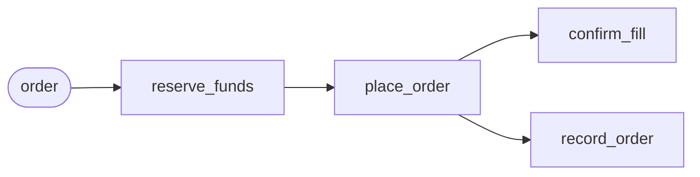

# Workflows

A workflow is a piece of work made of steps that run in a fixed order: reserve
the money, place the order, confirm the fill. In Flezha a workflow is a
relay whose class runs in steps (`run: steps`). Each step is a tasklet, and
the relay's graph says which step feeds which.

Running in steps gives a workflow three things a stream does not have. Each
finished step is written down before the next one starts, so after a crash the
work carries on from the step it had reached and the steps before it do not
run again. A step that fails for good undoes the steps that finished, last one
first, so half-done work is not left behind. And an instance has an end: it
stops by itself once its last step has run.

One instance is one piece of work. A hundred orders are a hundred instances
of the same factory, each with its own state, which do not get in each other's
way.

**Contents**

1. [How it works](#how-it-works)
2. [Configure it](#configure-it)
3. [A step that can be undone](#a-step-that-can-be-undone)
4. [A step that fails](#a-step-that-fails)
5. [Undoing: `undo_all` and `keep_progress`](#undoing-undo_all-and-keep_progress)
6. [Connect the steps](#connect-the-steps)
7. [One instance per piece of work](#one-instance-per-piece-of-work)
8. [Starting one from a tasklet](#starting-one-from-a-tasklet)
   1. [Spawn or deliver](#spawn-or-deliver)
   2. [Permission to spawn](#permission-to-spawn)
   3. [Reading the result of a spawn](#reading-the-result-of-a-spawn)
   4. [Example: one order per buy](#example-one-order-per-buy)
   5. [Replays and crash re-runs](#replays-and-crash-re-runs)
   6. [Dangers of a spawn without an id](#dangers-of-a-spawn-without-an-id)
9. [Crashes and resuming](#crashes-and-resuming)
10. [Sleeping when idle](#sleeping-when-idle)
11. [After it ends](#after-it-ends)
12. [How many instances a runner holds](#how-many-instances-a-runner-holds)
13. [Limits and gotchas](#limits-and-gotchas)
14. [See also](#see-also)

## How it works



An instance takes its input as messages on its entry channels. The first one
can ride the start: `flz relay start --text`, a schedule's stored message,
or the payload of a tasklet's spawn. The instance then runs its steps:

1. **A step runs over what the step before it handed on.** Its cells run as a
   stream's cells do, in parallel, each on its own messages.
2. **A step commits when its last item has settled.** Its state changes and
   what it emitted are written down, and the controller records the step as
   done in the instance's journal.
3. **Only then do the steps it feeds see its output.** A step that two steps
   feed (a join) runs once both have committed, over the items of both. Steps
   side by side, like the two arms of a `branch`, run and commit independently.
4. **The instance ends** when every last step has committed, when a step calls
   `complete`, when a `chained` loop runs out of work, when `max_duration_ms`
   passes, or when it is stopped. Every one of these ends in one completion,
   with status `ok`, `error` or `cancelled`, and a result when a step gave one.

Because a step's output is held until its commit, it is known exactly which
steps are done when an instance stops half way, and that is where it resumes.

## Configure it

The class declares the run and its two members
([`relay_settings.md`](../../configuration/relay_settings.md)):

| Setting | Values | Default |
| --- | --- | --- |
| `each` | `once`: one pass over the first message, then the instance is over. `per_input`: one pass, an iteration, per message, for as long as the instance lives. `chained`: each pass's last handoff feeds the next pass, and the loop ends on an empty one. | `once` |
| `on_failure` | `undo_all`: every finished step is undone. `keep_progress`: committed iterations are kept, and only the one in flight is undone. | `undo_all` |
| `max_duration_ms` | a wall-clock stop, counted from the run's first bind, so a sleep, a restart or a move does not restart it; the instance unwinds and ends `cancelled` | none |
| `durable` | `local`, `remote` or `false` (in memory: a crash starts over) | `local` |
| `sleep_after` | an idle instance sleeps after this long | six hours |

What a loop reads:

- A `once` instance reads its one message. A second message to it is accepted
  and never read.
- A `per_input` instance reads one message per iteration, numbered from 0. An
  instance with no message waits.
- A `chained` instance reads its first message, then its own carry. A `chained`
  class whose last tasklet hands nothing on is refused at registration
  (`topology.chained_loop_terminal_without_handoff`): a crash would restart it empty and read that
  as finished.

A message sent while a pass runs is not dropped: it waits in the instance's
queue for the next pass. A due cell timer waits in the same queue, in arrival
order with the messages, and a `chained` loop's carry is fed only once nothing
else is queued. A class that declares no tasklet is refused
(`topology.no_tasklets`).

## A step that can be undone

A step gets an undo by declaring a `compensate` hook. A step without one is
skipped when the work is undone.

In the tradedesk example, `reserve_funds` puts the money for an order aside
under an id, and its undo releases the money by that id. The step writes the
id into its state, because that is where the undo can find it after a crash:
Flezha brings back a step's state, but not what it handed on, so the list of
outputs `compensate` receives can be empty on a resumed instance.

<!-- tabs-open -->

### Java

```java
// ReserveFunds.java: step one. Puts the money aside, and releases it on an undo.
@Tasklet.Spec(name = "reserve_funds")
public final class ReserveFunds implements Tasklet<OrderTicket, ReserveFunds.Reservation, ReserveFunds.Reserved> {
    ...
    // The step: reserve the money under an id, remember the id, and hand the order on.
    @Override
    public void run(OrderTicket order, Ctx<Reservation, Reserved> ctx) throws TaskletException {
        String id = "res-" + ctx.stableId();                 // the same id when the step runs again
        ctx.change(new Reserving(id));
        ctx.emit(new Reserved(order, id));
    }

    // The undo: release the money, by the id the state kept.
    @Override
    public void compensate(List<Reserved> completedOutput, Ctx<Reservation, Reserved> ctx) {
        System.out.println("[undo] released " + ctx.state().id);
    }
}
```

Full file: [`ReserveFunds.java`](https://github.com/flezha/flezha_java_sdk/blob/main/examples/tradedesk/src/main/java/com/flezha/examples/tradedesk/ReserveFunds.java).

### Rust

```rust
// src/reserve_funds.rs: step one. Puts the money aside, and releases it on an undo.
#[tasklet(name = "reserve_funds")]
impl Tasklet for ReserveFunds {
    type Input = OrderTicket;
    type Output = Reserved;
    type State = Reservation;
    type Change = Reserving;

    // The step: reserve the money under an id, remember the id, and hand the order on.
    fn run(&mut self, order: OrderTicket, ctx: &mut Ctx<'_, Self>) -> Result<(), TaskletError> {
        let id = format!("res-{}", ctx.stable_id()); // the same id when the step runs again
        ctx.change(Reserving(id.clone()));
        ctx.emit(Reserved {
            order,
            reservation_id: id,
        })
    }

    // The undo: release the money, by the id the state kept.
    fn compensate(
        &mut self,
        _: Vec<Arc<Reserved>>,
        ctx: &mut Ctx<'_, Self>,
    ) -> Result<(), TaskletError> {
        println!("[undo] released {}", ctx.state().id);
        Ok(())
    }
}
```

Full file: [`src/reserve_funds.rs`](https://github.com/flezha/flezha_rust_sdk/blob/main/examples/tradedesk/src/reserve_funds.rs).

### Node

```javascript
// reserve_funds.mjs: step one. Puts the money aside, and releases it on an undo.
export const ReserveFunds = defineTasklet({
  name: 'reserve_funds',

  // What this step remembers, and how the id is written down.
  initState: () => ({ id: '' }),
  applyChange: (state, change) => {
    state.id = change.id;
  },

  // The step: reserve the money under an id, remember the id, and hand the order on.
  run: (order, ctx) => {
    const id = `res-${ctx.stableId()}`; // the same id when the step runs again
    ctx.change({ id });
    ctx.emit({ order, reservationId: id });
  },

  // The undo: release the money, by the id the state kept.
  compensate: (_outputs, ctx) => {
    console.log(`[undo] released ${ctx.state.id}`);
  },
});
```

Full file: [`reserve_funds.mjs`](https://github.com/flezha/flezha_node_sdk/blob/main/examples/tradedesk/reserve_funds.mjs).

### Python

```python
# reserve_funds.py: step one. Puts the money aside, and releases it on an undo.
@flezha.tasklet(name="reserve_funds")
class ReserveFunds:
    # The step: reserve the money under an id, remember the id, and hand the order on.
    def run(self, order: OrderTicket, ctx: flezha.Ctx[Reservation, Reserved]) -> None:
        reservation_id = f"res-{ctx.stable_id()}"  # the same id when the step runs again
        ctx.change(Reserving(id=reservation_id))
        ctx.emit(Reserved(order=order, reservation_id=reservation_id))

    def apply_change(self, reservation: Reservation, change: Reserving) -> None:
        reservation.id = change["id"]

    # The undo: release the money, by the id the state kept.
    def compensate(self, outputs: list[Reserved], ctx: flezha.Ctx[Reservation, Reserved]) -> None:
        print(f"[undo] released {ctx.state.id}", flush=True)
```

Full file: [`reserve_funds.py`](https://github.com/flezha/flezha_python_sdk/blob/main/examples/tradedesk/reserve_funds.py).

### Ruby

```ruby
# reserve_funds.rb: step one. Puts the money aside, and releases it on an undo.
class ReserveFunds < Flezha::Tasklet
  tasklet_name "reserve_funds"

  # What this step remembers, and how the id is written down.
  def init_state(_cell_key) = { id: "" }
  def apply_change(state, change) = state[:id] = change[:id]

  # The step: reserve the money under an id, remember the id, and hand the order on.
  def run(order, ctx)
    id = "res-#{ctx.stable_id}" # the same id when the step runs again
    ctx.change({ id: id })
    ctx.emit({ order: order, reservation_id: id })
  end

  # The undo: release the money, by the id the state kept.
  def compensate(_outputs, ctx)
    puts "[undo] released #{ctx.state[:id]}"
  end
end
```

Full file: [`reserve_funds.rb`](https://github.com/flezha/flezha_ruby_sdk/blob/main/examples/tradedesk/reserve_funds.rb).

### PHP

```php
// src/ReserveFunds.php: step one. Puts the money aside, and releases it on an undo.
#[Task(name: 'reserve_funds')]
final class ReserveFunds extends Tasklet
{
    ...
    // The step: reserve the money under an id, remember the id, and hand the order on.
    public function run(mixed $input, Ctx $ctx): void
    {
        $id = 'res-' . $ctx->stableId();                     // the same id when the step runs again
        $ctx->change(['id' => $id]);
        $ctx->emit(['order' => $input, 'reservation_id' => $id]);
    }

    // The undo: release the money, by the id the state kept.
    public function compensate(array $outputs, Ctx $ctx): void
    {
        echo "[undo] released {$ctx->state['id']}\n";
    }
}
```

Full file: [`src/ReserveFunds.php`](https://github.com/flezha/flezha_php_sdk/blob/main/examples/tradedesk/src/ReserveFunds.php).

### Elixir

```elixir
# lib/tradedesk/reserve_funds.ex: step one. Puts the money aside, and releases it on an undo.
defmodule Tradedesk.ReserveFunds do
  use Flezha.SDK.Tasklet, name: "reserve_funds"
  ...
  @impl true
  def run(order, reservation, ctx) do
    # The same id when the step runs again.
    id = "res-" <> stable_id(ctx)
    emit(ctx, %{order: order, reservation_id: id})
    {:ok, reserving(reservation, ctx, id)}
  end

  # The undo: release the money, by the id the state kept.
  @impl true
  def compensate(_outputs, reservation, _ctx) do
    IO.puts("[undo] released #{reservation.id}")
    {:ok, reservation}
  end
end
```

Full file: [`lib/tradedesk/reserve_funds.ex`](https://github.com/flezha/flezha_elixir_sdk/blob/main/examples/tradedesk/lib/tradedesk/reserve_funds.ex).

<!-- tabs-close -->

Two things in this step matter for any workflow:

- **The stable id.** `stableId()` (`stable_id` in the snake-case SDKs) gives an
  id that stays the same when the step runs again, so a step that is retried
  or resumed after a crash reserves under the same id instead of reserving
  twice.
- **An undo can run twice**, when a crash comes in the middle of an undo, so it
  has to be safe to repeat.

`place_order`, the second step in the example, has the same shape: it places
the order under an id, writes the id into its state, and its `compensate`
cancels the order by that id. `record_order`, which books the order, has no
`compensate` on purpose: the book records what was tried, and an order that
was cancelled again was still tried.

## A step that fails

A step fails when its tasklet raises, throws or returns an error. A failed item
is retried in place, with the items queued behind it, over the state its failed
attempt already applied; what the failed attempt emitted is dropped, never
emitted twice. The retry settings belong to the edge that feeds the step:

| Setting on the edge | Default | What it does |
| --- | --- | --- |
| `retry_max(n)` (`retryMax`) | 3 | Attempts in all, the first run included. `1` fails at once; `0` is refused (`topology.retry_max_zero`). |
| `retry_backoff_ms(ms)` (`retryBackoffMs`) | 50 | Attempt `n` waits `base x 2^(n-1)`, plus or minus 50 % jitter, at most 5 s. The wait holds no thread. |

A non-retryable error skips the retries: `TaskletError::non_retryable(..)` in
Rust, an error carrying `nonRetryable: true` in Node, `NonRetryableError` in
Python, `Flezha::NonRetryableError` in Ruby, and an
`{:error, {:non_retryable, reason}}` answer in Elixir. Every other error is
retried, a panic included.

When the attempts run out, the step fails. Where a stream would set the
message aside in the dead-letter queue and go on, a workflow ends in failure,
status `error`, and undoes what it did. A stop, `max_duration_ms` or a failed
step beside it cancels any retry still waiting.

In the tradedesk example, `confirm_fill` asks a demo exchange whether the
order filled. The exchange answers after ten seconds and fills at most 100 at a
time, so a bigger order fails here, three times, and is then undone. When the
fill is confirmed, the step ends the whole instance with its result through
`complete`.

<!-- tabs-open -->

### Java

```java
// ConfirmFill.java: asks the exchange whether the order filled, and ends the order with the answer.
@Override
public void run(PlacedOrder placed, Ctx<Void, Void> ctx) throws TaskletException {
    ...
    int quantity = placed.order().quantity();
    if (quantity > EXCHANGE_MAX) {
        throw new TaskletException(                      // tried again, then the order is undone
                "the exchange fills at most " + EXCHANGE_MAX + " a time, and this is " + quantity);
    }
    ctx.complete("filled " + placed.order().symbol() + " " + quantity + " as " + placed.orderId());
}
```

Full file: [`ConfirmFill.java`](https://github.com/flezha/flezha_java_sdk/blob/main/examples/tradedesk/src/main/java/com/flezha/examples/tradedesk/ConfirmFill.java).

### Rust

```rust
// src/confirm_fill.rs: asks the exchange whether the order filled, and ends the order with the answer.
fn run(&mut self, placed: PlacedOrder, ctx: &mut Ctx<'_, Self>) -> Result<(), TaskletError> {
    std::thread::sleep(Duration::from_secs(10)); // the paper exchange takes ten seconds to answer
    let quantity = placed.order.quantity;
    if quantity > EXCHANGE_MAX {
        return Err(TaskletError::Custom(format!(
            "the exchange fills at most {EXCHANGE_MAX} a time, and this is {quantity}"
        ))); // tried again, then the order is undone
    }
    ctx.complete(format!(
        "filled {} {quantity} as {}",
        placed.order.symbol, placed.order_id
    ))
}
```

Full file: [`src/confirm_fill.rs`](https://github.com/flezha/flezha_rust_sdk/blob/main/examples/tradedesk/src/confirm_fill.rs).

### Node

```javascript
// confirm_fill.mjs: asks the exchange whether the order filled, and ends the order with the answer.
run: async (placed, ctx) => {
  await sleep(10_000); // the paper exchange takes ten seconds to answer
  const { symbol, quantity } = placed.order;
  if (quantity > EXCHANGE_MAX) {
    // tried again, then the order is undone
    throw new Error(`the exchange fills at most ${EXCHANGE_MAX} a time, and this is ${quantity}`);
  }
  ctx.complete(`filled ${symbol} ${quantity} as ${placed.orderId}`);
},
```

Full file: [`confirm_fill.mjs`](https://github.com/flezha/flezha_node_sdk/blob/main/examples/tradedesk/confirm_fill.mjs).
The wait is awaited, so it holds nothing: other cells keep running while it is
pending. A blocking wait would hold the runner's one event loop.

### Python

```python
# confirm_fill.py: asks the exchange whether the order filled, and ends the order with the answer.
def run(self, placed: PlacedOrder, ctx: flezha.Ctx[None, None]) -> None:
    time.sleep(10)  # the paper exchange takes ten seconds to answer
    quantity = placed["order"]["quantity"]
    if quantity > EXCHANGE_MAX:  # tried again, then the order is undone
        raise RuntimeError(
            f"the exchange fills at most {EXCHANGE_MAX} a time, and this is {quantity}"
        )
    ctx.complete(f"filled {placed['order']['symbol']} {quantity} as {placed['order_id']}")
```

Full file: [`confirm_fill.py`](https://github.com/flezha/flezha_python_sdk/blob/main/examples/tradedesk/confirm_fill.py).
The wait holds one worker of the default thread executor. When every worker
has been busy for 100 ms the runner adds one, up to `FLEZHA_WORKER_POOL_MAX`
(ten times the processor count by default).

### Ruby

```ruby
# confirm_fill.rb: asks the exchange whether the order filled, and ends the order with the answer.
def run(placed, ctx)
  sleep 10                                                 # the paper exchange takes ten seconds to answer
  quantity = placed[:order][:quantity]
  if quantity > EXCHANGE_MAX                               # tried again, then the order is undone
    raise "the exchange fills at most #{EXCHANGE_MAX} a time, and this is #{quantity}"
  end

  ctx.complete("filled #{placed[:order][:symbol]} #{quantity} as #{placed[:order_id]}")
end
```

Full file: [`confirm_fill.rb`](https://github.com/flezha/flezha_ruby_sdk/blob/main/examples/tradedesk/confirm_fill.rb).
Under the default thread executor the wait holds one worker, up to
`FLEZHA_WORKER_POOL_MAX`; under the fiber executor
(`FLEZHA_RUBY_EXECUTOR=fibers`, with the `async` gem) `sleep` yields its fiber
and holds nothing.

### PHP

```php
// src/ConfirmFill.php: asks the exchange whether the order filled, and ends the order with the answer.
public function run(mixed $input, Ctx $ctx): void
{
    $ctx->change($input);
    $ctx->timerAfter(10_000);                            // the paper exchange answers ten seconds later
}

public function onTimer(TimerFiring $timer, Ctx $ctx): void
{
    $placed = $ctx->state['placed'];
    $quantity = $placed['order']['quantity'];
    if ($quantity > self::EXCHANGE_MAX) {
        throw new \RuntimeException(                     // tried again, then the order is undone
            'the exchange fills at most ' . self::EXCHANGE_MAX . " a time, and this is $quantity",
        );
    }
    $ctx->complete("filled {$placed['order']['symbol']} $quantity as {$placed['order_id']}");
}
```

Full file: [`src/ConfirmFill.php`](https://github.com/flezha/flezha_php_sdk/blob/main/examples/tradedesk/src/ConfirmFill.php).
A PHP runner serves every relay on one thread, so the step waits with a
cell timer instead of a sleep. The timer is saved with the cell and fires after
a crash too. An exception from `onTimer` is retried as one from `run` is, but
at once rather than ten seconds apart.

### Elixir

```elixir
# lib/tradedesk/confirm_fill.ex: asks the exchange whether the order filled, and ends the order with the answer.
@impl true
def run(%{order: order, order_id: order_id}, state, ctx) do
  # The paper exchange takes ten seconds to answer. Only the worker running
  # this order waits; the runner's other workers keep serving every other cell.
  Process.sleep(10_000)

  if order.quantity > @exchange_max do
    # Tried again, then the order is undone.
    {:error,
     "the exchange fills at most #{@exchange_max} a time, and this is #{order.quantity}"}
  else
    complete(ctx, "filled #{order.symbol} #{order.quantity} as #{order_id}")
    {:ok, state}
  end
end
```

Full file: [`lib/tradedesk/confirm_fill.ex`](https://github.com/flezha/flezha_elixir_sdk/blob/main/examples/tradedesk/lib/tradedesk/confirm_fill.ex).

<!-- tabs-close -->

## Undoing: `undo_all` and `keep_progress`

When a workflow ends in failure, or is stopped, its finished steps are undone
in reverse order: a join before the steps that fed it, a shared first step
last, independent branches in no fixed order relative to each other. Each
`compensate` runs once per cell that did something. A failing `compensate` is
logged and the rest of the undo still runs. A workflow that ends `ok` undoes
nothing.

A step still running when the instance fails is undone too, since it may have
done something, and is not committed. A stop takes the same path, and the undo
is not cut short by the stop, because the undo is the answer to it.

`on_failure` decides how far back the undo goes:

- **`undo_all`** undoes every finished step of every iteration. For a `once`
  workflow this is the whole instance.
- **`keep_progress`** keeps every committed iteration and undoes only the one
  in flight. For a `once` workflow the two are the same.

**A failed turn of a `keep_progress` session.** In a `per_input` loop with
`keep_progress`, a turn whose step runs out of attempts, or raises a
non-retryable error, ends only that turn, the way a stream sets a poison
message aside and goes on:

1. The pass stops, and nothing it had not committed is kept.
2. The turn's message is parked in the dead-letter queue, under the relay's
   `_turn` slot, with the entry channel, its offset and its exact bytes.
3. The turn's committed steps are undone, each `compensate` once.
4. The next message runs as the next iteration.

`flz dlq replay` sends the parked message back to the session as a new message.
A crash anywhere in this resumes it, and the message is parked at most once. A
class kept in memory parks the turn without its bytes. The failed turn shows
up as `Failed turns: <count> (last: iteration <n>)` in `flz relay info`, a
`dead_lettered` row in `flz state journal`, the
`flezha_steps_turns_dead_lettered_total` metric and a warning line.

Everything else still ends a `keep_progress` session: a `once` or `chained`
loop, a pass a timer opened, a commit the controller refuses, a stop and
`max_duration_ms`.

**Going back on purpose.** `flz relay rewind <instance> --to-iteration N`
takes a loop back to a committed iteration: it keeps iteration `N` and every
earlier one, undoes every later one newest first, and the next message becomes
iteration `N + 1`. The undone messages are not run again. A rewind is refused,
before anything changes, when `N` is not a committed iteration (the refusal
names the committed range) and when a step above `N` wrote plugin output and
declares no `compensate` (the refusal names the channels). A step without a
`compensate` keeps its state change. [`sessions.md`](sessions.md#rewinding-a-turn)
walks through it.

**A partitioned loop.** Each member of a partitioned `per_input` workflow
undoes its own passes only. A rescale seals every member's journal at its
latest committed iteration, so after a rescale `undo_all` undoes only the
iterations committed since, and a rewind below the seal is refused with the
committed range. The scale command names the members it sealed. A loop whose
passes must stay undoable across a rescale must not be rescaled.

## Connect the steps

The graph of a workflow is built with the same calls as a stream's
([`streams.md`](streams.md)): `input` names the entry channel, `into` adds a
step, `branch` splits the path into arms that run side by side. There is
usually no `output`: the last step ends the instance with its result through
`complete`, and `flz relay info` shows it. A channel between steps that has
no name of its own is named after the step that feeds it, which is the name in
the journal and in an error; `named(...)` gives one a stable name.

<!-- tabs-open -->

### Java

```java
// OrderExecutorRelay.java: the workflow's steps, in the order they run.
@Override
public void channels(@Nonnull ChannelBuilder c) {
    c.input(OrderTicket.class, "order")
            .into(ReserveFunds.class)                                  // step one
            .into(PlaceOrder.class)                                    // step two, once step one is done
            .branch(
                    fill -> fill.into(ConfirmFill.class),              // two arms, side by side
                    book -> book.into(RecordOrder.class));
}
```

Full file: [`OrderExecutorRelay.java`](https://github.com/flezha/flezha_java_sdk/blob/main/examples/tradedesk/src/main/java/com/flezha/examples/tradedesk/OrderExecutorRelay.java).

### Rust

```rust
// src/order_executor.rs: the workflow's steps, in the order they run.
fn channels(c: &ChannelBuilder) {
    c.input::<OrderTicket>("order")
        .into::<ReserveFunds>() // step one
        .into::<PlaceOrder>() // step two, once step one is done
        .branch([
            &|fill| {
                fill.into::<ConfirmFill>(); // two arms, side by side
            },
            &|book| {
                book.into::<RecordOrder>();
            },
        ]);
}
```

Full file: [`src/order_executor.rs`](https://github.com/flezha/flezha_rust_sdk/blob/main/examples/tradedesk/src/order_executor.rs).

### Node

```javascript
// order_executor_relay.mjs: the workflow's steps, in the order they run.
channels: (c) => {
  c.input('order')
    .into(ReserveFunds) // step one
    .into(PlaceOrder) // step two, once step one is done
    .branch([
      (fill) => fill.into(ConfirmFill), // two arms, side by side
      (book) => book.into(RecordOrder),
    ]);
},
```

Full file: [`order_executor_relay.mjs`](https://github.com/flezha/flezha_node_sdk/blob/main/examples/tradedesk/order_executor_relay.mjs).

### Python

```python
# order_executor.py: the workflow's steps, in the order they run.
(
    c.input("order")
    .into(ReserveFunds)  # step one
    .into(PlaceOrder)  # step two, once step one is done
    .branch(
        lambda fill: fill.into(ConfirmFill),  # two arms, side by side
        lambda book: book.into(RecordOrder),
    )
)
```

Full file: [`order_executor.py`](https://github.com/flezha/flezha_python_sdk/blob/main/examples/tradedesk/order_executor.py).

### Ruby

```ruby
# order_executor_relay.rb: the workflow's steps, in the order they run.
channels do |c|
  c.input("order")
   .into(ReserveFunds)                                     # step one
   .into(PlaceOrder)                                       # step two, once step one is done
   .branch(
     ->(fill) { fill.into(ConfirmFill) },                  # two arms, side by side
     ->(book) { book.into(RecordOrder) }
   )
end
```

Full file: [`order_executor_relay.rb`](https://github.com/flezha/flezha_ruby_sdk/blob/main/examples/tradedesk/order_executor_relay.rb).

### PHP

```php
// src/OrderExecutorRelay.php: the workflow's steps, in the order they run.
public static function channels(Builder $c): void
{
    $c->input('order')
        ->into(ReserveFunds::class)                               // step one
        ->into(PlaceOrder::class)                                 // step two, once step one is done
        ->branch(
            fn (Edge $fill) => $fill->into(ConfirmFill::class),   // two arms, side by side
            fn (Edge $book) => $book->into(RecordOrder::class),
        );
}
```

Full file: [`src/OrderExecutorRelay.php`](https://github.com/flezha/flezha_php_sdk/blob/main/examples/tradedesk/src/OrderExecutorRelay.php).

### Elixir

```elixir
# lib/tradedesk/order_executor.ex: the workflow's steps, in the order they run.
@impl true
def channels(c) do
  c
  |> input_with("order", &OrderTicket.decode/1)
  |> into(Tradedesk.ReserveFunds)
  |> into(Tradedesk.PlaceOrder)
  |> branch([&into(&1, Tradedesk.ConfirmFill), &into(&1, Tradedesk.RecordOrder)])
end
```

Full file: [`lib/tradedesk/order_executor.ex`](https://github.com/flezha/flezha_elixir_sdk/blob/main/examples/tradedesk/lib/tradedesk/order_executor.ex).

<!-- tabs-close -->

In this graph both arms of the `branch` get the same placed order. If
`confirm_fill` fails, the instance fails as a whole, so the steps before it
are undone even though `record_order` beside it succeeded.

## One instance per piece of work

A workflow's factory is registered on a runner like any other, and an instance
is started per piece of work: by hand with `flz relay start`, on a schedule
with `flz schedule add`, or from a running tasklet. In the tradedesk example
the ETL stream starts one `order_executor` for every buy, handing it the order
as its first message ([below](#starting-one-from-a-tasklet)):

```sh
$ flz relay start order_executor --text '{"symbol": "EUR/USD", "quantity": 10}' --channel order
```

A start without `--id` that is retried after a lost reply starts a second
instance, which here would be a second order. Pass `--id` when a start may be
retried ([`running_and_testing.md`](running_and_testing.md)).

## Starting one from a tasklet

A running tasklet can start a workflow with one call: `ctx.spawn_steps`. A stream that
watches prices can start one order workflow per buy; a router can start one triage job per
ticket, or hand a ticket to the job already working on its subject. The tasklet may belong to a
flow or a steps relay; what it starts is always a steps relay, in the tasklet's own
namespace.

The call is spawn-**or**-deliver: given an id that is free, it starts an instance there with the
payload as its first message; given an id that is taken, it delivers the payload to the running
instance as one more message. Without an id, it always starts a new instance under a generated
id.

| | |
|---|---|
| Callable from | any tasklet's `run`, in a flow or a steps relay |
| Starts | a **steps relay** only; flow relays are started and kept running by the controller |
| Namespace | the requester's, always; a tasklet cannot reach another namespace |
| Verb | spawn-or-deliver on (namespace, id); with no id, always a spawn under a generated id |
| Blocking | never: the call returns a handle before the controller decides |
| Failure | isolated: a refusal never fails `run`, its emits or its journaling |
| Replay | live processing only; a replayed invocation issues nothing |

The request goes to the controller, which judges and records it the way `flz relay start`
is, so the instance it starts is an ordinary steps relay: namespace quota (`max_relays`,
`max_cells_per_relay`), durable input log, sleeping and waking, its end and teardown,
retention, and a row in `flz relay list`. A delivery is judged as `flz relay send` is,
and recorded only when refused, because it happens once per event.

The payload is the new instance's first message by construction: it is taken in as the instance
binds, ahead of anything else in its mailbox, through the same entrance every message takes. It
names no channel, so it enters the first declared entry channel, is decoded by that channel's
codec or parser, and runs the chain that channel starts, whichever way the relay loops. Every
SDK encodes it the way an output with no codec encodes a value, the rule `ctx.complete` uses:
bytes as they are, a string as UTF-8, anything else as JSON, so a `text` or `json` entry reads
it. A spawn over the durable state an earlier run of that id left (its input log already holds
records) takes the payload after that state, not ahead of it, and a restart of a durable instance
never takes it again; an instance without a durable input log restarts empty and takes it again.

The factory is looked up cluster-wide: a controller with no runner for it routes the request to
one that has one, so `relay.factory_unknown` means no runner anywhere serves it.

### Spawn or deliver

The factory and the payload come first; the id and the policy are optional:

| SDK | Spawn | With an id and a policy |
| --- | --- | --- |
| Rust | `ctx.spawn_steps("triage", bytes)` | `ctx.spawn_steps_with("triage", bytes, SpawnOptions::id(id).if_running(IfRunning::Deliver))` |
| Java | `ctx.spawnSteps("triage", input)` | `ctx.spawnSteps("triage", input, SpawnOptions.id(id).ifRunning(IfRunning.DELIVER))` |
| Node | `ctx.spawnSteps('triage', payload)` | `ctx.spawnSteps('triage', payload, { id, ifRunning: 'deliver' })` |
| Python | `ctx.spawn_steps("triage", payload)` | `ctx.spawn_steps("triage", payload, id=id, if_running="deliver")` |
| Ruby | `ctx.spawn_steps("triage", payload)` | `ctx.spawn_steps("triage", payload, id: id, if_running: "deliver")` |
| PHP | `$ctx->spawnSteps('triage', $payload)` | `$ctx->spawnSteps('triage', $payload, id: $id, ifRunning: 'deliver')` |
| Elixir | `spawn_steps(ctx, "triage", input)` | `spawn_steps(ctx, "triage", input, id: id, if_running: :deliver)` |

Rust and Java build the options only from an id, so a policy without an id cannot be written
there; in the other five the core refuses it at the call with `spawn.if_running_without_id`, and
nothing is sent.

What the call does:

| The id is | policy `deliver` | policy `error` |
|---|---|---|
| not given | spawned under a generated id | (no policy without an id) |
| free | spawned; the payload is the first message | spawned |
| taken | delivered; the payload is one more message | refused, `relay.already_running` |

A generated id is the factory id, shortened to fit the 32-byte limit, a `-` and 16 characters of
time and randomness, such as `triage-k7m2qzxw4pd3fn2a`.

Concurrent requests for one id resolve to **exactly one** spawn, and deliveries for the rest. A
completed instance's id counts as free again, so a request arriving after the instance finished
starts a fresh one: make the started relay safe to run twice for the same work.

### Permission to spawn

With authorization on, the runner's connection acts as `runner@<namespace>` and needs a role
that grants the start. Bind it to `spawner`:

```sh
$ flz role bind runner@trading spawner trading
```

```output
bound runner@trading as spawner@trading
runner@trading  spawner@trading
```

`spawner` also lets that connection call `Relay.start` and `Relay.send` on the
administration surface, and nothing else (see [authorization](authorization.md)).

### Reading the result of a spawn

Every failure resolves the handle, never `run`. Reading the handle is optional; each SDK has a
read that waits and one that never waits:

| SDK | Waits | Never waits |
|---|---|---|
| Rust | `wait()` | `try_result()` |
| Java | `await()` | `tryResult()` |
| Node | `await wait()` | `tryResult()` |
| Python, Ruby | `wait` | `try_result` |
| PHP | `wait()` | `tryResult()` |
| Elixir | `Flezha.SDK.Spawn.await/2` | `Flezha.SDK.Spawn.try_result/1` |

A resolved read carries the id the request resolved to (given or generated) and the outcome,
`spawned` or `delivered`. A failure comes out of the read in the form that SDK reports errors (a
returned error, a thrown exception, a rejected promise), never out of the spawn call. The read
that never waits answers that the result is pending until it has arrived.

| Code | Meaning |
|---|---|
| `relay.already_running` | the id is taken and the policy is `error` |
| `relay.factory_unknown` | no connected runner on any controller registers that factory |
| `relay.factory_not_steps` | the factory's runners announced it as a flow relay; decided before anything is placed |
| `authz.role_insufficient` and other `authz.*` codes | authorization is on and `runner@<namespace>` holds no role that grants the spawn |
| `quota.exceeded`, and the controller's other codes | quota used up, controller shutting down, start failed |
| `spawn.timeout` | no answer within 30 seconds |
| `spawn.unavailable` | no control plane to ask: the runner is closed or has no controller |

Read a handle inside the invocation that made it, or not at all. A handle nobody read by the end
of its invocation reports a failure once, as a warning line naming the instance id (empty when
none was given), the factory and the reason, and a later read answers that it was released. In
Elixir the answer is a message to the process that made the request, so an answer arriving
after `run/3` returned is dropped, and the warning is what reaches you.

### Example: one order per buy

In the tradedesk example, `buy_above_average` starts one `order_executor` workflow per buy. The
order is the workflow's first message. It passes no id, so each buy starts a new instance:

<!-- tabs-open -->

### Java

```java
// BuyAboveAverage.java: buys when a price is far enough above its average.
        int quantity = (int) Math.round(percent * UNITS_PER_PERCENT);   // a stronger move buys more

        ctx.spawnSteps("order_executor", new OrderTicket(move.symbol(), quantity));   // one steps relay per order
```

[Full file](https://github.com/flezha/flezha_java_sdk/blob/main/examples/tradedesk/src/main/java/com/flezha/examples/tradedesk/BuyAboveAverage.java)

### Rust

```rust
// buy_above_average.rs: buys when a price is far enough above its average.
        let ticket = OrderTicket {
            symbol: m.symbol.clone(),
            quantity,
        };
        let order = serde_json::to_vec(&ticket).map_err(|e| TaskletError::Custom(e.to_string()))?;
        let _ = ctx.spawn_steps("order_executor", order); // one steps relay per order
```

[Full file](https://github.com/flezha/flezha_rust_sdk/blob/main/examples/tradedesk/src/buy_above_average.rs)

### Node

```js
// buy_above_average.mjs: buys when a price is far enough above its average.
    const order = { symbol: move.symbol, quantity };
    ctx.spawnSteps('order_executor', order); // one steps relay per order
```

[Full file](https://github.com/flezha/flezha_node_sdk/blob/main/examples/tradedesk/buy_above_average.mjs)

### Python

```python
# buy_above_average.py: buys when a price is far enough above its average.
        order = OrderTicket(symbol=move["symbol"], quantity=quantity)
        ctx.spawn_steps("order_executor", order)  # one steps relay per order
```

[Full file](https://github.com/flezha/flezha_python_sdk/blob/main/examples/tradedesk/buy_above_average.py)

### Ruby

```ruby
# buy_above_average.rb: buys when a price is far enough above its average.
    order = { symbol: move[:symbol], quantity: quantity }
    ctx.spawn_steps("order_executor", order) # one steps relay per order
```

[Full file](https://github.com/flezha/flezha_ruby_sdk/blob/main/examples/tradedesk/buy_above_average.rb)

### PHP

```php
// BuyAboveAverage.php: buys when a price is far enough above its average.
        $order = ['symbol' => $input['symbol'], 'quantity' => $quantity];
        $ctx->spawnSteps('order_executor', $order);        // one steps relay per order
```

[Full file](https://github.com/flezha/flezha_php_sdk/blob/main/examples/tradedesk/src/BuyAboveAverage.php)

### Elixir

```elixir
# lib/tradedesk/buy_above_average.ex: buys when a price is far enough above its average.
      # One steps relay per order.
      spawn_steps(ctx, "order_executor", %{symbol: symbol, quantity: quantity})
```

[Full file](https://github.com/flezha/flezha_elixir_sdk/blob/main/examples/tradedesk/lib/tradedesk/buy_above_average.ex)

<!-- tabs-close -->

The order executor reads the order on its entry channel `order`, the first one it declares. The
runner's connection needs the `spawner` role in `trading` ([above](#permission-to-spawn)).

### Replays and crash re-runs

**A replay issues nothing.** A replayed invocation (a late-input correction re-running a slice of
history) answers the outcome `skipped_on_replay` without asking the controller, so a replay
never doubles the instances a run started. Its id is the one the call gave, or empty when it gave
none: a generated id existed only in the controller's answer to the live run.

**A crash re-run asks again and gets the same answer.** A crash re-run is not a replay: an input
the runner took but had not durably consumed is sent again and runs live, so its spawn is
requested again. Each request a tasklet makes carries an identity: the requesting cell, the
input-log offset it was taking, the call's position in the invocation, the factory and the
payload. The controller answers a request whose identity it has already resolved with the
instance the first request resolved to:

- **Without an id**, the generated id is derived from the identity, so the re-run resolves to the
  instance the first run started (`spawned`, whether it still runs or has completed).
- **With an id**, a delivery into the running instance carries the identity as its message id,
  so the instance's input log drops the second delivery and the instance receives the payload
  once.

A re-run that asks for a different factory or payload at the same position is a new request and
spawns anew. An invocation that took no input offset (a timer firing, or an input to a relay
with no durable input log) carries no identity, and neither does a start from the CLI, the
administration API or a schedule.

### Dangers of a spawn without an id

- **It always starts a new instance.** It can never deliver into a running one, because there is
  no id to find it by.
- **Asked again in the same invocation after a lost or timed-out answer, it starts a second
  instance.** The second request is a later call, so its identity differs from the first's.
- **Skipped on replay, it answers an empty id.** The id was generated during the live run.

A caller that needs at most one instance, or the id on replay, passes its own id.

## Crashes and resuming

A crashed instance resumes on a runner, the same one restarted or another:
the steps the journal records as committed are skipped, the first one not
committed is fed the handoff the journal kept, and only the step in flight at
the crash runs again. An undo in flight at the crash resumes where it was.

This is at-least-once execution: a step, and an undo, can run more than once.
Write both so that running them twice does the same as once, with a stable id
as `reserve_funds` does, and keep what the undo needs in the step's state.

## Sleeping when idle

A workflow kept on disk sleeps after six idle hours unless its class sets
`sleep_after` (or `false`, never). An instance sleeps only at a committed
boundary with every cell drained and nothing queued. It then leaves its runner,
and wakes with its state on its next message, at its earliest pending timer, or
when it is stopped. While it sleeps:

| Surface | While asleep |
| --- | --- |
| `flz relay info` | phase `suspended` |
| `flz state get` | refused: no live cell |
| `flz relay stop` | wakes it onto a runner with the stop carried, and it ends `cancelled` with its record kept, as it would awake. With no runner to wake on, it is removed hard |
| the input-silence check | does not flag it |
| removing its factory from the runner | succeeds, because the runner cannot see a sleeping instance; the instance then cannot wake until a runner registers the factory again, and the controller logs `dropped factory ... that still has controller-known relays` |

`flz state journal <relay/instance>` shows the journal, and
`flz state inbox <relay/instance>` the input log's records. `flz relay replay`
is refused for a workflow's cell; `flz relay rewind` is a loop's way back. How
an instance sleeps and wakes: [the relay lifecycle](https://github.com/flezha/flezha/blob/main/docs/internal/architecture/relay_lifecycle.md).

## After it ends

A finished instance's completion record (status, error, result, finish time)
and state are kept for a while: `flz relay info <id>` shows phase
`finished` with the status, result and finish time. They are removed once the
retention window has passed.

`FLEZHA_STEPS_RETENTION_HOURS` sets `:default_relay_completed_retention_hours`,
the retention every class takes; `flz relay list` keeps a finished instance for
the same window.

Its type and default are in [Controller environment variables](../../configuration/environment_variables.md#every-variable)
and [Application env keys](../../configuration/application_env.md#every-key).

A workflow's cell keeps point-in-time history for
`time_travel_retention_hours`, like a stream's; set it to `0` for a class that
needs only its latest snapshot. A class kept in memory leaves no state to keep.

## How many instances a runner holds

An instance holds no thread. A waiting instance costs its memory and nothing
else, about 61 KiB each, measured with 10 000 instances on 8 cores and
32 GiB:

| 10 000 instances | blocked in a step | waiting for a message |
| --- | --- | --- |
| memory per instance | about 61 KiB | about 61 KiB |
| threads per instance | 0 | 0 |
| CPU while blocked | 0 % | 0 % |
| start / teardown | 0.35 s / 0.06 s | 0.35 s / 0.03 s |
| an unrelated instance's p99 beside them | 0.8x its unloaded latency | 0.9x |

Size a runner by what its steps hold, not by its instances. A step blocked on
a slow call holds the SDK worker running it and one in-flight slot:
`FLEZHA_MAX_INFLIGHT_ACTIVATIONS` (1 024 by default) bounds how many cells run
at once, so a runner meant to hold more blocked steps than that raises it with
its worker pool. `max_duration_ms` costs no thread either.

## Limits and gotchas

- **Keep bulk data out of handoffs.** A journal entry is at most 16 MiB
  (`:wal_high_watermark_bytes`). Keep large data in cell state and hand on
  references.
- **Many small workflows grow the disk.** Keep fire-and-forget work in memory
  (`durable: false`), or lower `FLEZHA_STEPS_RETENTION_HOURS`. Steps are not
  the high-throughput path; a stream is.
- **Not idempotent means doubled.** A step that is not safe to repeat can act
  twice after a crash. Write it idempotently, or keep the work in memory so a
  crash starts it over from a clean slate.
- **Stop runners gracefully.** A graceful stop lets a running instance move to
  another runner; a SIGKILL forces a crash-resume
  ([`deploying_a_controller.md`](../deploying/deploying_a_controller.md#graceful-shutdown)).
- **A sleeping instance costs a wake to stop**, as the table above says.
- **A `compensate` hook has no timers**: a rollback is not a place to arm one
  ([`timers.md`](timers.md)).
- **There is no platform retry of a failed instance.** An instance that ends
  `error` stays ended; retries happen per step, before the instance fails.
- **A faulty tasklet can spawn in a loop.** The namespace quota is the backstop; there is no
  per-requester rate limit. The telemetry event `[:flezha, :relay, :requested_spawn]`
  carries `namespace`, `instance_id` (the id the request resolved to), `factory_id` and
  `outcome` for each request, for rate alerts.
- **A runner cut off from its controller fails a spawn later**, like any control-plane
  request (`spawn.timeout` or `spawn.unavailable`).
- **Spawning with the id of an instance that just completed starts a fresh one** instead of
  delivering.
- **A spawn never crosses namespaces**, and has no journal of its own; scheduling is
  `flz schedule`'s job.

## See also

- [`relay_settings.md`](../../configuration/relay_settings.md): the settings tree, and `run: steps` in it.
- [`streams.md`](streams.md): the graph builder, and the run a workflow is not.
- [`state.md`](state.md): a step's state and how it comes back.
- [`durability.md`](durability.md): what each `durable` level keeps through a crash.
- [`running_and_testing.md`](running_and_testing.md): start, stop, info.
- [`sessions.md`](sessions.md): a workflow that runs once per message, and rewinding a turn.
- [`timers.md`](timers.md), [`authorization.md`](authorization.md): the `spawner` role.
- [Relay settings](../../configuration/relay_settings.md#channel-and-edge-options): edge options, retry included.
- [The steps relay internals](https://github.com/flezha/flezha/blob/main/docs/internal/resilience/steps_relay.md): how the controller and the runner carry it out.
- Tutorial: [`place_orders.md`](tutorials/place_orders.html) builds `order_executor`.
