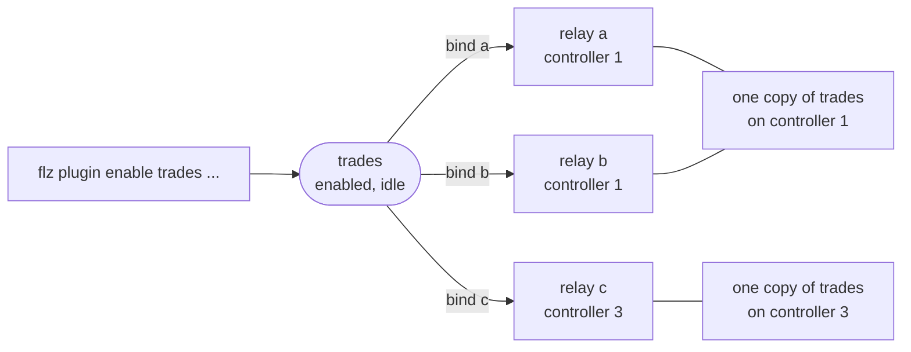

# Plugins

A plugin connects a relay to something outside Flezha: a file, a websocket, an HTTP
endpoint, Kafka, a database. It runs in the controller, at the edge of the relay. A
**source** plugin feeds one of the relay's entry channels, and a **output plugin** plugin takes
what the relay sends out on one of its output plugins. A third sort, the controller plugin, is
bound to no relay at all: it is told what happens in a namespace.

Plugins exist so that a relay's code never names where its data comes from or goes.
A relay declares where data comes in and goes out, and a user decides what is on the
other side. The same relay reads from a file today and from Kafka tomorrow with no
rebuild, and a plugin can be added, changed or removed while the relay runs.

## How it works

A plugin goes through three steps, each its own act:

1. **Installed.** A controller has a provider when its release ships it (the built-in
   plugins) or when a plugin package that provides it is installed on that controller. A
   package is installed per controller, through `FLEZHA_PLUGINS` or `flz plugin install`,
   and loaded when the controller starts; [`installing_plugins.md`](installing_plugins.md)
   covers it.
2. **Enabled.** `flz plugin enable <name> <provider>` records a plugin under a name of its
   own in a namespace, with its options, for the whole cluster. No relay is named and
   nothing starts: the plugin is listed `idle`. It survives a controller restart and a
   whole-cluster cold start.
3. **Bound.** `flz plugin bind <name> --relay_id <op>` connects a relay to the
   plugin. The plugin starts where that relay runs. A binding travels with its
   relay through a move, a restart and a cold start.

## Two types

| Type | Bound to | Runs |
| --- | --- | --- |
| relay plugin | one or more relays | on each controller where a relay bound to it runs, and nowhere else; stops when no bound relay runs there, and stays enabled |
| controller plugin | no relay | on every controller that holds its namespace, from its enable until it is disabled; it never stops for want of relays |

Every catalogue page in [`docs/public/plugins/`](https://github.com/flezha/flezha/tree/main/docs/public/plugins) says which type a plugin is. A
controller plugin is enabled with its hooks and is told what happened through them;
[`hooks.md`](hooks.md) covers it. The other pages of this section are
about relay plugins.

## In this section

1. [Where a plugin runs](where_plugins_run.md): shared and `single` copies, partitioned
   relays, when a copy stops, a controller without the provider, and durability
2. [Enabling and binding](enabling_and_binding.md): the commands, their flags, hooks,
   changing a running plugin and seeing what runs
3. [Plugins from your own code](plugins_from_code.md): the same acts from an SDK's admin
   handle
4. [Plugin examples](plugin_examples.md): a file in and a file out, a live feed into a
   partitioned relay, limits and gotchas
5. [Installing plugins](installing_plugins.md): plugin packages on a controller
6. [Hooks](hooks.md): every hook, and controller plugins
7. [Writing a plugin](writing_a_plugin.md): a plugin of your own

## The plugins that ship

| Plugin | Provider id | Connects | Type | Ships | Shareable | Partitioned relays |
|---|---|---|---|---|---|---|
| [File](../../plugins/file.md) | `relay_file_input`, `relay_file_output` | lines of a file in, one line per value out | relay | built in | no | allowed |
| [WebSocket](../../plugins/websocket_subscription.md) | `relay_websocket` | a live socket, both directions | relay | built in | yes | allowed |
| [HTTP poll](../../plugins/http_poll.md) | `relay_http_poll` | an HTTP resource as an input, whenever its answer changes | relay | built in | yes | allowed |
| [HTTP push](../../plugins/http_push.md) | `relay_http_push` | an HTTP endpoint as an output | relay | built in | yes | allowed |
| [Relay forward](../../plugins/relay_forward.md) | `relay_forward` | one relay's output into another's input | relay | built in | no | allowed |
| [Postgres output plugin](../../plugins/postgres_output.md) | `relay_postgres` | rows in a table as an output | relay | built in | no | allowed |
| [Postgres poll](../../plugins/postgres_poll.md) | `relay_postgres_poll` | a table as an input, read by polling | relay | built in | no | refused |
| [Webhook](../../plugins/hook_webhook.md) | `hook_webhook` | hook events to an HTTP endpoint | controller | built in | no | not applicable |
| [HTTP server](../../plugins/http_server.md) | `http_server` | a relay behind HTTP | relay | package `flezha_http` | no | refused |
| [HTTP API](../../plugins/http_api.md) | `http_api` | the controller's operations over HTTP, as MCP tools and plain JSON | controller | package `flezha_http` | no | not applicable |
| [Kafka producer](../../plugins/kafka_producer.md) | `kafka_producer` | a Kafka topic as an output | relay | package `flezha_kafka` | yes | allowed |
| [Kafka consumer](../../plugins/kafka_consumer.md) | `kafka_consumer` | Kafka topics as an input, read by a consumer group | relay | package `flezha_kafka` | no | refused |
| [RabbitMQ](../../plugins/rabbitmq.md) | `rabbitmq_consumer`, `rabbitmq_producer` | a queue as an input, an exchange as an output | relay | package `flezha_rabbitmq` | consumer no, producer yes | consumer refused, producer allowed |
| [Postgres change capture](../../plugins/postgres_cdc.md) | `postgres_cdc` | every row change of Postgres tables, from the write-ahead log | relay | package `flezha_postgres_cdc` | no | refused |

The release also carries providers Flezha uses for its own mechanisms, such as
`relay_stdout` and `relay_io_filter`. `flz plugin list --providers` lists every
provider a controller can enable, and ends with a line naming how many packages were
refused at boot.

## See also

- [`partitioning.md`](../core/partitioning.md): partitioned relays and their plugins
- [`durability.md`](../core/durability.md) and [`effectively_once.md`](../core/effectively_once.md): what an output plugin can promise
- [Controller environment variables](../../configuration/environment_variables.md): `FLEZHA_PLUGIN_IDLE_STOP_MS`, `FLEZHA_FILE_PLUGIN_ROOT` and the other plugin settings
- [`../../errors.md`](../../errors.md): every `plugin.*` code
- Getting started: [Connect a plugin](../../getting_started/connect_a_plugin.md); tutorial: [`watch_the_trades.md`](tutorials/watch_the_trades.html)
