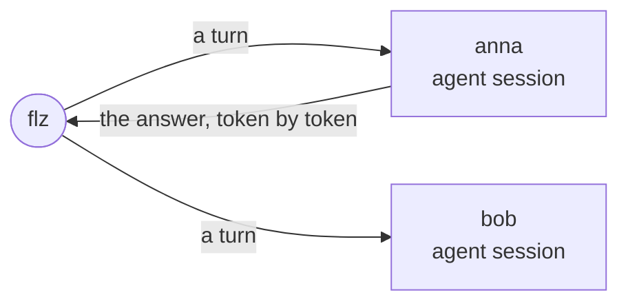

# The agentdesk

This tutorial runs `agentdesk`, a chat in which every conversation is a session
of its own, and many run at once. A session remembers its conversation, answers
each message as it is written, sleeps while nobody talks to it, and can take
turns back. The answers come from a demo model inside the example, a stand-in
that repeats one canned sentence, so nothing outside the example is needed.

Everything runs in Docker containers, started with Docker Compose. The later
pages put the sessions behind an HTTP service with a plugin, run several
controllers, and move the same images to Kubernetes.



> #### What you need {: .tip}
>
> - **Docker, with Docker Compose.**
> - **For the runner**, one language's toolchain, as
>   [Up and running](../up_and_running.html) lists it.
> - **A Kubernetes cluster, such as k3s, and `kubectl`**, for the last page.

> Get the example: run the commands in your language's tab. They download the
> agentdesk into a folder of its own, `flezha-<language>-agentdesk`, and go
> there. Every command in this tutorial runs from that folder.
> {: .step}

<!-- tabs-open -->

### Java

```sh
$ curl -fsSL https://github.com/flezha/flezha/releases/download/v0.1.0/flezha-java-agentdesk.tar.gz | tar xz
$ cd flezha-java-agentdesk
```

### Rust

```sh
$ curl -fsSL https://github.com/flezha/flezha/releases/download/v0.1.0/flezha-rust-agentdesk.tar.gz | tar xz
$ cd flezha-rust-agentdesk
```

### Node

```sh
$ curl -fsSL https://github.com/flezha/flezha/releases/download/v0.1.0/flezha-node-agentdesk.tar.gz | tar xz
$ cd flezha-node-agentdesk
```

### Python

```sh
$ curl -fsSL https://github.com/flezha/flezha/releases/download/v0.1.0/flezha-python-agentdesk.tar.gz | tar xz
$ cd flezha-python-agentdesk
```

### Ruby

```sh
$ curl -fsSL https://github.com/flezha/flezha/releases/download/v0.1.0/flezha-ruby-agentdesk.tar.gz | tar xz
$ cd flezha-ruby-agentdesk
```

### PHP

```sh
$ curl -fsSL https://github.com/flezha/flezha/releases/download/v0.1.0/flezha-php-agentdesk.tar.gz | tar xz
$ cd flezha-php-agentdesk
```

### Elixir

```sh
$ curl -fsSL https://github.com/flezha/flezha/releases/download/v0.1.0/flezha-elixir-agentdesk.tar.gz | tar xz
$ cd flezha-elixir-agentdesk
```

### Go

```sh
$ curl -fsSL https://github.com/flezha/flezha/releases/download/v0.1.0/flezha-go-agentdesk.tar.gz | tar xz
$ cd flezha-go-agentdesk
```

<!-- tabs-close -->

| Page | What you do |
|---|---|
| [Start a session](start_a_session.md) | Run the agentdesk in Docker Compose, talk to two sessions, and watch an idle one sleep |
| [Take a turn back](take_a_turn_back.md) | Rewind a session, and let a failed turn fail alone |
| [Stream an answer](stream_an_answer.md) | Watch an answer arrive token by token |
| [Add your own plugin](add_your_own_plugin.md) | Install the HTTP plugin by rebuilding the controller's image |
| [Serve HTTP](serve_http.md) | Put a gateway relay behind HTTP, and stream an answer to a browser |
| [Call the session](call_the_session.md) | Send messages over HTTP through the gateway, within a daily token budget |
| [Run a cluster](run_a_cluster.md) | Run two controllers, stop one, and watch its sessions move |
| [Kill the runner](kill_the_runner.md) | Kill the runner mid-message and see each message counted once |
| [Run on Kubernetes](run_on_kubernetes.md) | Run the same images on k3s |
