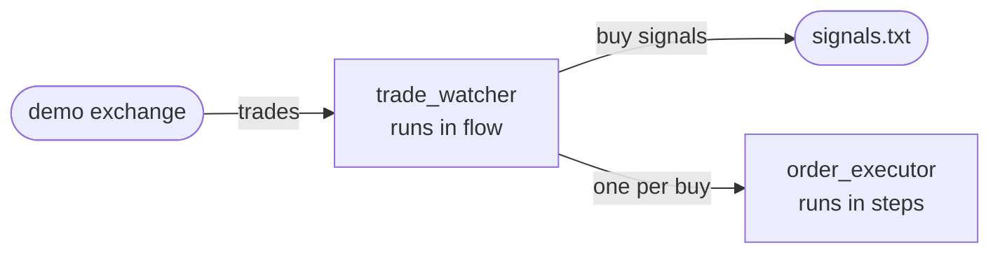

# The tradedesk

This tutorial runs `tradedesk`, a toy trader, and uses it to show what a
deployment needs beyond the echo: authorization, a namespace of its own, state,
partitions, plugins, and recovery from a crash.

The desk is two relays. `trade_watcher` is an ETL stream that runs in flow:
it reads trades from a demo exchange, keeps each symbol's recent prices, and
sends out a buy signal when a price is far enough above their average. Each buy
also starts an `order_executor`, a workflow that runs in steps: it takes one
order through its steps with paper money and ends when the order is filled or
refused.



> #### What you need {: .tip}
>
> - What [Up and running](../up_and_running.html) needed: a controller
>   release or Docker, and one language's toolchain for the runner.
> - **Node.js, with npm**, to run the demo exchange.

> Get the example: run the command in your language's tab. It downloads the
> tradedesk into a folder of its own, `flezha-<language>-tradedesk`.
> {: .step}

<!-- tabs-open -->

### Java

```sh
$ curl -fsSL https://github.com/flezha/flezha/releases/download/v0.1.1/flezha-java-tradedesk.tar.gz | tar xz
```

### Rust

```sh
$ curl -fsSL https://github.com/flezha/flezha/releases/download/v0.1.1/flezha-rust-tradedesk.tar.gz | tar xz
```

### Node

```sh
$ curl -fsSL https://github.com/flezha/flezha/releases/download/v0.1.1/flezha-node-tradedesk.tar.gz | tar xz
```

### Python

```sh
$ curl -fsSL https://github.com/flezha/flezha/releases/download/v0.1.1/flezha-python-tradedesk.tar.gz | tar xz
```

### Ruby

```sh
$ curl -fsSL https://github.com/flezha/flezha/releases/download/v0.1.1/flezha-ruby-tradedesk.tar.gz | tar xz
```

### PHP

```sh
$ curl -fsSL https://github.com/flezha/flezha/releases/download/v0.1.1/flezha-php-tradedesk.tar.gz | tar xz
```

### Elixir

```sh
$ curl -fsSL https://github.com/flezha/flezha/releases/download/v0.1.1/flezha-elixir-tradedesk.tar.gz | tar xz
```

### Go

```sh
$ curl -fsSL https://github.com/flezha/flezha/releases/download/v0.1.1/flezha-go-tradedesk.tar.gz | tar xz
```

<!-- tabs-close -->

| Page | What you do |
|---|---|
| [Open the desk](open_the_desk.md) | Start a controller with authorization on, give the desk its namespace and key, and connect its runner |
| [Watch the trades](watch_the_trades.md) | Start `trade_watcher` in two partitions, send it trades, read its state, and scale it |
| [Connect the exchange](connect_the_exchange.md) | Feed it the demo exchange's live trades and write the buy signals to a file |
| [Place orders](place_orders.md) | Start an order by hand, read its journal, and watch a failed order undo itself |
| [Crash the desk](crash_the_desk.md) | Stop and crash the runner and the controller, and handle a message that cannot be read |
