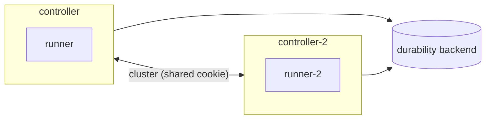

# Clustering

One controller can carry a whole application, but it is then a single machine to lose.
Several controllers can share the operators instead: they form a cluster, each hosts a part
of the operators, and when one is stopped it hands its operators to the others before it
exits. An operator that moves keeps what it remembers.

A cluster is a set of controllers that hold the same secret and know each other's node
names. Each controller has its own runners; an operator runs on a runner of the controller
that hosts it.

## How it works



- **Joining.** A controller joins the others when it holds the same `RELEASE_COOKIE` and can
  reach them by node name. A node name is `flezha@` and a host name (or IP), and a host name
  must contain a dot. `FLEZHA_INITIAL_NODES` lists the nodes each controller tries to connect
  to; on Kubernetes, `FLEZHA_CLUSTER_DISCOVERY=k8s_pod_discovery` finds them instead.
- **Sharing.** The operators are spread over the controllers. When a controller joins, it
  takes a share: some operators move to it as it joins.
- **Leaving.** A controller that is stopped hands its operators to the others before it
  exits. The graceful-shutdown timeout bounds that (`FLEZHA_GRACEFUL_SHUTDOWN_TIMEOUT_MS`,
  60000 by default), and the orchestrator must give the process longer than that before it
  kills it: the timeout plus 15 seconds, 75 seconds by default.
  [deploying_a_controller.md](../basics/deploying_a_controller.md) has the pairing rule.
- **The state copy.** A durability backend (PostgreSQL, S3 or a path that outlives the node's
  disk) holds a copy of each controller's state, which an operator that moves is restored
  from. For an operator at `durable: local` the copy is made in the background, every
  `FLEZHA_DURABILITY_SHIP_INTERVAL_MS` (30000 by default), so it can be a little behind; an
  operator at `durable: remote` waits for it before each acknowledgement.
  [durability.md](../basics/durability.md) has the levels.

## Configure a cluster

Every controller of the cluster sets:

| Variable | Value |
| --- | --- |
| `RELEASE_COOKIE` | the cluster's shared secret, the same on every controller. Unset, each node mints its own, which is enough for a single controller and keeps a cluster from forming |
| `FLEZHA_NODE_HOST` | this controller's host name (with a dot) or IP; the node name is `flezha@<host>` |
| `FLEZHA_INITIAL_NODES` | the node names of the cluster, comma separated |
| `FLEZHA_DURABILITY_BACKEND` | `postgres`, `s3` or `local_path`, with that backend's settings |
| the orchestrator's grace period | longer than `FLEZHA_GRACEFUL_SHUTDOWN_TIMEOUT_MS`: Compose `stop_grace_period`, Kubernetes `terminationGracePeriodSeconds` |

[configuration.md](../../configuration.md#cluster-and-nodes) lists every cluster setting
(reconnects, formation timeout, Kubernetes discovery), and
[its durability section](../../configuration.md#state-wal-and-durability) every backend's
settings.

## Example

The agentdesk example's `cluster.yaml` adds a second controller with its own runner, and a
PostgreSQL database, to its Compose file. Docker Compose reads it on top of `compose.yaml`
(`COMPOSE_FILE=compose.yaml:cluster.yaml`):

```yaml
# A second controller and its runner beside compose.yaml's, the two controllers one cluster,
# and a PostgreSQL database both keep a copy of their state in. Used with compose.yaml:
# COMPOSE_FILE=compose.yaml:cluster.yaml.
services:
  controller:
    environment: &cluster
      RELEASE_COOKIE: ${RELEASE_COOKIE:?set RELEASE_COOKIE, the same for every controller}
      FLEZHA_NODE_HOST: controller.agentdesk
      FLEZHA_INITIAL_NODES: flezha@controller.agentdesk,flezha@controller-2.agentdesk
      FLEZHA_DURABILITY_BACKEND: postgres
      FLEZHA_DURABILITY_PG_HOST: postgres
      FLEZHA_DURABILITY_PG_PASSWORD_ENV: DURABILITY_PASSWORD
      DURABILITY_PASSWORD: ${DURABILITY_PASSWORD:?set DURABILITY_PASSWORD}
    networks:
      default:
        aliases: [controller.agentdesk]    # a node name needs a host name with a dot
    depends_on: &postgres
      postgres:
        condition: service_healthy
    stop_grace_period: 75s                 # time to hand its operators over

  controller-2:
    build: controller
    environment:
      <<: *cluster
      FLEZHA_NODE_HOST: controller-2.agentdesk
      FLEZHA_AUTHZ_ENABLED: "false"
    ports:
      - "127.0.0.1:8081:8080"              # the gateway's HTTP port, when it runs here
    volumes:
      - app_data_2:/flezha/app_data
      - sockets_2:/flezha/app_data/sockets
    networks:
      default:
        aliases: [controller-2.agentdesk]
    depends_on: *postgres
    stop_grace_period: 75s

  runner-2:
    build: .
    environment:
      FLEZHA_SOCKET_FILES_PATH: /flezha/app_data/sockets
    volumes:
      - sockets_2:/flezha/app_data/sockets
    depends_on:
      controller-2:
        condition: service_healthy
    restart: on-failure

  postgres:
    image: postgres:17-alpine
    environment:
      POSTGRES_USER: flezha
      POSTGRES_PASSWORD: ${DURABILITY_PASSWORD}
    healthcheck:
      test: ["CMD", "pg_isready", "-U", "flezha"]
      interval: 2s
    volumes:
      - durable:/var/lib/postgresql/data

volumes:
  app_data_2:
  sockets_2:
  durable:
```

Full file: [`cluster.yaml`](https://github.com/flezha/flezha_java_sdk/blob/main/examples/agentdesk/cluster.yaml)

- **The cookie** comes from the shell, so none is written in the project. The database
  password is named by `FLEZHA_DURABILITY_PG_PASSWORD_ENV`, never written into it.
- **The node names** each get a network alias with a dot.
- **Each controller has its own runner**, reached through its own socket volume.
- **Port 8081** is the gateway's while `controller-2` hosts it: the HTTP server plugin runs on
  whichever controller hosts the operator it is bound to.

The two secrets are set in the shell that runs Compose:

```sh
$ export RELEASE_COOKIE=$(openssl rand -hex 32) DURABILITY_PASSWORD=$(openssl rand -hex 16)
$ export COMPOSE_FILE=compose.yaml:cluster.yaml
$ docker compose up -d --build --wait
```

### See the cluster

The runners of both controllers serve the namespace:

```sh
$ flz runner list --namespace agents
```

```output
Fetching runners for namespace 'agents'...
Runners in namespace 'agents':
  - agents_c8cade00c78f
  - agents_00322d6189cc
```

`flz operator list` shows which controller (`NODE`) and runner hosts each operator:

```sh
$ flz operator list --namespace agents
```

```output
Fetching operators for namespace 'agents'...
Operators in namespace 'agents':

  OPERATOR                          HEALTH      PARTS   NODE                  RUNNER
  anna                              suspended   -       flezha@controller-2.agentdeskagents_00322d6189cc
  bob                               suspended   -       flezha@controller-2.agentdeskagents_00322d6189cc
  carol                             suspended   -       flezha@controller.agentdeskagents_c8cade00c78f
  dave                              healthy     -       flezha@controller.agentdeskagents_c8cade00c78f
  gateway                           healthy     -       flezha@controller-2.agentdeskagents_00322d6189cc
```

The second controller took a share as it joined. The CLI, run in the first controller, sees
the whole cluster:

```sh
$ flz cluster status --namespace agents
```

```output
Cluster status for namespace 'agents':

  Leader:     flezha@controller.agentdesk
  Local node: flezha@controller.agentdesk (leader)

  Nodes:
    flezha@controller.agentdesk: 2 operator(s) recovery_state=normal [leader]
    flezha@controller-2.agentdesk: 3 operator(s) recovery_state=normal

  Operator health: suspended=3, healthy=2
```

### Stop a controller

Stopping the second controller and its runner, as if their machine were shut down:

```sh
$ time docker compose stop controller-2 runner-2
```

```output
...
real	0m58.378s
user	0m0.163s
sys	0m0.058s
```

The controller handed its operators over before it exited, which is what
`stop_grace_period` leaves time for; here that took about a minute. Everything is on
`controller` again:

```sh
$ flz operator list --namespace agents
```

```output
Fetching operators for namespace 'agents'...
Operators in namespace 'agents':

  OPERATOR                          HEALTH      PARTS   NODE                  RUNNER
  anna                              suspended   -       flezha@controller.agentdeskagents_c8cade00c78f
  bob                               suspended   -       flezha@controller.agentdeskagents_c8cade00c78f
  carol                             suspended   -       flezha@controller.agentdeskagents_c8cade00c78f
  dave                              suspended   -       flezha@controller.agentdesk(none)
  gateway                           healthy     -       flezha@controller.agentdeskagents_c8cade00c78f
```

The moved operators kept their state: a session's next answer continues its conversation, and
the gateway's per-user token budget moved with it.

```sh
$ flz operator call anna --namespace agents --text 'Are you still there?'
```

```output
{"text":"Message 8: you said \"Are you still there?\". I am a demo model.","tokens":13}
```

## Limits and gotchas

- **A plugin's port moves with its operator.** The HTTP port is served by whichever controller
  hosts the operator, so clients reach it through a proxy that tries each controller, as
  [http_server.md](../../plugins/http_server.md#deployment) says.
- **The background copy can be a little behind.** An operator at `durable: local` that moves
  after its controller is lost, rather than stopped, is restored from the last copy shipped.
  `durable: remote` closes that gap at the cost of a wait per acknowledgement.
- **Give the stop its time.** An orchestrator grace period shorter than the shutdown timeout
  kills the controller in the middle of the hand-over.
- **Bringing a stopped controller back into a running cluster** is not covered by this page.
- **One cookie for all.** A controller with a different cookie, or a minted one, does not join.

## See also

- [deploying_a_controller.md](../basics/deploying_a_controller.md): settings, graceful
  shutdown and the grace-period pairing.
- [durability.md](../basics/durability.md): durability levels and backends.
- [kubernetes.md](kubernetes.md): controllers on Kubernetes.
- [effectively_once.md](effectively_once.md): what a crash may repeat.
- [configuration.md](../../configuration.md#cluster-and-nodes).
- Tutorial: [run_a_cluster.md](../../tutorials/agentdesk/run_a_cluster.md).
