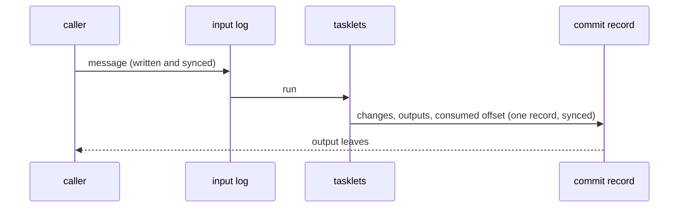

# Effectively once

A message that is lost is a question nobody answers. A message that is handled twice is an
answer given twice, a payment charged twice, tokens counted twice. The delivery guarantee
Flezha calls **effectively once** is that neither happens when a runner or a controller dies
at the wrong moment: a message may be delivered again after a crash, but what handling it
changes and sends counts once.

The guarantee is not free: every message waits for a disk write before it runs. So an
operator that runs in steps and keeps its work has it without asking, and an operator that
runs in flow declares it when it needs it.

## How it works

The guarantee rests on two records the controller keeps on its disk:

- **The input log.** Every message is written to the operator's input log, and synced, before
  it runs. A crash before the message is consumed runs it again from the log, so nothing in
  flight is lost.
- **The commit record.** What handling a message changes, sends and consumes is recorded as
  one unit. For a steps operator that is the end of each turn in its journal; for a flow
  operator it is one effect record per invocation: the state changes, the plugin outputs and
  the consumed input offset, persisted under one sync. An output leaves only once the record
  behind it is on disk, and a replay finds the record and does not count the message again.



| Operator | Without asking | Guarantee |
| --- | --- | --- |
| runs in steps, keeps its work (`durable: local` or `remote`) | input log and journal | effectively once: a turn runs to its end once; a crash before the end runs it again from the log, and the answer leaves only once the turn's end is written |
| runs in flow, `exactly: at_least_once` (the default) | no input log | at least once: after a crash an output can leave twice, and a message in flight can be lost |
| runs in flow, `exactly: effectively_once` | input log and effect records | effectively once |

**Across operators.** What crosses between two operators, such as a call and its answer, is
effectively once only when both ends keep an input log: the caller for the answer, the callee
for the message. [operator_calls.md](operator_calls.md) has the table for calls.

## Configure it

A flow operator declares the guarantee in its run settings. The tier has three optional
members:

| Member | Java | Elixir | Default | Meaning |
| --- | --- | --- | --- | --- |
| the tier | `new Run.Flow(new Exactly.EffectivelyOnce())` | `run: {:flow, exactly: :effectively_once}` | at least once | each invocation's changes, outputs and consumed offset as one record |
| `ack` | `.withAck(new Ack.Checkpoint())` | `ack: :checkpoint` or `{:checkpoint, every: n, max_delay_ms: ms, outputs: :at_checkpoint}` | `per_input` | when a consumed input is acknowledged: after every invocation, or only at a checkpoint (an explicit `ctx.checkpoint()`, every `n` inputs, or `max_delay_ms` after the input that opened the interval). Between checkpoints, a crash replays the interval. `outputs` says whether emits leave as produced (the default) or are held until the checkpoint; `max_delay_ms` is required when they are held |
| `correction_ms` | `.withCorrectionMs(ms)` | `correction_ms: ms` | none | a late-input window: an input whose event time is behind the cell's high-water mark by less than the window rewinds the cell and replays the slice in event-time order. Needs an event-time clock and keyed channels |
| `beyond_window` | `.withBeyondWindow(BeyondWindow.DROP)` | `beyond_window: :drop` | `process_as_arrival` | what an input later than the window becomes: processed as if it had just arrived, or dropped |

A declaration that cannot hold is refused when the operator is registered:

| Code | When |
| --- | --- |
| `topology.effectively_once_without_persistence` | the operator is kept in memory only (`durable: false`): the tier is durable state |
| `topology.unkeyed_channel_under_effectively_once` | a channel that ends in a sink plugin is not declared `.keyed()`: the tier drops a repeated output by its identity, so a sink plugin's channel must be keyed |
| `topology.dropping_policy_under_effectively_once` | a channel declares a dropping overflow policy: a shed input would be lost for good and reported nowhere |

## Example

In the agentdesk example, the sessions run in steps and keep their work, so they have the
guarantee without declaring it. The `gateway` operator, which answers HTTP requests and
counts each user's tokens, runs in flow and declares it, because a count must not be made
twice:

<!-- tabs-open -->

### Java

```java
// GatewayOperator.java: each request and answer on disk before it runs.
    @Override
    public Run run() {
        return new Run.Flow(new Exactly.EffectivelyOnce());
    }
```

Full file: [`GatewayOperator.java`](https://github.com/flezha/flezha_java_sdk/blob/main/examples/agentdesk/src/main/java/com/flezha/examples/agentdesk/GatewayOperator.java)

### Elixir

```elixir
# lib/agentdesk/gateway_operator.ex: each request and answer on disk before it runs.
  use Flezha.SDK.Operator,
    factory_id: "gateway",
    # each request and answer on disk before it runs
    run: {:flow, exactly: :effectively_once}
```

Full file: [`gateway_operator.ex`](https://github.com/flezha/flezha_elixir_sdk/blob/main/examples/agentdesk/lib/agentdesk/gateway_operator.ex)

<!-- tabs-close -->

The tasklet that counts, `budget`, takes the day from `ctx.now()`, not from the system clock:

<!-- tabs-open -->

### Java

```java
// Budget.java: the day comes from the invocation's time value.
        String today = LocalDate.ofInstant(Instant.ofEpochMilli(ctx.now()), ZoneOffset.UTC).toString();
```

Full file: [`Budget.java`](https://github.com/flezha/flezha_java_sdk/blob/main/examples/agentdesk/src/main/java/com/flezha/examples/agentdesk/Budget.java)

### Elixir

```elixir
# lib/agentdesk/budget.ex: the day comes from the invocation's time value.
  defp today(ctx), do: ctx |> now() |> DateTime.from_unix!(:millisecond) |> Date.to_iso8601()
```

Full file: [`budget.ex`](https://github.com/flezha/flezha_elixir_sdk/blob/main/examples/agentdesk/lib/agentdesk/budget.ex)

<!-- tabs-close -->

### Read the input log and the journal

`flz state inbox` shows an operator's input log. For a session named `anna`:

```sh
$ flz state inbox anna --namespace agents
```

```output
durable input log for anna (consumed through 11):

  offset=0 consumed 5 byte(s)
  offset=1 consumed 16 byte(s)
  offset=2 consumed 20 byte(s)
  offset=3 consumed 14 byte(s)
  offset=4 consumed 250 byte(s)
  offset=5 consumed 12 byte(s)
  offset=6 consumed 15 byte(s)
  offset=7 consumed 24 byte(s)
  offset=8 consumed 12 byte(s)
  offset=9 consumed 43 byte(s) channel=message
  offset=10 consumed 20 byte(s)
  offset=11 consumed 29 byte(s) channel=message
```

Every message the session was sent is there: from the CLI on its default entry channel, or
from the gateway's calls on the `message` channel. A message that failed and went to the
dead-letter queue (the 250-byte one) is consumed too.

`flz state journal` shows a steps instance's journal:

```sh
$ flz state journal anna --namespace agents
```

```output
task-journal for instance anna:
...
  seq=17 task_committed task_idx=0 iter=5 epoch=1
    ran: anna/reply/ record=8 channels=answer
    handoff: 1 item(s), 116 byte(s)
      edge: channel_id=1 1 item(s), 116 byte(s)

  seq=18 task_committed task_idx=1 iter=5 epoch=1
    ran: anna/deliver/ record=1 channels=deliver
    handoff: 0 item(s), 0 byte(s)

  seq=19 iter_committed task_idx=0 iter=5 epoch=1
    handoff: 0 item(s), 0 byte(s)
    consumed input-log offset: 7
...
```

A turn is `reply`, then `deliver`, then the turn's end, `iter_committed`, which names the
message it consumed. Rewinds and failed turns are recorded in the journal too.

The gateway's input log holds each HTTP request and each answer its calls bring back:

```sh
$ flz state inbox gateway --namespace agents
```

```output
durable input log for gateway (consumed through 2):

  offset=0 consumed 61 byte(s) channel=http
  offset=1 consumed 100 byte(s) channel=http
  offset=2 consumed 257 byte(s) channel=budget.response
```

`http` is a request, and `budget.response` is the answer of a call, on its way to `budget`,
which counts its tokens.

### Kill the runner in the middle of a message

The runner hosts both the session and the gateway. A user's budget before:

```sh
$ flz state get gateway/budget/anna --namespace agents
```

```output
state get gateway/budget/anna:
  change_seq: 4
  state:      {"budget":{"anna":{"day":"2026-09-30","tokens":36}}}
```

A message over HTTP, and the runner killed a second later:

```sh
$ curl -s -d 'Tell me everything' localhost:8080/sessions/anna/messages && sleep 1 && docker compose kill runner
```

The gateway answered `sent to anna`, and then the runner was gone. Whatever was on its way
(the session's turn, the call's answer or the count) is in an input log. After the runner is
started again and the session has answered:

```sh
$ docker compose start runner
$ flz state get gateway/budget/anna --namespace agents
```

```output
state get gateway/budget/anna:
  change_seq: 6
  state:      {"budget":{"anna":{"day":"2026-09-30","tokens":48}}}
```

The answer used 12 tokens, and they were counted once. The message is in the conversation
once, and the gateway's log shows the request and its answer once each:

```sh
$ flz state inbox gateway --namespace agents
```

```output
...
  offset=2 consumed 257 byte(s) channel=budget.response
  offset=3 consumed 102 byte(s) channel=http
  offset=4 consumed 265 byte(s) channel=budget.response
```

## What it requires

- **An input log on each end** of whatever crosses between operators: an operator that runs
  in steps and keeps its work has one, an operator that runs in flow declares the guarantee.
- **Tasklets that give the same result for the same input.** A message replayed after a
  crash runs its tasklet again. A tasklet reads the time from `ctx.now()`, one value per
  invocation, and never from the system clock. `ctx.now()` follows the tasklet's clock: wall
  time by default, the event time the tasklet extracts from its input, or a logical clock (the
  change sequence).
- **Keyed sinks.** On an operator that declares the guarantee, a channel that ends in a sink
  plugin must be `.keyed()`, so the sink can drop a record it has already written. Requests
  and calls need no key.
- **The controller's disk.** The logs are on it. A durability backend
  ([clustering.md](clustering.md)) is what carries them past losing that disk, a little behind
  unless the operator is at `durable: remote`.

## What it costs

Every input and every answer is written and synced to disk before it runs, and an output
leaves only once the record behind it is on disk. So each message waits for a disk write it
would not wait for otherwise, and the input log takes disk space until what it holds is
consumed. A slow disk makes a slow operator. Steps operators pay the same for their own log.
An operator that can lose a message or handle one twice, for example one that only shows a
preview, does not need to pay it. [operator_calls.md](operator_calls.md) says when an answer
leaves, for each kind of operator.

## Limits and gotchas

- **Effects outside Flezha are not covered.** A tasklet that calls an outside service is run
  again on a replay; the outside call happens again unless that service drops repeats itself.
- **A default flow operator is at least once.** Declare the tier where a repeat or a loss
  matters.
- **Memory-only operators cannot have it** (`topology.effectively_once_without_persistence`).
- **The wall clock is read again on a replay.** With the default clock, `ctx.now()` of a
  replayed invocation is the time of the replay; a result that must not change across a replay
  uses an event-time or logical clock.

## See also

- [durability.md](../basics/durability.md): the durability levels and what a crash can lose
  at each.
- [configuring_an_operator.md](../basics/configuring_an_operator.md): the settings tree.
- [operator_calls.md](operator_calls.md): guarantees of calls.
- [clustering.md](clustering.md): the copy in a durability backend.
- [errors.md](../../errors.md): the `topology.*` refusals.
- Tutorial: [call_the_session.md](../../tutorials/agentdesk/call_the_session.md).
