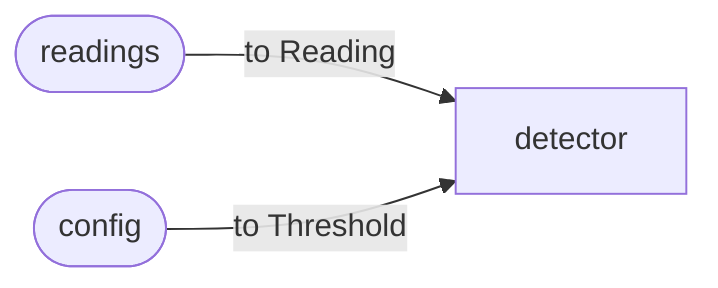

# Merged inputs

A tasklet takes one type of input, and `into` connects it to one channel. Some tasklets need
more than one stream: a stream of data and a stream of settings for it, a join of two computed
streams, or an enrichment path. A **merge** feeds one tasklet from two or more channels.

You declare the tasklet's input as a type of your own with one case per source (a sum type, a
sealed interface, a tagged map), and subscribe each source channel to it with a mapping that
turns the source's value into that type. The tasklet itself does not change: its dispatch, its
state, its retries and dead letters, and its emits all see the one input type.

## How it works

A merge is part of the operator's wiring, not a tasklet of its own. Each source channel keeps
its own edge into the merged tasklet, and the mapping runs on that edge as the value is routed,
the same place a [transform](../basics/streams.md) runs. Live delivery and a replay from disk
travel the same routing path, and each source's frames are stored per channel unchanged, so a
replay reproduces the run and a warm restart restores the same state. The controller does not
see a merge at all.

## How to declare one

Start a merge on the channel builder, add each source with its mapping, optionally key the
merge, and close it with `into`:

| SDK | Spelling |
| --- | --- |
| Rust | `c.merge::<I>().from(source, mapping).from(...).key_by(f).into::<T>()` |
| Java | `c.merge(I.class).from(source, mapping).from(...).keyBy(f).into(T.class)` |
| Node | `c.merge().from(source, map).from(...).keyBy(f).into(T)` |
| Python | `c.merge().from_(source, mapping).from_(...).key_by(f).into(T)` |
| Ruby | `c.merge.from(source) { mapping }.from(...).key_by { ... }.into(T)` |
| PHP | `$c->merge()->from($source, $map)->from(...)->keyBy($f)->into(T::class)` |
| Elixir | `c \|> merge() \|> from(source, mapping) \|> from(...) \|> key_by(f) \|> into(T)` |

A source is a stream handle: an entry channel (`input(...)`) or the output of another tasklet.

## What a merge promises

- **Sources may be entry channels or tasklet outputs, freely mixed**, on a flow operator.
  Mapping an entry channel directly saves a parsing tasklet for a low-rate control channel; a
  parsing tasklet is still right for a busy path with state of its own.
- **Each source keeps its order; nothing is ordered across sources.** There are no windowed
  joins, buffering or alignment: correlating the sources is the tasklet's state's job.
- **The key sees the mapped value.** Keying is declared once, on the merge. A `key_by` on a
  source handle is refused as `topology.transform_after_key_by`, because by the time keying
  runs that source's value has already become the merged type.
- **A source may carry its own transforms**, which run before the mapping on the source's own
  type; transforms on the merge run after, on the merged type.
- **A mapping must be pure and total.** It runs on live delivery and again on replay, and the
  two must agree. It returns the merged type, not a result that can fail, so work that can fail
  belongs in the tasklet, where it has somewhere to fail to.
- **In Rust, a source's payload must be `Clone`**: the mapping clones the value, where a plain
  `into` passes it on shared. Java has no such requirement.

## When a mapping fails

A mapping that throws or panics is contained:

| Where the mapping runs | What a failure does |
| --- | --- |
| a flow operator, either kind of source | the value climbs the source channel's retry ladder and then goes to the dead-letter queue, as a failing entry parse does. In Java the mapping runs inside an activation, so a throw is that activation's failure. |
| a steps operator, passing a step's output on | a non-retryable failure of the step that produced the value. That step counts as run, so the rollback undoes the steps recorded as completed, including it, and the instance reports its end with status `error`. It is not retried: a pure mapping would fail the same way again. |
| a steps operator, resuming after a crash | contained the same way; a producing step the journal already committed is undone even though the resumed pass did not run it again. |

A step still running beside the failing one in the same level is not in the undo plan: the
abort returns at the first failing edge, as any mid-level abort does.

## Refusals

Checked when the operator is declared, with every other wiring problem:

| Code | When |
| --- | --- |
| `topology.merge_too_few_sources` | fewer than two sources: wire a single source with `into` instead |
| `topology.duplicate_merge_source` | the same channel subscribed twice; only this code is reported, because the count includes every `from` written |
| `topology.edge_already_wired` | a source re-wires an edge that an `into` or another merge already declared |
| `topology.transform_after_key_by` | a key on a source handle instead of on the merge |
| mapped type differs from the tasklet's input | a compile error in Rust, a registration error naming both types in Java |

## Merges in a steps operator

A steps operator merges tasklet outputs and entry channels alike. An entry channel's message
carries the channel it arrived on, so its mapping is chosen the same way as in a flow
operator. A merged tasklet fed by an entry channel is a root of that channel's chain: a merge
of two entry channels runs the merged tasklet once per message, with that message's mapping, in
the pass the message starts. Where two chains meet, the join waits only for the producers of
the chain that runs. The mapping is applied both when a step's output is passed on and when a
resumed instance re-seeds a step from its journal, so a resumed merge sees what the live one
did.

## Example

None of the tracked example apps (echo, tradedesk, agentdesk) uses a merge yet. The agentdesk
example feeds one tasklet from two channels without a merge: its `agent` operator wires both
`turn` and `message` into `Reply` with two plain `into` edges, after mapping `message` to the
same type as `turn` (see [operator calls](operator_calls.md)). That works because both channels
carry, after a transform, the same type; a merge is for sources of different types.

## Limits

- No windowed joins, alignment or cross-source order.
- A mapping has no error channel; put fallible work in the tasklet.

## See also

- [Streams](../basics/streams.md): channels, edges, transforms and keys
- [Workflows](../basics/workflows.md): steps, levels and rollback
- [Durability](../basics/durability.md): replay and the dead-letter queue
- [Errors](../../errors.md): the `topology.*` codes
