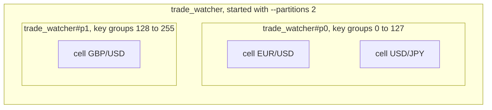
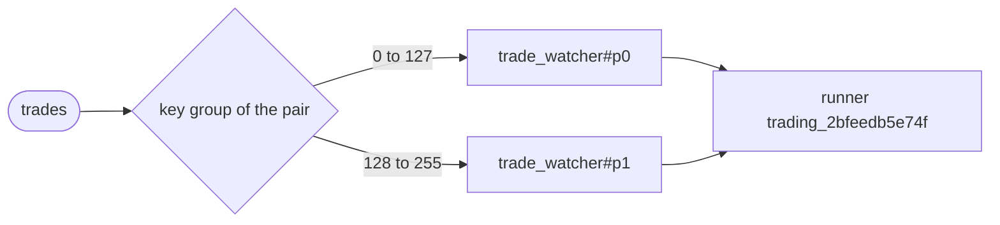

# Partitioning

An operator started the usual way is one instance: all of its keys and all of their cells run
on one runner, and that runner's machine is the limit. When input arrives faster than one
machine can handle it, starting more runners does not help, because the operator can only be
in one place.

Partitioning splits the operator into several instances, called partitions or members. Each
one runs the same code but owns only some of the keys, so every key belongs to exactly one
partition, and its input and its state stay there. The partitions are placed like any other
operator, so with more runners they spread out and each one does part of the work. You still
handle the group as one operator: you start, list, read, scale and stop it by its one name.

A flow operator and a `per_input` steps operator can be partitioned. The operator must be
keyed: its entry edge needs a `key_by`.

## Partitions and cells

A cell is one copy of a tasklet with its own state, one per key (see
[state](../basics/state.md)). Partitions work one level up, and the two are easy to mix up:

| | A cell | A partition |
|---|---|---|
| What it is | one copy of a tasklet with its own state, one per key | one copy of the whole operator, owning part of the keys |
| Made by | `key_by` in the operator's code | `--partitions` when the operator is started |
| Spreads work | inside one runner: cells run side by side on its cores | across runners and controllers: each partition can run on a different machine |
| In the tradedesk example | one per currency pair: EUR/USD's window, USD/JPY's window | `trade_watcher#p0` and `trade_watcher#p1`, each with the cells of its own pairs |

Cells are how one runner handles many keys at once, and partitions are how a cluster shares
them out. Every partition has the same code, and every key still gets its own cell, inside
whichever partition owns it:



## How a key finds its partition

It takes three steps, and the same key always ends up in the same place:

1. The key, what `key_by` returns, is turned into a number from 0 to 255 by a hash
   (FNV-1a-128 of the key's bytes, modulo 256). That number is its **key group**.
2. The 256 key groups are split evenly and contiguously between the partitions. With two,
   `#p0` owns 0 to 127 and `#p1` owns 128 to 255; with three, 0 to 84, 85 to 169 and 170 to
   255.
3. The key goes to the partition that owns its key group.

```text
"EUR/USD" → hash → 104 → in 0-127   → trade_watcher#p0
"USD/JPY" → hash →  97 → in 0-127   → trade_watcher#p0
"GBP/USD" → hash → 203 → in 128-255 → trade_watcher#p1
```

A few more keys and their key groups, the same in every SDK and in the controller:

| Key | Key group |
| --- | --- |
| `SOL-USD` | 60 |
| `BTC-USD` | 129 |
| `ETH-USD` | 213 |
| `a` | 100 |
| `""` (empty) | 141 |

You do not choose where a key goes; the hash does. With many keys it spreads them evenly, but
with only a few, two can land together, as EUR/USD and USD/JPY do above, and a partition can
be left with nothing to do.

## How a partition finds its runner

Once a partition exists, the controller places it in two steps:

1. **A controller.** Among the controllers whose runners registered the operator's factory,
   one is picked by hashing the partition's name. A controller with no such runner is never
   picked.
2. **A runner on that controller.** Among its runners that registered the factory, one is
   picked by hashing again, with a cap so that no runner takes more than its fair share of the
   operators already bound.

Both steps are hashes, so the answer is the same every time it is worked out. With one runner,
all partitions share it; with as many runners as partitions, each partition usually gets one
of its own.



## Start a partitioned operator

`--partitions N` on `flz operator start` starts N members as one group. Each member is an
ordinary instance named `<id>#p<K>`:

```sh
$ flz operator start trade_watcher --id trade_watcher --partitions 2 --namespace trading
```

```output
Operator trade_watcher started with 2 partitions:
  trade_watcher#p0
  trade_watcher#p1
```

- `--partitions 1`, the default, is an unpartitioned start. N must be between 2 and 256,
  otherwise the start is refused as `operator.partitions_out_of_range`.
- A partitioned start carries no first message: `--text` names one instance, and a group's
  message reaches its member by key, so `--partitions` with `--text` is refused
  (`operator.partitioned_first_message`) before any member starts.
- The group id must leave room for the `#pK` suffix inside the operator-id byte limit
  (`operator.group_id_too_long`).
- N partitions take N units of the namespace's `max_operators` quota.
- An operator with no keyed entry-fed tasklet (neither `key_by` nor declared cell keys) is
  refused as `topology.partitions_without_keyed_tasklet`: each partition would fold a slice of
  the input into its own copy of the same state. A **statically** keyed operator partitions
  normally: every member declares every key, and the ones outside its range receive no input.
- A steps operator that reads one message (`each: once` or `chained`) is refused as
  `topology.partitions_without_per_input_loop`. Only a `per_input` steps operator is a group.

After a refused start, the controller remembers the factory's verdict, so a later partitioned
start of the same factory is refused before any runner is touched.

`flz operator info` shows each member's key groups, the runner it is on and its health:

```sh
$ flz operator info trade_watcher --namespace trading
```

```output
Partition group: trade_watcher (2/2)
  p0  trade_watcher#p0               key groups 0-127  trading_2bfeedb5e74f  healthy
  p1  trade_watcher#p1               key groups 128-255  trading_2bfeedb5e74f  healthy
  coverage: all 256 key groups owned exactly once
...
```

`flz operator list` shows one row per group, with the **worst** member's health and where each
member runs:

```output
  OPERATOR      HEALTH      PARTS   NODE       RUNNER
  ohlc          healthy     3/3     node@a     p0→r1, p1→r2, p2→r1
```

A `failed` or `unbound` member reads `recovering` in both until the unmet-intent grace runs out
(`FLEZHA_CONVERGENCE_UNMET_INTENT_GRACE_MS`, the one `/healthz` uses), and its own word after
that: a group moving off a dead runner is the usual case. Coverage is worked out from the
members on every read, and a missing member or an overlapping range is shown as a warning
naming the gap or the contested key group.

`flz operator stop <group>` stops every member.

## The one rule: route by the `key_by` value

For a partitioned operator, whatever routes a record to a member must equal the value `key_by`
extracts: a source plugin's subscription string, or the `flz.key` an upstream operator's emit
carries.

A plain `emit` on a keyed channel keeps this rule by construction. What is left to get wrong
is a source's subscription string and an explicit `emit_keyed` under a key of your own choice.
Each member checks every cell key against its own range, and a miss parks the record before
any state for that key is created:

```text
key 'BTC-USD' hashes to key group 129, which partition 0 of 3 does not own
(it owns groups 0..84); the routing item / flz.key must equal the key_by result
```

The error code is `runtime.key_outside_partition`.

## Send to, call and read a group

The group's id names no single operator, so a message needs a key or a member id:

```sh
$ flz operator send 'trade_watcher#p1' --namespace trading --channel trades --text '{"channel": "trade", "data": [{"symbol": "GBP/USD", "price": 1.3400, "ord_type": "market"}]}'
```

```output
Delivered to 'trade_watcher#p1'.
```

- `flz operator send <group> --key <key>` and `flz operator call <group> --key <key>` reach the
  member whose range owns the key. Without a key, both are refused, naming the members (for a
  call, `call.target_unkeyed`). The quotes around `trade_watcher#p1` keep some shells from
  reading the `#` as a comment.
- `flz state get <group>/<tasklet>/<key>` reads from the member that owns the key. Leaving the
  key off reads every key, from every member, merged:

```sh
$ flz state get trade_watcher/track_prices --namespace trading
```

```output
state get trade_watcher/track_prices:
  change_seq: 3
  state:      {"track_prices":{"EUR/USD":{"prices":[1.085,1.0853,1.11]},"GBP/USD":{"prices":[1.34]}}}
```

## Plugins on a partitioned operator

A plugin bound to a group is bound to every member: `flz plugin bind <name> --operator_id
<group>` binds each member with its partition identity (its index, the member count and its
key-group range) added to the plugin's options, and `flz plugin unbind` is symmetric. A partial
bind reports which members succeeded and which failed, by name (`plugin.group_enable_partial`).
`--plugins` on a partitioned `flz operator start` is applied the same way, once per member.

A plugin that can be shared is not shared with a partitioned operator: each member asks
upstream for its own share of the key range, so each runs its own copy. An unpartitioned
operator bound to the same plugin keeps its controller's shared copy.

Sources filter what they ask for, never the data:

| Source | On a member |
| --- | --- |
| [Websocket subscription](../../plugins/websocket_subscription.md) | subscribes only to the items whose key group the member owns, from a polled list or from a static `subscription_items` list |
| [HTTP poll](../../plugins/http_poll.md) | `{{partition_index}}` and `{{partition_count}}` in `url` are filled in at start; a placeholder on an operator that is not partitioned is refused as `plugin.partition_placeholder_unfilled` |

A source that cannot tell which member a record's key belongs to refuses a group member as
`plugin.partitioned_host`: the Kafka consumer, the RabbitMQ consumer, Postgres CDC, Postgres
poll and the HTTP server. Enable those on an operator that is not partitioned and forward into
the group.

## Forward into a group

[`operator_forward`](../../plugins/operator_forward.md) targeting a group keeps one worker per
member, so a slow member does not hold up the others, and routes each message by the key group
of its `flz.key` to the member that owns it. A message with no `flz.key` (an emit on a channel
not declared `.keyed()`) is parked with `partitioned target requires keyed emit`; it is never
spread round-robin or hashed by payload.

## Restart missing members: converge

Running the same partitioned start against a group with live members **converges**: it starts
only the members that are missing and leaves every survivor untouched. A restarted member
restores its cell state from disk, so the start command is also the repair for a group that
lost a member.

```sh
$ flz operator start candles --id ohlc --partitions 3
```

```output
Operator ohlc converged: started 1 missing member(s), 2 already running:
  started ohlc#p2
  already running ohlc#p0
  already running ohlc#p1
```

A complete group exits 0 with nothing started. Converge checks presence only: the survivors'
factory, init values, options and plugins are not compared, and `--plugins` applies only to the
members this run starts. Converge never changes N: a count that differs from what the survivors
declare is refused before anything starts (`operator.group_partition_mismatch`), naming
`flz operator scale`. Also refused: a plain start of a live group's id
(`operator.group_base_taken`), and a `--partitions` start of an id held by a live unpartitioned
operator (`operator.unpartitioned_running`).

## Change the number of partitions

`flz operator scale <group> <N>` changes how many partitions a running group has. The key
groups are split again, and every cell whose key now belongs to another member moves there with
its state:

```sh
$ flz operator scale trade_watcher 3 --namespace trading
```

```output
Scaling operator group trade_watcher to 3...
Operator trade_watcher rescaled 2 -> 3 (2 cells moved, 0 trees removed):
  trade_watcher#p0
  trade_watcher#p1
  trade_watcher#p2
```

A rescale runs in these steps:

1. **Quiesce.** Every member's source plugins are turned off. The command refuses while any
   member holds parked dead-letter entries (`operator.rescale_parked_entries`: replay or drop
   them first, `flz dlq list`), then waits until every member has consumed its input log. The
   wait is bounded by `--timeout` in milliseconds (default 30000). On timeout it stops with
   nothing stopped and nothing moved (`operator.rescale_quiesce_timeout`), naming the lagging
   member; only the sources are off. Run it again with a longer `--timeout`. An operator that
   commits at checkpoints advances only at a checkpoint, so the wait follows its checkpoint
   cadence.
2. **Preflight.** The ranges for the new count are worked out, and the id-length and
   `max_operators` checks a partitioned start runs apply to the change in members. A failure
   leaves every member running.
3. **Stop.** Members stop with their state kept; the command waits up to 15 seconds for each id
   to be released (`operator.rescale_id_held`).
4. **Move.** Every cell whose key group changes owner has its stored files moved to the new
   owner: a rename on the same controller, a copy then delete across controllers.
5. **Start.** The new members start with their new ranges and restore from disk, which costs
   what a restart after a crash costs.
6. **Clean up.** A member past the new count, which no longer owns anything, is removed.

A crash in the middle of a rescale is recoverable: before the move nothing durable has
changed, each cell moves as one unit, and running `flz operator scale` again finishes the
remaining moves (`operator.rescale_move_failed` says so). Only one rescale of a group runs at a
time, cluster-wide (`operator.rescale_running`). Forwards into the group follow it: a forwarding
plugin whose members no longer match restarts and reads the member set again, a surviving
member keeps its queued messages, and a removed member's queue goes to the new owner.

## A per-input steps operator as a group

A `per_input` steps operator partitions like a flow operator: N ordinary steps instances, each
with its own key-group range, journal and input log, through the same start, converge and
rescale. Its entry edge must be keyed. A message reaches its member by key, through a keyed
forward, or by member id (`flz operator send orders#p1 ...`); a key the member does not own
parks under the entry channel and starts no pass. What a steps operator adds:

- **Each member ends and undoes its own work.** `ctx.complete`, `max_duration`, a stop or a
  final failure ends that member alone, with its own completion record, and its rollback undoes
  its own passes. There is no group-wide end, result or rollback. A member that ended leaves a
  gap in `flz operator info` until a converge restarts it.
- **Per member, by member id**: `flz operator rewind`, `flz state journal`, `flz state inbox`.
  `flz operator stop <group>` is one cooperative stop per member.
- **A rescale happens between passes.** The quiesce waits until no pass is in flight and no
  message is queued; a pass that outlives `--timeout` refuses the rescale with nothing changed.
- **A rescale seals.** Each surviving member's journal is cut to its latest committed iteration
  before it restarts, because a moved cell's earlier passes now belong to another member. A
  rewind below the seal is refused with the committed range, and an all-or-nothing rollback
  stops at the seal. The scale command names the members it sealed. A new member starts at
  iteration 0 with an empty log.
- **A spawn and a schedule name one instance.** Neither carries a key, so `ctx.spawn_steps`
  naming a group's id is refused, as a plain start of that id is.

## Example

In the tradedesk example, `trade_watcher` keys its trades by currency pair before its first
tasklet. That `key_by` is what makes it partitionable: started with `--partitions 2`, each
member receives the pairs whose key group it owns, and the websocket subscription of each
member asks the exchange for those pairs only.

<!-- tabs-open -->

### Java

```java
// TradeWatcherOperator.java: the desk's stream, keyed by currency pair.
        c.input(TradeMessage.class, "trades")
                .filter(message -> "trade".equals(message.channel())) // trade messages only
                .flatMap(Trade.class, TradeMessage::data)            // a message into its trades
                .filter(trade -> "market".equals(trade.ord_type()))  // market orders only
                .keyBy(Trade::symbol)                                // one cell per symbol
                .into(TrackPrices.class)
```

[Full file](https://github.com/flezha/flezha_java_sdk/blob/main/examples/tradedesk/src/main/java/com/flezha/examples/tradedesk/TradeWatcherOperator.java)

### Rust

```rust
// trade_watcher.rs: the desk's stream, keyed by currency pair.
        c.input::<TradeMessage>("trades")
            .filter(|message| message.channel == "trade") // trade messages only
            .flat_map(|message| message.data) // a message into its trades
            .filter(|trade| trade.ord_type == "market") // market orders only
            .key_by(|trade| trade.symbol.clone()) // one cell per symbol
            .into::<TrackPrices>()
```

[Full file](https://github.com/flezha/flezha_rust_sdk/blob/main/examples/tradedesk/src/trade_watcher.rs)

### Node

```js
// trade_watcher_operator.mjs: the desk's stream, keyed by currency pair.
    c.input('trades')
      .filter((message) => message.channel === 'trade') // trade messages only
      .flatMap((message) => message.data) // a message into its trades
      .filter((trade) => trade.ord_type === 'market') // market orders only
      .keyBy((trade) => trade.symbol) // one cell per symbol
      .into(TrackPrices)
```

[Full file](https://github.com/flezha/flezha_node_sdk/blob/main/examples/tradedesk/trade_watcher_operator.mjs)

### Python

```python
# trade_watcher.py: the desk's stream, keyed by currency pair.
        c.input("trades")
        .filter(lambda message: message.get("channel") == "trade")  # trade messages only
        .flat_map(lambda message: message["data"])  # a message into its trades
        .filter(lambda trade: trade["ord_type"] == "market")  # market orders only
        .key_by(lambda trade: trade["symbol"])  # one cell per symbol
        .into(TrackPrices)
```

[Full file](https://github.com/flezha/flezha_python_sdk/blob/main/examples/tradedesk/trade_watcher.py)

### Ruby

```ruby
# trade_watcher_operator.rb: the desk's stream, keyed by currency pair.
    c.input("trades")
     .filter { |message| message[:channel] == "trade" }      # trade messages only
     .flat_map { |message| message[:data] }                  # a message into its trades
     .filter { |trade| trade[:ord_type] == "market" }        # market orders only
     .key_by { |trade| trade[:symbol] }                      # one cell per symbol
     .into(TrackPrices)
```

[Full file](https://github.com/flezha/flezha_ruby_sdk/blob/main/examples/tradedesk/trade_watcher_operator.rb)

### PHP

```php
// TradeWatcherOperator.php: the desk's stream, keyed by currency pair.
        $c->input('trades')
            ->filter(fn (array $message) => ($message['channel'] ?? null) === 'trade') // trade messages only
            ->flatMap(fn (array $message) => $message['data'])                         // a message into its trades
            ->filter(fn (array $trade) => $trade['ord_type'] === 'market')             // market orders only
            ->keyBy(fn (array $trade) => $trade['symbol'])                             // one cell per symbol
            ->into(TrackPrices::class)
```

[Full file](https://github.com/flezha/flezha_php_sdk/blob/main/examples/tradedesk/src/TradeWatcherOperator.php)

### Elixir

```elixir
# lib/tradedesk/trade_watcher.ex: the desk's stream, keyed by currency pair.
    c
    |> input_with("trades", &Jason.decode/1)
    |> filter(&(&1["channel"] == "trade"))
    |> flat_map(& &1["data"])
    |> filter(&(&1["ord_type"] == "market"))
    |> key_by(& &1["symbol"])
    |> into(Tradedesk.TrackPrices)
```

[Full file](https://github.com/flezha/flezha_elixir_sdk/blob/main/examples/tradedesk/lib/tradedesk/trade_watcher.ex)

<!-- tabs-close -->

## Hot keys: aggregate in two stages

One key is served by one cell on one machine, to keep its order. A key hot enough to saturate
a core cannot be split by partitioning, so split it in the operator instead. A first,
partitioned operator keys by a sub-key (the key plus a small bucket number, such as the pair and
the trade id modulo 8) and aggregates locally; it emits its partial results on a keyed channel.
A second operator, unpartitioned or with a smaller N, receives them through `operator_forward`,
keys them by the pair alone and merges the partials. The first stage's `key_by` must return the
sub-key, not the pair, or the guard above refuses the first record.

## Limits

- **More partitions than runners buys nothing.** The extra members share machines with the
  others and add no parallelism, so start the runners before the group.
- **Placement spreads by count, not by anti-affinity.** A group of N members across N runners
  normally lands one per runner, but nothing pins a particular member to a particular runner,
  and two members can share one when the fleet is already uneven. `flz operator info` shows
  where each landed.
- **One partition's whole state lives on one controller.** Each partition opens its own source
  connections, and each partition's sink plugins open their own connections too.
- **A rescale stops the group** and restores it cold: no warm handoff and no rescale while
  input keeps flowing.
- **Assignment is contiguous and even.** There is no way to weight it.
- **A `once` or `chained` steps operator cannot be partitioned.**

## See also

- [Configuring an operator](../basics/configuring_an_operator.md): flow and steps, and `key_by`
- [Streams](../basics/streams.md): keys and cells
- [State](../basics/state.md): what a moved cell carries
- [Plugins](../plugins/plugins.md): sharing, and which plugins refuse a group member
- [Operator calls](operator_calls.md): calling a group by key
- [Clustering](clustering.md): several controllers
- [`websocket_subscription`](../../plugins/websocket_subscription.md),
  [`http_poll`](../../plugins/http_poll.md),
  [`operator_forward`](../../plugins/operator_forward.md)
- [Errors](../../errors.md), [Glossary](https://github.com/flezha/flezha/blob/main/docs/glossary.md): partition, key group, group
- Tutorial: [watch the trades](../../tutorials/tradedesk/watch_the_trades.md)
