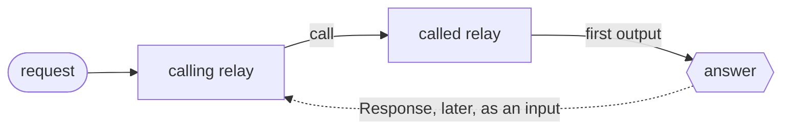

# Relay calls

A call sends one input to a relay and gets one answer back: the first output that input caused
on an output of the relay's graph, or one coded error saying why none came.
There are two kinds:

- An **outside call** comes from outside Flezha and waits for its answer: `flz relay call`,
  application code through `Flezha.Service.Relay.call/6`, or a plugin feeding the relay it
  is enabled on (the [HTTP server plugin](../../plugins/http_server.md) answers each request
  this way).
- A **relay call** is one relay calling another from its graph, with a `call(...)` end.
  Nothing waits: the outcome comes back later as an ordinary input, a `Response`, on the caller's
  Response channel. A call to a factory can also start the instance it calls.

Flow and steps relays both answer calls and make them. Calls exist so that a request and its
answer can cross relays without the caller polling state or listening to an output: a gateway
calls a user's session and counts the tokens its answer used; an order desk calls a pricing
relay; a script calls a relay and prints what it answered.

## How it works



The controller ties an input to the outputs it causes with a token in the input's metadata,
`flz.reply_to`. It creates one for every outside call, after removing any `flz.reply_to` the
caller's metadata carried. Every other way into a relay drops that key, so no hook, plugin or
sender can add, drop or change one. The token is journaled with the input wherever the relay
journals input, so a sleep, a move to another runner or a crash re-run deliver it again. The
runner carries it from the input to every value derived from it and stamps it on each output
output the input causes; a tasklet never sees it, and a timer firing carries none. `flz relay
listen --input` shows it on the arriving input, but it is of no use there: an answer only ever
goes to the caller waiting for it, and no plugin or listener sees it on an output.

The answer may come from any tasklet downstream of the input, not only the one that received it:
in `input("in") |> into(Parse) |> into(Price) |> output("quotes")` the value `Price` emits answers
the call. In a steps relay the answer comes from the pass the call's input opened.

## Answering: the relay's outputs

A relay does not say which of its channels answers a caller. Whether an answer is wanted is a
fact of how an input arrived: when it came from a call, the first output it causes on an output
answers the call. That output then goes on to the output's plugins and to `flz relay listen` like
any other output, so one tasklet answers a caller and records the answer with no extra step.
Tasklets do not change.

- **The caller may name the answering channel.** `flz relay call --answer-channel quotes`,
  `answer_channel` in the options of `Relay.call/6`, or the answer channel of a `call(...)` end
  (see [below](#where-a-call-goes)). Then only an output on that channel answers, and every other
  output the input causes is an ordinary output. Without a name, the first output answers.
- **Several outputs per graph.** An accepted path and a refused path may each end in an output;
  whichever output comes first answers, unless the caller names a channel.
- **One answer per call.** Later outputs of the same input are ordinary outputs.
- **Parts never answer.** A [part](streamed_answers.md) goes to listeners while the tasklet works;
  only a finished emit answers.
- **Every output is keyed under the effectively-once tier**, answering ones included, because an
  answer also reaches the output's plugins, which drop a duplicate by its key.
- **One plugin end per channel.** An output and a `call(...)` on one channel, or two `call(...)`
  ends, are refused when the relay is declared, as `topology.channel_ends_twice`.

### Where an answer leaves

An answer leaves the runner exactly where an output of the same relay leaves, so a call is
never answered before the state change its turn made is durable, where the relay's
[durability](../basics/durability.md) promises that:

| Relay | The answer leaves |
| --- | --- |
| off the effectively-once tier | at settle, with no durability wait |
| under the effectively-once tier | after the effect record that carries it is synced to disk |
| a durable steps relay | when the step that produced it commits (for a one-tasklet turn, the iteration's commit) |
| a steps relay that journals nothing | at settle |

An output that answers a call goes to its caller first, and then on to the `on_output` hooks
without the token, so output plugins and `flz relay listen` see it as an ordinary output. Then:

- the first matching output for a waiting call goes to its caller and ends the call;
- every later output of the same input, and every output whose input nobody waits for (it came
  through `flz relay send`, a plugin or a forward, or its caller already timed out), is an
  ordinary output and nothing more.

## Outside calls

Every outside call carries a positive deadline in milliseconds, measured by the called relay
from the moment the call reached it. With no answer by then, the caller receives `call.timeout`.
The input stays accepted: its turn still runs, and its outputs still reach the relay's plugins. A slow turn
that costs something, such as a paid request to another service, still costs it after its caller
has given up. A call to a sleeping instance is journaled, the append wakes it, and the time the
wake takes counts against the deadline.

### `flz relay call`

```text
flz relay call <relay_id> --text <payload> [--channel <ch>] [--answer-channel <ch>] [--key <k>] [--timeout <ms>] [--namespace <ns>]
```

It prints the answer's payload and a newline on stdout and exits 0. `--channel` names the entry
channel the input arrives on, and `--answer-channel` the channel whose output answers. `--timeout`
defaults to 30000 and has no short spelling, because `-t` is `--text`. A failure is written on stderr with its code
and exits by its class (see [the CLI](../cli/cli.md)):

```sh
$ flz relay call echo --text hello
```

```output
hello
```

```sh
$ flz relay call slow --text x --timeout 100
```

```output
error: relay 'slow' did not answer within 100 ms; the input stays accepted and its turn still runs (call.timeout)
```

### `Flezha.Service.Relay.call/6`

```elixir
Flezha.Service.Relay.call(namespace, relay_id, message, channel, opts, caller_context)
```

`channel` is the entry channel, `nil` or `""` for none. `opts` carries `deadline_ms` (required, a
positive integer), `answer_channel` (the channel whose output answers) and `key`. It answers `{:ok, payload, %{"channel" => channel}}`, naming the
channel that produced the answer, or `{:error, %Flezha.Error{}}`. Its own wait lasts the deadline
plus `call_grace_ms`, so the relay's `call.timeout` always reaches the caller first.

A connected runner reaches it through the administration surface, like every published
function. That surface is for application code outside relays: a tasklet never makes a call
from `run`; one relay calls another from its graph.

### A feeding plugin

```elixir
Flezha.Plugin.Host.inject(overwatch, message, metadata, :call, deadline_ms)
```

A plugin calls the relay it is enabled on and receives what `Relay.call/6` answers. Its wait
is bounded the same way, and a relay it cannot reach answers `call.unavailable`. A
`flz.reply_to` in `metadata` is dropped: the answer reaches this call and no other. See
[writing a plugin](../plugins/writing_a_plugin.md).

### A partition group

A [partition group](partitioning.md) is called by key: `--key EURUSD` on the CLI, or
`key: "EURUSD"` in `opts`, reaches the member whose key-group range owns the key, the way
`flz state get` finds it. A group called with no key is refused as `call.target_unkeyed`, naming
its members; a member named directly (`prices#p0`) is called directly. `flz relay send` takes
`--key` the same way.

### Authorization

A call through `flz relay call` or `Relay.call/6` is judged as `relay.send` in the
relay's namespace and audited like a send, naming the relay, with the error code on a
failure. A caller allowed to send can so read any output its own input causes on an output, and
pick which one with the answer channel; outputs of other inputs stay behind `relay.listen`. A refused call delivers no input and keeps its own `authz.*` code (exit 4). A plugin's
call on its own relay is that relay's own input and is not judged again. See
[authorization](../basics/authorization.md).

## Relay calls: `call(...)`

One relay calls another by ending a chain of its graph in `call(...)`. Every value that
reaches the end, after the chain's transforms and key, is one request. The call waits for
nothing; its outcome comes back later as a `Response` on the relay's **Response channel**. The
tasklet that made the call may read it, and so may any other: wiring the Response channel back
into the calling tasklet is fan-in, not a cycle.

### Where a call goes

| Target | Reaches |
| --- | --- |
| an id, `call("pricing", ...)` | the instance `pricing`, or, when `pricing` is a partition group, the member that owns the request's key (from a `key_by` before the end) |
| a factory after a key, `key_by(...)` then `call(factory: "agent", ...)` | the instance of `agent` whose id is the request's key, started with the request as its first input when no instance holds that id |
| a factory without a key, `call(factory: "triage", ...)` | a new steps instance of `triage` per call, under a generated id |

- The request enters the called relay on the entry channel `channel` names, or on its first
  declared entry channel.
- The called relay's output on the channel the answer channel names answers the call, or, when
  the end names none, its first output for the request.
- A target is always in the caller's namespace.
- Creating and delivering go through the controller's one spawn-or-deliver (the one
  [`ctx.spawn_steps`](spawning_from_a_tasklet.md) uses), so two calls racing for one absent id
  start one instance and deliver the other request to it.
- A factory call reaches only an instance of that factory: a key naming a running instance of
  another factory is answered `relay.factory_mismatch` and nothing is delivered, so a key that
  came from a client cannot steer a request into an unrelated relay.
- With `create: false`, an absent id is answered `relay.not_found` and nothing starts. A
  gateway uses it for the turns of a session that may have ended, so an expired session is
  refused rather than silently started again.
- A factory call without a key cannot say `create: false`, and one to a flow factory is refused
  as `relay.factory_not_steps`, since nothing would ever end the instances it started. A key
  may start a flow instance: it runs until it is stopped, and sleeps when idle as its settings
  say.

| SDK | Spelling | Answer channel |
| --- | --- | --- |
| Rust | `.call::<Answer>(CallTarget::id("pricing"), 500)`, `CallTarget::factory("agent").create(false).channel("turn")` | `CallTarget::id("pricing").answer_channel("quotes")` |
| Java | `.call(CallTarget.id("pricing"), Answer.class, 500)`, `CallTarget.factory("agent").create(false).channel("turn")` | `CallTarget.id("pricing").answerChannel("quotes")` |
| Node | `.call("pricing", { deadlineMs: 500, codec })`, `.call({ factory: "agent", create: false, channel: "turn" }, { deadlineMs })` | `{ deadlineMs: 500, answerChannel: "quotes" }` |
| Python | `.call("pricing", deadline_ms=500)`, `.call(factory="agent", deadline_ms=..., create=False, channel="turn", codec=...)` | `answer_channel="quotes"` |
| Ruby | `.call("pricing", deadline_ms: 500)`, `.call(factory: "agent", deadline_ms: ..., create: false, channel: "turn", codec: ...)` | `answer_channel: "quotes"` |
| PHP | `->call(target: 'pricing', deadlineMs: 500)`, `->call(factory: 'agent', deadlineMs: ..., create: false, channel: 'turn', codec: ...)` | `answerChannel: 'quotes'` |
| Elixir | `call(s, "pricing", deadline_ms: 500)`, `call(s, factory: "agent", deadline_ms: ..., create: false, channel: "turn", serialize: f, decode: g)` | `answer_channel: "quotes"` |

The request is written the way an `output` writes, and the answer read the way an `input` reads: the
answer type in Rust and Java, one named codec for both directions in Node, Python, Ruby and PHP
(JSON by default), and optional `serialize:` and `decode:` functions in Elixir (by default the
output rule and the raw binary; the Elixir `Response` carries the request as the bytes that were
sent).

Registration refuses:

| Code | When |
| --- | --- |
| `topology.channel_ends_twice` | the channel already ends in an output or another call |
| `topology.call_deadline_zero` | the deadline is zero |
| `topology.call_without_key` | a factory call with `create: false` and no `key_by` before it |
| `topology.call_response_unread` | the Response channel feeds no tasklet, so every outcome would be journaled and read by nobody; use `relay_forward` when no outcome is wanted |
| `topology.call_outside_per_input_loop` | a call in a `once` or `chained` steps relay, which never reads the later message a `Response` is |

### The `Response`

The Response channel is an entry channel named after the calling channel with `.response`
appended (`gateway.response`). Each `Response` carries the request as the call end wrote it, the
result (the answer, or the error that ended the call, in the SDK's one error type; a timeout is
`call.timeout`), `target` (the instance that answered, a generated one included) and `created`
(whether this call started it), so a gateway can tell a new session from one that expired.

| SDK | Type |
| --- | --- |
| Rust | `flezha_runner::Response<Req, Ans>`: `request`, `result: Result<Ans, FlezhaError>`, `target`, `created` |
| Java | `Response<Req, Ans>`: `request()`, `answer()`, `error()`, `ok()`, `target()`, `created()` |
| Node | `Response<Req, Ans>`: `request`, `value` or `error`, `target`, `created` |
| Python | `Response`: `request`, `value` or `error`, `target`, `created` |
| Ruby | `Flezha::Response`: `request`, `value` or `error`, `ok?`, `target`, `created` |
| PHP | `Flezha\Response`: `request`, `value` or `error`, `ok()`, `target`, `created` |
| Elixir | `%Flezha.SDK.Response{request, result: {:ok, value} \| {:error, error}, target, created}` |

### A steps relay as the caller

A `per_input` steps relay calls without suspending: the request leaves when the step that
emitted it commits, and the `Response` arrives on the Response channel as a later message, run as
a later iteration. An agent session calls a tool relay this way. An instance that ends with
calls pending abandons them; their outcomes are dropped and counted as `unclaimed`.

### Authorization and quotas

A relay call is judged as its namespace's runner identity, as a tasklet's `ctx.spawn_steps`
is: creating the called instance against `relay.start` (audited as a start naming the new
instance), delivering the request against `relay.send` (no record of its own). The runner
identity needs the `spawner` or `app` role in the namespace; a refusal ends the call with its
`authz.*` code and starts and delivers nothing. The `Response`'s way back is the caller's own and
is not judged again.

A session a call creates counts against its namespace's `max_relays` from its start to its
teardown, asleep or awake; a creation past it is answered `quota.exceeded`, and calls to running
sessions are still delivered. A session that ended (it completed, or expired itself on a cell
timer and `ctx.complete`) no longer holds its id: a call creates a new empty instance and says
`created: true`, or, with `create: false`, is answered `relay.not_found` before any turn runs.

## Example

In the agentdesk example, a `gateway` relay takes HTTP requests from the
[HTTP server plugin](../../plugins/http_server.md). A POST to `/sessions/<user>/messages` is a
message for the user's session. The gateway keeps each user's daily token budget in a `budget`
cell per user, answers the request itself with 202 or 429 on an output, and,
when the message is admitted, **calls** the user's session with it. The tokens the answer used
come back as a `Response` into the same `budget` tasklet.

<!-- tabs-open -->

### Java

```java
// GatewayRelay.java: answers every request, and calls the session a message is for.
        Stream<Verdict> verdicts = http.filter(Request::sends)
                .map(Event.class, request -> new Sent(request.message()))
                .keyBy(Event::user)                          // one cell per user
                .into(Budget.class);
        verdicts.into(Admit.class)
                .keyed()
                .output();                                   // 202, or 429 over the budget
        verdicts.filter(Verdict::admitted)
                .map(Message.class, Verdict::message)
                .keyBy(Message::user)                        // the user's session
                .call(CallTarget.factory("agent").channel("message"), Answer.class, DEADLINE_MS)
                .map(Event.class, Used::of)
                .keyBy(Event::user)
                .into(Budget.class);                         // the tokens the answer used
```

[Full file](https://github.com/flezha/flezha_java_sdk/blob/main/examples/agentdesk/src/main/java/com/flezha/examples/agentdesk/GatewayRelay.java)

### Elixir

```elixir
# lib/agentdesk/gateway_relay.ex: answers every request, and calls the session a message is for.
    verdicts
    |> into(Admit)
    |> keyed()
    # 202, or 429 over the budget
    |> output()

    verdicts
    |> filter(&Budget.admitted?/1)
    |> map(& &1.message)
    # the user's session
    |> key_by(& &1.user)
    |> call(
      factory: "agent",
      channel: "message",
      deadline_ms: @deadline_ms,
      decode: &Jason.decode/1
    )
    |> map(&Budget.used/1)
    |> key_by(& &1.user)
    # the tokens the answer used
    |> into(Budget)
```

[Full file](https://github.com/flezha/flezha_elixir_sdk/blob/main/examples/agentdesk/lib/agentdesk/gateway_relay.ex)

<!-- tabs-close -->

- **`call` after `keyBy`** reaches the instance of `agent` whose id is the key, the user, and
  starts one with the message as its first input when there is none, so a new user needs no
  `flz relay start`. `channel("message")` is the entry channel it arrives on.
- **The call waits for nothing.** Its outcome comes back later as a `Response` on the gateway's
  Response channel, within the 60-second deadline at the latest.
- **Two outputs** in one graph (the other answers the non-message requests): whichever output
  comes first answers the request. The 202 leaves before the session has read the message. Both
  are `keyed()`, as every output of an effectively-once relay is.

The `Response` carries the request it answers, which is where the user comes from. A turn that
failed, or took too long, used no tokens:

<!-- tabs-open -->

### Java

```java
// Budget.java: each user's tokens for the day, and whether a message is admitted.
    public record Used(String user, int tokens) implements Event {    // the tokens an answer used
        static Used of(Response<Message, Answer> response) {          // a failed turn used none
            return new Used(response.request().user(), response.ok() ? response.answer().tokens() : 0);
        }
    }
```

[Full file](https://github.com/flezha/flezha_java_sdk/blob/main/examples/agentdesk/src/main/java/com/flezha/examples/agentdesk/Budget.java)

### Elixir

```elixir
# lib/agentdesk/budget.ex: each user's tokens for the day, and whether a message is admitted.
  # The tokens an answer used; a failed turn used none.
  def used(%Response{request: request, result: result}) do
    %{user: Jason.decode!(request)["user"], tokens: tokens(result)}
  end

  defp tokens({:ok, answer}), do: answer["tokens"]
  defp tokens({:error, _error}), do: 0
```

[Full file](https://github.com/flezha/flezha_elixir_sdk/blob/main/examples/agentdesk/lib/agentdesk/budget.ex)

<!-- tabs-close -->

On the called side, the session takes the gateway's message on an entry channel of its own,
`message`, beside the `turn` channel the CLI uses, and answers from its output `answer`, which
listeners read too. Both channels reach the same `reply` tasklet, with the same conversation:

<!-- tabs-open -->

### Java

```java
// AgentRelay.java: one conversation, answering whoever called.
        c.input(String.class, "turn")
                .into(Reply.class)
                .output("answer");                       // to whoever called, and whoever listens
        c.input(Message.class, "message")                // from the gateway
                .map(String.class, Message::text)
                .into(Reply.class);
```

[Full file](https://github.com/flezha/flezha_java_sdk/blob/main/examples/agentdesk/src/main/java/com/flezha/examples/agentdesk/AgentRelay.java)

### Elixir

```elixir
# lib/agentdesk/agent_relay.ex: one conversation, answering whoever called.
    c
    |> input("turn")
    |> into(Reply)
    # to whoever called, and whoever listens
    |> output("answer")

    # from the gateway
    c
    |> input_with("message", &Jason.decode/1)
    |> map(& &1["text"])
    |> into(Reply)
```

[Full file](https://github.com/flezha/flezha_elixir_sdk/blob/main/examples/agentdesk/lib/agentdesk/agent_relay.ex)

<!-- tabs-close -->

A message for a user with no session starts one:

```sh
$ curl -s -d 'Hi, I am Carol' localhost:8080/sessions/carol/messages
```

```output
sent to carol
```

```sh
$ flz state get carol/reply --namespace agents
```

```output
state get carol/reply:
  change_seq: 1
  state:      {"reply":{"messages":["Hi, I am Carol"]}}
```

The budget is 40 tokens a day, and an answer to a one-word message uses 10, so the fifth one-word
message of the day is refused:

```sh
$ for text in One Two Three Four Five; do curl -s -o /dev/null -w '%{http_code}\n' -d "$text" localhost:8080/sessions/dave/messages; sleep 2; done
```

```output
202
202
202
202
429
```

Tokens are counted when an answer arrives, so a message sent while the previous answer is still
being written is admitted on the count before it: the budget can be overrun by the answers in
flight, never by more. The day is taken from `ctx.now()`, not from the clock, so a replay under
[effectively-once](effectively_once.md) agrees with the live run. The budget is the gateway's: a
message sent with the CLI to the session's `turn` channel does not go through it, and is neither
counted nor refused. The HTTP route authenticates nobody: anyone who reaches the port can write
to any user's session.

## When a call ends early

A call is answered at once, with a code, whenever its answer can no longer come or the call
cannot be taken:

- **The called relay's Overwatch (its controller-side process) moves.** Waiting callers move
  with it to the other node and are still answered there, or time out at their original
  deadline.
- **The Overwatch crashes.** Every caller waiting on it receives `call.unavailable` at once, not at
  its deadline. The journaled input still runs.
- **The input is dead-lettered.** The caller receives `call.failed` once the dead-letter entry is
  durable (for a failed turn of a durable `per_input` `keep_progress` relay, once the turn's
  record is), carrying the entry's reference and the error text. The input stays in the
  dead-letter queue (`flz dlq list`), and a replay can still succeed; its answer then reaches
  nobody.
- **The instance ends.** When a run completes, fails or is stopped, every waiting caller receives
  `call.callee_ended` with the run's final status: `ok` (a steps run), `completed` (a flow
  instance's `complete`), `error` or `cancelled`. The exception is a relay caller of an
  instance that keeps a durable input log and was stopped without ending: its call stays
  journaled and is answered when the instance runs again, or by the caller's deadline.

A relay caller receives each of these as a `Response` carrying the error, and also
`call.not_accepted` from a `once` or `chained` instance that has taken its input, and the
controller's own codes for a creation or delivery it refuses (`quota.exceeded`,
`relay.factory_unknown`, `relay.not_found`, `relay.factory_mismatch`, an `authz.*`
code). A `per_input` `keep_progress` session answers a failed turn `call.failed` and goes on; the
calls queued behind it are answered by their own turns. A rewind of the called relay neither
answers a call again nor takes an answer back; a turn it interrupts before its answer left leaves
its caller to the deadline.

### Error codes

The exit code is `flz`'s for the class ([errors](../../errors.md)).

| Code | Class (exit) | When |
| --- | --- | --- |
| `relay.not_found` | not_found (5) | no relay or member of that id in the namespace |
| `call.timeout` | unavailable (7) | the deadline passed with no answer; `details.deadline_ms` |
| `call.failed` | unavailable (7) | the relay dead-lettered the input; `details.dlq_ref`, `details.error` |
| `call.callee_ended` | unavailable (7) | the instance ended before it answered; `details.status` |
| `call.absorbed` | conflict (6) | the input was dropped as a duplicate, or an `on_input` hook filtered it out |
| `call.not_accepted` | conflict (6) | a `once` or `chained` steps instance has already taken its input; nothing is journaled |
| `call.busy` | unavailable (7) | the relay already owes `call_pending_max` answers; nothing is taken in |
| `call.unavailable` | unavailable (7) | the relay is parked or not ready, its durable append was refused, or its Overwatch went away |
| `call.target_unkeyed` | invalid (2) | a partition group was called with no key; `details.members` |
| `relay.factory_mismatch` | conflict (6) | a factory call named an instance of another factory; nothing is delivered |
| `topology.channel_ends_twice` | invalid (2) | a channel declares two plugin ends (raised when the relay is declared) |
| `topology.call_*` | invalid (2) | a `call(...)` end the runtime cannot honour (see above) |

## Guarantees

A call and its `Response` are ordinary inputs, and each side keeps the guarantee of its own
durability: the request is journaled in the called relay's input log when it journals input,
the `Response` in the caller's when the caller does.

| Caller and called relay | A call |
| --- | --- |
| both keep a durable input log (an effectively-once flow relay, a durable steps one) | survives a crash of either side's runner, Overwatch or controller, runs its turn at most once to its commit, and ends with exactly one `Response`. A request still on its way when only the controller's call delivery crashes is not sent again, and that call ends in `call.timeout` at its deadline. |
| either keeps none | best effort: a lost request or answer ends in `call.timeout` at the deadline while the caller's Overwatch lives, and a caller off the tier that loses its Overwatch loses its pending calls |

For a durable pair:

- The call output stays held in the caller's outbox until its `Response` is durable in the
  caller's input log, so the caller's recovery sends every call that has no `Response` again.
- The request carries the call id as its message id, so the called relay drops a request sent
  again while the first is retained, and each record carrying a live call is retained until the
  call's deadline plus `call_retention_margin_ms`.
- A recovered call whose `Response` the caller's log holds is settled with nothing sent; one
  whose deadline is ahead is sent again and waits; one past its deadline, within the margin, is
  answered `call.timeout`.
- **The one corner:** a call recovered past its deadline plus the margin (the caller's side down
  that long) is settled with no `Response`, because one may have been appended and truncated
  since, and counted as `[:flezha, :call, :recovered_unanswered]`. There the guarantee is at most
  one `Response`.
- The called relay holds its answer in its own outbox until the caller's Overwatch took it,
  retrying until then or until the deadline plus the margin, when it drops it as `caller_gone`; a
  caller no longer declared in its namespace is dropped at once. An answer lost while held is
  sent again.
- Clocks are assumed synchronized to well within the margin.

The deadline of a relay call is the caller's alone: a wall-clock time taken when the calling
invocation emitted the request. The time a sleeping called relay takes to wake counts against
it. When it passes, the caller receives `call.timeout` and the called turn still runs; its outputs
still reach the called relay's plugins.

## Order and bounds

- **Requests keep their order** from one caller to one target, so a session's turns run in the
  order they were called. `Response`s arrive in the order their appends complete, with no order
  across calls; a caller that needs one restores it from the request each `Response` carries.
- **`call_pending_max` bounds the called relay**: the answers one relay owes the callers
  waiting on it, outside callers and relays alike. A call past it is answered `call.busy` and
  nothing is taken in.
- **A relay's own calls never count against it.** A durable caller's pending calls are
  bounded per cell by its outbox window (`outbox_inflight_max`, 1 000 entries): a cell whose
  window is full of pending calls sends its later outputs only as calls end. That is queueing,
  never loss. A caller off the tier keeps no outbox; its calls are bounded by their deadlines.

| Setting | Default | |
| --- | --- | --- |
| `call_pending_max` (`FLEZHA_CALL_PENDING_MAX`) | 10 000 | the answers one relay owes its waiting callers; past it, `call.busy` |
| `call_grace_ms` | 1 000 | how long an outside caller waits past its deadline, so the relay's own `call.timeout` reaches it first |
| `call_retention_margin_ms` (`FLEZHA_CALL_RETENTION_MARGIN_MS`) | 300 000 | how long an input log keeps a record carrying a relay call past the call's deadline |
| `call_worker_idle_ms` | 30 000 | how long a relay call's delivery worker (one per caller and target) waits with an empty queue before it stops |

All are in [Application env keys](../../configuration/application_env.md#runner-and-relay-lifecycle). A long deadline makes the called relay keep
that much input: the `input_log_frozen_watermark` signal reports a log that keeps growing.

## Observing calls

The controller emits `[:flezha, :call, :answered]` with the answer's latency,
`[:flezha, :call, :timeout]`, `[:flezha, :call, :answer_dropped]` with its reason (`unclaimed`,
an outcome no pending call of the caller takes, or `caller_gone`) and `[:flezha, :call, :refused]` with its code, each naming the
namespace and the relay; a relay caller's `timeout` and
`[:flezha, :call, :recovered_unanswered]` also name the call's `target`. The observability source
`flezha_call` exports them as the histogram `flezha_call_answer_duration` and the counters
`flezha_call_timeouts_total`, `flezha_call_answers_dropped_total`, `flezha_call_refused_total`
and `flezha_call_recovered_unanswered_total`. `flz relay info` shows the number of callers
waiting on a relay as `Waiting callers`.

Measured on one machine with debug builds: a call to an awake durable `per_input` steps
relay on the Rust runner took 14 to 32 ms inside the controller, and 29 to 48 ms for the first
call after it slept; through `flz relay call` both are about 300 ms, most of it the CLI's own
start-up. A relay call to a sleeping session, from the input reaching the gateway to the
`Response` reaching it, took 60 to 84 ms on the Rust, Java, Node and Python runners and under
102 ms on the Elixir, Ruby and PHP runners (one sample each), the wake included.

## See also

- [Spawning from a tasklet](spawning_from_a_tasklet.md): the spawn-or-deliver a factory call
  shares
- [Sessions](sessions.md): an agent session as a called relay
- [Streamed answers](streamed_answers.md): the answer itself, streamed to the browser
- [Partitioning](partitioning.md): calling a group by key
- [Effectively once](effectively_once.md): the tier an answer can wait for
- [Durability](../basics/durability.md), [Authorization](../basics/authorization.md)
- [HTTP server plugin](../../plugins/http_server.md)
- [Errors](../../errors.md), [Glossary](https://github.com/flezha/flezha/blob/main/docs/glossary.md): call, answer channel, Response
- Tutorial: [call the session](../../tutorials/agentdesk/call_the_session.md)
