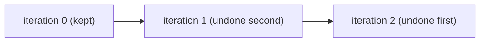

# Rewinding a turn

A conversation sometimes has to go back. A user edits a message sent a while ago, or an
answer went wrong, and the conversation should continue from an earlier turn as if the later
ones had not happened. And sometimes a single turn fails, because the model refused or timed
out, and only that turn should be lost, not the conversation.

Flezha covers both for an operator that runs in steps once per message, such as a
[session](sessions.md): `flz operator rewind` takes the instance back to an earlier turn, and
the failure mode `keep_progress` lets a failed turn fail alone.

## How it works

Each message a session runs is one **iteration**, numbered from 0. When an iteration ends,
the controller records it as committed in the instance's journal.

**A rewind** takes the instance back to a committed iteration. It keeps that iteration and
every earlier one, and undoes every later one, newest first, through each tasklet's
`compensate`. The messages it undoes are not run again; the loop resumes at the next
iteration with the next message that arrives.



A rewind is refused when it cannot undo what it would have to:

| Code | When |
| --- | --- |
| `operator.rewind_uncovered` | a tasklet whose output left the instance (through a sink or a `response()` end) between the target and now declares no `compensate` |
| `operator.iteration_not_committed` | the target iteration has not committed, so there is no boundary to rewind to |

A steps instance is taken back only as a whole: `flz operator replay` of one of its cells is
refused with `operator.replay_steps`, whose hint is the rewind.

**A failed turn.** What a failure undoes is the run's `on_failure` setting:

| `on_failure` | A failed turn |
| --- | --- |
| `undo_all` (the default) | every completed tasklet of every turn is undone in reverse through its `compensate`, and the instance ends |
| `keep_progress` | finished iterations are kept and only the failed one is undone; in a per-input loop the failed turn's message goes to the dead-letter queue and the instance takes its next message |

## Configure it

### An undo for each tasklet

A tasklet's undo is its `compensate`. It receives the outputs the tasklet sent in the
iteration being undone and the tasklet's state, and records a change that takes the
iteration's effect back. A tasklet whose output leaves the instance needs one for a rewind
to pass, even when there is nothing to take back: it then declares an empty one.

### A turn that fails alone

<!-- tabs-open -->

### Java

```java
// AgentOperator.java: a failed turn fails alone.
    @Override
    public Run run() {
        return new Run.Steps(
                Each.PER_INPUT,                          // one turn per message
                OnFailure.KEEP_PROGRESS);                // a failed turn fails alone
    }
```

Full file: [`AgentOperator.java`](https://github.com/flezha/flezha_java_sdk/blob/main/examples/agentdesk/src/main/java/com/flezha/examples/agentdesk/AgentOperator.java)

### Elixir

```elixir
# lib/agentdesk/agent_operator.ex: a failed turn fails alone.
    # one turn per message; a failed turn fails alone
    run: {:steps, each: :per_input, on_failure: :keep_progress},
```

Full file: [`agent_operator.ex`](https://github.com/flezha/flezha_elixir_sdk/blob/main/examples/agentdesk/lib/agentdesk/agent_operator.ex)

<!-- tabs-close -->

## Example

In the agentdesk example, the session's tasklet `reply` keeps the conversation as a list of
messages. Its undo forgets the last message of the conversation, and prints which one, so the
undos can be seen in the runner's log.

<!-- tabs-open -->

### Java

```java
// Reply.java: the undo, a change that forgets the last message.
    public record Unsaid() implements Change<Conversation> {
        @Override
        public void applyTo(Conversation conversation) {
            conversation.messages.removeLast();
        }
    }
    ...
    // The undo, when a turn is taken back: the conversation forgets its message.
    @Override
    public void compensate(List<Answer> sent, Ctx<Conversation, Answer> ctx) {
        System.out.println("[undo] forgot \"" + ctx.state().messages.getLast() + "\"");
        ctx.change(new Unsaid());
    }
```

Full file: [`Reply.java`](https://github.com/flezha/flezha_java_sdk/blob/main/examples/agentdesk/src/main/java/com/flezha/examples/agentdesk/Reply.java)

The tasklet `deliver`, which hands the answer to the caller, has nothing to take back, and
declares an empty undo so that a rewind passes:

```java
// Deliver.java: an answer already given has nothing to take back.
    // The undo, when a turn is taken back: an answer already given has nothing to take back.
    @Override
    public void compensate(List<Answer> sent, Ctx<Void, Answer> ctx) {}
```

Full file: [`Deliver.java`](https://github.com/flezha/flezha_java_sdk/blob/main/examples/agentdesk/src/main/java/com/flezha/examples/agentdesk/Deliver.java)

### Elixir

```elixir
# lib/agentdesk/reply.ex: the undo, a change that forgets the last message.
  defchange unsaid(conversation) do
    %{conversation | messages: Enum.drop(conversation.messages, -1)}
  end
  ...
  # The undo, when a turn is taken back: the conversation forgets its message.
  @impl true
  def compensate(_answers, conversation, ctx) do
    IO.puts(~s([undo] forgot "#{List.last(conversation.messages)}"))
    {:ok, unsaid(conversation, ctx)}
  end
```

Full file: [`reply.ex`](https://github.com/flezha/flezha_elixir_sdk/blob/main/examples/agentdesk/lib/agentdesk/reply.ex)

The tasklet `deliver`, which hands the answer to the caller, has nothing to take back, and
declares an empty undo so that a rewind passes:

```elixir
# lib/agentdesk/deliver.ex: an answer already given has nothing to take back.
  # The undo, when a turn is taken back: an answer already given has nothing to take back.
  @impl true
  def compensate(_answers, state, _ctx), do: {:ok, state}
```

Full file: [`deliver.ex`](https://github.com/flezha/flezha_elixir_sdk/blob/main/examples/agentdesk/lib/agentdesk/deliver.ex)

<!-- tabs-close -->

### Take turns back

A session named `anna` that has run three turns holds three messages:

```sh
$ flz state get anna/reply --namespace agents
```

```output
state get anna/reply:
  change_seq: 3
  state:      {"reply":{"messages":["Hello","What can you do?","Are you still there?"]}}
```

Taking it back to iteration 0 keeps the first message:

```sh
$ flz operator rewind anna --to-iteration 0 --namespace agents
```

```output
Operator 'anna' rewound to iteration 0. Iterations above it were compensated; the loop resumes at 1.
```

The runner ran the two undos, newest first. In the example's Docker Compose setup:

```sh
$ docker compose logs runner | grep undo
```

```output
runner-1  | [undo] forgot "Are you still there?"
runner-1  | [undo] forgot "What can you do?"
```

```sh
$ flz state get anna/reply --namespace agents
```

```output
state get anna/reply:
  change_seq: 5
  state:      {"reply":{"messages":["Hello"]}}
```

The undos are changes of their own, so `change_seq` grows. The next message continues from
the first one:

```sh
$ flz operator call anna --namespace agents --text 'Where were we?'
```

```output
{"text":"Message 2: you said \"Where were we?\". I am a demo model.","tokens":12}
```

### Fail a turn

The demo model reads at most 200 characters, and refuses a longer message with an error that
is not worth retrying (a non-retryable tasklet error, so the turn is not tried again):

```sh
$ flz operator call anna --namespace agents --text "$(printf '%0250d' 0)"
```

```output
error: operator 'anna' dead-lettered the call's input as 'anna/_turn/fd471f7e0b872ddf': tasklet `reply` failed after 1 attempt(s): non-retryable tasklet error: the demo model reads at most 200 characters, and this message has 250 (call.failed)
hint: flz dlq list anna
```

The message is kept in the dead-letter queue, where it can be read, replayed or dropped
([durability.md](../basics/durability.md)). The session goes on, and the failed message is
not part of the conversation:

```sh
$ flz operator call anna --namespace agents --text 'Sorry, go on'
```

```output
{"text":"Message 3: you said \"Sorry, go on\". I am a demo model.","tokens":12}
```

## Limits and gotchas

- **Rewound messages are gone from the turn order.** A rewind does not run the undone
  messages again; a client that wants them answered again sends them again.
- **An undo cannot recall what already left.** An answer already sent to a caller or a
  listener stays sent; `compensate` only takes back what the instance itself keeps, and
  whatever the tasklet can reach (an external system's own cancel call, for example).
- **Every tasklet with output that left needs a `compensate`,** even an empty one, or the
  rewind is refused with `operator.rewind_uncovered`.
- **Only committed iterations are targets.** A turn still running is not a boundary.
- **With the default `undo_all`, one failed turn ends the session.** Declare
  `keep_progress` for a conversation.

## See also

- [sessions.md](sessions.md): the operator shape a rewind works on.
- [workflows.md](../basics/workflows.md): steps, undo and failure modes in general.
- [durability.md](../basics/durability.md): the dead-letter queue.
- [errors.md](../../errors.md): `operator.rewind_uncovered`, `call.failed`.
- Tutorial: [take_a_turn_back.md](../../tutorials/agentdesk/take_a_turn_back.md).
