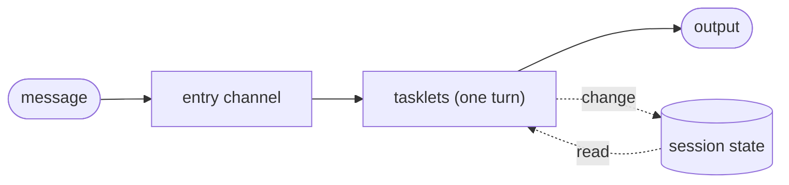

# Sessions

A session is a relay instance that lives for as long as a conversation does: it has a
beginning, it takes one message after another, and it remembers what was said. A chat with a
model, a support case or a user's shopping basket all have that shape.

Flezha has no separate session type. A session is a relay that runs in steps, once per
message it is sent, with its state kept between messages. Each conversation is an instance
of its own, started under its own id, with its own state. Where a workflow instance runs its
steps once and ends, a session runs them again for every message, and each run is a
**turn**.

## How it works



- **One instance per conversation.** The relay class is started once per conversation,
  each time with its own id (for example the user's name). The instances share the class's
  graph and nothing else.
- **One turn per message.** A message that arrives on the entry channel runs the chain once.
  The instance then waits for its next message. Turns are numbered from 0; each one is an
  **iteration** of the instance, which [rewinding_a_turn.md](rewinding_a_turn.md) uses.
- **State between turns.** A tasklet keeps the conversation in its state through changes,
  exactly as any tasklet keeps state ([state.md](../basics/state.md)). The next turn reads
  the state the previous one left.
- **An answer to the sender.** When the message came from a call, for example `flz relay call`
  or another relay's call, the turn's first output goes back to the caller, and on to the
  output's plugins and listeners ([relay_calls.md](relay_calls.md)).
- **An idle session sleeps.** A session waiting for its next message still holds a place on
  its runner, and with many sessions that adds up. So an instance that keeps its state on
  the controller sleeps when it has been idle for a while: it leaves its runner, the
  controller keeps its state, and its next message wakes it on whichever runner is there.

## Configure a session

A session is a relay that runs in steps with `each` set to per input. Its durability
setting says where its state is kept and when an idle instance sleeps.

| Setting | Java | Elixir | Meaning |
| --- | --- | --- | --- |
| Run in steps, once per message | `Run.steps(Each.PER_INPUT)` | `run: {:steps, each: :per_input}` | One turn per message, the instance waits between turns |
| Keep the state on the controller's disk | `Durable.local()` | `durable: :local` | The default; the state outlives a runner |
| Sleep after an idle interval | `new Durable.Local(Duration.ofSeconds(10))` | `durable: {:local, sleep_after: 10_000}` | An instance idle that long sleeps |
| Never sleep | `new Durable.Local(new Durable.SleepAfter.Never())` | `durable: {:local, sleep_after: false}` | The instance keeps its runner place |

When the class says nothing about sleeping, the run decides: a steps instance sleeps after
six hours idle, a flow instance never sleeps. `sleep_after` exists only on `local` and
`remote` durability; an instance kept in memory only (`durable: false`) has nothing to wake
from, so it does not sleep. [configuring_a_relay.md](../basics/configuring_a_relay.md)
has the whole settings tree.

By default a failed turn ends the whole session and undoes every turn, as a failed step ends a
workflow instance. A conversation usually wants to lose only the failed turn:
[rewinding_a_turn.md](rewinding_a_turn.md#a-turn-that-fails-alone) shows the failure mode
that does that.

## Example

In the agentdesk example, the relay `agent` is a session: one per user, named after the
user. The tasklet `reply` answers each message with a demo model and keeps the conversation,
the list of messages so far, in its state. The model sees the conversation, so its answer can
say which message this is.

<!-- tabs-open -->

### Java

```java
// Reply.java: answers a message with the demo model, and keeps the conversation.
@Tasklet.Spec(name = "reply")
public final class Reply implements Tasklet<String, Reply.Conversation, Reply.Answer> {

    public record Answer(String text, int tokens) {}

    public static class Conversation {                       // what the session remembers
        public List<String> messages = new ArrayList<>();
    }

    public record Said(String message) implements Change<Conversation> {
        @Override
        public void applyTo(Conversation conversation) {
            conversation.messages.add(message);
        }
    }
    ...
    @Override
    public void run(String message, Ctx<Conversation, Answer> ctx) throws TaskletException {
        ctx.emit(DemoModel.answer(ctx.state().messages, message, ctx::part));
        ctx.change(new Said(message));
    }
```

Full file: [`Reply.java`](https://github.com/flezha/flezha_java_sdk/blob/main/examples/agentdesk/src/main/java/com/flezha/examples/agentdesk/Reply.java)

```java
// AgentRelay.java: one conversation, one turn per message.
public final class AgentRelay implements Relay {

    @Override
    public String factoryId() {
        return "agent";
    }

    @Override
    public Run run() {
        return new Run.Steps(
                Each.PER_INPUT,                          // one turn per message
                OnFailure.KEEP_PROGRESS);                // a failed turn fails alone
    }

    @Override
    public Durable durable() {
        return new Durable.Local(Duration.ofSeconds(10)); // an idle session sleeps after 10 s
    }

    @Override
    public void channels(ChannelBuilder c) {
        c.input(String.class, "turn")
                .into(Reply.class)
                .output("answer");                       // to whoever called, and whoever listens
```

Full file: [`AgentRelay.java`](https://github.com/flezha/flezha_java_sdk/blob/main/examples/agentdesk/src/main/java/com/flezha/examples/agentdesk/AgentRelay.java)

### Elixir

```elixir
# lib/agentdesk/reply.ex: answers a message with the demo model, and keeps the conversation.
defmodule Agentdesk.Reply do
  use Flezha.SDK.Tasklet, name: "reply"

  alias Agentdesk.DemoModel

  # What the session remembers.
  state do
    field(:messages, :list, default: [])
  end

  defchange said(conversation, message) do
    %{conversation | messages: conversation.messages ++ [message]}
  end
  ...
  @impl true
  def run(message, conversation, ctx) do
    with {:ok, answer} <- DemoModel.answer(conversation.messages, message, &part(ctx, &1)) do
      emit(ctx, answer)
      {:ok, said(conversation, ctx, message)}
    end
  end
```

Full file: [`reply.ex`](https://github.com/flezha/flezha_elixir_sdk/blob/main/examples/agentdesk/lib/agentdesk/reply.ex)

```elixir
# lib/agentdesk/agent_relay.ex: one conversation, one turn per message.
defmodule Agentdesk.AgentRelay do
  use Flezha.SDK.Relay,
    factory_id: "agent",
    # one turn per message; a failed turn fails alone
    run: {:steps, each: :per_input, on_failure: :keep_progress},
    # an idle session sleeps after 10 s
    durable: {:local, sleep_after: 10_000}
  ...
  @impl true
  def channels(c) do
    c
    |> input("turn")
    |> into(Reply)
    # to whoever called, and whoever listens
    |> output("answer")
```

Full file: [`agent_relay.ex`](https://github.com/flezha/flezha_elixir_sdk/blob/main/examples/agentdesk/lib/agentdesk/agent_relay.ex)

<!-- tabs-close -->

An answer is its text and the number of tokens the model used for it. `DemoModel` stands in
for a model's client: it answers each message with one canned sentence, so nothing outside the
example is needed. Its third argument receives each token as it is written, which
[streamed_answers.md](streamed_answers.md) uses. The lines elided above add an undo
([rewinding_a_turn.md](rewinding_a_turn.md)).

### Start a session and talk to it

A session is started like any relay, with an id: the id names the conversation.

```sh
$ flz relay start agent --id anna --namespace agents
```

```output
Started anna
```

`flz relay call` sends one message and waits for the first output the turn sends to its output
([relay_calls.md](relay_calls.md) is its contract):

```sh
$ flz relay call anna --namespace agents --text 'Hello'
$ flz relay call anna --namespace agents --text 'What can you do?'
```

```output
{"text":"Message 1: you said \"Hello\". I am a demo model.","tokens":10}
{"text":"Message 2: you said \"What can you do?\". I am a demo model.","tokens":13}
```

The second answer knows about the first message. A session started for another user, say
`bob`, has a conversation of its own and starts again at message 1.

### See a session sleep and wake

After its idle interval, the controller reports the instance as `suspended`: it keeps the
session's state, and no runner holds it.

```sh
$ flz relay info anna --namespace agents
```

```output
...
Relay: anna
  Run: steps (each: per_input, on_failure: keep_progress)
  Durable: local (sleep_after: 10s)
  Phase: suspended
  Health: suspended
  Runner ID: 
...
```

The next message wakes it, on the same runner or another one, with its conversation:

```sh
$ flz relay call anna --namespace agents --text 'Are you still there?'
```

```output
{"text":"Message 3: you said \"Are you still there?\". I am a demo model.","tokens":13}
```

## Limits and gotchas

- **A wake takes time, and the call pays for it.** The time a sleeping session takes to wake
  counts against the call's deadline.
- **Start each session with an id.** The id is what later messages and calls address. A
  start without an id gets a generated name, and a start retried after a lost reply starts a
  second instance ([running_relays.md](../basics/running_relays.md)).
- **A failed turn ends the session by default.** Without `on_failure: keep_progress`, a turn
  that fails undoes every turn and ends the instance; see
  [rewinding_a_turn.md](rewinding_a_turn.md).
- **A session in memory forgets.** With `durable: false` a crash starts the conversation
  over, and the instance does not sleep.

## See also

- [rewinding_a_turn.md](rewinding_a_turn.md): take turns back, and let a turn fail alone.
- [streamed_answers.md](streamed_answers.md): send the answer while the model writes it, also
  over HTTP.
- [relay_calls.md](relay_calls.md): send a session a message from another relay.
- [workflows.md](../basics/workflows.md), [configuring_a_relay.md](../basics/configuring_a_relay.md),
  [state.md](../basics/state.md), [durability.md](../basics/durability.md).
- [`relay_commands.md`](../cli/relay_commands.md#flz-relay) for `flz relay start`, `call` and `info`.
- Tutorial: [start_a_session.md](tutorials/start_a_session.html).
