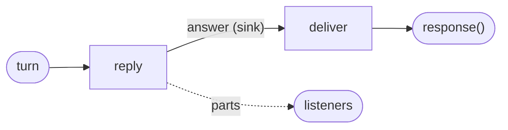

# Streamed answers

A model writes its answer a token at a time, and a long answer takes a while. Rather than
wait for all of it, a reader can watch it grow. A tasklet does that by sending **parts**
while it runs: previews of the output it is producing, which leave at once and reach whoever
listens to the operator. The finished output still leaves once, as it always does.

Parts work for any long-running tasklet whose progress is worth showing: a model's tokens, a
report's sections, a long computation's progress.

## How it works

- **A part is a preview of the tasklet's own output.** It is encoded exactly as an output on
  that channel would be, and it leaves the runner at once, while `run` is still running.
- **Only listeners see parts.** A part reaches the operator's listeners (`flz operator
  listen`, or the HTTP plugin's event stream below). It does not reach the caller, a sink
  plugin never receives it, and nothing about it is kept or replayed. With nobody listening,
  it is dropped.
- **Sending never waits.** A part that cannot leave at once is dropped and counted. A replayed
  input sends no parts.
- **Parts are numbered per attempt.** The runtime numbers the parts of each attempt from 0
  and stamps the attempt, the cell and the channel, so a turn that is tried again starts its
  preview again.
- **The output channel must end in a sink.** A tasklet sends parts only when its output
  channel ends in a sink; a `response()` end is not one. A channel ends in one sink or one
  `response()`, never both, so a tasklet that both streams and answers a caller ends in a
  sink, and a second tasklet after the sink passes the finished output to the `response()`
  end.



| Code | When |
| --- | --- |
| `part.no_sink` | a tasklet sent a part, but its output channel has no sink |
| `part.outside_invocation` | a part was sent through a context whose invocation has already returned |

## Use it

In Java a tasklet sends a part with `ctx.part(value)`; in Elixir with `part(ctx, value)`. The
value has the type of the tasklet's output.

## Example

In the agentdesk example, the session's tasklet `reply` hands the demo model a function that
sends each token as a part. The demo model calls it once per token, with a short pause, the
way a model's client streams.

<!-- tabs-open -->

### Java

```java
// Reply.java: each token of the answer leaves as a part.
        ctx.emit(DemoModel.answer(ctx.state().messages, message, ctx::part));
```

Full file: [`Reply.java`](https://github.com/flezha/flezha_java_sdk/blob/main/examples/agentdesk/src/main/java/com/flezha/examples/agentdesk/Reply.java)

```java
// DemoModel.java: the demo model hands over each token as it writes it.
        for (int i = 0; i < tokens.length; i++) {
            part.accept(new Answer(tokens[i], i + 1));
            LockSupport.parkNanos(PER_TOKEN.toNanos());
        }
        return new Answer(text, tokens.length);
```

Full file: [`DemoModel.java`](https://github.com/flezha/flezha_java_sdk/blob/main/examples/agentdesk/src/main/java/com/flezha/examples/agentdesk/DemoModel.java)

A real model's client would be called here instead, handing each token it streams to `part`
the same way.

`reply`'s channel ends in the sink `answer`, and `deliver` passes the finished answer on to
the caller:

```java
// AgentOperator.java: reply's channel ends in a sink, deliver answers the caller.
        c.input(String.class, "turn")
                .into(Reply.class)
                .sink("answer")                          // to whoever listens
                .into(Deliver.class)
                .response();                             // to whoever called
```

Full file: [`AgentOperator.java`](https://github.com/flezha/flezha_java_sdk/blob/main/examples/agentdesk/src/main/java/com/flezha/examples/agentdesk/AgentOperator.java)

```java
// Deliver.java: hands the finished answer to the caller.
@Tasklet.Spec(name = "deliver")
public final class Deliver implements Tasklet<Answer, Void, Answer> {

    @Override
    public void run(Answer answer, Ctx<Void, Answer> ctx) throws TaskletException {
        ctx.emit(answer);
    }
```

Full file: [`Deliver.java`](https://github.com/flezha/flezha_java_sdk/blob/main/examples/agentdesk/src/main/java/com/flezha/examples/agentdesk/Deliver.java)

### Elixir

```elixir
# lib/agentdesk/reply.ex: each token of the answer leaves as a part.
    with {:ok, answer} <- DemoModel.answer(conversation.messages, message, &part(ctx, &1)) do
```

Full file: [`reply.ex`](https://github.com/flezha/flezha_elixir_sdk/blob/main/examples/agentdesk/lib/agentdesk/reply.ex)

```elixir
# lib/agentdesk/demo_model.ex: the demo model hands over each token as it writes it.
      for {token, i} <- Enum.with_index(tokens, 1) do
        part.(%Answer{text: token, tokens: i})
        Process.sleep(@per_token_ms)
      end
```

Full file: [`demo_model.ex`](https://github.com/flezha/flezha_elixir_sdk/blob/main/examples/agentdesk/lib/agentdesk/demo_model.ex)

A real model's client would be called here instead, handing each token it streams to `part`
the same way.

`reply`'s channel ends in the sink `answer`, and `deliver` passes the finished answer on to
the caller:

```elixir
# lib/agentdesk/agent_operator.ex: reply's channel ends in a sink, deliver answers the caller.
    c
    |> input("turn")
    |> into(Reply)
    # to whoever listens
    |> sink("answer")
    |> into(Deliver)
    # to whoever called
    |> response()
```

Full file: [`agent_operator.ex`](https://github.com/flezha/flezha_elixir_sdk/blob/main/examples/agentdesk/lib/agentdesk/agent_operator.ex)

```elixir
# lib/agentdesk/deliver.ex: hands the finished answer to the caller.
defmodule Agentdesk.Deliver do
  use Flezha.SDK.Tasklet, name: "deliver"

  @impl true
  def run(answer, state, ctx) do
    emit(ctx, answer)
    {:ok, state}
  end
```

Full file: [`deliver.ex`](https://github.com/flezha/flezha_elixir_sdk/blob/main/examples/agentdesk/lib/agentdesk/deliver.ex)

<!-- tabs-close -->

`deliver`'s output leaves the session too, so a [rewind](rewinding_a_turn.md) needs an undo
from it, and it declares an empty one.

### Watch a turn stream

`flz operator listen` prints what an operator emits, parts included, for as long as its
window lasts (`--duration-ms`, 30000 by default). Listening to a session named `anna` for
five seconds:

```sh
$ flz operator listen anna --namespace agents --duration-ms 5000
```

A message sent to the session meanwhile, from another terminal:

```sh
$ flz operator call anna --namespace agents --text 'Tell me a story'
```

```output
{"text":"Message 4: you said \"Tell me a story\". I am a demo model.","tokens":13}
```

The caller gets the finished answer, once. The listener sees every token as it was sent,
then the answer on the sink:

```output
answer	{"text":"Message ","tokens":1}	part=0 attempt=1 cell=anna/reply/
answer	{"text":"4: ","tokens":2}	part=1 attempt=1 cell=anna/reply/
answer	{"text":"you ","tokens":3}	part=2 attempt=1 cell=anna/reply/
...
answer	{"text":"demo ","tokens":12}	part=11 attempt=1 cell=anna/reply/
answer	{"text":"model.","tokens":13}	part=12 attempt=1 cell=anna/reply/
answer	{"text":"Message 4: you said \"Tell me a story\". I am a demo model.","tokens":13}	cell=anna/reply/ seq=7.0
```

A part line is the channel, the part, and `part=<n> attempt=<a>`. The last line is the output,
which carries its place in the session's record, `seq`, instead. With `--json` each frame is
one object whose `kind` is `output`, `input`, `part` or `dead_lettered`.

## Stream over HTTP

A browser follows an answer as it is written over server-sent events, through the HTTP
server plugin ([http_server.md](../../plugins/http_server.md)). The plugin is installed in
the controller's image ([installing_plugins.md](../plugins/installing_plugins.md)) and enabled on an
operator that answers HTTP requests.

> #### Not a production setup {: .warning}
>
> The agentdesk example runs with authorization off, and the HTTP plugin authenticates
> nobody: anyone who can reach the port can read any session's answers. The plugin page's
> [security section](../../plugins/http_server.md#security) says what the plugin guards and
> what it leaves to the operator.

### A request is an input

The plugin turns every HTTP request into one input of the operator it is enabled on, as a
JSON envelope: the method, the path, the body and a few more fields. Whatever a `response()`
end of the operator produces from that input is the HTTP answer: a status and a body, or the
name of an operator to stream. The plugin has no routes of its own: the operator's graph
routes on the method and the path.

When the answer names an operator to stream, for example `{"stream":"anna"}`, the plugin
attaches a listener to that operator and keeps the response open: every part and every
output on the operator's sinks is written as one event, as it happens, until the client goes
away. The operator that answered the request is not in that path; it only named the session.

In the agentdesk example, an operator called `gateway` carries the plugin. It answers
`GET /sessions/<user>/events` with the user's session, named after the user, and any other
request it does not route elsewhere with 404.

<!-- tabs-open -->

### Java

```java
// Request.java: one HTTP request, as the plugin hands it to the gateway.
@JsonIgnoreProperties(ignoreUnknown = true)                  // the envelope carries more than the gateway reads
public record Request(String method, String path, String body) {

    private static final Pattern ROUTE = Pattern.compile("/sessions/([a-z][a-z0-9_-]{0,63})/(messages|events)");
    ...
    boolean listens() {
        return is("GET", "events");
    }

    String user() {
        return route(1);
    }
    ...
    private boolean is(String verb, String what) {
        return method.equals(verb) && route(2).equals(what);
    }

    private String route(int part) {                         // "" when the path is not a route
        Matcher route = ROUTE.matcher(path);
        return route.matches() ? route.group(part) : "";
    }
}
```

Full file: [`Request.java`](https://github.com/flezha/flezha_java_sdk/blob/main/examples/agentdesk/src/main/java/com/flezha/examples/agentdesk/Request.java)

The pattern accepts only a short lower-case name as the user, because the user names a
session.

```java
// Http.java: the gateway's answer to a request.
@JsonInclude(JsonInclude.Include.NON_NULL)
public record Http(Integer status, String body, String stream) {

    static Http of(int status, String body) {
        return new Http(status, body, null);
    }

    static Http stream(String session) {
        return new Http(null, null, session);
    }
}
```

Full file: [`Http.java`](https://github.com/flezha/flezha_java_sdk/blob/main/examples/agentdesk/src/main/java/com/flezha/examples/agentdesk/Http.java)

Unset fields are left out, because the plugin refuses an answer with a key it does not know.

```java
// Watch.java: a session's events, or 404.
@Tasklet.Spec(name = "watch")
public final class Watch implements Tasklet<Request, Void, Http> {

    @Override
    public void run(Request request, Ctx<Void, Http> ctx) throws TaskletException {
        ctx.emit(request.listens() ? Http.stream(request.user()) : Http.of(404, "no such route"));
    }
}
```

Full file: [`Watch.java`](https://github.com/flezha/flezha_java_sdk/blob/main/examples/agentdesk/src/main/java/com/flezha/examples/agentdesk/Watch.java)

```java
// GatewayOperator.java: every request that does not send a message goes to watch.
        EntryChannel<Request> http = c.input(Request.class, "http");
        http.filter(request -> !request.sends())
                .into(Watch.class)
                .response();                                 // a stream, or 404
```

Full file: [`GatewayOperator.java`](https://github.com/flezha/flezha_java_sdk/blob/main/examples/agentdesk/src/main/java/com/flezha/examples/agentdesk/GatewayOperator.java)

### Elixir

```elixir
# lib/agentdesk/request.ex: one HTTP request, as the plugin hands it to the gateway.
defmodule Agentdesk.Request do
  defstruct [:method, :path, :body]

  @route ~r"^/sessions/([a-z][a-z0-9_-]{0,63})/(messages|events)$"

  # The envelope carries more than the gateway reads.
  def decode(json) do
    case Jason.decode(json) do
      {:ok, %{"method" => method, "path" => path} = envelope} ->
        {:ok, %__MODULE__{method: method, path: path, body: envelope["body"]}}

      _other ->
        {:error, "not a request envelope"}
    end
  end
  ...
  def listens?(request), do: is?(request, "GET", "events")

  def user(request), do: route(request, 1)
  ...
  defp is?(request, verb, what), do: request.method == verb and route(request, 2) == what

  # "" when the path is not a route.
  defp route(request, part) do
    case Regex.run(@route, request.path) do
      nil -> ""
      groups -> Enum.at(groups, part)
    end
  end
end
```

Full file: [`request.ex`](https://github.com/flezha/flezha_elixir_sdk/blob/main/examples/agentdesk/lib/agentdesk/request.ex)

The pattern accepts only a short lower-case name as the user, because the user names a
session.

```elixir
# lib/agentdesk/watch.ex: a session's events, or 404.
defmodule Agentdesk.Watch do
  use Flezha.SDK.Tasklet, name: "watch"

  alias Agentdesk.Request

  @impl true
  def run(request, state, ctx) do
    emit(
      ctx,
      if Request.listens?(request) do
        %{stream: Request.user(request)}
      else
        %{status: 404, body: "no such route"}
      end
    )

    {:ok, state}
  end
end
```

Full file: [`watch.ex`](https://github.com/flezha/flezha_elixir_sdk/blob/main/examples/agentdesk/lib/agentdesk/watch.ex)

An answer is the JSON object the plugin expects: a status and a body, or the session to
stream. The plugin refuses an answer with a key it does not know.

```elixir
# lib/agentdesk/gateway_operator.ex: every request that does not send a message goes to watch.
    http = input_with(c, "http", &Request.decode/1)

    http
    |> filter(&(not Request.sends?(&1)))
    |> into(Watch)
    # a stream, or 404
    |> response()
```

Full file: [`gateway_operator.ex`](https://github.com/flezha/flezha_elixir_sdk/blob/main/examples/agentdesk/lib/agentdesk/gateway_operator.ex)

<!-- tabs-close -->

The other branch of the gateway, `POST /sessions/<user>/messages`, sends the session a message
through a call: [operator_calls.md](operator_calls.md) covers it.

### Enable the plugin

The gateway runs for as long as the application does, one request after another, so it runs
in flow, the default. Start it with an id, then enable the HTTP plugin and bind it to the
gateway in the same command:

```sh
$ flz operator start gateway --id gateway --namespace agents
```

```output
Started gateway
```

```sh
$ flz plugin enable web http_server --operator_id=gateway --namespace agents --hook=on_terminate --Xport=8080 --Xbind=0.0.0.0 --Xchannel=http
```

```output
Enabling plugin...
Plugin web enabled.
Plugin web bound to gateway.
```

`--Xchannel=http` is the entry channel every request arrives on. Inside a container the plugin
must listen on every address, `0.0.0.0`: its default, loopback, cannot be reached from outside
the container. The agentdesk example's Compose file publishes the port on the host's loopback
only, so only that machine reaches it. [http_server.md](../../plugins/http_server.md#options)
lists the plugin's other options.

A path the gateway does not know:

```sh
$ curl -si localhost:8080/sessions/anna
```

```output
HTTP/1.1 404 Not Found
...
content-type: text/plain; charset=utf-8

no such route
```

### Read a stream

Opening a session's stream for five seconds:

```sh
$ curl -sN --max-time 5 localhost:8080/sessions/anna/events
```

While it is open, a message sent to the session from another terminal:

```sh
$ flz operator call anna --namespace agents --text 'Tell me more'
```

```output
{"text":"Message 6: you said \"Tell me more\". I am a demo model.","tokens":12}
```

The stream shows every token as the demo model wrote it, then the answer:

```output
:

event: part
data: {"attempt":1,"channel":"answer","part":0,"payload":"{\"text\":\"Message \",\"tokens\":1}"}

event: part
data: {"attempt":1,"channel":"answer","part":1,"payload":"{\"text\":\"6: \",\"tokens\":2}"}

...

event: output
data: {"channel":"answer","payload":"{\"text\":\"Message 6: you said \\\"Tell me more\\\". I am a demo model.\",\"tokens\":12}"}
```

The first line, `:`, is a comment the plugin writes when the stream opens, and again whenever
the stream has been quiet for a while, which keeps proxies from closing it. A failed turn is a
`dead_lettered` event, and the plugin page's [streams section](../../plugins/http_server.md#streams)
lists every event. A browser reads the same stream with `EventSource`, and that section has
the few lines that show a growing answer.

## Limits and gotchas

- **Parts are not durable.** A part can be dropped (no listener, or it could not leave at
  once), a replay sends none, and a retried attempt starts again at part 0. A client shows
  parts as a preview and treats the output as the answer.
- **A caller never sees parts.** `flz operator call` and an operator's call get the finished
  output only.
- **The streaming tasklet's channel must end in a sink,** or the part is refused with
  `part.no_sink`; put a second tasklet after the sink to answer a caller.
- **The HTTP stream starts at the live edge.** No event id is written, so a client that
  reconnects misses what was sent while it was away.

## See also

- [sessions.md](sessions.md), [rewinding_a_turn.md](rewinding_a_turn.md),
  [operator_calls.md](operator_calls.md).
- [http_server.md](../../plugins/http_server.md): the HTTP plugin's options, envelopes,
  statuses, streams, security and deployment.
- [installing_plugins.md](../plugins/installing_plugins.md), [plugins.md](../plugins/plugins.md).
- [`operator_commands.md`](../cli/operator_commands.md#flz-operator) for `flz operator listen`.
- Tutorials: [stream_an_answer.md](../../tutorials/agentdesk/stream_an_answer.md),
  [serve_http.md](../../tutorials/agentdesk/serve_http.md).
