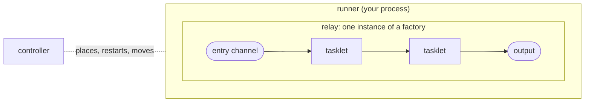

# Building blocks

Code that runs on Flezha is made of three pieces: tasklets, relays and
runners. A **tasklet** is a processing stage of your own. A **relay** is a
processing unit that works like a worker: it keeps its own state and carries
data through its tasklets. It declares the graph that moves data between them,
and is the unit the controller starts, places and restarts. Flezha runs
thousands of relays in parallel. A **runner** is a process you run,
which connects to the controller and runs the relays the controller hands
it. The pieces mean the same thing in all seven SDKs.

None of the three names the others. A runner registers the relay factories
it can run; the controller learns them; you ask for a relay by its factory
id; and the controller binds it to a runner that registered that factory.
Messages then arrive on the channels the relay declared and travel its
graph.

## How the pieces fit



### The tasklet

**A processing stage of your own.** Where a step needs more than a one-line
transform, the relay hands the message to a tasklet: typed input and
output and, when you need them, per-key state that survives a restart
([`state.md`](state.md)), timers ([`../advanced/timers.md`](../advanced/timers.md))
and retries.

A tasklet emits its result without saying where the result goes. The relay
decides that, so the same tasklet can be rewired without being touched.

**Its name is durable.** State is stored under the tasklet's name, so renaming
a tasklet in a new release does not rename anything: it declares a different
tasklet. Choose the name once. The class or module that carries it can be
renamed freely.

A tasklet does its work in **cells**. A cell is one running copy of the
tasklet with its own state: one cell by default, or one per key when the
relay keys the tasklet's input. A cell handles its messages one at a time,
in the order they arrived, and different cells work side by side
([`streams.md`](streams.md#keys-and-cells)).

### The relay

**What you write to move data between steps.** It declares the graph: the
channels data enters on, the steps each message passes through, and the
channels results leave on.

Some steps live in the graph itself. `map`, `filter`, `flatMap` and `keyBy`
reshape, drop, split and key messages where they are declared, with no class
of their own ([`streams.md`](streams.md#transforms)). A step that needs your
own processing, or state that has to survive, is a tasklet the graph routes
messages into. A relay can chain as many tasklets as it needs, the output
of one feeding the next, and split or join the path between them.

A relay runs in one of two ways, set by its class
([`configuring_a_relay.md`](configuring_a_relay.md)): in flow, the
default, it handles messages for as long as it runs, like an ETL stream
([`streams.md`](streams.md)); in steps, it runs its tasklets as the steps of a
job that ends ([`workflows.md`](workflows.md)).

The relay is the unit everything else works in: what the controller
starts, places on a runner, restarts after a crash, and moves when a runner
disappears.

**Channel names are addresses, not labels.** An entry channel's name is what
`flz relay send --channel` writes to, and an output's name is stamped on
everything that channel delivers. Something outside the code uses both, so
changing one is a breaking change rather than a rename.

**The entry channels are the relay's API.** Each one's format, its answer and,
when you give them, a description and a schema are announced by the runner and
shown by `flz relay info <id>`, so an application, a script or an AI agent can
call the relay without reading its code ([`relay_api.md`](relay_api.md)).

The graph is checked when the runner registers the relay, so a graph that
cannot work is refused there rather than failing half way through a run.

### Factory and relay

The relay code is a template, and the running relays are instances of
it, the way objects are instances of a class:

| Flezha | In general terms | In the echo example |
| --- | --- | --- |
| **factory** | a template | the relay code |
| **factory id** | the template's name | `echo` |
| **relay** | an instance | one started with `flz relay start echo` |
| **relay id** | the instance's name | `my_echo`, or one the controller generates |

One factory can have as many relays as you need. Every start makes another
independent instance with its own state, so watching ten exchanges is one
factory started ten times. Hundreds or thousands of relays from one factory
are an ordinary deployment: the controller places each on a runner that
registered the factory, and more runners mean room for more relays.

The factory id is recorded in the controller's registry and in durable state,
so changing it later declares a new factory rather than renaming the old one.

### The runner

**A process you run.** It connects to the controller, says which relay
factories it can serve, and waits. It decides nothing: it offers capacity and
does what the controller asks.

**Registering a factory on a runner does not start a relay.** It says this
process can run relays made from that factory. Starting one is a separate
step ([`running_relays.md`](running_relays.md)). One runner can register
many factories, and many runners can register the same one, which is how a
deployment grows.

A runner belongs to one namespace, the tenant it serves
([`namespaces.md`](namespaces.md)). If its connection drops, it reconnects on
its own. How it reaches the controller and how to run it as a service is
[`connecting_a_runner.md`](../deploying/connecting_a_runner.md).

## Seven SDKs, one engine

The SDKs share one engine rather than reimplementing it seven times. Six sit on
one kernel written in Rust, `flz_core`: Rust uses it directly, Java through
JNI, and Node, Python, Ruby and PHP through a C ABI. Elixir writes its own
kernel and binds only the transport, through a Rust NIF, which is also what
lets it run inside the controller's own node.

The kernel owns **what runs and when**. It picks the next activation, holds
per-cell ordering and exclusivity, runs the retry ladder and durability, and
caps how much work is underway at once. Each SDK owns **the threads to run it
on**, and brings whatever its own runtime provides.

So the rules the kernel enforces are the same in every language: ordering,
exclusivity, the retry ladder, durability. What differs is the runtime and the
concurrency of the host language, and with them how work spreads across cores
and how much throughput one process reaches. Those differences are real and
sometimes large; [Concurrency per language](#concurrency-per-language) says
what they are.

## Example: the echo

The echo example is the smallest relay: one tasklet that answers each
message with `echo: ` in front of it, between an entry channel `in` and an output
`out`. Its tasklet keeps no state and takes no configuration.

<!-- tabs-open -->

### Java

```java
// Echo.java: the tasklet. The processing stage the graph routes each message into.
@Tasklet.Spec(name = "echo")                 // state is saved under this name, so choose it once
public final class Echo implements Tasklet<String, Void, String> {

    @Override
    public void run(String input, Ctx<Void, String> ctx) throws TaskletException {
        ctx.emit("echo: " + input);          // where it goes is the relay's business
    }
}
```

Full file: [`Echo.java`](https://github.com/flezha/flezha_java_sdk/blob/main/examples/echo/src/main/java/com/flezha/examples/echo/Echo.java).

```java
// EchoRelay.java: the relay. The graph, and the unit the controller schedules.
public final class EchoRelay implements Relay {

    @Override
    @Nonnull
    public String factoryId() {
        return "echo";
    }

    @Override
    public void channels(@Nonnull ChannelBuilder c) {
        c.input(String.class, "in").into(Echo.class).output("out");
    }
}
```

Full file: [`EchoRelay.java`](https://github.com/flezha/flezha_java_sdk/blob/main/examples/echo/src/main/java/com/flezha/examples/echo/EchoRelay.java).

```java
// Main.java: the runner. Connects, registers the echo factory, and serves.
public static void main(String[] args) throws Exception {
    FlezhaRunner runner = Flezha.createRunner(args.length > 0 ? args[0] : "default")
            .registerFactory(EchoRelay.class)
            .start();

    runner.awaitTermination();
}
```

Full file: [`Main.java`](https://github.com/flezha/flezha_java_sdk/blob/main/examples/echo/src/main/java/com/flezha/examples/echo/Main.java).

**The class is the tasklet.** It implements `Tasklet<String, Void, String>`: a
string in, no state, a string out. With `Void` state it keeps nothing between
messages and journals nothing. `@Tasklet.Spec` gives it its name, and the
relay names the class itself: nothing is generated. `output(name)` both names
the output channel and ends it on the plugin layer, so naming the channel again
with `named(...)` is refused at registration. `start()` connects and hands back
the runner, and `awaitTermination()` blocks until shutdown, a SIGTERM or a
`close()` from another thread; `run()` does both in one call.

### Rust

```rust
// src/tasklet.rs: the tasklet. The processing stage the graph routes each message into.
#[derive(Default)]
pub struct Echo;

#[tasklet(name = "echo")]
impl Tasklet for Echo {
    type Input = String;
    type Output = String;

    fn run(&mut self, input: String, ctx: &mut Ctx<'_, Self>) -> Result<(), TaskletError> {
        ctx.emit(format!("echo: {input}"))
    }
}
```

Full file: [`src/tasklet.rs`](https://github.com/flezha/flezha_rust_sdk/blob/main/examples/echo/src/tasklet.rs).

```rust
// src/relay.rs: the relay. The graph, and the unit the controller schedules.
pub struct EchoRelay;

impl Relay for EchoRelay {
    fn factory_id() -> &'static str {
        "echo"
    }

    fn channels(c: &ChannelBuilder) {
        c.input::<String>("in").into::<Echo>().output_named("out");
    }
}
```

Full file: [`src/relay.rs`](https://github.com/flezha/flezha_rust_sdk/blob/main/examples/echo/src/relay.rs).

```rust
// src/main.rs: the runner. Connects, registers the echo factory, and serves.
fn main() -> Result<(), Box<dyn std::error::Error>> {
    let namespace = std::env::args()
        .nth(1)
        .unwrap_or_else(|| "default".to_string());

    let runner = Flezha::create_runner(namespace)?;
    runner.register_factory(relay::EchoRelay)?.start()?;

    runner.await_termination()?;
    Ok(())
}
```

Full file: [`src/main.rs`](https://github.com/flezha/flezha_rust_sdk/blob/main/examples/echo/src/main.rs).

**The tasklet is your own type**, `Echo`. `#[tasklet]` generates no type: it
fills in what the block leaves out. With no `type State` written, it keeps
nothing and journals nothing. `input::<String>("in")` is the entry channel and
the type it carries: a `String` or a `Vec<u8>` passes through as its bytes, and
any other type is parsed from JSON. `output_named("out")` names the channel it
ends on the plugin layer; `output()` would leave it the tasklet's name. A graph
whose types do not line up is refused when the runner declares it. The runner
is bound to a name because a chained temporary would be dropped, and shut down,
at the end of its statement.

### Node

```javascript
// echo_tasklet.mjs: the tasklet. The processing stage the graph routes each message into.
export const EchoTasklet = defineTasklet({
  name: 'echo',
  run: (input, ctx) => ctx.emit(`echo: ${input}`),
});
```

Full file: [`echo_tasklet.mjs`](https://github.com/flezha/flezha_node_sdk/blob/main/examples/echo/echo_tasklet.mjs).

```javascript
// echo_relay.mjs: the relay. The graph, and the unit the controller schedules.
export default defineRelay({
  factoryId: 'echo',
  channels: (c) => {
    c.input('in', { codec: 'text' }).into(EchoTasklet).output('out');
  },
});
```

Full file: [`echo_relay.mjs`](https://github.com/flezha/flezha_node_sdk/blob/main/examples/echo/echo_relay.mjs).

```javascript
// runner.mjs: the runner. Connects, registers the echo factory, and serves.
const namespace = process.argv[2] ?? 'default';

const runner = createRunner(namespace);
await runner.registerFactory('./echo_relay.mjs');

await runner.run();
```

Full file: [`runner.mjs`](https://github.com/flezha/flezha_node_sdk/blob/main/examples/echo/runner.mjs).

What `run` returns is not output; a value leaves only through `ctx.emit`.
`{ codec: 'text' }` hands the tasklet the bytes `flz relay send --text`
delivers as a string; an entry that names no codec reads JSON. The output names
no codec, so a string leaves as its UTF-8 bytes and any other value as JSON.
The relay is registered by **module specifier**, a path rather than an
imported value, because every dispatch loop imports the module itself; that is
why registering is awaited. A relative specifier resolves against the working
directory.

### Python

```python
# echo_tasklet.py: the tasklet. The processing stage the graph routes each message into.
@flezha.tasklet(name="echo")  # the durable identity: state is filed under it
class Echo:
    def run(self, value: str, ctx: flezha.Ctx[None, str]) -> None:
        ctx.emit(f"echo: {value}")
```

Full file: [`echo_tasklet.py`](https://github.com/flezha/flezha_python_sdk/blob/main/examples/echo/echo_tasklet.py).

```python
# echo_relay.py: the relay. The graph, and the unit the controller schedules.
@flezha.relay("echo")  # the stable identity `flz relay start` takes
def echo_relay(c: flezha.Channels) -> None:
    c.input("in", codec="text").into(Echo).output("out")
```

Full file: [`echo_relay.py`](https://github.com/flezha/flezha_python_sdk/blob/main/examples/echo/echo_relay.py).

```python
# runner.py: the runner. Connects, registers the echo factory, and serves.
def main() -> None:
    namespace = sys.argv[1] if len(sys.argv) > 1 else "default"
    flezha.configure_logging("info")

    runner = flezha.create_runner(namespace).register_factory(echo_relay)

    runner.start()
    runner.await_termination()
```

Full file: [`runner.py`](https://github.com/flezha/flezha_python_sdk/blob/main/examples/echo/runner.py).

`Ctx[None, str]` names no state and a `str` output, so the tasklet keeps
nothing and journals nothing. `codec="text"` hands it the bytes
`flz relay send --text` delivers as a string; an entry that names no codec
reads JSON. `start()` connects and starts serving, and `await_termination()`
blocks until shutdown and then drains; `run()` is the two in one call.

### Ruby

```ruby
# echo_tasklet.rb: the tasklet. The processing stage the graph routes each message into.
class EchoTasklet < Flezha::Tasklet
  tasklet_name "echo" # the durable identity: state is filed under it

  def run(input, ctx) = ctx.emit("echo: #{input}")
end
```

Full file: [`echo_tasklet.rb`](https://github.com/flezha/flezha_ruby_sdk/blob/main/examples/echo/echo_tasklet.rb).

```ruby
# echo_relay.rb: the relay. The graph, and the unit the controller schedules.
class EchoRelay < Flezha::Relay
  factory_id "echo"

  channels do |c|
    c.input("in", codec: :text)
     .into(EchoTasklet)
     .output("out")
  end
end
```

Full file: [`echo_relay.rb`](https://github.com/flezha/flezha_ruby_sdk/blob/main/examples/echo/echo_relay.rb).

```ruby
# runner.rb: the runner. Connects, registers the echo factory, and serves.
namespace = ARGV[0] || "default"

runner = Flezha.create_runner(namespace).register_factory(EchoRelay)

runner.boot
runner.await_termination
```

Full file: [`runner.rb`](https://github.com/flezha/flezha_ruby_sdk/blob/main/examples/echo/runner.rb).

`tasklet_name` is not `name`, which is the class's own name in Ruby. Which
optional hooks a tasklet has is read from the methods it defines, so with no
`init_state` and no `apply_change` it keeps nothing. `boot` connects and
starts serving, and `await_termination` blocks until shutdown and then drains;
`run` is the two in one call. Classes are registered explicitly: nothing is
autoloaded, and what runs is what you named.

### PHP

```php
// src/EchoTasklet.php: the tasklet. The processing stage the graph routes each message into.
#[Task(name: 'echo')]
final class EchoTasklet extends Tasklet
{
    public function run(mixed $input, Ctx $ctx): void
    {
        $ctx->emit('echo: ' . $input);
    }
}
```

Full file: [`src/EchoTasklet.php`](https://github.com/flezha/flezha_php_sdk/blob/main/examples/echo/src/EchoTasklet.php).

```php
// src/EchoRelay.php: the relay. The graph, and the unit the controller schedules.
#[Relay(factoryId: 'echo')]
final class EchoRelay extends \Flezha\Relay
{
    public static function channels(Builder $c): void
    {
        $c->input('in', codec: ChannelCodec::Text)
            ->into(EchoTasklet::class)
            ->output('out');
    }
}
```

Full file: [`src/EchoRelay.php`](https://github.com/flezha/flezha_php_sdk/blob/main/examples/echo/src/EchoRelay.php).

```php
// runner.php: the runner. Connects, registers the echo factory, and serves.
$runner = Flezha::createRunner($argv[1] ?? 'default')
    ->registerFactory(EchoRelay::class)
    ->start();

$runner->awaitTermination();
```

Full file: [`runner.php`](https://github.com/flezha/flezha_php_sdk/blob/main/examples/echo/runner.php).

Which optional hooks a tasklet has is read from the methods it overrides, so
with no `initState` and no `applyChange` it keeps nothing.
`ChannelCodec::Text` hands the tasklet the text `flz relay send --text`
sends, checked as UTF-8. The attribute carries the declaration and the method
carries the graph. `start()` connects, and `awaitTermination()` is where the
process serves: PHP has no threads, so under the default executor nothing is
processed until the wait begins.

### Elixir

```elixir
# lib/echo/tasklet.ex: the tasklet. The processing stage the graph routes each message into.
defmodule Echo.Tasklet do
  use Flezha.SDK.Tasklet, name: "echo"

  @impl true
  def run(input, state, ctx) do
    emit(ctx, "echo: " <> input)
    {:ok, state}
  end
end
```

Full file: [`lib/echo/tasklet.ex`](https://github.com/flezha/flezha_elixir_sdk/blob/main/examples/echo/lib/echo/tasklet.ex).

```elixir
# lib/echo/relay.ex: the relay. The graph, and the unit the controller schedules.
defmodule Echo.Relay do
  use Flezha.SDK.Relay, factory_id: "echo"

  @impl true
  def channels(c) do
    c |> input("in") |> into(Echo.Tasklet) |> output("out")
  end
end
```

Full file: [`lib/echo/relay.ex`](https://github.com/flezha/flezha_elixir_sdk/blob/main/examples/echo/lib/echo/relay.ex).

```elixir
# lib/echo/application.ex: the runner. Connects, registers the echo factory, and serves.
children = [
  {Flezha.SDK, namespace: namespace, relays: [Echo.Relay], transport: :uds}
]

{:ok, supervisor} = Supervisor.start_link(children, strategy: :one_for_one)
```

Full file: [`lib/echo/application.ex`](https://github.com/flezha/flezha_elixir_sdk/blob/main/examples/echo/lib/echo/application.ex).

`run/3` answers `{:ok, state}`, and what it emitted is released only then.
With no `state` block it keeps nothing. A binary crosses a channel as it is,
so plain text needs no decoder. The runner is a child of your own supervision
tree, so a crash restarts it and it reconnects under the same identity.
`relays:` takes any relay: how it runs is read from the module, never
named by the list. The example depends on the `flezha_sdk` package alone,
which starts no controller.

<!-- tabs-close -->

Registering a factory is the same call whether its class runs in flow or in
steps.

## The short form

A relay that is exactly one tasklet between one input and one output can be
declared in one piece, with the tasklet's body in place of a `channels` graph.
It is the same relay you would write by hand with that single tasklet: an
entry channel (named `input` unless the declaration names it), the tasklet, a
plugin output when one is named, the factory id, and the settings tree the
declaration writes. It takes the place of both the tasklet and the relay,
under the relay's name, so the runner does not change.

The long form is the one that grows: a second tasklet, or a transform on the
way, needs it. The echo examples are written long.

| SDK | The echo, written short |
| --- | --- |
| Java | a tasklet class annotated `@Relay(id = "echo", input = "in", output = "out")` |
| Rust | a function annotated `#[flezha_runner::relay(id = "echo", input = "in", output = "out")]`, whose return value is its output; `fn echo_relay` becomes the type `EchoRelay` |
| Node | `defineRelay({ factoryId: 'echo', input: 'in', output: 'out', codec: 'text', run: ... })` |
| Python | a function decorated `@flezha.relay(id="echo", input="in", output="out", codec="text")`, whose return value is its output |
| Ruby | an `Flezha::Relay` class with `factory_id "echo"`, `input "in"`, `output "out"`, `codec :text` and a `run` method |
| PHP | `#[Relay(factoryId: 'echo', input: 'in', output: 'out', codec: ChannelCodec::Text)]` on a class with a `run` method |
| Elixir | `use Flezha.SDK.Relay, factory_id: "echo", input: "in", output: "out"` in a module with a `run/3` |

Rules every SDK shares:

- A declaration that carries both a tasklet body and a `channels` body is
  refused (`topology.short_form_with_topology`).
- An `output` on a body that, as far as the SDK can see, declares no output is
  refused (`topology.output_without_type`). Node, Ruby, PHP and Elixir cannot
  see an output type, so they do not check this.
- A second relay under a factory id the runner already holds, written short
  or long, is refused at the call that declares it
  (`topology.duplicate_factory_id`).
- `output` is optional: with none, the relay declares the entry channel and
  the tasklet, and keeps state without sending anything out.
- A steps short form runs once over its first message unless it writes `each`;
  a second message to it is accepted and never read.

In Java the tasklet is named after the `id`, so a short form needs no
`@Tasklet.Spec`; it carries one only for settings, and then its `name` must
equal the `id` or registration fails with `ShortFormNameMismatch`. The SDK
reference pages have each SDK's rules: [Java](https://github.com/flezha/flezha/blob/main/docs/sdk/java_sdk.md#the-short-form),
[Rust](https://github.com/flezha/flezha/blob/main/docs/sdk/rust_relay_architecture.md#the-short-form),
[Node](https://github.com/flezha/flezha/blob/main/docs/sdk/node_sdk.md#the-short-form),
[Python](https://github.com/flezha/flezha/blob/main/docs/sdk/python_sdk.md#the-short-form),
[Ruby](https://github.com/flezha/flezha/blob/main/docs/sdk/ruby_sdk.md#the-short-form),
[PHP](https://github.com/flezha/flezha/blob/main/docs/sdk/php_sdk.md#the-short-form) and
[Elixir](https://github.com/flezha/flezha/blob/main/docs/sdk/elixir_sdk.md#the-short-form).

## Concurrency per language

The kernel's rules are the same everywhere; how the work spreads over threads
and cores is the host language's.

<!-- tabs-open -->

### Java

**One virtual thread per activation.** Platform *fetcher* threads loop
`poll -> decode -> hand off -> poll`, and each activation is dispatched on its
own virtual thread, which encodes the result and completes it. Fetchers stay
platform threads on purpose: `FlzCore.poll` blocks in native code, and a
native frame pins its carrier.

A supervisor thread parks in the core's starvation wait and starts another
fetcher whenever one is observed, up to a ceiling. It is required: a virtual
thread parked inside `complete` holds its fetcher's handout, and with every
fetcher held the runner would process nothing at all.

What no ceiling can fix is user code that never returns.

### Rust

**A worker pool sized to the machine.** The base is the available
parallelism, falling back to 2, and a starvation supervisor grows it up to
`FLEZHA_WORKER_POOL_MAX`, ten times the base by default. A worker started by
growth retires after 30 seconds idle.

A `DropNothing` producer parks the worker it ran on, so a pipeline of depth D
under that policy wants at least `2 x D + 1` threads. A parked producer is not
inside `poll`, so the work queued behind it is exactly the starvation the pool
grows on: raising the base only removes the growth latency.

### Node

**Compute parallelism is the dispatch loop count, and it defaults to one.**
`0` workers means the main event loop, so one handler body runs at a time.
`.workers(n)` or `FLEZHA_NODE_WORKERS` gives `n` worker threads and compute
parallelism `n`. Two fetch threads sit in `poll`; raising that number does not
raise concurrency, because a fetcher does not run user code.

Handlers are registered by module specifier, not as imported values, in every
configuration. A dispatch loop imports the module itself, which is what makes
turning worker threads on a flag rather than a rewrite.

I/O-bound handlers reach the core's in-flight cap on one loop. Compute-bound
ones do not, because they hold the loop while they compute, and that is what
the loop count is for.

### Python

**A pool of Python threads**, each looping `poll -> dispatch -> complete` on
itself, plus one supervisor parked in the core's starvation wait.

Whether handler bodies run in parallel is the interpreter's decision, not the
SDK's. The compatibility wheel is `abi3` targeting 3.11 and runs everywhere,
with the GIL bounding handler bodies to one at a time. Free-threaded wheels
from **3.14t** lift that and let bodies run in parallel. The runner prints
which tier it is running in its startup line, so a benchmark is not ambiguous
about it.

### Ruby

**Handler bodies are bounded to one core per process.** That is the GVL, and
this SDK does not work around it.

Everything below the poll seam runs in parallel: transport, framing,
durability, retries, credit, routing and the activation codec all run in Rust
with the GVL released. The lock bounds your handler body and nothing else.

So the lever for CPU-bound handlers is **process count, not thread count**:
run more runner processes, and start the relay with `--partitions N` so its
keys spread across them. Handlers that are 90 % I/O saturate a core at roughly
2,000 activations per second and the pool grows to cover the wait; handlers
that are pure Ruby at 5 ms each serve about 200 per second however large the
pool is.

### PHP

**PHP has no threads, so in-flight concurrency is the number of loops you
run.** Under the default `SyncExecutor` a loop is a process: 20 simultaneous
slow calls need 20 processes, which is 20 replicas or 20 systemd instances.

`SwooleExecutor` changes the arithmetic to threads times processes, and it is
the reason both executors exist. A process carries a PHP interpreter plus
`flz_core`'s roughly 20 OS threads, so a few dozen to low hundreds per host is
comfortable and thousands is not. A Swoole thread carries an interpreter and
no second core runtime, so one process reaches its core count without
multiplying either. It declares higher requirements, checked when you select
it rather than at install.

The runner measures this rather than leaving it to be assumed: at shutdown it
logs the activations it served, the mean body time, and the per-loop
throughput they imply.

### Elixir

**The one SDK with a core of its own.** Dispatch, cells and state are Elixir,
sharing no code with `flz_core` and re-expressing the same rules. Concurrency
is therefore the BEAM's: lightweight processes on the VM's schedulers,
preempted across every core, with a cell's work ordered through its own
mailbox (`mailbox_capacity`, 1024 by default).

It is also the only SDK that runs two ways. **In-node**
(`transport: :native`, the default) it runs inside the controller's own BEAM
and the transport is a function call rather than a socket, so a connect from
another BEAM node is refused. **Standalone** (`:uds` or `:quic`) it is its own
node speaking the binary protocol, and there it reaches the wire through
`flz_nif`, the same Rust NIF the controller uses. The core above that seam is
the same Elixir code either way.

<!-- tabs-close -->

## Limits and gotchas

- **Renaming is not free.** A tasklet's name, a factory id and a channel name
  are identities: changing one declares something new, and the old state or
  address is not carried over.
- **A runner does not start relays.** Until something starts a relay,
  a runner with registered factories runs nothing.
- **One runner per process, one namespace per runner**
  ([`connecting_a_runner.md`](../deploying/connecting_a_runner.md#one-runner-one-namespace)).
- **The full form of a tasklet** (implementing `Tasklet` directly, a change
  written by hand, a clock other than the wall clock, a configuration type,
  `onTimer`) has no page of its own yet; [`state.md`](state.md) and
  [`../advanced/timers.md`](../advanced/timers.md) cover the parts that exist.

## See also

- [`configuring_a_relay.md`](configuring_a_relay.md): the settings tree every relay carries.
- [`streams.md`](streams.md) and [`workflows.md`](workflows.md): the two ways a relay runs.
- [`connecting_a_runner.md`](../deploying/connecting_a_runner.md): reaching the controller, running a runner as a service.
- [`running_relays.md`](running_relays.md): starting relays from a factory.
- [`../../glossary.md`](https://github.com/flezha/flezha/blob/main/docs/glossary.md): every term in one place.
- [`../../sdk/authoring_contract.md`](https://github.com/flezha/flezha/blob/main/docs/sdk/authoring_contract.md): what every SDK guarantees.
- Up and running: [Write the echo runner](../../getting_started/up_and_running.md#write-the-echo-runner) builds the echo.
